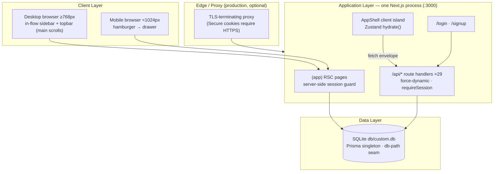
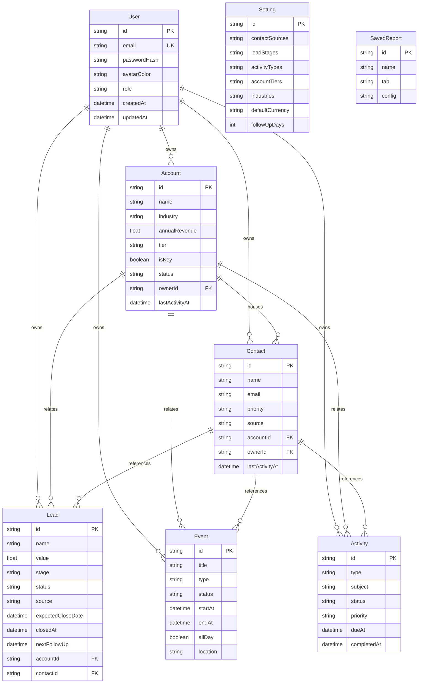

# NEO CRM — Master Project Architecture Document (PAD) v1.0

**Classification:** Internal Engineering Reference
**Status:** DEFINITIVE, PRODUCTION-LOCKED BLUEPRINT
**Companion Document:** `README.md` (onboarding), `AGENTS.md` (agent contract), `CLAUDE.md` (workflow reference)
**Last Updated:** 2026-10-23
**Audience:** Senior Engineers, Tech Leads, DevOps, and Onboarding Engineers
**Rule:** Every architectural decision in this document traces to a specific rationale.
Nothing is here "because it's popular."

---

## Table of Contents

1. [System Overview & Decisions](#1-system-overview--decisions)
2. [High-Level System Topology](#2-high-level-system-topology)
3. [Application Architecture](#3-application-architecture)
4. [Data Architecture](#4-data-architecture)
5. [Design System Reference](#5-design-system-reference)
6. [Security Architecture](#6-security-architecture)
7. [Testing Strategy](#7-testing-strategy)
8. [Build & Deployment](#8-build--deployment)
9. [Developer Handbook](#9-developer-handbook)
10. [Known Issues & Outstanding Tasks](#10-known-issues--outstanding-tasks)
11. [Key Files Reference](#11-key-files-reference)
12. [Glossary](#12-glossary)

---

## 1. System Overview & Decisions

### 1.1 Document Metadata & Purpose

NEO CRM is a faithful, self-hosted clone of the reference CRM workspace at
`https://neo-crm-8ab2c17c.base44.app/` (recon artifacts in `docs/`), rebuilt
on an open, single-process stack. Use this PAD to understand how the system is
wired, why each choice was made, and where the sharp edges are. A new engineer
should read sections 1–3 then skim 9; anyone debugging auth, the SQLite path
resolution, or the mobile navigation should read sections 3.3 and 6 in full.

The clone's one historical behavioral divergence — **mobile navigation** —
was upstreamed: the reference's 2026-10 parity event (probe #119) fixed its
own 100+-session defect (its sidebar hid below `md` with no replacement).
NEO CRM now mirrors that fix (the Radix Sheet construction, walk37-decoded)
and keeps its behavioral supersets: the resize-past-md auto-close, the
main-scroller lock, the route-change close — all pinned by the dedicated
E2E regression suite.

### 1.2 Technology Stack Summary

| Layer | Technology | Version | Key Rationale |
| ----- | ---------- | ------- | ------------- |
| Web framework | Next.js (App Router) | 16.4.2 | Single-process RSC + API routes; async `cookies()`/`params`; standalone output for self-contained deploys |
| UI runtime | React | 19.3 | Async params, `inert` as a boolean prop, no `forwardRef`; lint-enforced hook discipline |
| Language | TypeScript | 5.9 | Full strict mode (session-174: the `noImplicitAny: false` escape hatch retired — the digma graft per the repo's own evaluation report §9.2); the build is the type gate (`ignoreBuildErrors` retired) with the explicit `typecheck` step as the faster signal |
| Styling | Tailwind CSS | 4.3.3 | CSS-first `@theme` tokens; zero JS config; validated against `docs/Tailwind-V4-Validation-Report.md` |
| Animation | tw-animate-css (vendored) | 1.4.0 | npm package exposes only the `style` export condition — unsupported by Turbopack, so the dist CSS is vendored |
| UI primitives | Radix UI | per-package | Dialog, Popover, Select, Label, Slot already in scaffold; hand-rolled tabs/tables/checkboxes with native ARIA |
| Charts | recharts | 3.10.1 | Session-176 (the N-3 retirement): the 2.15 → 3.x major; render-identical on the standing drift gates, `accessibilityLayer={false}` pinned at every site for the reference's 2.x wrapper DOM parity |
| Icons | lucide-react | 0.525 | Sole icon set; two-class stroke system (nav 1.8 / content 2.0) |
| ORM | Prisma | 6.19.3 | Schema-first single-file model; `db push` keeps zero-migration dev loop |
| Database | SQLite | (libsqlite) | Zero-config local story; path resolution normalized in `src/lib/db-path.ts` |
| State | Zustand | 5.0.15 | One client store for all server state — no React Query/SWR layer to keep in sync |
| Unit tests | Vitest | 5.0 | Fast node-environment seam tests; `@` alias resolution |
| E2E tests | Playwright | 1.64 | Real Chromium against the standalone production build on :3100 |

### 1.3 Architecture Decision Records (ADRs)

**ADR-001: Next.js 16 App Router single app (no monorepo)**

- **Context:** The reference is a single-page platform app; the operator
  wants a self-contained clone that runs with one command and pushes to one
  repo. The sibling scandihaven project demonstrates a pnpm/Turborepo
  monorepo, but its multi-package overhead buys nothing at this scope.
- **Decision:** One Next.js application; `src/app` route groups partition
  public (`/login`, `/signup`) from authenticated (`(app)`) surfaces; API
  handlers live under `src/app/api`.
- **Rationale:** Single deploy artifact, one lockfile, one test runner;
  the `(app)` layout guard replaces a middleware/proxy entirely.
- **Consequences:** + Simple mental model, trivial local setup. − No
  independent scaling of API vs UI (acceptable: SQLite is single-node anyway).
- **Alternatives Rejected:** Turborepo monorepo (scandihaven pattern) —
  premature at this scale; separate Express API — loses RSC and doubles
  surface area.

**ADR-002: Prisma + SQLite with normalized relative-path resolution**

- **Context:** The Prisma CLI resolves relative `file:` URLs against
  `prisma/schema.prisma`, but the runtime resolves them against the process
  CWD — and the standalone server chdirs into `.next/standalone`. Without
  normalization, dev, CLI and production land on three different database
  files (this failure was observed live during E2E bring-up). A second
  hazard surfaced in the session-2 audit: **bun loads `.env` for every
  `bun run`/`bun x` process and rewrites a relative `file:` DATABASE_URL
  into an absolute path resolved against the `.env` file's own directory** —
  with the root contract `file:../db/custom.db` that is one directory
  OUTSIDE the repo, and absolute URLs pass through the resolver untouched
  (observed live: the dev server opened `<parent-of-repo>/db/custom.db`).
- **Decision:** `src/lib/db-path.ts` re-implements the CLI rule at runtime
  (anchor order: standalone-CWD detector → module repo-root validator →
  plain CWD with an existence guard). Validated anchors `mkdir -p` the
  `db/` folder (first boot). `runtimeDatabaseUrl()` additionally parses the
  `.env` at the process CWD and, when the env var is exactly bun's
  absolutization of the `.env` value, re-derives the URL from the RAW value
  via the schema rule; any other env value (e2e override, postgres, an
  intentional absolute path) wins untouched. `src/lib/db.ts`,
  `prisma/seed.ts` and the `scripts/prisma-env.ts` wrapper (`db:push`) all
  derive their URL through this seam, so every consumer lands on
  `<repo>/db/<name>`.
- **Rationale:** Keeps `DATABASE_URL=file:../db/custom.db` working
  identically across `next dev`, `next build`, `next start`, Prisma CLI and
  the Playwright webServer — pinned by `tests/db-path.test.ts` (20 checks:
  urlForRoot first-boot mkdir, parseEnvFile, effectiveDatabaseUrl
  re-anchoring, runtimeDatabaseUrl discovery, plus the original passthrough
  and anchoring contract).
- **Consequences:** + Zero-config dev, no migration ceremony. − SQLite is
  single-writer; swapping to PostgreSQL later means changing the datasource
  block and re-verifying the path seam.
- **Alternatives Rejected:** Drizzle + Postgres 17 (scandihaven stack) —
  requires a running database service; absolute production paths in `.env` —
  cwd-fragile in containers; `prisma/.env` split — bun keeps loading the
  root `.env` first, so the split does not remove the hazard (verified
  empirically); `bun --env-file` in scripts — the flag does not chain into
  `bun x prisma` invocations.

**ADR-003: Hand-rolled scrypt + HMAC cookie sessions (no auth library)**

- **Context:** Two authenticated surfaces exist (login page + 29 route
  handler files). NextAuth/Better-Auth pull provider abstractions, adapters
  and their own DB schema for what is, here, a single email/password flow.
  The scaffold family already standardizes a minimal hand-rolled pattern.
- **Decision:** `src/lib/auth.ts` + the pure `src/lib/password.ts` seam:
  scrypt password hashes (`scrypt:salt:hash`), HMAC-SHA256-signed stateless
  cookie `neo_session` (7-day TTL) carrying the **tokenVersion revocation
  dimension** (`uid,iat,exp,v` — session-163, the digma S67-A port: a
  password reset increments the live row's version and every pre-reset
  cookie dies at the `getSessionUser` comparison; a missing `v` reads as 0),
  `verifySessionToken` with `timingSafeEqual`, the login timing equalizer
  (the miss branch burns the same scrypt), `requireSession()` guard used by
  every handler, auth routes rate-limited per IP/15min (login 10, signup 10,
  resend 5, verify 20, forgot 10, reset 10) keyed on the LAST x-forwarded-for
  hop behind the deploy-declared `NEO_PROXY_HOPS` depth. The password-reset
  funnel (session-163): forgot-password/reset-password routes (atomic
  single-use tokens + the eviction) + the `/reset-password` landing page.
  The auth family validates through the Zod seam (`src/lib/schemas.ts` +
  `parseBody()` — session-163).
- **Rationale:** ~184 auditable lines, zero extra dependencies, no external
  identity provider needed for a self-hosted clone; the reference's Google
  button is rendered for parity but degrades to an explanatory toast (no
  OAuth credentials exist in a self-hosted clone — documented deviation, not
  a silent failure).
- **Consequences:** + No library churn, full control of cookie flags.
  − Rotating `AUTH_SECRET` invalidates all sessions (acceptable, documented);
  no SSO until deliberately added.
- **Alternatives Rejected:** NextAuth v4 (in scaffold's allowed stack) —
  adapter + provider ceremony outweighs a two-field login; Better-Auth —
  same, plus its own migration story.

**ADR-004: One Zustand store for all server state + `{ok,data}` envelope**

- **Context:** Nine entity pages all need the same slices (accounts,
  contacts, leads, activities, events, settings, dashboard, users), plus
  cross-cutting concerns (global search, quick-create from anywhere).
  Introducing React Query would add cache keys, retries and hydration rules
  for a dataset that fits in memory and is only mutated by one user at a
  time.
- **Decision:** `src/stores/crm-store.ts` — a single store with a `call()`
  fetch client that understands the envelope, `hydrate()` bootstrapping every
  slice after `/api/auth/me`, and per-entity CRUD actions that refresh the
  affected slices. All 41 API handlers respond with `ok()`/`fail()` from
  `src/lib/api.ts` (session-68 F-68b1: the stale "22" carrier refreshed —
  29 route files / 41 verb handlers, the count the audit censuses carry).
- **Rationale:** One place to reason about client cache; mutations always
  leave the store internally consistent (action → API → refetch slice);
  envelope gives uniform error UX via toasts.
- **Consequences:** + No query-key sprawl; trivially greppable data flow.
  − Refetch granularity is per-slice, not per-item (fine at demo scale).
- **Alternatives Rejected:** TanStack Query — cache complexity without a
  multi-user freshness requirement; React Context — re-render storms.

**ADR-005: Tailwind v4 CSS-first with literal-hex tokens and vendored animation CSS**

- **Context:** Tailwind v4 removes the JS config; its documented pitfalls
  (`@theme` `var()` chains silently dropped; `hidden` attribute overriding
  display utilities; plugin/PostCSS misconfiguration producing "flat look")
  were validated in `docs/Tailwind-V4-Validation-Report.md`. The scaffold
  shipped **without `postcss.config.mjs`**, which silently disabled the
  entire pipeline (observed: fully unstyled pages with parse warnings at the
  `@theme` directive). The `tw-animate-css` npm package additionally exposes
  only the `style` export condition, which Turbopack's CSS resolver rejects.
- **Decision:** All design tokens are literal hex in one `@theme` block
  (`src/app/globals.css`); custom utilities via `@utility`; the PostCSS
  config pins `@tailwindcss/postcss`; `tw-animate-css` is vendored at
  `src/app/vendor/tw-animate.css` and imported relatively.
- **Rationale:** Each rule prevents an observed failure: missing PostCSS
  config → unstyled app; package import → `Module not found: Can't resolve
  'tw-animate-css'`; `var()` chains → silently dropped tokens.
- **Consequences:** + Reproducible styling pipeline. − Animation library
  updates require re-vendoring (tracked in Known Issues).
- **Alternatives Rejected:** `@config` bridge to a JS config — legacy path,
  loses v4 features; `tailwindcss-animate` JS plugin — not loadable
  CSS-first.

**ADR-006: Mobile navigation drawer (deliberate fix over the reference)**

- **Context:** Verified on the live reference at 390×844: below `md` the
  sidebar vanishes and the only interactive chrome is the avatar dropdown
  (Profile/Logout). No hamburger, no drawer — the app is unusable on phones.
- **Decision:** `src/components/layout/mobile-nav.tsx` — always-mounted
  drawer (`inert` + `visibility:hidden` when closed so it is removed from
  tab order and from Playwright/AT visibility), CSS-transform slide
  animation, focus trap with Tab cycling, Escape close with focus restore,
  dual scroll-lock with original-value cleanup (`document.body` AND the
  `main` scroller — since session 6 `main` is the app's scroll container),
  close-on-route-change via
  adjust-during-render (React 19 lint-safe), and auto-close when the viewport
  grows past `md` (session-7: the drawer and trigger are `md:hidden`,
  matching the reference sidebar's `hidden md:flex`). Pinned by
  `tests/e2e/mobile-navigation.spec.ts` (11 checks, 390/700px viewports).
- **Rationale:** Restores the primary navigation affordance the reference
  lost; every behavior maps to a documented Tailwind-v4/React-19 failure
  class in the skills research (overlay clipping, z-index wars, scroll-lock
  leaks, setState-in-effect).
- **Consequences:** + Phone users get full navigation; regression suite
  prevents silent reintroduction. − One more layout component to keep in
  sync with the sidebar (shared `SidebarNav` keeps them in lockstep).
- **Alternatives Rejected:** Bottom tab bar — diverges visually from the
  reference sidebar; no fix (reference behavior) — unacceptable.

**ADR-007: React-19-lint-clean dialog patterns (remount-via-key)**

- **Context:** The scaffold's ESLint enforces `react-hooks/set-state-in-effect`
  as an error. The classic "reset form state when the dialog opens" effect
  violates it; naive fixes (refs, flags) just move the smell.
- **Decision:** Every entity dialog (`src/components/shared/entity-dialogs.tsx`)
  is split into a shell + form: the shell mounts the form only while open,
  keyed by entity id; the form initializes **all** state via `useState`
  initializers at mount. No dialog component contains a single effect-based
  setState.
- **Rationale:** The pattern is the React-docs-sanctioned way to "reset state
  with a key"; it is also bug-free against double-open / switch-edit-target
  races, and keeps the store's settings snapshot as the single source for
  defaults.
- **Consequences:** + Zero lint suppressions; predictable form lifecycles.
  − Slightly more files/props than an effect-based reset.
- **Alternatives Rejected:** Guarded setState-in-render inside one component
  — legal but fragile under concurrent rendering; disabling the rule —
  erodes the repo-wide guarantee.

---

**ADR-014: In-app OTP/reset deliveries behind production kill-switches**

- **Context:** A self-hosted demo/first-run posture needs working signup
  verification and password reset WITHOUT a wired mail transport — the
  s163 auth retrofit (the digma port) had both families answering their
  codes/links in the API response (ADR-014's in-app deliveries), while a
  production deployment with a real mail transport must NOT leak them.
- **Decision:** Both deliveries sit behind env knobs:
  `NEO_DISABLE_IN_APP_OTP="1"` stops the signup/resend responses
  carrying `verificationCode`; `NEO_DISABLE_IN_APP_RESET="1"` stops the
  forgot-password response carrying `resetUrl` (the s163 e2e family
  rides the unset defaults). The no-enumeration 200 is unchanged either
  way; a deployment wires its mail transport and knobs both OFF.
- **Rationale:** The demo UX stays honest (the verify view's code hint,
  the sent card's reset link — all rendered from the response), while
  the production channel closes with one env change — no code path
  forks, no dual response shapes to test.
- **Consequences:** + One response shape per family, knobbed at the
  edge. − The env contract grows two knobs (§3.3's table carries them);
  a knobbed-off deployment needs the transport itself (out of repo
  scope, `docs/DEPLOYMENT.md`).
- **Alternatives Rejected:** Always answering the codes (a silent
  credential leak in production); never answering them (the demo
  posture loses its working flows — the pre-s163 client-side theater
  defect class).

**ADR-015: The resilience family — the error boundaries, the boot gate, the smoke leg, the artifact hygiene (session-170)**

- **Context:** The s169 round closed the runtime secret gate (the
  first-session-op throw) but three §6.2/§13.4/§14 checklist legs were
  still open: no error boundaries anywhere (an uncaught render error
  shipped Next's stock crash page — no brand, no recovery, no digest),
  no boot-time env validation (a misconfigured production boot failed
  late or never signaled), and no smoke leg between build and e2e (the
  web-app-foundation gate order's missing step). AND the audit's
  critical discovery: the standalone artifact traced the WHOLE repo root
  (the upload family's runtime-computed fs paths defeat @vercel/nft's
  static analysis) — shipping `.env` (the real AUTH_SECRET), `.git/`
  (171 MB), `db/` (the dev SQLite with user rows), `uploads/`, `skills/`
  (194 MB) and `docs/` (49 MB) in every deployable (~550 MB where ~151
  MB suffices); Next's own `writeStandaloneDirectory` additionally
  copies `.env` explicitly (immune to tracing excludes).
- **Decision:** Four surfaces, one rotation. (1) `src/app/error.tsx` +
  `src/app/global-error.tsx` — the scandihaven-ported boundary pair
  (the house-styled card, the digest ref, the `reset()` Try-again; the
  stale-chunk self-heal via `src/lib/chunk-recovery.ts` — one guarded
  reload per 10s cooldown, the flag written BEFORE the reload;
  global-error renders its own html/body + imports its own globals.css;
  ZERO component-tree imports beyond the recovery seam). (2)
  `src/instrumentation.ts` → `src/lib/boot-env.ts` — the boot gate:
  production AUTH_SECRET missing/short THROWS AT BOOT (the
  phase-production-build skip keeps `next build` secretless — verified
  live); the NEXT_PUBLIC_SITE_URL localhost misconfig + the unknown
  NEO_* typo family + off-vocabulary kill-switch values + unparsable
  proxy-hops WARN; dev/test boot soft. (3) `scripts/smoke-test.sh` +
  the `gate`/`gate:full` wiring — the §13.4/§14 smoke leg: the
  standalone boot on :3210 with its own `db/smoke.db` + a dedicated
  throwaway secret, the 14-check ladder (health · 401s · the login
  round-trip · the Zod 400 · the valid create · the logout data:null
  face · the 11th-login 429 · the pages · the SEO family · THE
  BOOT-GATE PROBE · THE ARTIFACT-HYGIENE assertions). (4)
  `outputFileTracingExcludes` in `next.config.ts` + the build script's
  `rm -f .next/standalone/.env` — the artifact-hygiene double-cure.
- **Rationale:** The boundaries are the reference's OWN gap (it ships
  none) — the superset posture the mobile drawer already established;
  the boot gate front-runs the s169 runtime throw with the same message
  family; the smoke leg polices the artifact contract every rebuild
  (the hygiene assertions ride check 14); the excludes keep the
  artifact at the server's true runtime needs (verified: the
  photo-e2e pair GREEN against the clean artifact — `prisma/schema.prisma`
  stays traced, `db/`/`uploads/` are mkdir'd on demand).
- **Consequences:** + A secretless production boot refuses to serve
  (the actionable message at boot, not the first sign-in); + the
  artifact is ~151 MB of server-only content; + the smoke leg catches
  envelope/auth/limiter regressions between build and e2e. − The gate
  chain grows one step (~25 s); − the boundaries are unreachable by
  honest e2e without a debug affordance (documented — the unit
  source-pins + the live captures carry that proof instead).
- **Alternatives Rejected:** Error boundaries importing the component
  tree (a resilience surface must not depend on the tree that might be
  broken); a `middleware.ts` boot check (middleware runs per-request,
  not at boot — the wrong seam); post-build artifact scrubbing outside
  the build script (invisible to `bun run build` consumers); leaving
  `.env` in the artifact (Next's designed behavior, but the documented
  production posture sets env at launch — the copy was never the
  mechanism, only an accident that shipped the dev secret).

---

**ADR-016: The a11y two-gate — the named-control family + the sanctioned register (session-171)**

- **Context:** The web-app-foundation §8.3 prescribes the "best-in-class
  add-on": an axe-core two-gate (structural violations must be zero;
  color-contrast nodes must cite the sanctioned palette). The s170 round
  named it as the next rotation's candidate. The live audit found three
  families: 34 unnamed controls on our open surfaces (19 SelectTrigger
  comboboxes + 11 inert Checkboxes + 4 phone-width icon-only Buttons —
  `role="combobox"` names come from author attributes only, so the
  visible span text is invisible to the accessible-name computation),
  the shared parity palette (color-contrast), and the recharts
  funnel-genus (`svg-img-alt` on library-hardcoded `role="img"` Layers).
  The reference ships all three identically — verified live on its own
  DOM.
- **Decision:** (1) Every open-surface interactive control carries an
  accessible name (aria-label — invisible supersets; the reference's
  nameless controls are its defect, ours name them; the drawer
  precedent). (2) `tests/e2e/a11y.spec.ts` rides the e2e harness as the
  two-gate: GATE 1 asserts structural violations zero (the named-control
  proof); GATE 2 asserts every color-contrast/svg-img-alt node cites the
  SANCTIONED register — the parity palette + the recharts genus, each
  matcher carrying its citation (fixing them would break visual parity
  or require patching library internals). (3) `axe-core` is a DECLARED
  devDep (^4.13.0) — the gate must not stand on a transitive standby.
- **Consequences:** New interactive controls must ship named (the
  a11y-controls census pins every open-surface SelectTrigger); a new
  contrast regression outside the sanctioned register REDs the e2e gate;
  the dialog-surface select family (closed by default, unprobed) is the
  documented next candidate; the register is matcher-scoped — a new
  unsanctioned family fails rather than slipping through.

**ADR-017: The closed-surface naming closure + the property-family doctrine (session-172)**

- **Context:** The s171 two-gate scans pages + the drawer-open state —
  but a Radix Dialog's content is ABSENT from the DOM while closed, so
  the dialog-surface controls were invisible to every probe AND to the
  gate (the closed-by-default genus). The live open-dialog audit (axe on
  each open state, ours + the reference's own open dialogs) found: 9
  nameless create-dialog SelectTriggers + the entity-edit-dialog family
  (5 nameless config-driven triggers + 17 unlabeled Inputs — the bare
  `<Label>{f.label}</Label>` forms no htmlFor/id association). The
  reference ships the identical nameless-combobox family on every
  dialog plus its own label violations — the fixes are invisible
  supersets (the s171 doctrine). The round also adopted the OTHER
  s170-named candidate: the fast-check property family (the round's
  one devDep bump; the no-mid-rotation-bump posture — s171 bumped
  axe-core, s172 bumped fast-check).
- **Decision:** (1) Every dialog-surface interactive control carries an
  accessible name: the create-dialog triggers take their sibling
  Label's exact text as `aria-label`; the edit-dialog wires the real
  association (`htmlFor`/`id` on the `edit-${f.key}` pair — the s115
  Defaults genus) + `aria-label={f.label}` on the config-driven
  combobox arm. (2) The two-gate EXTENDS to the open-dialog states —
  six explicit registrations (the five create dialogs + the contact
  edit dialog), the sanctioned register unchanged. (3) The pure seams
  carry PROPERTY tests (`tests/property.test.ts`, fast-check): every
  seam's round-trip/invariant/totality contract is pinned over a
  generated input space — a new seam violation family REDs the unit
  gate. (4) `parseCsv` normalizes line endings INSIDE the state
  machine, outside quotes only (RFC 4180 §2.6 — a quoted CRLF is field
  data; the pre-172 global replace mutated quoted cells silently).
- **Consequences:** New dialog controls must ship named + label-wired
  (the dialog-controls census pins the constructions); new pure seams
  ship with a property pin (the round-trip/totality doctrine); the
  csv round-trip property is the parser's regression guard; the
  property generators must respect the seam's OWN domain contracts
  (the three live-caught calibrations: the vocabulary intrusion · the
  undefined-typed field · the ragged-row normalization).

### ADR-018 — The injectable clock seam + the deeper property family (session-173)

- **Context:** The s172 close named the deeper property family as the
  next rotation: the schemas.ts Zod round-trips + the rate-limit window
  arithmetic — the latter blocked on a seam gap: `rateLimit()` read
  `Date.now()` internally, so no generator could drive the clock and the
  fixed-window semantics lived only under the example-based battery's
  wall-clock accidents (a 60s window cannot be waited out inside a
  test). The s164 sweep had ALREADY taken `now = Date.now()`
  (`sweepRateLimits` + the pure `computeWatermark` seam) — the
  rateLimit path had never joined its own module's injectable form.
- **Decision:** (1) `rateLimit(key, limit, windowMs, now = Date.now())`
  — the s164 form extended to the rateLimit path, PURELY ADDITIVE (the
  default is the wall clock; all 7 call sites ride unchanged; zero
  behavior change on the wire). (2) The property battery grows IN PLACE
  (`tests/property.test.ts`, the ADR-017 one-suite doctrine — SUITES
  held): the Zod round-trip half (P-h…P-m — the create-defaults
  quadrant · the enum membership · the emailField trim/lowercase
  contract · the PUT three-state · the required-name quadrant · the
  contacts legacy priority mapping) + the rate-limit window half
  (P-n…P-q — the fixed-window reset crossing · the retryAfterSec
  formula · the remaining monotonicity · the default-clock
  equivalence). (3) The clock-seam example battery joins the seam's own
  suite (`tests/rate-limit.test.ts` +3, incl. the additive-signature
  source pin).
- **Consequences:** A time-dependent seam ships with an injectable
  clock (the sweep precedent now the module-wide rule); the stateful
  property family appends a per-run monotonic run id to its keys (the
  L-173c3 lesson: the module-level bucket map persists across fc runs —
  uniqueness is a property of the RUN, not of the generated input); the
  N-67b shape pin carries the additive signature; NO new devDep
  (fast-check rides the s172 declaration).

### ADR-019 — The build-is-the-type-gate doctrine + full strictness + the single lockfile (session-174)

- **Context:** The repo's own newest artifacts (commit `25f1847` —
  `skills/web-application/SKILL.md` v1.0.0, the four-sibling family
  distillation, + `skills/web-application/codebase-evaluation-report.md`,
  the comparative audit ranking neo-crm #1 while naming its defect
  register) prescribe three hardening grafts (report §9.2): drop
  `ignoreBuildErrors` (the zero-balance graft), drop
  `noImplicitAny: false` (the digma graft), and one lockfile (Appendix A
  lesson 14). The code disagreed with the repo's own distilled doctrine
  — so the code is what got fixed (the code-wins rule in reverse).
- **Decision:** (1) `next.config.ts`'s `typescript: {
  ignoreBuildErrors: true }` block RETIRED — the build IS the type gate
  (a planted type error fails `bun run build`; the gate-proof ran the
  SAME plant both ways: swallowed under the old posture, caught under
  the new one). The explicit `typecheck` script stays in the gate chain
  as the FASTER signal (the §15 fast-gates-first order holds). (2)
  `tsconfig.json`'s `"noImplicitAny": false` RETIRED — full TS
  strictness; the flip surfaced exactly three stragglers repo-wide
  (`scripts/sweep.ts`'s inline union-find twin — now typed verbatim like
  its fully-typed pure seam). (3) `package-lock.json` RETIRED — one
  package manager (bun), one lockfile (`bun.lock`); the
  `outputFileTracingExcludes` entry stays as the defensive tripwire.
  The config source-pin battery `tests/type-gate.test.ts` (the 138th
  suite, +5) holds all three moves + the typed arms + the gate-chain
  order.
- **Consequences:** A type error can no longer compile into the
  deployable artifact (the skipped-command hazard closed — the build
  enforces what only the manual step used to catch); full strictness
  means every future implicit-any fails `tsc` AND the build (the three
  surfacing stragglers proved the src/ tree was already clean — the
  escape hatch protected nothing but the stragglers); the npm-world
  path (`install_packages.sh`) was verified lockfile-independent before
  the retirement (it installs by package NAME from the registry); the
  s61/s62 §16ba two-lockfile regen rule is superseded (its AGENTS/PAD
  narrative rows stay as history).

### ADR-020 — The response-side wire-contract doctrine: the READ half is a stated contract, not a rendering coincidence (session-175)

- **Context:** The request side had its contracts stated twice over —
  the Zod seam at every body boundary (s163/166) and the fast-check
  property family over the schemas (s173 P-h…P-m). The READ side — what
  `ok(rows)` ships to the client store — had NO battery of its own: the
  wire shapes (the routes' include select sets, the orderBy contracts,
  the envelope's passthrough discipline, the Date→ISO serialization the
  client's format family consumes, the null-preservation the `??`
  fallback chains depend on) were pinned only indirectly, through the
  e2e's RENDERED output. A wire-shape regression that keeps the UI
  rendering (e.g. a dropped joined field the current seed never
  exercises as null) would have landed silently.
- **Decision:** The READ side is now a stated contract in two layers.
  (1) The property family (`tests/property.test.ts` P-r/P-s): every one
  of the six entities' ROUTE-EXACT rows survives the wire serialization
  verbatim — scalars unchanged, every Date as its exact `toISOString()`
  form, nulls PRESENT, the key set exact, the joined shapes intact; the
  envelope pair carries its shape as a property (`ok()` two-key
  passthrough, `fail()` verbatim error arm — driven through the real
  helpers). (2) The source pins (`tests/crud-zod-seam.test.ts`, the
  ROUTE-side suite's other half): the five include-carrying routes'
  exact include select sets, the six list routes' orderBy contracts, the
  every-GET-through-the-envelope doctrine (s42), the opportunities
  raw-row contract (s31), and the me route's full SessionUser carrier.
- **Consequences:** A wire-shape change (an include select edited, an
  orderBy flipped, an envelope key added, a projection field dropped)
  now fails the unit gate at the seam level BEFORE any rendered symptom
  — mutation-proven both ways this round (the planted include regression
  and the planted envelope key each tripped exactly one pin). The
  contract is per-shape, not per-Prisma-semantics: the generators state
  the wire's field-level invariants independently of join-nullity
  coupling. The login response's slim 5-field user shape is documented
  as a zero-consumer divergence (the login card reads only `body.ok`);
  the canonical user carrier is `auth/me` — pinned with `photoUrl`.

### ADR-021 — The chart-major migration doctrine: parity props + version-borne interiors never enter the layout alignment (session-176)

- **Context:** The recharts 2.15 → 3.10.1 migration (the report's N-3
  retirement — the last named register item touching product code).
  The official 3.0 guide's breaking census against the repo's nine
  chart-type JSX sites surfaced exactly one DOM-visible default flip:
  `accessibilityLayer` ships false in 2.x, TRUE in 3.0+ — the chart
  wrappers would gain `role="region"`/`tabIndex`/`aria-label` the
  reference's 2.x DOM does not carry. The live migration also moved the
  tick-label texts into per-axis z-index layers, elided the zero-value
  bar rectangles (2.15 rendered degenerate zero-height wrappers), and
  restructured the chart interiors into `recharts-zIndex-layer_*`
  groups — which the interior census's ALIGNER chased into false resync
  offsets (the tablet-dashboard decode: a phantom +581px cross-card
  re-pair over apps a direct probe proved byte-equal at every card
  position).
- **Decision:** Two standing rules. (1) **The parity-prop discipline**:
  every chart-type site pins `accessibilityLayer={false}` explicitly —
  the reference's 2.x wrapper DOM is the parity surface; turning the
  3.x layer ON is an owner-level decision (it is our addition, not a
  reference mirror — the a11y two-gate's sanctioned register was
  calibrated on the 2.x genus), documented here as the enable path.
  (2) **The version-borne chart interior never enters the layout
  alignment**: the census collector records the recharts svg BOX (the
  chart's layout face, with the wrapper divs) and skips its subtree —
  the walk42 glyph-interior doctrine extended to the chart svg; the
  chart visual + DOM parity rides the pixel sweeps + the e2e chart pins
  (the L-138c2 grid sentinel — the standing "future recharts upgrade"
  guard, which passed live on 3.10.1 as this round's upgrade-proof).
  The decoder keeps a signature-matched `recharts3-restructure` genus
  for any chart-interior events that do reach it (both sides
  g-elements, one side carrying a 3.x structural token — never a
  `/recharts/` catch-all; the negatives pinned: a DIV pair and a
  same-class non-degenerate tick with a real drift stay RED).
- **Consequences:** A future chart-library major (recharts 4.0 — the
  `Cell` → `shape` refactor is already named there) migrates without
  re-deriving the pixel baselines when the rendered output is
  byte-stable (this round's ledger: the six drift gates CLEAN at the
  migrated tree — render-identical, the standing baselines held), and
  without the census's alignment losing sync (the interiors are
  excluded by construction). The type seam stays at the family
  boundary: the formatters keep `(v: number) => string` (the numeric
  aggregates) behind the `tooltipFormatter` adapter, and the Pie label
  callback keeps the open-record param (the runtime truth recharts'
  own types cannot express) behind a documented bridge.

### ADR-022 — The interior re-walk doctrine: a surface's parity is only proven by walking its OPEN/ACTIVE DOM, and the v4 space-y margin-BOTTOM semantics is a standing per-surface hazard (session-177)

- **Context:** The drawer interior re-walk — the candidate six
  consecutive closes named (s171–s176) and no round ever ran. Every
  standing leg verifies a DIFFERENT face of the drawer: the battery
  its behavior (locks, focus, ESC, resize), the a11y two-gate its axe
  violations, the captures its visuals, the source pins its contract
  strings, the interior census its CLOSED state (52 page-axis runs,
  zero drawer-open). The drawer-OPEN interior — the element ledger
  both apps actually render — was never compared. walk50 (the
  two-app element-ledger tool, `scripts/walk50-drawer-interior.ts`)
  found exactly one live defect hiding in that gap: the drawer
  header's space-y-2 under v4's margin-BOTTOM semantics (the h2's
  `:where()` mb-2 in flow, header 88px) vs the reference's v3-era
  margin-TOP on the sr-only `<p>` (out of flow, header 80px) — an 8px
  spine shift present since the s147 re-derivation, invisible to every
  standing leg because none walks the open drawer's interior.
- **Decision:** Two standing rules. (1) **A parity-critical surface's
  OPEN/ACTIVE interior earns a walk when its risk profile changes**
  (a construction change, a Tailwind/react major, or the
  six-close nomination pattern) — the walk's form is the two-app
  element ledger (tag · class · aria · text · geometry, DFS-spine
  aligned), not a pixel sweep alone: pixels showed nothing (the
  8px shift sat inside the drawer the page sweeps never open). (2)
  **The v4 space-y margin-BOTTOM semantics is a PER-SURFACE hazard,
  cured per-surface with the explicit zero-margin override** (the
  M-92c1 `mb-0` precedent — (0,1,0) beats `:where()`'s (0,0,0)),
  never by rewriting the reference's literal class strings: the
  header's `space-y-2` stays byte-parity (the class-string contract),
  the computed rhythm goes byte-equal (the layout contract). The
  s11/s14/M-92c1/walk50 lineage is now the documented family: wherever
  a space-y group's gap semantics differs between the v3-era
  reference and our v4 build, the fix rides the CHILD (mt-2 / mb-0),
  the group's literal rides the reference.
- **Consequences:** The drawer-open interior's parity is now
  walk-proven (the post-cure spine byte-equal at every element; the
  two-app captures 0.02% apart — the font floor), the walk tool is a
  standing script (re-runnable the day the reference ships a new
  bundle — it pairs with probe:ref as the interior face of the
  fresh-bundle re-derivation), and the drawer's own genus register is
  documented (the token/literal idiom, the dead shadcn variants, the
  lucide aria-hidden, the useId format, the kept supersets each
  re-verified invisible). The next re-walk candidate list resets to
  the surfaces whose OPEN interiors have gone longest unwalked —
  adjudicated per the same doctrine.

## 2. High-Level System Topology



Runtime characteristics: a single Node/Bun process serves RSC pages, route
handlers and static chunks. Scaling is vertical only (SQLite is
single-writer); horizontal scaling requires the PostgreSQL swap documented in
ADR-002 consequences. There are no background workers, queues or external
service dependencies — every external integration point (email, OAuth) is a
documented graceful degradation.

---

## 3. Application Architecture

### 3.1 The Layer Model

```
Layer 0: Browser — the only "use client" leaves (AppShell, pages, dialogs,
         charts, store). Rule: client code never imports Prisma or lib/db.
Layer 1: RSC pages + (app) layout — resolve the session server-side,
         redirect unauthenticated visits, render client islands with props.
         Rule: no data fetching happens here beyond the session; pages own
         their data through the store.
Layer 2: API route handlers — 29 files / 41 handlers (incl. `PATCH
         /api/users` for the profile Full-Name edit), all `force-dynamic`,
         19 gated via `requireSession()` (the 10 ungated: the public
         auth family's 7 verbs [rate-limited instead] + `me` [the
         by-design logged-out data:null face, session-41] + `health`
         + the regex-pinned `uploads/[name]` serving — search IS
         gated). Rule: validation rides the Zod
         seam at the body boundary (`parseBody` + `src/lib/schemas.ts`);
         return the envelope, never throw across it.
Layer 3: Pure seams (src/lib) — auth, api envelope, db + db-path, format,
         csv, constants, rate-limit, download. Rule: unit-tested; handlers
         and pages import these instead of inlining logic.
Layer 4: Persistence — Prisma singleton over SQLite. Rule: import `db` from
         "@/lib/db" only; never construct PrismaClient directly.
```

**Golden Rule:** dependencies point strictly downward (Browser → RSC → API →
seams → Persistence). The store is the sole Browser-side data gateway; the
envelope is the sole wire format.

### 3.2 Annotated Directory Structure

```
neo-crm/
├── prisma/
│   ├── schema.prisma            # 9 models; SQLite datasource
│   └── seed.ts                  # idempotent demo workspace (in-place wipe + insert)
├── src/
│   ├── app/
│   │   ├── (app)/               # session-guarded route group
│   │   │   ├── layout.tsx       # getSessionUser → redirect("/login") → AppShell
│   │   │   ├── page.tsx         # Dashboard: KPIs, filters, charts, lists, recent deals
│   │   │   ├── accounts/        # tier checkboxes, owner/industry/revenue filters
│   │   │   ├── contacts/        # sortable table, scan-card + CSV import dialogs
│   │   │   ├── leads/           # 7-stage pipeline + 3 charts + funnel
│   │   │   ├── calendar/        # month grid, agenda, per-day events, type filters
│   │   │   ├── activities/      # quick-log buttons, priority tabs, timeline
│   │   │   ├── reports/         # 5 analytics tabs, period/owner/stage/status filters
│   │   │   ├── settings/        # picklist editors, defaults, data/danger zone
│   │   │   └── profile/         # account card + workspace footprint
│   │   ├── api/                 # auth(8: login signup logout me verify
│   │   │                       # resend forgot-password reset-password) users
│   │   │                       # accounts contacts leads
│   │   │                       # activities events opportunities dashboard
│   │   │                       # reports settings search export upload
│   │   │                       # uploads/[name] reset health — 29 route files
│   │   ├── login/ signup/       # public auth pages (redirect away when signed in)
│   │   ├── not-found.tsx        # server 404 wrapper (NO metadata — the root title default, s194) — session-12
│   │   ├── not-found-body.tsx   # client 404 body (usePathname, quoted-path msg)
│   │   ├── layout.tsx           # root: metadata, Toaster (NO webfont — session-22)
│   │   ├── globals.css          # Tailwind v4 @theme tokens + @utility definitions
│   │   └── vendor/tw-animate.css# vendored animation utilities (ADR-005)
│   ├── components/
│   │   ├── layout/
│   │   │   ├── app-shell.tsx    # sidebar + topbar + drawer composition, hydrate()
│   │   │   ├── sidebar.tsx      # SidebarNav + BrandMark (shared desktop/mobile)
│   │   │   ├── topbar.tsx       # global search, notifications, user dropdown
│   │   │   ├── mobile-nav.tsx   # THE drawer fix (ADR-006)
│   │   │   ├── nav-config.ts    # nav items (single source for both chromes)
│   │   │   └── login-card.tsx   # signin/signup card + Google parity button + the in-place reset-password flow (session-11)
│   │   ├── ui/                  # button input card dialog select dropdown table
│   │   │                       # tabs badge label(+checkbox) avatar toast misc
│   │   ├── charts/charts.tsx    # recharts wrappers at the DOM-pinned per-surface heights (300/250/150) with stock defaults (tooltip + legend)
│   │   └── shared/
│   │       ├── page-parts.tsx   # PageHeader, KpiCard, BarStatCard, TrendStatCard, IconStatCard, CircleStatCard, Sparkline (bare-shadow stat family; recharts monotone sparks — session-12)
│   │       └── entity-dialogs.tsx # remount-via-key forms (ADR-007)
│   ├── lib/                     # the pure seams (Layer 3)
│   ├── stores/crm-store.ts      # single Zustand store + call() client
│   └── types/index.ts           # wire types shared by API and client
├── tests/
│   ├── *.test.ts                # 138 Vitest suites — 2817 checks
│   └── e2e/                     # global-setup, auth.setup, 11 spec files + setup project — 195 checks
├── docs/                        # validation report, SSH runbook, screenshots
├── next.config.ts               # standalone output + traced prisma root
└── postcss.config.mjs           # @tailwindcss/postcss — REQUIRED (ADR-005)
```

### 3.3 Critical Code Patterns

**Pattern 1 — The session guard (every handler, every page shell)**

```ts
// src/lib/api.ts — guard returns either the user or a ready-to-return 401.
export async function requireSession(): Promise<{ user: SessionUser } | { response: NextResponse }> {
  const user = await getSessionUser();
  if (!user) return { response: ERR.UNAUTHORIZED() };
  return { user };
}

// Typical handler usage — the isGuarded() narrowing keeps it two lines:
export async function GET() {
  const guard = await requireSession();
  if (isGuarded(guard)) return guard.response;
  const rows = await db.account.findMany({ /* … */ });
  return ok(rows);
}
```

*Why this pattern:* avoids the double-`await getSessionUser()` that a
`getSessionUser() ?? throw` API would force, keeps TypeScript narrowing
explicit, and makes the guard visible as the first statement of every
handler — greppable in security review.

**Pattern 2 — SQLite path normalization (the seam that keeps dev/prod/e2e identical)**

```ts
// src/lib/db-path.ts — mirror the Prisma CLI rule: relative file: URLs
// resolve against prisma/schema.prisma, not process.cwd().
const anchors: Array<() => string | null> = [
  repoRootFromStandaloneCwd, // cwd contains ".next" (standalone chdir) → repo is two levels up
  repoRootFromModule,        // this file's repo root, validated by schema.prisma on disk
  () => process.cwd(),       // last resort
];
for (const anchor of anchors) {
  const root = anchor();
  if (!root) continue;
  const candidate = join(root, "prisma", ref); // same shape the CLI computes
  if (existsSync(candidate) || existsSync(dirname(candidate))) return `file:${candidate}`;
}
```

*Why this pattern:* without it, `next dev`, `next build`, the standalone
server and the Playwright webServer each resolve `file:../db/custom.db`
against a different CWD and silently create/read different database files —
observed live as "login works but the dashboard redirects to /login"
(API chunk and page chunk held different stale handles).

**Pattern 3 — Remount-via-key dialogs (React-19-lint-clean forms)**

```tsx
// src/components/shared/entity-dialogs.tsx — shell mounts the form only
// while open, keyed by entity id; the form owns NO effects that setState.
export function AccountDialog({ open, onOpenChange, account }: Props) {
  return (
    <Dialog open={open} onOpenChange={onOpenChange}>
      <DialogContent className="max-w-xl">
        <DialogHeader>…</DialogHeader>
        {open && (
          <AccountForm key={account?.id ?? "new"} account={account ?? null} … />
        )}
      </DialogContent>
    </Dialog>
  );
}

function AccountForm({ account }: { account: Account | null; … }) {
  const { settings, users } = useCrmStore();
  const [form, setForm] = React.useState(() => ({
    tier: account?.tier ?? settings?.defaultTier ?? "B", // settings snapshot at mount
    /* … */
  }));
  // …
}
```

*Why this pattern:* `react-hooks/set-state-in-effect` is an ERROR in this
repo. Keyed remount gives every open a pristine form initialized from
props/store — no reset effects, no stale-field bugs when switching the edit
target, and the store's settings snapshot is read exactly once.

**Pattern 4 — Mobile drawer lifecycle (the reference-app fix)**

```tsx
// src/components/layout/mobile-nav.tsx — close on route change WITHOUT
// setState-in-useEffect: adjust state during render (React 19 sanctioned).
const [prevPathname, setPrevPathname] = React.useState(pathname);
if (prevPathname !== pathname) {
  setPrevPathname(pathname);
  if (open) onOpenChange(false);
}
// …
// Closed state must be a real "hidden": inert removes it from the a11y tree
// and tab order; visibility:hidden (transitioned) keeps the slide-out
// animation while making `toBeHidden()` semantics honest for AT + tests.
<div
  className={cn("fixed inset-0 z-50 transition-[visibility] duration-300 lg:hidden",
    open ? "visible" : "invisible pointer-events-none")}
  role="dialog" aria-modal="true" inert={!open}
>
```

*Why this pattern:* every line answers a documented failure class —
Tailwind v4's `hidden`-attribute trap, scroll-lock leaks without cleanup,
focus left behind in a removed subtree, and drawers that stop closing when
JS state desyncs from the URL.

---

## 4. Data Architecture

### 4.1 Database Schema



Field notes: picklists (sources, stages, industries…) are stored as JSON
strings on the `Setting` singleton — settings round-trip as arrays through
`/api/settings`, parsed defensively with fallbacks. `Lead.status` is derived
from `stage` (`won`→`closed_won`, `lost`→`closed_lost`, else `open`) and
written transactionally by the API on every stage change. All relation
deletes are `SetNull` except `Activity→Account` and `Event→Account`
(`Cascade`) — deleting an account keeps its people but removes its logged
activities/events.

### 4.2 Data Models

Wire types live in `src/types/index.ts` (User, Account, Contact, Lead,
CrmEvent, Activity, Settings, Opportunity, plus the computed aggregates
`DashboardData` and `ReportsData` with their KPI shapes — the
`SavedReport` interface was retired at session-59; the localStorage
schema lives in `src/lib/saved-reports.ts`). Dates serialize as
ISO strings; `null` is used (never `undefined`) on the wire for optional
fields so JSON round-trips are lossless.

### 4.3 Persistence Strategy

- **Client instantiation:** one `PrismaClient` per process via
  `globalThis.__neoCrmPrisma` (`src/lib/db.ts`) — hot reload safe.
- **Schema evolution:** `bun run db:push` (no migrations directory). The seed
  (`prisma/seed.ts`) is idempotent: it wipes domain tables and reinserts —
  **in place**, never by deleting the file (a live server keeps reading the
  deleted inode; this exact failure was diagnosed and fixed during E2E
  bring-up).
- **Indexes:** every foreign key and every filtered column (`stage`,
  `status`, `dueAt`, `startAt`, `name`, `email`) is indexed.
- **Derived aggregates:** dashboard/report computations run server-side in
  their route handlers (single pass over leads/activities/users) — no
  SQL aggregates to port if the datasource changes.

---

## 5. Design System Reference

### 5.1 Typographic System

| Role | Face | Notes |
| ---- | ---- | ----- |
| Everything | **The system stack** (session-22: `ui-sans-serif, system-ui, sans-serif, "Apple Color Emoji", "Segoe UI Emoji", "Segoe UI Symbol", "Noto Color Emoji"` — pinned in `@theme --font-sans`) | The reference ships ZERO webfonts (no `@font-face`, `document.fonts` empty); the scaffold's Inter webfont was retired after measuring ~6-14% narrower text than the reference on the same string. No `antialiased`, no `text-rendering` override, no `::selection` tint (all browser defaults, like the reference) |
| KPI values | System 600, 28px, tight tracking | `text-[28px] font-semibold tracking-tight` |
| Card titles | System 600, 16px | `CardTitle` (the s13 re-pin — the base is 16px) |
| Table headers | System 500, muted ink, Title Case | `font-medium text-muted-ink` on `TableHead` (the session-3 parity fix — NOT uppercase/tracked; th inherits the 16px base) |
| Body/base | System 400, 16px | set on `body` in `globals.css` (the s13 pin) |

### 5.2 Color Tokens

Defined as **literal hex** in the single `@theme` block
(`src/app/globals.css`) — `var()` chains inside `@theme` are silently
dropped by the v4 build (validated in
`docs/Tailwind-V4-Validation-Report.md`).

| Token | Hex | Usage |
| ----- | --- | ----- |
| `--color-sidebar` | `#2563eb` | Sidebar/drawer background (measured from reference) |
| `--color-primary` | `#2563eb` | Primary buttons, active states, focus rings (the session-7 re-pin) |
| `--color-primary-hover` | `#1d4ed8` | Primary hover arms |
| `--color-background` | `#f9fafb` | App canvas |
| `--color-surface` | `#ffffff` | Cards, topbar, dialogs |
| `--color-foreground` | `#0a0a0a` | Primary text (the session-13 re-pin) |
| `--color-muted` | `#6b7280` | Secondary text |
| `--color-muted-ink` | `#737373` | Placeholders, tertiary text (the session-10 pin — NOT `--color-subtle`) |
| `--color-subtle` | `#9ca3af` | Tertiary text accents |
| `--color-line` | `#e5e5e5` | Borders, dividers (the session-12 split) |
| `--color-line-strong` | `#e5e7eb` | The stronger border family (since session-12) |
| `--color-line-soft` | `#f5f5f5` | Hover fills, input fills (the session-14 re-pin) |
| `--color-success` | `#10b981` | Won stage, positive deltas |
| `--color-warning` | `#f59e0b` | Proposal stage, key-account badges |
| `--color-danger` | `#ef4444` | Destructive actions, lost stage, overdue |
| Chart palette (stage/type hex) | `#3b82f6 #06b6d4 #eab308 #f97316 #9ca3af …` | Meta colors in `constants.ts` (session-4 DOM-pinned: Proposal yellow-500, Won grey-400) |
| Stat-bar palette (-400 family) | `#60a5fa #4ade80 #22d3ee #c084fc #f87171 #fbbf24` | Stat-card mini bars (accounts/activities/dashboard KPI strips), pinned by `tests/constants.test.ts` |
| Dialog/filter vocabularies (session-5) | Status: New/Contacted/Qualified/Unqualified · Sources: Call/Email/Website/Partner + 5 emoji contact sources · Event types: Meeting/Call/Demo/Task/Reminder/Appointment | DOM-extracted from the live dialogs, pinned by `tests/constants.test.ts` |

Placeholders ride `--color-muted-ink` (`#737373` — the session-10
measure), not `--color-subtle`. Contrast: all text pairs (`#0a0a0a`,
`#6b7280` on `#ffffff`/`#f9fafb`) exceed WCAG AA; the sidebar's
`#ffffff`-on-`#2563eb` exceeds AA at nav sizes. (Session-170: this table
was the LAST un-flipped color carrier — the s169 wave re-pinned SKILL
§4.1/§19 and left PAD §5.2 on the pre-session-7/12/13/14 hexes; every
row is now read live by `tests/doctrine-census.test.ts`.)

### 5.3 Component Primitives

Radix primitives (dialog, popover-based dropdown, select, label, slot) under
`src/components/ui/` with NEO CRM styling; tabs, tables, checkboxes, avatars
and toasts are hand-rolled with native ARIA (`role="tablist/tab/tabpanel"`,
`role="status"` toasts, native checkbox inputs). z-index scale: topbar `z-40`,
drawer/dialogs `z-50`, dropdown portals `z-[60]`, toasts `z-[100]`.

### 5.4 Motion / Animation

Dialog/dropdown enter-exit from the vendored `tw-animate-css`
(`data-[state=open]:animate-in`, `fade-in-0`, `zoom-in-95`); the mobile
drawer slides via a CSS `transition-transform` on a `translate-x` toggle with
a matched `transition-[visibility]` (so the closed state is truly hidden
after the animation completes). `prefers-reduced-motion: reduce` collapses
all animations to 0.01ms via a global media rule.

---

## 6. Security Architecture

### 6.1 Security Rules

| # | Rule | Enforcement |
| - | ---- | ----------- |
| 1 | Every gated API handler requires a valid session | `requireSession()` first statement; call-form grep-verified across the 29 route files (19 gated; the 10 ungated: the public auth family's 7 verbs [rate-limited instead] + `me` [the data:null face, session-41] + `health` + the regex-pinned `uploads/[name]` serving) |
| 2 | Authenticated page group unreachable without a session | `(app)/layout.tsx` server redirect |
| 3 | Passwords stored as `scrypt:salt:hash` (64-byte derived key) | `hashPassword()` only; no plaintext paths exist |
| 4 | Session tokens HMAC-SHA256 signed, `timingSafeEqual` compared, 7-day TTL | `signSession` / `verifySessionToken` (unit-tested) |
| 5 | Cookies `HttpOnly`, `SameSite=Lax`, `Secure` in production, `Path=/` | `setSessionCookie` |
| 6 | Login + signup rate-limited 10 attempts / IP / 15 min | fixed-window limiter + `Retry-After` on 429 |
| 7 | All inputs trimmed, length-capped, enum-checked; IDs existence-checked | `parseBody` + `src/lib/schemas.ts` (the Zod seam) + `asString/asNumber/asDate/asFKId` on the URL-param family + per-handler referential checks |
| 8 | Destructive reset requires typing `RESET` + explicit confirm | `/api/reset` + Settings danger zone |
| 9 | No secrets in git (`.env`, `*.key`, `db/*.db` ignored; `.env` untracked) | `.gitignore` + SSH wrapper runbook (keys never inside the repo) |
| 10 | No `console.log` of secrets / tokens in shipped code | review + envelope error messages are user-safe |

### 6.2 Security Utilities

`src/lib/auth.ts` (scrypt, HMAC, cookie lifecycle), `src/lib/rate-limit.ts`
(fixed-window limiter with sweeper), `src/lib/api.ts` (guard + validation
coercers). The Prisma client parameterizes all queries (no raw SQL except
the health probe's `SELECT 1`).

### 6.3 Authentication & Authorization

Stateless cookie sessions (ADR-003). Roles: `admin` (first user) vs `rep` —
currently informational (owners/filters), no route-level RBAC yet (tracked
in Known Issues). The signup endpoint assigns `admin` to the first user only
(bootstrap); subsequent users are `rep`.

### 6.4 Threat Model

| Vector | Mitigation |
| ------ | ---------- |
| Credential stuffing | rate limiter + constant-time token compare + generic error copy |
| Session forgery/tampering | HMAC + `timingSafeEqual`; 64-hex signatures |
| XSS | React auto-escaping; no `dangerouslySetInnerHTML` in app code; notes rendered as text |
| CSRF on mutations | `SameSite=Lax` cookies + JSON-only endpoints (cross-site form posts can't shape the body); no GET mutates anything except the explicit `?download=1` CSV export |
| SQLi | Prisma parameterization everywhere |
| Clickjacking | No embedded frames by design; standard `X-Frame-Options`/CSP left to the edge proxy (documented in Deployment) |
| Data loss | Danger-zone reset is double-gated (typed confirm + API confirm); backups are file-copies of `db/custom.db` (documented) |

---

## 7. Testing Strategy

### 7.1 Test Distribution

| Category | Files | Checks | Location | Framework |
| -------- | ----- | ------ | -------- | --------- |
| Unit — db-path | 1 | 16 | `tests/db-path.test.ts` | Vitest |
| Unit — auth | 1 | 9 | `tests/auth.test.ts` | Vitest |
| Unit — avatar | 1 | 5 | `tests/avatar.test.ts` | Vitest |
| Unit — format | 1 | 23 | `tests/format.test.ts` | Vitest |
| Unit — csv | 1 | 8 | `tests/csv.test.ts` | Vitest |
| Unit — rate-limit | 1 | 6 | `tests/rate-limit.test.ts` | Vitest |
| Unit — chart palette + vocabularies (DOM-pinned; + session-10 reports vocab) | 1 | 12 | `tests/constants.test.ts` | Vitest |
| Unit — leads-filters seam (session-8) | 1 | 12 | `tests/lead-filters.test.ts` | Vitest |
| Unit — layout + chrome + anatomy contracts (DOM-pinned, sessions 6–17) | 1 | 175 | `tests/page-layout.test.ts` | Vitest |
| Unit — design tokens (shadow/blur/border-split/foreground/base-font re-pins, ring, cursor rule, inks, th/td platform reset — sessions 9–16) | 1 | 15 | `tests/design-tokens.test.ts` | Vitest |
| Unit — reports-data seam (the 8-slug pipelineStageCounts SPLIT, the insertion-order "MMM yyyy" month keys, the actual/forecasted accuracy formula, the created-date aging, the last-activity at-risk join — session-31 rewrite) | 1 | 15 | `tests/reports-data.test.ts` | Vitest |
| Unit — login-reset seam (view swaps, submit gating — session-11) | 1 | 14 | `tests/login-reset.test.ts` | Vitest |
| Unit — page-titles (auth absolute titles — session-13) | 1 | 2 | `tests/page-titles.test.ts` | Vitest |
| Unit — charts-contracts (dashed grid + funnel type — session-13) | 1 | 4 | `tests/charts-contracts.test.ts` | Vitest |
| Unit — profile-route (the /Profile RENDER alias inside the (app) group + the retired s14 redirect — session-24 rewrite) | 1 | 5 | `tests/profile-route.test.ts` | Vitest |
| Unit — metadata (the siteUrl seam + SITE_DESCRIPTION + OG/Twitter/icon/sitemap/robots pins — session-18) | 1 | 14 | `tests/metadata.test.ts` | Vitest |
| Unit — pwa-metadata (the manifest route-handler bytes + theme-color/PWA_META + the apple-icon convention + the pageMetadata() per-route factory + the dialog micro-contracts — session-19) | 1 | 14 | `tests/pwa-metadata.test.ts` | Vitest |
| Unit — http-headers (the next.config.ts headers() security set + the static-file content-types — session-20) | 1 | 9 | `tests/http-headers.test.ts` | Vitest |
| Unit — login-views (the auth error strings + the Callout vocabulary + the signup/verify view machines/layouts + the verification ladder — session-21) | 1 | 31 | `tests/login-views.test.ts` | Vitest |
| Unit — typography (the Inter-webfont retirement + the exact reference `--font-sans` stack pin + the smoothing/::selection retirements — session-22) | 1 | 11 | `tests/typography.test.ts` | Vitest |
| Unit — tabs-aria (the useId trigger/panel id wiring + the TabsPanel shell contract + the ArrowLeft/Right/Home/End wrap keyboard pins + the per-page panel migration + the authed-login-redirect retirement — session-23) | 1 | 15 | `tests/tabs-aria.test.ts` | Vitest |
| Unit — route-case (the nine capital-route render aliases + the capital-case pageMetadata + the Dashboard root-head contract + the capitalized NAV_ITEMS hrefs + the case-insensitive isActive + the /Profile menu target + the dead More... + the no-capital-auth-alias pin + the zero-URL-state census — session-24) | 1 | 16 | `tests/route-case.test.ts` | Vitest |
| Unit — pdf-export (the html2canvas-pro + jsPDF seam — the A4 portrait pagination loop + the `crm_reports_` filename + the text-artifact `exportTablePdf` with the paren-truncating slug + the three-button wiring with NO window.print/toast — session-25) | 1 | 10 | `tests/pdf-export.test.ts` | Vitest |
| Unit — saved-reports (the `crm_saved_reports` localStorage seam + the SavedReport schema with the SHORT dateRange slugs + the encode/decode round-trip + the dialog structure pins + the live-count wiring — session-25) | 1 | 13 | `tests/saved-reports.test.ts` | Vitest |
| Unit — loading-layer (the skeleton retirement — zero Skeleton imports + zero animate-pulse + the loadingFlags/loading() removals + the misc.tsx export retirement — session-25; session-56: the whole app-authored misc.tsx MODULE retired, its s25-stranded EmptyState gone, the Skeleton pin re-anchored to the module's absence) | 1 | 8 | `tests/loading-layer.test.ts` | Vitest |
| Unit — csv-contract (the `prefix_YYYY-MM-DD.csv` filename + the leads 8-column set + the filter-aware type=report branch + downloadBlob() + the per-table client-side blobs with the SHORTER CSV prefixes — session-25) | 1 | 7 | `tests/csv-contract.test.ts` | Vitest |
| Unit — report-periods (the 6-entry period vocabulary today/week/month/quarter/ytd/all + the periodStart() mappings + the quarter default — session-25) | 1 | 3 | `tests/report-periods.test.ts` | Vitest |
| Unit — settings-data-tab (the three CardDescriptions + the per-index `ml-0 sm:ml-2` button margins + the trash2 icon — session-26) | 1 | 10 | `tests/settings-data-tab.test.ts` | Vitest |
| Unit — reset-flow (the native confirm/alert contract — the 118-char confirm message, the defensive/success/failure alerts, NO toast on the reset path, the store's refetch half — session-26) | 1 | 6 | `tests/reset-flow.test.ts` | Vitest |
| Unit — csv-templates (the three byte-exact static templates + the `_template.csv` convention + the seam wiring with zero /api/export — session-26) | 1 | 5 | `tests/csv-templates.test.ts` | Vitest |
| Unit — entity-export (the raw-dump seam — first-row-keys header, quoted values, empty-at-zero, singular prefixes + the quoted page-level exports incl. Health + the dead branches retired — session-26) | 1 | 16 | `tests/entity-export.test.ts` | Vitest |
| Unit — account-health (the stored health field — the schema default, the seeded three-state vocabulary, the export column — session-26) | 1 | 4 | `tests/account-health.test.ts` | Vitest |
| Unit — import-dialog (the reference's Import Contacts dialog — the copy, the dropzone family, the chosen-file box, the Required/Optional columns, the footer gating, no template link — session-26) | 1 | 9 | `tests/import-dialog.test.ts` | Vitest |
| Unit — charts-internals (the chart-family rewrite — the stock-axis correction, SingleBarChart/GroupedBarsChart/TrendLineChart/LabelPieChart/HorizontalBarChart, the retired scaffold components, the per-surface wirings — session-27) | 1 | 25 | `tests/charts-internals.test.ts` | Vitest |
| Unit — account-health-tab (the computed health seam — the days>60\|\|lost / days>30 rules, the 999 sentinel, "Nd ago"/"Never", the API's computed distribution + sorted top-10 + the slice-20 at-risk list, the tab-5 rendering pins — session-27) | 1 | 15 | `tests/account-health-tab.test.ts` | Vitest |
| Unit — dashboard-contracts (the O-map legend chips with the Won fallback, the KPI static deltas + spark arrays, the checkbox-row Lead Sources + Upcoming Activities — session-27) | 1 | 15 | `tests/dashboard-contracts.test.ts` | Vitest |
| Unit — leads-charts (the 5-status pipeline vocabulary with value sums, the grouped wonlost bars, the LEADS_FUNNEL labels/colors — session-27) | 1 | 8 | `tests/leads-charts.test.ts` | Vitest |
| Unit — calendar-cells (the EVENT_TYPE_CHIP tint map, the plain-text day numbers, the clickable chips, the "+N more" lines, the tall-bar upcoming rows, the 40×40 agenda squares + the filtered slice 10 + the EllipsisVertical dropdown — session-27) | 1 | 17 | `tests/calendar-cells.test.ts` | Vitest |
| Unit — contact-model (the Key/Standard/At Risk vocabulary, the role/engagement/company-size fields, the raw source values, the ce formatter, the health/tier badge maps — session-28) | 1 | 12 | `tests/contact-model.test.ts` | Vitest |
| Unit — entity-edit-dialog (the W7/wce/Mke edit-dialog family — the shared max-w-2xl component + the three configs' field sets — session-28) | 1 | 12 | `tests/entity-edit-dialog.test.ts` | Vitest |
| Unit — contact-surfaces (the contacts row contract, the Pke slide-over, the kke filter panel, the stats fix — session-28) | 1 | 20 | `tests/contact-surfaces.test.ts` | Vitest |
| Unit — account-surfaces (the accounts row, the Ece insights dialog, the Oce rail alignment — session-28) | 1 | 19 | `tests/account-surfaces.test.ts` | Vitest |
| Unit — leads-inline (the leads INTERACTIVE row — the orange Target name box, the inline Value/Status/Date inputs, the five raw status options, the source badge, the overdue border + CircleAlert, the dead Convert item, the sticky thead, the optimistic store apply, the Gke popover pins, the raw source migration — session-29) | 1 | 25 | `tests/leads-inline.test.ts` | Vitest |
| Unit — upload-api (the self-hosted UploadFile mirror — POST /api/upload with the image check + the 5MB ceiling, GET /api/uploads/[name] with the pinned name charset, uploads/ gitignored — session-30) | 1 | 11 | `tests/upload-api.test.ts` | Vitest |
| Unit — contact-photo (the AAe photo section — the img/initials/User render, the remove X, the camera + the MIME trio, the alert strings, the Uploading hint, the John Doe Name field, the W7 photo-less negative, the slide-over initial-only negative, the dialog scroll-cap layer — session-30) | 1 | 26 | `tests/contact-photo.test.ts` | Vitest |
| Unit — profile-photo (the aCe flow — the image/* input with no type alert, the toast vocabulary, the schema + API photoUrl carriage, the 500ms-reload save, the topbar img branch — session-30) | 1 | 11 | `tests/profile-photo.test.ts` | Vitest |
| Unit — opportunity-model (the Opportunity entity — the six-stage vocabulary + the P/O badge maps, the PIPELINE_STAGES opp redefinition, the schema/seed/API/store/reset pins, the dashboard KPI derivations incl. the hardcoded-0 sales target + the FIXED Nov..May labels, the reports derivations incl. the 8-slug funnel split + the opp-based KPI row — session-31) | 1 | 21 | `tests/opportunity-model.test.ts` | Vitest |
| Unit — currency scale + period wire ids (the fixed `scale: "k"/"M"` variants — the dashboard's literal /1e3 formulas incl. the "$0k" target quirk + the accounts' /1e6 family; the REPORT_PERIODS wire-id correction to thisWeek/thisMonth + the normalizeSavedPeriod legacy migration + the KPI call-site pins — session-32) | 4 | 14 | `tests/format.test.ts` `tests/dashboard-contracts.test.ts` `tests/account-surfaces.test.ts` `tests/report-periods.test.ts` | Vitest |
| Unit — the dead-control decode closure (the FILTER_BAR.searchPlaceholder pin — the reference's DEAD "Stage: Source" input — + the extended DASHBOARD_HEADER trio contract [Add + outline Export + blue Export] with the render pins [the contract-consumed placeholder/labels, the functional search wiring, the no-op Filter/More pair] — session-33) | 2 | 6 | `tests/page-layout.test.ts` `tests/dashboard-contracts.test.ts` | Vitest |
| Unit — the standalone-launch database-path recovery (the RED re-anchor pin [bun absolutized against the LAUNCH dir while server.js chdirs into .next/standalone → re-anchored on the validated repo root through urlForRoot] + the e2e-style override guard + the launch-from-standalone guard — session-34) | 1 | 3 | `tests/db-path.test.ts` | Vitest |
| Unit — the uploads-GET-route recovery + the API robustness layer (the ANCHORED `/uploads/` gitignore pin with its negative guard [the unanchored form silently ignored `src/app/api/uploads/` — the GET route was never committed] + the FK-guard/envelope/store source contracts across the four PUT `[id]` routes + the activities/events POSTs + the store's resetData-fetchOpportunities + logout-clears-settings — session-35) + the db-path absolute-launch-.env passthrough guard | 2 | 15 | `tests/api-robustness.test.ts` `tests/db-path.test.ts` `tests/upload-api.test.ts` | Vitest |
| Unit — the envelope-completion + input-hardening layer (the events PUT end≥start invariant against the MERGED record + the per-handler `handlerBlock()` try/catch slices across the five DELETEs / three POST creates / users PATCH / settings PUT / activities `[id]` update / the atomic `$transaction` reset + the photoUrl prefix guards + the health 503 pin — session-36) + the upload Content-Length pre-gate ordering pins | 2 | 21 | `tests/api-robustness.test.ts` `tests/upload-api.test.ts` | Vitest |
| Unit — the containment-proof + FK-type-hardening layer (the auth-family envelope completion [signup/verify/resend] + the activities `[id]` fetch-inside + the settings GET wrap + the `asFKId`/`isBadFK` non-string-FK 400s at all 16 parse sites across 9 route files + the `trySpans`/`allInsideTry` CONTAINMENT pins [every db call inside a try→catch span — the span end anchored on the `} catch` clause so promise `.catch` chains don't truncate] + the photoUrl cap-parity pin — session-37) | 1 | 35 | `tests/api-robustness.test.ts` | Vitest |
| Unit — the silent-bug + parser + proof-coverage layer (the signup name-parse `optional: true` revival [the `nameFromEmail` fallback was dead for 16 sessions — `""` is not nullish] + the `isBadFK(body.photoUrl)` guards on all three writers + the users trim harmonization + the parseCsv/importContacts import wiring with the single-refetch shape pin + the upload write envelope containment + the four-route sweepRateLimits pins + the reset/settings-GET/auth-reads/`$queryRaw` proof-coverage completion — session-38) + the gate umbrella script pins | 2 | 23 | `tests/api-robustness.test.ts` `tests/gate-script.test.ts` | Vitest |
| Unit — the error-semantics + gate-integrity layer (the gate's `CI=1` fresh-boot pins [the stale-server-reuse claim was false — `reuseExistingServer: !process.env.CI` reuses a leftover :3100 listener regardless of build timing] + the lint `--max-warnings 0` enforcement pin + the `importContacts` `{ created, attempted }` return-shape pin + the runImport three-way branch pin [all-POSTs-failed → the reference's "Failed to import contacts" vocabulary] + the signup `isBadFK(body.name)` guard + the derived-name 80-cap pin + the auth-reads presence pairing [the `allInsideTry` vacuity closer] + the before-the-denied-return sweep placement pins on all four auth routes + the profile save try/catch/finally envelope pin — session-39) | 3 | 13 | `tests/api-robustness.test.ts` `tests/gate-script.test.ts` `tests/profile-photo.test.ts` | Vitest |
| Unit — the non-FK coercion-guard layer (the `isBadString`/`isBadDate`/`isBadNumber` behavior tests on the REAL edge matrix [garbage date strings, `Number()`'s `true`→1 / `[5]`→5 / `" "`→0 truthy edges, the explicit-clear `""` conventions] + the 30-row PUT-side sweep pins across the five `[id]` routes + the contacts `status` CONTACT_STATUSES membership pin + the settings quartet `optional: true` revival pin + the five settings guard pins + the 7-row POST-side inventing-twin pins + the login envelope pin with its auth-reads it.each row — session-40) | 2 | 58 | `tests/coercion-guards.test.ts` `tests/api-robustness.test.ts` | Vitest |
| Unit — the POST-side lenient-create + export-integrity layer (the 31-row POST guard-sweep pins across the five create routes [the 19 string-null silent drops + the 12 enum type-gap silent defaults — the PUT twins' predicates + messages] + the session-read envelope pins [requireSession's try/catch → ERR.INTERNAL + auth/me's wrap] + the RFC-4180 qq() quote-doubling pins [the three builders + the export→import round-trip + the byte-exactness contract] + the case-insensitive relatedType join rows + isBadNumber's NaN/Infinity edge rows — session-41) | 4 | 42 | `tests/api-robustness.test.ts` `tests/entity-export.test.ts` `tests/reports-data.test.ts` `tests/coercion-guards.test.ts` | Vitest |
| Unit — the GET-list envelope + silent-clear completion layer (the 11-row GET containment it.each [presence pairing + allInsideTry + ERR.INTERNAL — the five entity lists, opportunities, users, dashboard, reports, search, export] + the isBadBool behavior edge matrix + the 4 strict-bool guard rows [accounts isKey POST/PUT, events allDay POST/PUT] + the activities/[id] FK-branch pins + its FK_SITES census row + the contacts status non-optional parse pin + the bare-request period-default pins [reports + export] — session-42) | 2 | 24 | `tests/api-robustness.test.ts` `tests/coercion-guards.test.ts` | Vitest |
| Unit — the Lead.contactId + defaults-quartet + dead-?? completion layer (the leads POST create-data + PUT existence FK pins + the two FK_SITES census rows [contactId added] + the 9-row dead-`??` it.each [leads stage, activities priority/type/status, events type/status, accounts status/tier, contacts priority] + the settings quartet pins [defaultLeadStage vs LEAD_STAGES, defaultTier vs ACCOUNT_TIERS, calendarView vs month/week/agenda, the firstDayOfWeek isBadString guard] + the events GET from/to isBadDate guard pin + the topbar search try/catch-wrap pins — session-43) | 2 | 20 | `tests/api-robustness.test.ts` `tests/topbar-search.test.ts` | Vitest |
| Unit — the health/status + clear-parity layer (the accounts health POST+PUT membership pins [the ACCOUNT_HEALTH_STATUSES vocabulary + the create-default `?? "Healthy"` + the PUT `!health \|\|` narrow] + the contacts POST status create-default pin + the **21-row dialog clear-parity it.each** [every dual-verb payload mapping asserts the POSITIVE null/"" shape — account industry/email/phone/website/revenue/employees/ownerId, contact accountId, lead email/phone/company/source/expectedCloseDate/nextFollowUp, event description/location/relatedType-"none"/endAt, activity notes/relatedType/relatedName] + the class-census pin [no \|\| undefined, no `: undefined` Number/Date ternary] + the reports saveReport try/catch + toast vocabulary pins + the topbar envelope-reset pin + the reports dead-account-include removal pin [owner stays, account gone] — session-44) | 3 | 30 | `tests/api-robustness.test.ts` `tests/constants.test.ts` `tests/dialog-clear-parity.test.ts` `tests/report-save-guard.test.ts` `tests/topbar-search.test.ts` | Vitest |
| Unit — the unwrapped-surface + stale-response layer (the reports PDF `.catch` + toast vocabulary pins [+ the happy-path regression guard: the `exportReportsPdf()` call stays] + the localStorage read-guard pins [the listSavedReports try/catch → `[]`, the leads mount-timer wrap, the zero-unguarded-reads census] + the topbar AbortController pins [the per-run `new AbortController()`, the `signal` on the fetch, the cleanup `controller.abort()` + the aborted early-return] + the store last-call-wins token pins [the `++eventsFetchToken` increment + the `token === eventsFetchToken` set guard] + the format-hygiene pins [3 negative source pins on the dead exports + the behavioral `formatMonthYear("not-a-date")` → `"—"`] — session-45) | 5 | 15 | `tests/report-pdf-guard.test.ts` `tests/storage-read-guards.test.ts` `tests/topbar-search.test.ts` `tests/store-fetch-guards.test.ts` `tests/format-hygiene.test.ts` | Vitest |
| Unit — the mutation-feedback + settings-write + dialog-repair layer (the ten-site toast-convention pins [3 edit-dialog submits + 5 deletes + 2 inline mutations + the four-page import census] + the DefaultsEditor debounce pins [the 500 ms trailing schedule, the unmount flush, the serialized flush chain, the happy-path persist] + the picklist-rollback pins [the guarded revert + the full-serialization remount keys] + the topbar abort-aware envelope-reset pin [the s44-P5 pin evolved with it] + the hygiene pair pins [the dead `leads` destructure + the dead `?? a.createdAt` tail] + the edit-dialog remount-key pins ×3 + the dropdown-containment pin — session-46) | 6 | 24 | `tests/mutation-feedback.test.ts` `tests/settings-debounce.test.ts` `tests/settings-rollback.test.ts` `tests/topbar-search.test.ts` `tests/dead-code-hygiene.test.ts` `tests/edit-dialog-remount.test.ts` `tests/dropdown-containment.test.ts` | Vitest |
| Unit — the export-rewire + vocabulary + feedback layer (the dashboard-export pins [zero `/api/export` + zero `downloadFile`, the four menu-item builder wirings, the one-click primary, the four page-convention builders verbatim — unquotedHeaderCsv 8-col leads / toQuotedCsv 7-col contacts / toQuotedCsv 10-col accounts / entityDumpCsv activity] + the insights-vocabulary pins [the lowercase comparisons + the Capitalized absence, the tint-class + icon-mapping regression guard] + the leads-inline-feedback pins [the three `.then(onLeadEditResult)` chains with the call shapes verbatim, the 500 ms debounced toast helper, the unmount cleanup] + the topbar-import-hygiene pin [the dead Dropdown block gone, Menu* intact] — session-47) | 4 | 12 | `tests/dashboard-export.test.ts` `tests/insights-vocabulary.test.ts` `tests/leads-inline-feedback.test.ts` `tests/topbar-import-hygiene.test.ts` | Vitest |
| Unit — the security-remainder + decision layer (the csv-formula-guard pins [the `=`/`+`/`@`/tab/CR guard inside the quoting on toCsv + toQuotedCsv + unquotedHeaderCsv + entityDumpCsv, the `-` exclusion, the no-op contract, the round-trip `'`, the templates-outside-guard, the both-seams source pin] + the source-vocabulary pins [the src-dead CONTACT_SOURCES absent, the contradictory s5 comment gone, the routes' free-form no-membership shape, the settings defaults verbatim] + the insights-badge-case pins [the ACTIVITY_TYPE_META label + raw fallback, the raw-slug badge absent] + the reports-export-feedback pins [zero downloadFile, the fetch→blob + toast shape, downloadFile retired from download.ts] — session-48) | 4 | 19 | `tests/csv-formula-guard.test.ts` `tests/source-vocabulary.test.ts` `tests/insights-badge-case.test.ts` `tests/reports-export-feedback.test.ts` | Vitest |
| Unit — the filter-membership + AND-semantics + feedback layer (the reports-filter-validation pins [both routes' stage-vs-OPPORTUNITY_STAGES + status-vs-REPORT_STATUSES membership with the envelope 400s, the owner/source-open guard with the raw notAll spreads preserved + no owner/source 400s, the in-file reconciliation records, the normalizeSavedStage/Status functional matrix incl. the lead-stage cross-vocabulary guards, the reports-page Load normalizer wiring, the AND-wrapped status conjunct in both routes' oppWhere with the bare overwrite form absent] + the leads-inline-feedback ordering pin [the clearTimeout precedes the ok early-return — a later success cancels the pending stale toast] + the constants re-anchor [LEAD_SOURCES absent, the living LEAD_SOURCE_OPTIONS values] — session-49) | 3 | 11 | `tests/reports-filter-validation.test.ts` `tests/leads-inline-feedback.test.ts` `tests/constants.test.ts` | Vitest |
| Unit — the create-dialog single-mode + docs-accuracy layer (the create-dialog-single-mode pins [the three Dialog wrappers carry NO entity prop, the three Forms carry NO createMode machinery, zero updateContact/updateAccount/updateLead references in the file, the three pages declare NO dead editing state] + the create-mode regression guards [the three titles + toasts + the reference's create vocabularies survive] + the EventDialog/ActivityDialog dual-mode boundary guard + the leads-inline create-default re-anchor [the raw "email" on the create-only initializer] — session-50) | 2 | 7 | `tests/create-dialog-single-mode.test.ts` `tests/leads-inline.test.ts` | Vitest |
| Unit — the calendar window + KPI-baseline layer (the calendar-fetch-bounds pins [the trailing next-month coverage: Nov 2026's `to` = the untrimmed grid's Dec 12 cell ≥ the trimmed render's Dec 5; the zero-trailing month Oct 2026; the prev-month `from` over-coverage preserved] + the page-wiring source pins [the effect derives its window from `calendarFetchBounds` with the month-end form absent; the three KPI trend baselines read `visible`, no raw `events.filter` in the KPI region] + the neighbor guard [calendarGrid's 42-cell + monday-default contracts, the page's sunday call + whole-week trim, the Total Events pseudo-delta + trend() helper verbatim, the fetchEvents(from, to) call shape] — session-51) | 1 | 5 | `tests/calendar-fetch-bounds.test.ts` | Vitest |
| Unit — the saveView updater-purity layer (the storage-read-guards purity pin [the leads-page saveView's `const next = [...savedViews, { name, filters }]` form + the guarded localStorage write in the handler body + NO storage access after the `setSavedViews(` call — updaters stay pure, the S44-P4 saveReport convention] — session-52) | 1 | 4 | `tests/storage-read-guards.test.ts` | Vitest |
| Unit — the census-seam + hygiene layer (the db-census pins [scripts/census.ts exists + counts through the app's db singleton with NO raw PrismaClient, prints the resolved runtimeDatabaseUrl, carries the seed-contract EXPECTED table with the process.exit(1) drift guard, the db:census package script wired] + the dead-code-hygiene session-53 pins [the seven calendar-page orphans absent with EVENT_TYPE_CHIP surviving, the leads-page CHART_COLORS import gone, the src-dead EVENT_STATUS_META retired, the never-caching wonVsLost useMemo replaced by the module-scope buildWonVsLost plain call] — session-53) | 2 | 8 | `tests/db-census.test.ts` `tests/dead-code-hygiene.test.ts` | Vitest |
| Unit — the dead-vocabulary retirement + calendar-memo layer (the N-54b pins [the seven FULLY-DEAD vocabulary exports absent — OPEN_STAGES/isClosedOppStage/CONTACT_SOURCE_LABEL/LEAD_EDIT_STATUSES/LEAD_EDIT_SOURCES/TIER_META/PRIORITY_META; the TEST-ONLY family absent — DROPPED_STAGES/isDroppedStage/REPORTS_PIPELINE_SLUGS/FUNNEL_STAGES/ACCOUNT_EDIT_STATUSES] + the N-54a calendar pins [the visible/eventsOn never-caching wrappers retired for the module-scope buildVisibleEvents plain call] + the re-anchors [the Dropped-equals-lost-STRICTLY live filter, the ACCOUNT_STATUSES select wiring — contact-model] + the ghost-action annotation markers + the census-banner derivation pin [no hardcoded count literal — db-census, with pin 2 strengthened to the `database: ${url}` print form] — session-54) | 4 | 8 | `tests/dead-code-hygiene.test.ts` `tests/db-census.test.ts` `tests/constants.test.ts` `tests/contact-model.test.ts` | Vitest |
| Unit — the orphaned-import + test-only-seam retirement layer (the N-55a pins [reports-page carries none of the four orphaned imports — KpiCard/RevenueLineChart/ConversionFunnel/CHART_COLORS — while the live siblings stay] + the N-55b pins [format.ts avgDaysBetween/percentDelta absent, the living formatters stay] + the N-55c pins [lead-filters.ts encodeLeadFilters/decodeLeadFilters absent] + the guards [the living saved-views seam survives; the leads-page stale palette-ownership claim corrected] — with the four encode/decode behavioral its RE-ANCHORED to the saved-views pair in tests/lead-filters.test.ts + the format analytics its retired [−3] — session-55) | 3 | 5 | `tests/dead-code-hygiene.test.ts` `tests/format.test.ts` `tests/lead-filters.test.ts` | Vitest |
| Unit — the orphaned-import sweep + dead-module retirement layer (the N-56a pins [contacts-page carries none of its six orphans — Pencil/Avatar/DropdownSeparator/FILTER_RAIL/ENGAGEMENT_LEVELS/timeAgo; accounts + activities carry none of their three; the dashboard + the reports route + charts.tsx carry none of their three — with the live siblings pinned staying] + the N-56b pins [page-parts CardCaption absent, the seven living exports stay] + the N-56c pins [the misc.tsx module GONE, zero ui/misc references] + the N-56f pins [format addMonths absent, the date-arithmetic siblings stay] + the guards [the living underlying surfaces stay exported; the vendored ui stock-surface mirror stays whole — the N-56e operator KEEP: CardDescription/CardFooter/DialogClose/DialogTrigger/DropdownLabel/SelectGroup/SelectLabel/SelectSeparator] — with the loading-layer Skeleton pin re-anchored to the module's absence + the addMonths it retired [−1] — session-56) | 3 | 8 | `tests/dead-code-hygiene.test.ts` `tests/loading-layer.test.ts` `tests/format.test.ts` | Vitest |
| E2E — auth (logged out + the reset-password flow + session-21's in-place signup/verify funnel) | 1 | 9 | `tests/e2e/auth.spec.ts` | Playwright |
| E2E — setup (login) | 1 | 1 | `tests/e2e/auth.setup.ts` | Playwright |
| E2E — golden path (+ titles, reports tabs, chart geometry, custom 404, account menu, funnel, by-type, settings Defaults/Data + /Profile alias, entity-dialog geometry, the session-16 responsive layer, the session-17 stock button/checkbox layer, the session-18 document-metadata layer, the session-19 PWA + per-route metadata layer, the session-20 HTTP response-header layer, the session-22 typography layer, the session-23 tabs ARIA + keyboard layer, the session-24 route-case layer — capital routes render in place, the capitalized sidebar hrefs, the case-insensitive active state, capital auth 404s, the dead More... — and the session-25 loading + export-contract layer — zero skeleton pass, the real client-side PDF/CSV artifacts, the Save Custom Report View round-trip, the 6-option period vocabulary — and the session-26 Settings import/export layer — the three Data-tab descriptions, the static template artifacts, the raw-dump singular-prefix exports, the quoted page-level CSVs incl. Health, the Import Contacts round-trip with its result box + auto-close, the reset flow's decline-holds/accept-wipes native-dialog round-trip — sessions 10–26, and the session-27 chart-internals + Account Health / calendar layer — the computed health PIE + horizontal Top-10 + red at-risk rows + the dashboard Follow-up rows + the static KPI sparks + the calendar chip Edit dialog + the single-blue by-type bars, and the session-28 entity layer — the contacts slide-over + the W7/wce/Mke edit dialogs + the inline role select + the Account Insights dialog + the kke filter panel, and the session-29 leads interactive layer — the inline Value/Status/Date editing round-trip + the overdue border + CircleAlert + the orange Target box + the sticky thead + the dead Convert item + the "(Active)" suffix + the prompt-based Save View + the loadable Saved Views select, and the session-30 photo-upload layer — the New Contact photo round-trip rendering + persisting with the remove X verified + the profile photo round-trip with the toast + both avatar renders + the topbar pickup after the 500ms reload, and the session-39 import error-semantics layer — the route.abort-driven all-POSTs-failed banner + the header-only no-rows banner + the delete-all-matches cleanup, and the session-47 dashboard-export layer — the outline Export menu's Leads item + the primary Export both downloading the client-side `leads_ISO.csv` with the URL staying `/` [was the raw 400 JSON navigation] — and the session-48 reports-export layer — the header Export CSV downloading the route's BOM'd 7-column artifact via the fetch→blob flow with the URL staying `/reports` [was the raw JSON navigation on any non-200] — and the session-49 filter-semantics + deterministic-wait layer — the stage+status AND intersection e2e [stage=Prospecting + status=Won → the API's wonDeals 0 + the rendered "Won Deals 0 $" KPI, failing on the pre-fix overwrite code], the 12 sleeps retired to 2 annotated no-op-contract keeps [5 redundant deletes before auto-retrying assertions, 4 response-waits with the post-wipe proofs asserted on the RESPONSE BODIES, 1 race-free reorder], and the N-48e toHaveURL tightening — and the session-54 month-flip trailing-cell layer [a next-month event created on a trailing cell through the dialog PERSISTS the month flip — the s51 N-51a fetch-window proof end-to-end — then deleted via the Demos-filtered agenda with zero residue]) | 1 | 95 | `tests/e2e/crm.spec.ts` | Playwright |
| E2E — mobile nav regression (+ focus entry — session 12) | 1 | 7 | `tests/e2e/mobile-navigation.spec.ts` | Playwright |
| Unit — the dead-surface narrowing + comment-accuracy layer (the N-57c pins [profile-page carries no usersTotal token — neither passed nor typed, no users.length feed] + the N-57b pins [uploads.ts no longer EXPORTS UPLOADS_DIR_NAME] + the guards [the constant stays defined internally for the repo-root resolution; the profile form keeps its live wiring — onSaved={fetchUsers} + the keyed remount] — session-57; the N-57a/nav-config + Avatar-attribution + seven→ten comment corrections ride GREEN in the touched sources) | 1 | 3 | `tests/dead-code-hygiene.test.ts` | Vitest |
| Unit — the dead-surface narrowing + type-contract boundary layer (the N-58a pins [crm-store carries no apiCall alias token] + the N-58b pins [types/index.ts carries no SearchResult token; constants.ts carries none of the three definition-only derived types — LeadStage/ActivityType/EventType] + the guard [the store's `async function call` engine + the three arrays stay; the N-58c module type-contract boundary holds — ApiError/ApiResult, DeltaText/DeltaBadgeText, RateLimitResult, CrmState stay exported] — session-58; the s58 line-citation self-shift refresh rides GREEN in the touched sources) | 1 | 4 | `tests/dead-code-hygiene.test.ts` | Vitest |
| Unit — the dead-surface narrowing, missed-sibling layer (the N-59a pins [types/index.ts carries no SavedReport token — the DB-wire-shape interface retired; the LIVE SavedReport is the localStorage shape in saved-reports.ts] + the N-59b pins [entity-edit-dialog carries no entityId token — the dead prop retired with its three call-site bindings] + the guard [the live saved-reports type stays exported with dateRange/wonDate; the dialog keeps initial/fields/onSubmit; the three pages keep their fields/initial bindings] — session-59) | 1 | 3 | `tests/dead-code-hygiene.test.ts` | Vitest |
| Unit — the dead-surface narrowing, palette-key + test-local layer (the N-60a pins [constants.ts carries none of the six never-read CHART_COLORS keys — blue/cyan/teal/amber/orange/green; zero key-reads + zero computed access repo-wide] + the N-60b pins [crm.spec.ts carries no formAvatar token — the dead test-local locator retired] + the guard [the ten live palette keys stay — red/gray/violet/emerald + the -400 family — with their live consumers: the dashboard sparklines, the accounts/activities stat-card mini bars] — session-60; the session_111.md line-count bracket correction + the SKILL §15.4/§19 carriers ride GREEN in the touched sources) | 1 | 3 | `tests/dead-code-hygiene.test.ts` | Vitest |
| Unit — the dead-surface narrowing, manifest + public-asset layer (the N-61a pins [public/ carries no neo-crm-dashboard.png — the byte-identical duplicate of the referenced docs/ original retired; it shipped in every standalone build via the `cp -r public` step] + the N-61b/d pins [package.json carries none of the three never-referenced dependency tokens — @radix-ui/react-alert-dialog + @radix-ui/react-radio-group runtime (zero imports repo-wide AND in all git history), bun-types dev (zero references, never auto-included)] + the guard [the 7 live radix packages + their real import sites stay — dialog/dropdown-menu/label/popover/select/slot/toast; tw-animate-css (the ADR-005 vendoring source) + jspdf + html2canvas-pro (the s25 PDF seam) stay; the docs/neo-crm-dashboard.png original stays] — session-61; the SKILL deps-table + runtime-deps-paragraph + §19 chart-row carriers + the README/PAD tree-block numerics + the PAD §11 Lines-column re-census + the package-lock.json regeneration to s25-parity ride GREEN in the touched sources) | 1 | 3 | `tests/dead-code-hygiene.test.ts` | Vitest |
| Unit — the manifest-honesty + dead-arm + profile-save layer (the N-62a pins [package.json carries no @radix-ui/react-toast — the never-imported from-scratch mirror dep retired; @types/node devDep EXPLICIT (the npm-world closure); the install script at the 30-token set: 19 runtime + 11 dev] + the 62-a#4 honest census [EVERY surviving radix package pinned to its REAL import site — label joins] + the N-62c re-anchor [activities-page reads `new Date(a.createdAt)` directly at both count filters — the unreachable `?? a.dueAt` arms retired; the s46 two-arm pin re-anchored] — session-62) + the N-62b profile pin [`save()` mirrors the reference's unconditional PATCH — no dirty gate, both fields sent; tests/profile-photo.test.ts +1] | 2 | 4 | `tests/dead-code-hygiene.test.ts` `tests/profile-photo.test.ts` | Vitest |
| Unit — the server-seam honesty layer (the 63-b#1 pins [the repo root carries NEITHER foreign manual — scandihaven_SKILL.md + project-management_SKILL.md retired, the s54 DOC-FILE variant] + the N-63b split [dashboard route + the client page read `PIPELINE_LABELS[stage]` / `PIPELINE_LABELS[s]` DIRECT — the construction-dead `??` arms retired; settings reads the includes form with no `!view`; the defensive DB-read family ANNOTATED: the reports triple + `o.stage || "unknown"` + the statically-required `: 0` arm] + the N-63g pins [auth.ts carries the production warn-once branch] + the N-63i pins [login reads the email at `{ max: 160 }` — the family truncation parity] — session-63) + the N-63c sweep pin [`allLayoutClasses()` covers every exported class-string group — 71 groups; page-layout.test.ts +1] + the N-63a re-anchors [CALENDAR_CELL re-derived from the live cell: the flex column + the focusRing key + the de-duplicated transition-all] + the sweep-collision re-anchors [the three O-map its re-anchored to the `export const PIPELINE_LEGEND` definition form — the sweep list now carries the token too, the chronic self-shift class] — session-63; +6 its = 1216) | 4 | 6 new + 4 re-anchored | `tests/dead-code-hygiene.test.ts` `tests/page-layout.test.ts` `tests/dashboard-contracts.test.ts` `tests/charts-internals.test.ts` | Vitest |
| Unit — the logout-seam + test-suite honesty layer (the N-64j pins [crm-store carries the module-level `sessionWriteToken`; logout bumps BOTH tokens — `eventsFetchToken += 1` + `sessionWriteToken += 1` — before the clearing set; every hydrate-fired slice fetch captures the session token and guards its set; hydrate dies entirely on a mid-auth logout] + the guard [fetchEvents keeps its s45 last-call-wins body byte-identical — the session guard rides logout's bump of the events token, NOT a second condition] + the N-64g absence pin [no tests/*.test.ts carries the unreachable stripComments second replace — the braced-pattern pass after the plain-pattern sweep, retired from all 54 helper copies] — session-64) + the N-64b re-anchor [the leads funnel cumulative pin on the EXACT filter forms `n(["contacted", "qualified", "won"])` / `n(["qualified", "won"])` — the pre-s64 /cumulative\|LEADS_FUNNEL/ disjunct could never fail; tests/leads-charts.test.ts re-pinned, perturbation-proven] | 2 | 6 new + 1 re-anchored | `tests/store-fetch-guards.test.ts` `tests/dead-code-hygiene.test.ts` (+ tests/leads-charts.test.ts re-anchored; 54 helper files swept) | Vitest |
| Unit — the e2e-honesty + page-render dead-surface layer (the N-65d pins [accounts-page carries no `a.tier === "Key"` disjunct — tier is membership-validated to A/B/C at both write seams; a.isKey is the live arm] + the N-65e pins [reports-page's stage select reads `OPP_STAGE_META[s].label` — no `?.`/`?? s` dead arm over the six-key internal constant] + the N-65c pins [contacts-page's store destructure carries no leads/users/settings lines; settings-page's SettingsPage destructure carries no updateSettings — the editors destructure their own] + the N-65g pins [AGENTS + PAD document `src/app/(app)/Profile/page.jsx` — the s24 render alias — and NOT the retired top-level redirect path outside the group] — session-65) + the N-65b e2e re-anchor [the global-search test asserts the dropdown's OWN DOM — the SearchResultRow button + the section header as its preceding sibling; the pre-s65 getByText().first() assertions resolved to the sidebar link + the Recent Deals cell] + the N-65h assertion [the mobile-nav Escape test asserts the focus RESTORE]; +5 its = 1227) | 1 | 5 new (+ tests/e2e/crm.spec.ts + tests/e2e/mobile-navigation.spec.ts re-anchored/strengthened) | `tests/dead-code-hygiene.test.ts` | Vitest |
| Unit — the badge-primitive honesty + parity-gap wiring layer (the N-66i pins [the Badge primitive is the reference's STOCK badge mirror — a DIV with rounded-md px-2.5 py-0.5 text-xs font-semibold + the stock default/secondary/destructive/outline variant set; the scaffold-era rounded-full SPAN + invented variants retired; the computed-equal variant expressions where our tokens are deliberately inverted; the accounts N-Overdue rides destructive; the slide-over priority badge carries no row overrides] + the call-site wirings [the ROW badge keeps `border font-medium px-3 py-1` byte-identical] — session-66) + the N-66d pins [the Tabs count span renders the reference's literal `ml-2 px-2 py-0.5 text-xs bg-red-100 text-red-800 rounded-full`; the activities Overdue tab passes the guarded count; ONLY that tab carries one] + the F-66a1 pin [the calendar agenda row aligns items-START — the bundle contract] + the N-66b/c pins [tabs carries no GRID_COLS_LG; KpiCard carries no deltaSuffix/invertDelta; BarStatCard carries no barColorFor + the ternary arm gone; the Sparkline guards before Math.max] + the N-66e scan [the route-case URL-state census sees .jsx aliases too]; +18 its = 1245) | 5 | 18 new (+ the badge-contract suite) + the e2e re-anchors/strengthenings [the search Escape round-trip; the overdue-count badge; the mobile-nav inert + Tab-wrap test +8] | `tests/badge-contract.test.ts`, `tests/dead-code-hygiene.test.ts`, `tests/tabs-aria.test.ts`, `tests/calendar-cells.test.ts` | Vitest |
| Unit — the auth-seam honesty + small-hole closures layer (the S67-P1 pins [verify/route.ts increments ATOMICALLY — `verificationAttempts: { increment: 1 }`, the returned record feeds the lockout/remaining ladder; the read-modify-write form retired] + the S67-P2 pins [api.ts exports MAX_AUTH_BODY_BYTES = 16 * 1024 + isBodyTooLarge; all four public auth routes gate BEFORE `req.json()`] + the S67-P3 pins [the upload route rate-limits at 20/15min AFTER the session guard — the documented placement rationale] + the S67-P4 pins [/signup carries no getSessionUser/redirect — the s23-P2 pure-render shape] + the S67-P5 pins [ERR.RATE_LIMITED carries the optional retryAfterSec + Retry-After; all four routes pass limit.retryAfterSec + zero NextResponse.json hand-builds; clearSessionCookie mirrors the set-side httpOnly/sameSite/secure/path family; the resend in-flight guard (resending state + disabled link + the early return); the honest `body?.data?.message` read] + the keep-set records [the per-process limiter/clientKey shapes; the upload pre-gate ceiling]; +12 its = 1257 — session-67) | 1 | 12 new (+ the e2e wrong-code ladder test — rungs 2-5 + the lockout repeat + the post-lockout resend — the 114th check) | `tests/auth-contract.test.ts` | Vitest |
| Unit — the stat-value honesty + small-wiring layer (the N-68a pins [page-parts' BarStatCard value renders the bare `text-2xl sm:text-3xl font-bold`, IconStatCard the bare `text-3xl font-bold`, CircleStatCard the bare `text-2xl font-bold` — the s13 decoration trio (leading-none/tracking-tight/leading-tight/text-foreground) retired from the three families the s13 sweep missed; the bundle census x15/x4/x10 all bare] + the N-68b pins [the reports Won/Lost call-sites pass `scale: "k"` — the reference's literal /1e3 formula; the sub-1000 options window closed ($950 renders "$0.9K"/"$1K", pinned, not "$950.0K")] + the N-68d pins [entity-edit-dialog consumes DIALOG_CONTENT.wide + DIALOG_FOOTER_WIDE; save-report-dialog consumes DIALOG_CONTENT.wide; settings-page consumes SETTINGS_PICKLIST.industriesPlaceholder; contacts-page consumes CONTACTS_LAYOUT.mobileCards — the inline byte-copies gone, the source pins re-anchored to the constant-consumption form] + the F-68a2 pins [all 12 sessioned routes import isBodyTooLarge, gate BEFORE req.json() (ordering-pinned), and answer the auth family's exact 400 form] + the N-68i absence pin [CARD_TITLE_OVERRIDE carries no `filters` member] + the N-68e coverage [timeAgo upcoming/>=7d, timeUntil in-1m/in-Nd, the startOf* boundaries + addDays rollover] + the N-68h dedupe pin [format.ts declares the month array exactly once]; +18 its = 1275 — session-68) | 8 | 18 new + 6 re-anchored | `tests/stat-value-contract.test.ts`, `tests/body-pregate.test.ts`, `tests/format.test.ts`, `tests/dead-code-hygiene.test.ts`, `tests/page-layout.test.ts`, `tests/entity-edit-dialog.test.ts`, `tests/saved-reports.test.ts`, `tests/contact-photo.test.ts` | Vitest |
| Unit — the e2e-honesty + s68-straggler layer (the F-69a1 pin [the IconStatCard LEADS variant renders the bare `text-xl sm:text-2xl font-bold` — the surviving text-foreground + pre-normalization order retired, the absence pinned] + the F-69a3 pin [no sessioned route reads the DB between its handler start and the pre-gate — handler-scoped so root GET findMany stays green; leads/[id] hoisted above the try] + the F-69a5 pin [contact-detail-panel's mmmDyyyy rides the exported MONTHS_SHORT — the repo declares the array exactly once] + the N-69g pin [the 3100 e2e-port default lives exactly once, in tests/e2e/e2e-port.ts; config + 401 probe import it]; +4 its = 1279 — session-69) | 4 | 4 new | `tests/stat-value-contract.test.ts`, `tests/body-pregate.test.ts`, `tests/dead-code-hygiene.test.ts`, `tests/gate-script.test.ts` | Vitest |
| Unit — the chart-family honesty + store write-guard layer (the F-70a1 pin [STAT_CARD.value is the bare `text-2xl font-bold` — the 5th stat-card family's text-foreground retired, the page-layout pin re-anchored in lockstep, the consumer pinned at the constant-consumption form] + the N-70c4 pins [REPORTS_PIE_FILLS.four/.five carry the reference's literal palettes; the three reports pies consume the constants, no inline arrays] + the N-70c5/c6 pins [the by-type chart rides SingleBarChart grid={false} tickFontSize={10} height={150}, no name="Logged"; ZERO isAnimationActive in src/] + the N-70c2/c10 pins [updateSettings' post-await set carries the session-token guard; updateLead's fetchLeads unconditional + fetchDashboard gated on res.ok]; +8 its = 1287 — session-70) | 8 | 8 new/extended | `tests/stat-value-contract.test.ts`, `tests/constants.test.ts`, `tests/charts-internals.test.ts`, `tests/store-fetch-guards.test.ts`, `tests/page-layout.test.ts`, `tests/dead-code-hygiene.test.ts` | Vitest |
| E2E — the 69-c coverage closures (the sessioned pre-gate 400 probe [PUT /api/settings, 20KB → 400 "Request body too large", zero residue — the s68 fix surface, unit+LIVE-only until now] + the ten-route zero-390px-overflow sweep [both Dashboard casings — the LIVE-battery check, now pinned]; +2 checks = 116 — session-69) | 2 | 2 new | `tests/e2e/crm.spec.ts`, `tests/e2e/mobile-navigation.spec.ts` | Playwright |
| Unit — the permanently-mounted dialog-family layer (the S71-P1 pins [the open-epoch mount contract: useOpenEpoch adjust-during-render, all five Dialog wrappers + the EntityEditDialog shell mounting their forms UNCONDITIONALLY keyed by the epoch; ZERO render-time keys — Date.now() retired; the three pages carry NO outer key on EntityEditDialog; the EntityEditForm child + the useOpenEpoch helper pinned] + the S71-P2 pins [the three edit call sites feed isLoading={savingEdit} with the setSavingEdit(true/false) bracket] + the S71-P3 pin [the Event status SelectItems' plain literal labels, no capitalize] + the S71-P4 hygiene quartet pins [zero hideClose in src/, ContactForm's settings-free destructure, the charAt(0).toUpperCase() form, the DIALOG_FIELDS_WRAPPER exactly-one-consumer guard] + the re-anchored page-layout wrapper pin [only .lead survives] + the rewritten edit-dialog-remount 4 [the epoch-keyed child mechanism + the no-outer-key contract]; +13 its = 1300 — session-71) | 4 | 13 new/rewritten | `tests/dialog-mount-contract.test.ts` (NEW), `tests/edit-dialog-remount.test.ts` (rewritten), `tests/dead-code-hygiene.test.ts`, `tests/page-layout.test.ts` | Vitest |
| Unit — the settings/profile seam layer (the H-72c1 picklist item-row anatomy pins [the SETTINGS_PICKLIST.itemRow bordered-row geometry + the deleteBtn red pair; the Pencil/Save/X/Trash2 icon family; the onAdd/onUpdate/onDelete contract; the empty-state sibling form] + the M-72c1/M-72c4 pins [the props-driven ConfigEditor (no local lists, no mutate, the single-key patch handlers); the resolved-epoch DefaultsEditor key; the reference's fallback initializers; ZERO "Loading settings" gates] + the L-72c6 pin [the pure set() — next outside the updater] + the M-72c3 pins [exactly month/week in the page + the route enum] + the M-72c5 pin [the Data panel's mt-2 space-y-6] + the L-72c1/N-72c1/L-72c8 pins [the four export Download icons; the AED/new/B placeholders; the raw-keystroke onChange forms] + the M-72c2 pin [the users PATCH pre-gate ordering] + the S72-P7 profile pins [the updateUser store action with the s64 guard; the Account card's user.photoUrl read; the single-arg toasts; the three-dot Saving...; the headerless py-12 Loading... branch; the icon-dropping Uploading... label] + the rewritten settings-rollback 4 [the structural F-46c successor: no local lists, the failed-PUT phantom unreachable]; +30 its = 1330 — session-72) | 7 | 30 new/rewritten/re-anchored | `tests/settings-profile-parity.test.ts` (NEW), `tests/settings-rollback.test.ts` (rewritten), `tests/body-pregate.test.ts`, `tests/dead-code-hygiene.test.ts`, `tests/page-layout.test.ts`, `tests/profile-photo.test.ts`, `tests/api-robustness.test.ts` | Vitest |
| E2E — the 72-c coverage closures (the picklist add/rename/delete round-trip [the ListEditor's first e2e — the bordered-row anatomy through a real self-cleaning cycle] + the defaults debounce + focus-persistence contract [the input KEEPS FOCUS through the 500ms flush — the M-72c1 surface; the value persists across reload] + the upload negative [a text/plain file → the "Failed to upload photo" toast + no img — the documented standing gap closed]; +3 checks = 122 — session-72) | 1 | 3 new + 1 re-anchored | `tests/e2e/crm.spec.ts` | Playwright |
| Unit — the topbar/search + row-menu family layer (the M-73c6 pins [all four row-action menus — accounts/contacts/leads/calendar — on the Menu* primitives with ZERO Popover remnants in the row-menu regions; the MenuContent S46-P7 containment composition; the DropdownSeparator retirement] + the M-73c7/c9 pins [text-only items — no Pencil/Trash2/Separator inside any MenuItem; the bare className="text-red-600" Delete literal, no destructive prop] + the M-73c8 pin [the leads trigger at variant="ghost" size="icon", no iconSm] + the N-73c10 pin [the EllipsisVertical family — no MoreVertical imports] + the topbar sextet pins [the header border-line-strong record; the stock Button mail/bell construction with the reference's exact className; the "Hi," name||email||"Guest" chain with no @-split; the avatar "G" terminal; the iconButton/userMenu record retirements; the globals.css inventory carrier] + the L-73c5 anchor pin [MenuItem asChild + the next/link /Profile anchor] + the N-73c5/c6 pins [BUTTON_BASE.svgSize + INPUT_BASE.file + the compositions] + the N-73c2/c7 pins [the success-path abort gate; the /api/search include trim] + the N-73a1/a3 pins [the api.ts 13-route comment; the DefaultsEditor wrapper retirement]; +26 its = 1356 — session-73) | 1 | 26 new + 6 files re-anchored | `tests/topbar-rowmenu-parity.test.ts` (NEW), `tests/page-layout.test.ts`, `tests/leads-inline.test.ts`, `tests/calendar-cells.test.ts`, `tests/route-case.test.ts`, `tests/dead-code-hygiene.test.ts`, `tests/topbar-search.test.ts` | Vitest |
| E2E — the 73-c coverage closures (the logout round-trip [the menu Logout → the /login redirect + a protected route redirecting after] + the signup 4xx negatives [the duplicate email surfacing in the card's ErrorCallout + the API trio: invalid email / short password / the oversized-body pre-gate] + the contact upload negative trio [the non-image client alert "Please upload an image file (JPG or PNG)"; the oversized declared-length 400 → the failure alert; the unsupported image/svg+xml → the same alert — the run's own gif-whitelist discovery] + the quick-create dropdown smoke [the aria-haspopup-disambiguated trigger, the five items, the Lead click-through]; +4 checks = 126 — session-73) | 2 | 4 new + 5 tests re-anchored (the ⋮ menuitem locators) | `tests/e2e/crm.spec.ts`, `tests/e2e/auth.spec.ts` | Playwright |
| Unit — the reports-page family layer (the M-74c1 pins [OPP_STAGE_META.closed_won/.closed_lost = "Closed Won"/"Closed Lost" — the reference's lCe list] + the M-74c2/c3 period pins [thisWeek → startOfWeek(now, "sunday") on BOTH routes; quarter → subMonthsClamped(now, 3) — the ROLLING window; startOfQuarter retired repo-wide] + the subMonthsClamped behavioral trio [the plain month-back with time preserved; the May-31→Feb-28/Jul-31→Apr-30 clamps; the zero-months identity + no mutation] + the N-74c6 both-bounds pin [gte: from, lte: now on both routes' finite-period wheres] + the M-74c4/c5 pins [the leads-list slice(0,10); the outline Badge with the RAW stage] + the M-74c6 pins [the openPdfRows/riskPdfRows split with the formatted amounts; the SHORT "Deals at Risk" PDF title] + the L-74c7/c8 dialog pins [the space-y-6 py-4 body; the mt-1 Input; the grid-cols-2 columns; the blue Current-Filters box; the Save icon; NO reset-on-open + the post-save self-clear] + the L-74c9 Reset-placement pins [the selects cluster's last child; the actions exports-only] + the L-74c10/c11/c15 KPI pins [KPI_ICON_TEXT -600 map; the class-composed icon span; the reportsMaxWidth retirement; the plain-div value; the Won Deals single template] + the L-74c12/c13 chart pins [the optional series name; the two unnamed lines; the numberFormatter export + the tab-1 Pipeline formatter] + the N-74c1/c2 pins [the h-4 w-4 icons; the raw forecast accumulation] + the L-74c14 cell-class pins [the bare family — no text-foreground/text-muted/font-semibold] + the N-74c5 pin [the raw ISO Close Date]; +41 its = 1397 — session-74) | 1 | 39 new (reports-page-parity) + 6 files re-anchored (opportunity-model, page-layout, report-periods, format, dead-code-hygiene, stat-value-contract) | `tests/reports-page-parity.test.ts` (NEW), `tests/opportunity-model.test.ts`, `tests/page-layout.test.ts`, `tests/report-periods.test.ts`, `tests/format.test.ts`, `tests/dead-code-hygiene.test.ts`, `tests/stat-value-contract.test.ts` | Vitest |
| E2E — the 74-c coverage closures (the save-report dialog round-trip [save → the count 1 → the saved list → Load applies — self-cleaning via the crm_saved_reports key] + the stage-select Closed Won/Closed Lost + the Reset defaults round-trip [all four selects back to their defaults] + the per-table CSV download [the open_deals_ prefix, scoped to the CARD — the filter bar's own Export CSV rides the crm_report_ route]; +3 checks = 129 — session-74) | 1 | 3 new | `tests/e2e/crm.spec.ts` | Playwright |
| Unit — the accounts/contacts table-family layer (the M-75c1-1 pins [the distinct-accountId Set + .size — the overdueAccounts derivation] + the L-75c1-2 pins [the five STATIC 6-value sparkbar literals; zero Spark memos] + the L-75c1-3/N-75c2-10 pins [the accounts trailing w-12; zero w-10 TableHeads] + the N-75c1-4 pin [the gray health terminal — no ACCOUNT_HEALTH_BADGE.Healthy fallback] + the N-75c1-5/6 route pins [zero _count in the accounts route; zero lastActivityAt] + the M-75c2-1/L-75c2-8/N-75c2-12 header pins [toggleSort("name") + the hover family + the active-only chevrons; the th-direct onClick; zero ArrowUpDown; the epoch-0 null fallback] + the M-75c2-2 pin [the Filters variant flip] + the M-75c2-3/6 panel pins [the SIXTH Engagement Level group after Source; the engagement-${i} ids; the engagementLevels clause; zero native type="checkbox"; the onCheckedChange family] + the M-75c2-4/L-75c2-7/N-75c2-15 stat pins [the filtered basis; the both-roles Decision Maker union; the Rx anatomy — items-start, flex-1, gray-600 label, gray-900 value, p-3 chip, w-6 h-6 text-white icons] + the M-75c2-5/L-75c2-9 empty-state pins [the CircleUser rich stack + the bare mobile p] + the N-75c2-11/13/14 hygiene pins [the position-free search scope; the single priority==="Key" read; the scanFile null reset]; +20 its = 1417 — session-75) | 1 | 20 new (account-contacts-parity) + 2 files re-anchored (contact-surfaces, stat-value-contract) + 1 title re-anchor (reports-page-parity) | `tests/account-contacts-parity.test.ts` (NEW), `tests/contact-surfaces.test.ts`, `tests/stat-value-contract.test.ts`, `tests/reports-page-parity.test.ts` | Vitest |
| E2E — the 75-c coverage closures (the settings/users surface smoke [the three-tab strip + the Data-tab template/export family + the accounts rail's Owner select listing the seeded users — the /api/users round-trip's first e2e, the rail-scoped combobox locator] + the calendar month-boundary math [the December→January rollover increments the title year — formatMonthYear across the boundary]; +2 checks = 131 — session-75) | 1 | 2 new | `tests/e2e/crm.spec.ts` | Playwright |
| Unit — the activities/calendar family layer (the M-76c6 KPI-statics pins [ACTIVITY_KPI_STATICS/CALENDAR_KPI_STATICS + the retired dynamic-memo family] + the M-76c1/M-76c2 row-family pins [the vx construction — the initials box, the destructive overdue badge, the Check-as-completed button; the Rce construction — the long-weekday groups, the tinted icon squares, the Related-to line, the avatar footer, the Loading line] + the M-76c7/M-76c8 grid pins [the isToday-first chain; the untrimmed 42 cells; the plain space-y-0.5 chips; the CALENDAR_CELL consumption] + the M-76c9/M-76c10/L-76c4 pins [the 7-day/scheduled/slice-5 window; formatWeekdayBulletTime; the desc ordering] + the L-76c1/L-76c2/L-76c3/L-76c5/L-76c7/L-76c9/L-76c10/L-76c11 pins + the M-76c3/M-76c4/M-76c5 vocabulary pins + the dialog-family pins [M-76c12/13/14 + L-76c6/L-76c8 — the blue both-modes submit, the conditional Name field, the five placeholders, the five-option select + the preset-at-submit, rows=4, the empty related defaults, the ASCII Saving...] + the N-76c1/N-76c4 hygiene pins; +40 its = 1457 — session-76) | 1 | 40 new (activities-calendar-parity) + 6 files re-anchored (page-layout ×2, dead-code-hygiene ×2, mutation-feedback, create-dialog-single-mode, calendar-fetch-bounds ×2) | `tests/activities-calendar-parity.test.ts` (NEW), `tests/page-layout.test.ts`, `tests/dead-code-hygiene.test.ts`, `tests/mutation-feedback.test.ts`, `tests/create-dialog-single-mode.test.ts`, `tests/calendar-fetch-bounds.test.ts` | Vitest |
| E2E — the opportunities-consumers smoke (the 76-c bundle verdict: NO /opportunities page on either app — the entity feeds its consumers; the new e2e proves the seeded opps round-trip through the insights dialog's Open Deals tab + the contact panel's Deals tab + the dashboard Recent Deals; +1 check = 132 — session-76) | 1 | 1 new | `tests/e2e/crm.spec.ts` | Playwright |
| Unit — the leads-page family layer (the M-77c1/M-77c2 pins [the STATIC ArrowUpDown sortable glyphs — the chevron flip retired; the created-date won-vs-lost buckets + the "Oct 2026" labels + the insertion order + the slice(-6) cap] + the M-77c3/M-77c4 pins [the colSpan-9 Loading... row + the leadsLoaded flag; the DIALOG_SUBMIT edit-submit fix] + the L-77c5/L-77c6 pins [the "Creating..." labels; STAT_CHIP_PAIRS + the chipTone chips + the responsive icons + the gray-600/gray-500 label/subValue + the $${toLocaleString()} subValues] + the L-77c7/L-77c8/L-77c9 pins [the raw-string min value + the truthy-"0" predicate; the untrimmed search; the raw code-unit comparator + the always-asc toggle] + the L-77c10/N-77c11 pins [the popover shadow-md + sideOffset 4; the SELECT_TRIGGER.focusRing click ring] + the N-77c12/N-77c14 hygiene pins; +38 its = 1495 — session-77) | 1 | 38 new (leads-family-parity) + 3 files re-anchored (lead-filters, dead-code-hygiene, page-layout) | `tests/leads-family-parity.test.ts` (NEW), `tests/lead-filters.test.ts`, `tests/dead-code-hygiene.test.ts`, `tests/page-layout.test.ts` | Vitest |
| Unit — the dashboard family layer (the M-78c1 pins [the RAW-percentage bar heights — style height ${v}%, no Math.max normalization/floor/opacity, flex-1 rounded-sm, no rounded-[2px]/w-1.5] + the M-78c2 pins [the p memo — the store opportunities slice filtered by stage/source; the Deals Closed + Revenue This Month KPIs + the pipeline chart + legend + the topReps + the full-list-sorted-slice-5 Recent Deals all derive from it; the unfiltered Total Leads/Conversion/Avg Cycle stay on the route's kpis] + the route-slim pins [pipeline/topReps/recentDeals/dealsClosedValue/revenueThisMonth/daysUntil retired — zero consumers; the three DB reads stay inside the try; the DashboardData type slims] + the L-78c2 pins [the BarStatCard raw heights — no pct()/floor/opacity] + the L-78c3 pins [the trailing MoreHorizontal ghost button] + the L-78c4/N-78c6 pins [the top-10-by-dueAt-desc take-10 window, no status where, the >=now filter + slice(0,3); the relatedName-bare subtext] + the L-78c5 pins [the accountsLoaded flag + the colSpan-8 Loading ternary] + the N-78c7/N-78c8 pins [the border-b hover:bg-background row classes; the KPI_SPARK.bars member + the mixed-family comment]; +28 its = 1523 — session-78) | 1 | 28 new (dashboard-family-parity) + 3 files re-anchored (opportunity-model, dead-code-hygiene ×2) + 1 e2e gate repair (the accounts Loading-row race) | `tests/dashboard-family-parity.test.ts` (NEW), `tests/opportunity-model.test.ts`, `tests/dead-code-hygiene.test.ts`, `tests/e2e/crm.spec.ts` | Vitest |
| Unit — the login family layer + the N-77c17 TableHead sweep (the M-79c1 pins [the auth text-size ladder — the stock text-base md:text-sm on the signin/reset inputs, text-sm on all four submits, the signup inputs' three-rung text-sm sm:text-base md:text-sm] + the M-79c2 pins [the mb-2 / mb-2 sm:mb-4 back-button ladders — the v4-falsified verbatim -mb-2 retired] + the M-79c3 pins [the ShieldCheck verify tile] + the M-79c4 pins [the solid slate-400 ring + the 2px white offset — the 30%-opacity arm retired] + the M-79c5 pins [the stock th text-muted-ink — the N-77c17 adjudication] + the L-79c6/7/8/10/11 pins [the mobile nbsp spacer; the verify hint line + its wrapper; the verify stack/form space-y-4 sm:space-y-6; the slate-400 icon split; the flat stock code inputs] + the N-79c12/13/14 pins [the submit disabled+keyboard chrome; the bare-text callouts; the back2 retirement] + the CLAUDE.md count repair [79-b's census finding]; +38 its = 1561 — session-79) | 1 | 38 new (login-family-parity) + 2 files re-anchored (login-reset ×2 incl. the send chrome, login-views ×1) | `tests/login-family-parity.test.ts` (NEW), `tests/login-reset.test.ts`, `tests/login-views.test.ts`, `CLAUDE.md` | Vitest |
| Unit — the profile-family layer + the hover-variant un-wrap (the M-80c1 pins [the neutral-900 hover ALPHA arms — the reference's dark-primary surfaces ship hover:bg-primary/80 [badges] + /90 [buttons] per its decoded stylesheet hsl(var(--primary) / .8); ours shipped SOLID hover:bg-neutral-800 #262626 on all five carriers; the computed-equals hover:bg-neutral-900/80 + /90] + the M-80c2 pins [the @custom-variant hover (&:hover); un-wrap — v4 compiles every hover: utility inside @media (hover: hover) so ALL our hovers no-op on touch; the reference's stylesheet ships ZERO hover-media wraps; the one-line globals.css override restores v3 semantics family-wide] + the L-80c3 pins [type=email on the disabled profile email input] + the N-80c4 pins [the two stale s21 comment remnants retired] + the N-80c5 green anchors [the documented parities: text-foreground rgb(10,10,10) both apps, the chips' computed-equal inline colors, the 0/8px gap stack, the avatar ladders, the 390px responsive set] + the 80-b doc carriers [CLAUDE:38/:125 + PAD:772]; +15 its = 1576 — session-80) | 1 | 15 new (profile-family-parity) + 3 files re-anchored (badge-contract, page-layout ×3 pins) | `tests/profile-family-parity.test.ts` (NEW), `tests/badge-contract.test.ts`, `tests/page-layout.test.ts`, `CLAUDE.md`, `Project_Architecture_Document.md` | Vitest |
| Unit — the settings-defaults layer (the M-81c1 pins [the SELECT-CONTENT CHROME — the reference's open popovers ship z-50 max-h-96 rounded-md shadow-md + ALL FOUR slide-in-from-* arms + the four per-side translates; ours shipped the scaffold-era z-[60] max-h-72 rounded-lg shadow-lg draft with fade+zoom only, never pinned in 80 sessions] + the M-81c2 pins [the SELECT-ITEM family — rounded-sm computing 4px + the focus:text-neutral-900 arm (the reference's accent-foreground #171717 shift on highlight) + the BARE h-4 w-4 check (ours rendered a BLUE #2563eb check on every selected item)] + the M-81c3 pins [the TRIGGER BASE re-derivation — [&>span]:line-clamp-1 (its span computes flow-root/clip/clamp-1 vs our truncate's block/ellipsis), text-ink/transition-colors/placeholder:text-muted-ink retired, ring-offset-background added, the chevron shrink-0 retired] + the L-81c4 pins [the number-input min family — the follow-up min/max + the dialog annualRevenue/employees min={0} retired; the reference ships none; the API 0-90 guard stays] + the L-81c5 pins [the TabsPanel data-state/data-orientation/tabIndex trio] + the N-81c6 pins [the subtitle DIV] + the N-81c7 comment carriers [badge-contract:32 + page-layout:1190 re-anchored in s81; the AGENTS:200 carrier was claimed but NOT landed — the 82-a re-audit caught it, fixed at s82] + the green anchors [the card chrome, the 36px/14px geometry, the debounce contract, the vocabularies, the 390px set]; +23 its = 1599 — session-81) | 1 | 23 new (settings-defaults-parity) + 3 files re-anchored (page-layout ×1 pin + badge-contract comment + page-layout comment) | `tests/settings-defaults-parity.test.ts` (NEW), `tests/page-layout.test.ts`, `tests/badge-contract.test.ts` | Vitest |
| Unit — the contacts-panel layer + the Button-icon-margin re-derivation (the M-82c1 pins [the Button base's svg-margin arms RETIRED — the reference's stock base (the bundle's uie) carries only pointer-events-none + size-4 + shrink-0; its icon-text spacing rides EACH SURFACE'S OWN svg margin class (mr-2 on the 16-site header/export family; mr-1 on the compact family); the s9 iconGap cascade's only-child mr-0 (0,2,1) had nullified the svg's own margins (0,1,0) on every svg+bare-text button — LIVE-measured 0px vs the reference's 4px/8px; the topbar's mr-0 neutralizer retired with it] + the M-82c2 pins [the slide-over activity card's icon is lucide ACTIVITY — the bundle's AC alias with the pulse path, byte-identical in our lucide; ours rendered Zap] + the M-82c3 pins [the activity-date format "MMM D, YYYY h:mm A" via the new formatMonthDayYearTime seam; ours rendered the bare date] + the L-82c4 pins [the deals amount renders the reference's jsx array — bare $ + amount?.toLocaleString(), no space, no 0-fallback] + the N-82c6 pins [the email row's bare form] + the green anchors [the panel's standing computed-equal surfaces]; +20 its = 1619 — session-82) | 1 | 20 new (contacts-panel-parity) + 5 files re-anchored (page-layout ×3 pins + reports-page-parity + settings-data-tab) | `tests/contacts-panel-parity.test.ts` (NEW), `tests/page-layout.test.ts`, `tests/reports-page-parity.test.ts`, `tests/settings-data-tab.test.ts`, `AGENTS.md`, `Project_Architecture_Document.md` | Vitest |
| Unit — the reports filter-card layer + the per-surface-margin collateral closure (the M-83a1 pins [the settings Data tab's 7 export buttons: SETTINGS_DATA.buttonIcon h-4 w-4 -> the reference's w-4 h-4 mr-2 — the record's own s72 comment had documented the reference's classes while shipping h-4 w-4] + the M-83c2 pins [the dashboard Filter button's svg h-3.5 w-3.5 -> w-4 h-4 mr-2 — the 14px size AND the margin; the svg+span construction's gap regressed 16px->8px at s82] + the M-83c3 pins [the quick-log row's four svgs gain mr-2] + the L-83c4 pins [the Log WhatsApp ghost->DEFAULT variant — the label stays white on hover] + the N-83c5/c6/c7/c8 pins [the four dead SelectValue placeholders + the "accounts" tab id + the Load button's bare form + the reports-content id] + the N-83a1/a2 absence pins [the AGENTS iconGap/neutralizer carriers] + the green anchors [the bar chrome + tokens, the selects' vocabularies, the Reset/actions constructions, the header family, the KPI grid + static spark + the bare value's standing decision, the TABS_PILL resolved forms, the spark line variant, the save dialog's families]; +30 its = 1649 — session-83) | 1 | 30 new (reports-filter-parity) + 2 pins re-anchored (page-layout x2: SETTINGS_DATA.buttonIcon + ACTIVITY_QUICKLOG.whatsapp) | `tests/reports-filter-parity.test.ts` (NEW), `tests/page-layout.test.ts` | Vitest |
| Unit — the insights-dialog icon-identity + stock-Avatar layer (the M-84c1/c2 pins [the Total Revenue stat icon TrendingUp + the Open Deals Target — the reference's Wc/op aliases resolved at their tr() assignment lines; ours shipped Users/Phone] + the M-84c3/M-84c6 pins [the contacts initials box = the stock Avatar rounded-full CIRCLE with the reference's verbatim no-uppercase formula; the square div + the toUpperCase helper retired] + the L-84c4 pins [the deals badge = the BARE default dark variant + the raw slug; the OPP_STAGE_META map gone from the file — the dashboard-only family] + the L-84c5 pins [the blank-body Calendar fallback; CalendarDays gone] + the green anchors [the shell/header/grid construction, the stat-value formulas, the segmented tabs, the F-47b tint ternaries, the N-48b badge display-case, the empty-state trio, the deals rows, the documented joins]; +21 its = 1670 — session-84) | 1 | 21 new (insights-parity) + 1 pin re-anchored (insights-vocabulary: the Calendar fallback) | `tests/insights-parity.test.ts` (NEW), `tests/insights-vocabulary.test.ts` | Vitest |
| Unit — the reports tab-content layer (the L-85c1 pins [the Recent Won + Deals at Risk account cells render the BARE field — the em-dash fallbacks retired, the reference's account_name forms] + the N-85c2 pins [the tab-1 charts ride TWO 2-chart grids — the reference's cCe split, our single 4-chart grid retired] + the N-85c3/c4 pins [the Forecasting Accuracy header's appended flex-row family via the new headerClassName escape + the caption's div>p construction with the reference's own span class order] + the N-85c5 pins [the overdue filter's DATE-PRESENT guard + the bare formatDate render + the wire type narrowed to string] + the green anchors [the five tab structures, the chart wirings, the ten table heads + empty states, the export pair, the red rows, the owner grouping, the $XK cell]; +17 its = 1687 — session-85) | 1 | 17 new (reports-tabcontent-parity) | `tests/reports-tabcontent-parity.test.ts` (NEW) | Vitest |
| Unit — the accounts rail layer (the M-86c1 pins [the account Status trio active/inactive/PROSPECT at BOTH dialog configs — the reference's bce/wce decode; the edit dialog's offered Prospect previously ALWAYS 400'd against the churned validators] + the M-86c2 pins [the accountTierFromRevenue boundary matrix + the six consumption sites — row/KPI/filter/both exports/Cards — + the five stored-field retirement negatives: schema/type/API/create-payload/seed] + the L-86c3 pins [the name-only search predicate + the industry/email concat negative] + the N-86c6 pin [the explicit pl-9 h-9] + the L-86c4 pins [the filtered-map export basis + the zero-RAW guard + the RAW header binding] + the N-86c5 pins [the three dead SelectValue placeholders] + the green anchors [the rail anatomy + the checkbox labels + the revenue ranges]; +25 its, −3 retired = +22 net → 1709 — session-86) | 1 | 25 new − 3 lockstep-retired (accounts-rail-parity) | `tests/accounts-rail-parity.test.ts` (NEW) | Vitest |
| Unit — the dashboard KPI-family layer (the M-87c1 pins [the Avg-Sales-Cycle "days" suffix text-muted gray-500 -> the reference's literal text-gray-600 rgb(75,85,99), the s12 label fix's missed sibling, LIVE-verified both apps] + the L-87c2 pins [the SINGLE-SLOT spark construction — ONE slot div per card (mt-2 h-8 line/area; mt-2 h-8 flex items-end gap-1 bars) with the chart as the DIRECT child: the bare ResponsiveContainer / the bare div bars flex-1 bg-cyan-400|bg-green-400 rounded-sm (the static colors as bg-CLASSES, inline only for the colorFor variant); the KpiCard's sparkClassName slot + the content-only Sparkline (the className prop, the aria-hidden, the reports' h-full intermediate div all retire)] + the L-87c3 pins [the Card > CardContent "p-4 sm:p-6" split + the labelRow (flex justify-between items-start mb-2 > span) + the BARE valueRow (flex items-end gap-2 — no mt-2, no flex-wrap) + the span value + the div delta/valueNote] + the N-87c4 pins [the stage/source dead SelectValue placeholders mirrored + the view switcher's "Format" documented-unmirrorable (our functional "" default would render it)] + the N-87c5/c6 pins [the bare sm:w-auto + the explicit pl-9 h-9] + the N-87c7 pins [the Pipeline card's BARE stock CardHeader + the five nested flex justify-between items-center rows + the Last-6-months literal text-gray-500] + the N-87a1 pin [the vacuous api-robustness tier row retired]; +25 its, −1 vacuous-retired = +24 net → 1733 — session-87) | 1 | 25 new − 1 lockstep-retired (dashboard-kpi-parity) + 3 files re-anchored (page-layout KPI_CARD.card, dashboard-family-parity ×3 pins, reports-filter-parity LineChart) | `tests/dashboard-kpi-parity.test.ts` (NEW), `tests/page-layout.test.ts`, `tests/dashboard-family-parity.test.ts`, `tests/reports-filter-parity.test.ts`, `tests/api-robustness.test.ts` | Vitest |
| Unit — the contacts-family layer + the v3-palette re-pin (the M-88c1 pins [the @theme V3-PALETTE RE-PIN — 92 --color-{family}-{step} tokens covering every literal palette class used in src/; Tailwind v4's default oklch palette diverges from the reference's v3 hex palette on the chromatic families (blue-600 v4 #155dfc rgb(21,93,252) vs v3 #2563eb rgb(37,99,235); red-600 Δ38; green-400 Δ69; amber-400 Δ36; purple-600 Δ35; cyan-400 Δ34 — 56 of 118 literal classes visibly; verified against the reference's compiled CSS on 97 rules, zero mismatches; the S15-P12 hazard retired family-wide; the fifth member of the v4 re-pin family)] + the M-88c2 pins [the table's last-activity icon Zap -> the reference's AC=tr("Activity") pulse glyph] + the M-88c3 pins [the Award pair — wT=tr("Award") at the stat card icon + the name-cell amber overlay; the bundle ships NO Crown] + the M-88c4 pins [the Source labels capitalized via the reference's own charAt(0).toUpperCase()+slice(1); the id/value stay raw] + the L-88c5 pins [the IconStatCard contacts-arm Card > CardContent "p-6" split + the iconColor bg-CLASS chip mechanism (no inline style/shrink-0/aria-hidden) + the trend-row div with explicit-color TrendingUp|TrendingDown + trendDir; the subValue/tone/color retire from the arm] + the L-88c6 pins [the Export CSV disabled binding reads the RAW list — the s63 N-62e "unresolvable" bundle-RESOLVED] + the L-88c7 pins [the conditional mr-[500px] on the inner scroll div while the detail slide-over is open] + the N-88c8 pins [the mobile badge's bare map — the border font-medium extras retired] + the N-88c9 pin [the aria-expanded superset documented] + the N-88a1/a2 pins [the describe-title count + the stale s11 comment re-derived]; +17 its = 1750 — session-88) | 1 | 17 new (contacts-family-parity) + 2 files re-anchored (api-robustness describe title, page-layout comment) | `tests/contacts-family-parity.test.ts` (NEW), `tests/api-robustness.test.ts`, `tests/page-layout.test.ts` | Vitest |
| Unit — the leads stat-card family layer (the M-89c1 pins [the leads value's EXPLICIT text-gray-900 — LIVE rgb(17,24,39) on the reference vs our inherited rgb(10,10,10); the F-69a1 s69 misdecode resolved; the dashboard values stay bare on both apps] + the L-89c2 pins [the Card (bare) > CardContent "p-4 sm:p-6" split — the merged-padding div retires, the L-87c3/L-88c5 genus, the LAST stat-card arm] + the L-89c3 pins [the icon-guarded width-first chip DIV consuming STAT_CHIP_PAIRS with chipTone defaulting "blue" — the SPAN/shrink-0/aria-hidden extras retire] + the N-89c4 pin [the CircleX import — the reference's BQ=tr("CircleX"), the deprecated XCircle alias retires] + the N-89c5 pins [the dead number-trend mechanism — the shared prop widens React.ReactNode \| number, the leads arm consumes the sign-colored Math.abs % row; dead in the reference, zero behavioral delta] + the N-89c7 pin [the subValue truthy guard] + the N-89c6 doc pin [the lucide 0.525 library-injected svg aria-hidden superset documented at icons.tsx]; +9 its = 1759 — session-89) | 1 | 9 new (leads-statcard-parity) + 2 files re-anchored (stat-value-contract F-69a1 gray-900, leads-family-parity arm windows) | `tests/leads-statcard-parity.test.ts` (NEW), `tests/stat-value-contract.test.ts`, `tests/leads-family-parity.test.ts` | Vitest |
| Unit — the stat-card family construction layer (the M-90c1 pins [the calendar Mx value's EXPLICIT text-gray-900 — LIVE rgb(17,24,39) on the reference vs our inherited rgb(10,10,10); the F-70a1 s70 misdecode resolved on the calendar arm] + the M-90c2 pins [the reports ay value's gray-900 — the s74 comment's own citation landed] + the L-90c3 pins [the Card > CardContent splits ×3 — BarStatCard/TrendStatCard/CircleStatCard, the merged-padding genus closed for real this time] + the L-90c4 pins [the DIV bars with the per-arm bg-CLASS color maps + the raw-percentage inline height ONLY] + the L-90c5 pins [the color-KEY chip pairs with the direct-icon mechanism] + the L-90c6 pins [the direction-keyed DIV trend rows] + the N-90c7-c10 pins + the S90-P0 palette extension [red-400 #f87171 + purple-400 #c084fc] + the call-site census [20 sites on the color KEY + the icon component refs]; +29 its = 1788 — session-90) | 1 | 29 new (statcard-family-parity) + 9 files re-anchored (stat-value-contract, page-layout, activities-calendar-parity, reports-filter-parity, dashboard-family-parity, dead-code-hygiene, reports-page-parity, constants, contacts-family-parity) — session-91 (G-91a5): the s90 row said "8" then listed nine | `tests/statcard-family-parity.test.ts` (NEW) + the 9 re-anchored suites | Vitest |
| Unit — the v4 space-y hazard family (the 91-c full-app zero-data screenshot-diff rotation: both apps at the ZERO-DATA state — the reference's own standing state, our side via scripts/zero-data.ts clearing the 7 domain tables incl. opportunity; 9 pages × 1440x900, pairwise pixel diff + DOM probes on BOTH apps — accounts/reports 0.00% byte-clean, calendar/activities 0.01%, contacts 0.51% noise, dashboard 0.33% the 2px zero-area chart artifact, settings 4.73% the picklist-data genus; ALL ONE ROOT CAUSE — v3 space-y = margin-TOP on following siblings at (0,3,0) vs v4 = margin-BOTTOM on non-last children inside :where() at zero specificity, diverging when a non-last child is INLINE [every shadcn Label] or a non-first child carries mb-*): the M-91c1 pins [the profile form's four space-y-2 groups collapsed to 4px label→control gaps where the reference computes 12px — the form 32px shorter; FIXED via PROFILE_LAYOUT.controlMt, the FOURTH of the s14/s15 family] + the M-91c2 pins [the leads filters-row mb-4 DEAD on the reference — v3's space-y rule kills it at (0,3,0) — but ALIVE on ours → the toolbar 137 vs 121px, the table 16px lower; FIXED by the class retirement per the s11 computed-gap rule] + the L-91c3 pins [the edit dialogs' field groups → the reference's own BARE unclassed divs, the DIALOG_BARE_GROUP form never re-derived for the EDIT family] + the L-91c4 pins [the import dialog's Select File group mt-2] + the N-91c5 genus sweep [the space-y census swept — the s92 F-92a1 re-derivation: the "all 99" prose was not re-derivable; the documented census is 112 comment-stripped occurrences — the 4 finds are the complete set] + the 7 audit nanos [G-91a1..a5 + B-1/B-2, the count-in-comment genus guard re-run]; +13 its = 1801 — session-91) | 1 | 13 new (spacey-hazard-parity) | `tests/spacey-hazard-parity.test.ts` (NEW) | Vitest |
| Unit — the dialog-geometry parity layer (the 92-c dialogs-at-390 walk: every dialog family opened at TRUE 390px on BOTH apps — the M-92c1 pins [the PHANTOM-MB SELECT-TRIGGER GENUS: Radix's hidden native select (position:absolute, no hidden attribute) as the Select group's last TREE-child makes v4's :not(:last-child) match the TRIGGER → margin-bottom 8px where v3 computed 0; invisible in block groups (collapses out) but +8px wherever the group is a DIRECT GRID ITEM (a BFC) — the Account Status + Contact source groups 68→76; FIXED via DIALOG_GROUP.controlMt "mt-2" → "mt-2 mb-0", the (0,1,0) class beating the (0,0,0) :where() rule] + the L-92c2 pins [the contact dialog's sections NESTED — the h3s inside the space-y-4 pairGroups, the reference's own [H3, group, group] construction; the flattened grid-item H3s retired] + the M-92c3 pins [the Event Description textarea rows={3} — the reference's own rows, the house's own comment had decoded it but the prop never landed] + the N-92c4 pins [the Import columns-box p2 mt-1 — the reference COMPUTES 4px, the v3 space-y-1 (0,3,0) rule overriding the (0,1,0) mt-2 utility; the M-91c2 genus INVERSE] + the census anchors [the 4 controlMt select triggers; the Event family's BARE-cell selects immune; the textarea rows family 3+4; the 112 comment-stripped space-y occurrence census — F-92a1's documented method] + the audit-nano pins [the stat-value-contract 2-bare+4-explicit re-derivation; the AGENTS §Session-91 block; the CLAUDE 1828 anchors]; +19 its = 1828 — session-92) | 1 | 19 new (dialog-geometry-parity) + 2 files re-anchored (page-layout DIALOG_GROUP, spacey-hazard-parity controlMt-count) + 3 prose files (stat-value-contract header, constants label, spacey header) | `tests/dialog-geometry-parity.test.ts` (NEW), `tests/page-layout.test.ts`, `tests/spacey-hazard-parity.test.ts`, `tests/stat-value-contract.test.ts`, `tests/constants.test.ts` | Vitest |
| Unit — the sweep-tool layer (the S92-P5 promotion: the s91 zero-data screenshot-diff sweep as a ONE-COMMAND repo regression — scripts/sweep.ts + the `bun run sweep` alias: the 9-page list verbatim, the per-channel tolerance 12, the PURE diffPixels seam [identical → 0.00%, a 2-pixel shift → exactly those pixels, tolerance-aware, size-mismatch throws], the zero-data.ts reuse + the db:seed restore, the canvas getImageData diff with ZERO new dependencies; +8 its — session-92) | 1 | 8 new (sweep-tool) | `tests/sweep-tool.test.ts` (NEW) | Vitest |
| Unit — the fresh-clone gate-repair pin (the 93 F-A layer: scripts/sweep.ts failed `tsc --noEmit` on a FRESH CLONE — the child-process env was cast `as Record<string, string | undefined>` before `spawnSync({ env })`, and Next 16's next/types/global.d.ts augments NodeJS.ProcessEnv with a REQUIRED readonly NODE_ENV literal union that an index-signature record cannot satisfy; the s92 gate's tsc-0 was masked by its sandbox's incremental build state; FIXED by retiring the cast — the spread's inferred NodeJS.ProcessEnv is the correct spawnSync env, `delete zEnv.DATABASE_URL` stays legal via the Dict<string> index signature; the pin asserts the uncast construction in the positive form + the cast-retirement negative, stash-re-proven non-vacuous; +1 it = 1829 — session-93) | 1 | 1 new (the sweep-tool env-typing pin) | `tests/sweep-tool.test.ts` | Vitest |
| Unit — the phone-width sweep-mode layer (the 94 S94-P0 pins: scripts/sweep.ts gains `--width`/`--height` — `bun run sweep -- --width 390 --height 844` runs the same 9-page zero-data pairwise diff at phone width, the s93 suggested next with the 390px rotation method productized [the dialog s92 / popover-menu s93 / tabs s94 families were walked manually at TRUE 390x844 for three sessions first]; the pins assert the flag parsing + the parameterized capture viewport [the hardcoded 1440x900 retired], the viewport-tagged shots dir `w${WIDTH}x${HEIGHT}` [a phone run never collides with the desktop shots], and the width-AGNOSTIC per-page content-wait [`.locator("main")` — the nav links are display:none below md on BOTH apps, so the old nav-a visible-wait burned its full 15s timeout per page at 390]; the MAIDEN 390x844 run: 8 pages at the ~0.5% mobile-nav-superset topbar floor [the displaced account glyphs + the hamburger ≈ 1600px ≈ 0.49% of the 390x844 frame] + settings 7.34% [the picklist genus, a larger share of the narrower frame] — ZERO new drift, both standing tables documented in the tool header; +3 its = 1832 — session-94) | 1 | 3 new (the sweep-tool phone-width pins) + 1 file re-anchored (dialog-geometry-parity CLAUDE count 1829→1832) + 2 prose files (sweep-tool header usage docs, sweep-tool-test header) | `tests/sweep-tool.test.ts` | Vitest |
| Unit — the sweep --pages-filter layer (the 95 S95-P0 pins: scripts/sweep.ts gains `--pages leads,settings` — a comma-separated SUBSET filter for targeted rotation runs [the s94 suggested next #3], restricting BOTH the capture and the diff loops; the PURE `parsePagesArg(argv, all)` seam exported beside PAGES/TOLERANCE/diffPixels [the result keeps the PAGES order; an unknown name fails FAST listing the valid names — a typo must never silently sweep everything]; the header documents the flag + the B-95a8 `--max-diff <pct>` space-separated-form fix [the `=` form never parsed]; RED-first 4 pins stash-re-proven non-vacuous [4 failed | 12 passed pre-fix → 16/16 post]; the MAIDEN filtered run: leads 0.00% + settings 4.73% — the standing values; +4 its = 1836 — session-95) | 1 | 4 new (the sweep-tool --pages pins) + 1 file re-anchored (dialog-geometry-parity CLAUDE count 1832→1836) + 1 prose file (the sweep-tool header usage docs) | `tests/sweep-tool.test.ts` | Vitest |
| Unit — the form-family v4-genus remediation + the drift-gate layer (the 96 S96-P0/P1/P2 pins: the login-card v4 space-y-genus fix — `LOGIN_LAYOUT.field` + `LOGIN_SIGNUP_LAYOUT.field` `space-y-1.5` → `[&>*+*]:mt-1.5` [the v4-correct mt-on-following: the reference's v3 margin lands on the inputWrap BLOCK, v4's margin-bottom on the INLINE label is IGNORED — the 6px gap silently lost at BOTH widths; the M-79c2 doctrine] + the signin column's ONE w-full BLOCK section nesting [google + divider + form] [the reference's own DOM — its margins COLLAPSE to 24/24; the s95-era flat shape STACKED v4 space-y's margin-bottom with the divider's my-6 in the flex column: 48 vs 24 at 390] + the labels-stay-INLINE guard + login joining the sweep's 10-page PAGES [the S23-P2 authed-login finding — the auth surface now pixel-swept; the maiden values 0.27% desktop / 0.75% phone, the CSS brand-mark logo genus] + the F-96a1 drawer-battery reopen-before-resize fix [the auto-close listener only registers while open — the resize probe now runs against a verified-OPEN drawer] + the sweep --fail-on-drift mode [the STANDING_BASELINES table by viewport class split at md — BOTH walked phone widths 390x844 + 375x812 ride one table; the PURE standingBaseline/driftVerdict seams; a page fails when it exceeds ITS OWN baseline + margin (default 0.5pct, --drift-margin override); a missing baseline judges at 0 — the fail-fast doctrine]; RED-first 13 pins stash-re-proven non-vacuous [10 failed | 50 passed pre-fix → 60/60 post]; the LIVE re-walk: the login card FULL GEOMETRY MATCH Δ=+0 on all 11 elements + the filter rows byte-identical; +13 its = 1849 — session-96) | 3 | 13 new (4 login-views + 5 sweep-tool incl. the 10-page PAGES re-anchor + 4 drawer-battery-tool NEW) + 2 files re-anchored (dialog-geometry-parity: the census 112→111 + the CLAUDE lockstep 1836→1849; spacey-hazard-parity: the header census) | `tests/login-views.test.ts`, `tests/sweep-tool.test.ts`, `tests/drawer-battery-tool.test.ts` (NEW), `tests/dialog-geometry-parity.test.ts`, `tests/spacey-hazard-parity.test.ts` | Vitest |
| Unit — the tablet-class + numeric-fail-fast + composite-gate layer (the 97 S97-P0/P1/P2/P3 pins: the STANDING_BASELINES 3-way md/lg banding — `standingBaseline()` <768 phone · <1024 tablet [the maiden 768×1024 run: accounts 0.8 the s95 overflow genus at the md boundary — the reference's bare flex-1 poke-out vs our min-w-0 in-box scroll · settings 5.5 the picklist genus · login 0.5 the logo genus] · else desktop — + the PURE `parseNumberArg(argv, flag, fallback)` seam [B-97a2: a missing/non-numeric `--drift-margin`/`--max-diff`/`--width`/`--height` value THROWS listing the expected form instead of arming NaN — `pct > NaN` is always false, the gate silently disarmed; the --pages typo doctrine extended to the numeric family] + the stale 9-page comment nanos (N-97a1) + the `gate:full` package script [the standing gate chain + the three drift sweeps — desktop, phone 390×844, tablet 768×1024, each --fail-on-drift]; RED-first 13 pins [12 failed | 29 passed pre-fix → 41/41 post; stash-proven: stash sweep.ts+package.json → 12 failed → pop → 41/41]; the tablet drift gate verified CLEAN live; +13 its = 1862 — session-97) | 2 | 13 new (9 sweep-tool + 4 gate-script) | `tests/sweep-tool.test.ts`, `tests/gate-script.test.ts` | Vitest |
| Unit — the reports-tabs chart rotation + the CardHeader row-genus + the vs-wins legend layer (the 98 S98-P0/P1/P2/P3/P4 pins: the CardHeader base `flex flex-col space-y-1.5 p-6` → `flex flex-col [&>*+*]:mt-1.5 p-6` [F-98c1, the M-79c2 doctrine on a NEW surface — the v4 row-genus: the reference's v3 space-y computes margin-TOP on FOLLOWING siblings, inert in a flex-row header; v4's margin-BOTTOM lands on the TITLE and grows the flex line +6px when the title is tallest — the reports tab-2 table cards 221/253 vs the reference's 215/247 at 390; single-child headers immune, the genus invisible to all three sweeps (the tab-2 cards unmounted at the default tab); column-mode gaps IDENTICAL, the genus structurally retired family-wide; the space-y census re-anchored 111/19 → 110/18] + the GroupedBarsChart `legend?: boolean` prop with the vs-wins call-site opt-out [F-98c2 — the reference renders NO legend wrapper on "Activities vs Wins" at either width while its wonlost sibling renders the 2-item legend; the s27 bundle decode agrees: Legend on wonlost only] + the F-98a1 stale-phrasing cleanup [the three surviving nine-page sites → ten-page] + the WIDENED two-file guard pin [string-concatenated pattern — the pin cannot match its own guard text] + the B-98a1 STANDING_BASELINES 3-way doc + the PURE `standingExplained(width)` per-class genera seam wired into the print [N-98a1 — the desktop trio no longer prints on phone runs]; RED-first 8 new pins + 3 re-anchors [10 failed pre-fix → 277/277 post across the five suites; stash-proven: stash the four source files → 8 failed → pop → 264/264]; the LIVE re-walk: the reports tabs 26/26 elements FLAT at TRUE 390 + the vs-wins legend gone at both widths; +8 its = 1870 — session-98) | 3 | 8 new (2 page-layout + 2 charts-internals + 4 sweep-tool) + 3 re-anchored (dialog-geometry-parity: the census 111/19→110/18 + the s91-header + SKILL-phrase pins; spacey-hazard-parity header; the charts-internals s27 pin title) + the lockstep carry-forward (1862→1870) | `tests/page-layout.test.ts`, `tests/charts-internals.test.ts`, `tests/sweep-tool.test.ts`, `tests/dialog-geometry-parity.test.ts`, `tests/spacey-hazard-parity.test.ts` | Vitest |
| Unit — the landscape-class layer (the 99 S99-P0/P1/P2/P3 pins: the STANDING_BASELINES 4-way md/lg/xl banding — `standingBaseline()` <768 phone · <1024 tablet · <1280 landscape [the maiden 1024×768 run: accounts 2.6 the overflow genus at its lg-band share — the reference's bare flex-1 content FLOORS at its table's min-content 535, SQUEEZES its own w-80 rail 320→183, and pokes main +6px past the viewport; ours the min-w-0 in-box scroll + the full 320 rail, the s95 consistent pattern documented STANDING, VLM-confirmed] · else desktop — + the `standingExplained(width)` landscape line [the per-class genera seam grown to the fourth class] + the gate:full FOURTH drift sweep [`--width 1024 --height 768 --fail-on-drift`; the plain gate UNCHANGED] + the F-99a1 PAD:358 stale-count fix [1862 → the living count]; RED-first 2 new pins + 6 re-anchors [8 failed | 58 passed pre-fix → 66/66 post; stash-proven: stash sweep.ts+package.json+CLAUDE.md → 8 failed → pop → 66/66]; the landscape drift gate verified CLEAN live + the other three re-gated CLEAN; +2 its = 1872 — session-99) | 1 | 2 new (2 sweep-tool) + 6 re-anchored (the 4-way boundary pin · the 4-way doc pin · the explained boundary mirror · the gate:full chain + count · the CLAUDE-count lockstep 1870→1872) | `tests/sweep-tool.test.ts`, `tests/gate-script.test.ts`, `tests/dialog-geometry-parity.test.ts` | Vitest |
| Unit — the diff-clustering decode layer (the 100 S100-P0/P1 pins: scripts/sweep.ts gains the PURE `clusterDiff(a, b, tol, w, h, gap)` seam — the coarse-grid union-find decode of the diff mask [cell = gap px, default 16 via `--cluster-gap`; 8-adjacent marked cells merge — clusters closer than ~gap px merge, the anti-aliasing-noise absorption the genus hunts tuned by hand]; each bucket carries its diff-pixel bbox + count + share-of-diff + share-of-frame, sorted px DESC; the size-mismatch throw [the diffPixels parity] + the non-positive-gap throw [the B-97a2 doctrine] — + the `--clusters` CLI flag with the browser-side inline twin in the diffPair evaluate [the no-bundling doctrine] + the per-page bucket table in the report [top 5 per page]; the gate semantics UNCHANGED; the maiden 1280x800 xl-boundary spot-check validated the tool live [accounts 0.00 — the rail-squeeze genus DEAD at 1280, the s99 prediction confirmed; every page within the DESKTOP baselines — the 1280 -> desktop class assignment holds, no fifth class] + the landscape 1024 re-run with --clusters reproducing the F-99c1 decode [one dominant accounts bucket x 356..1023 at 95.4% of diff]; RED-first 8 new pins + 2 re-anchors [10 failed | 53 passed pre-fix; stash-proven: stash sweep.ts+CLAUDE.md -> 10 failed -> pop -> 63/63]; all four drift gates re-verified CLEAN — session-100) | 1 | 8 new (8 sweep-tool) + 2 re-anchored (the ALL-FIVE parseNumberArg wiring pin [--cluster-gap joins the numeric fail-fast family] · the CLAUDE-count lockstep 1872→1880) | `tests/sweep-tool.test.ts`, `tests/dialog-geometry-parity.test.ts` | Vitest |
| Unit — the edge-wrap fix + the drift-probe layer (the 101 S101-P0/P1/P2 pins: the clusterDiff column-bounds guard `if (cx + dx < 0 || cx + dx >= cw) continue;` in BOTH copies [F-101a1 — the s100 union-find's neighbor lookup `nk = (cy+dy)*cw + (cx+dx)` wrapped cx=0/dx=-1 onto the LAST column of the adjacent row, falsely merging edge cells up to ~w-gap px apart; proven live: two 16×16 blocks 129px apart merged into one [x 0..159] bucket; vertical out-of-range keys cannot collide with a marked cell — the horizontal guard is complete] + `scripts/drift-probe.ts` NEW [`bun run probe:ref` — the per-session reference-stability throwaway promoted: the POST-LOGIN app-shell bundle discovery [largest JS by bytes] + the node:crypto md5 + the demo-data census [contacts/leads/accounts data rows, the single-cell colspan empty-state row excluded] + the desktop nav 256px/8 census + the TRUE-390 mobile-nav defect check [nav w=0 · 0 visible links · 0 menu buttons — the reference's own bug, our drawer the superset]; exit 1 on any CHANGED — gateable; `--json`; the PURE pickAppBundle/stabilityVerdict/desktopNavVerdict/mobileNavVerdict/demoDataVerdict seams + the STANDING constants; NOT part of gate/gate:full — the reference is a network dependency, the offline gate stays offline] + the F-101a2/B-101a-1 PAD Files-column fixes [the s93–s98 semantics pinned: Files = files gaining NEW its; the s99 + s100 rows 2→1] + the maiden verification [the probe's first run reproduced the standing layers: bundle md5 a70a637f... EXACT — the 72nd consecutive stable; census #97 demo zero · desktop 256/8 · the defect STANDS — 22nd; the MAIDEN 375×812 drift-gate spot-check CLEAN — the phone-class margin holds at the second walked width]; RED-first 2 new sweep-tool pins + the NEW drift-probe-tool suite [10 its] + the CLAUDE-count lockstep re-anchor [13 failed | 62 passed pre-fix; stash-proven: stash the four source files → 13 failed → pop → 75/75]; +12 its = 1892 — session-101) | 2 | 12 new (2 sweep-tool + 10 drift-probe-tool) + 1 re-anchored (the CLAUDE-count lockstep 1880→1892) | `tests/sweep-tool.test.ts`, `tests/drift-probe-tool.test.ts` (NEW), `tests/dialog-geometry-parity.test.ts` | Vitest |
| Unit — the secondary-sites lockstep layer (the 102 S102-P0/P1/P2/P3 pins: the NEW tests/docs-counts.test.ts [11 its — the F-99a1/F-102a2 recurring stale-count genus RETIRED: every live-tense count site under the unit gate — the README badge arithmetic (2035 = 1903+132) · the README file tree (:125 — "105 Vitest suites (1903 checks)") · the README commands comment (:178 — the count + the suite list carrying drift-probe-tool AND docs-counts) · the README Tested row · the AGENTS commands table + gate-order lines · the PAD file tree + Total row + HEAD line + checklist + commands table · the scoped stale-form negatives ("103 Vitest suites" · "1880 checks" · "1880/1880" · "1880 unit checks" — never a whole-file number ban; the AGENTS §Session-N history blocks + the PAD inventory rows keep their historical numbers by design, the F-100a2 doctrine)] + the CLAUDE-count lockstep re-anchor [1892 → 1903] + the F-102a1 off-by-one corrections [the s101 "76/76" green-state → the true 75/75 — 13+62=75, session_204.md:48 recorded it live; 6 repo-doc sites: session_203.md:126 · the s101 plan :183 · AGENTS:4008 · session_204.md:91 · SKILL §16co · worklog:3311] + the N-102a1 probe ordinal refresh [the drift-probe.ts header 71/21st → 73/23rd — the live standing after the s101 maiden + the s102 run] + the count realignment [105 suites · 1903 unit · badge 2035: README:8/:55/:125/:178 + AGENTS:20/:29 + CLAUDE ×4 + PAD:358/:782/:795/:1217/:1287]; RED-first 12 failed [11 docs-counts + 1 lockstep] at the pre-fix docs, the failures enumerated; stash-proven: stash README+AGENTS+CLAUDE+PAD → 12 failed → pop → 30/30; the maiden 414×896 third-phone-width drift-gate spot-check CLEAN [floor 0.45-0.49 · login 0.67 · settings 8.15 the picklist genus at its highest phone share yet, within the 7.7+0.5 standing margin, arithmetic verified — the phone-class margin holds at the third walked width; no sixth sweep, the <768 banding already covers 414] + probe:ref post-fix all standing layers [bundle STABLE the 73rd consecutive · census #98 demo zero + desktop 256/8 · the mobile-nav defect STANDS the 23rd] + the drawer battery FULLY GREEN twice; +11 its = 1903 — session-102) | 1 | 11 new (docs-counts NEW) + 1 re-anchored (the CLAUDE-count lockstep 1892→1903) | `tests/docs-counts.test.ts` (NEW), `tests/dialog-geometry-parity.test.ts`, `scripts/drift-probe.ts`, `tests/drift-probe-tool.test.ts` | Vitest |
| Unit — the seeded-state chart-geometry freeze + the phone-floor maiden layer (the 103 S103-P0/P1/P2/P3/P4 pins: the NEW tests/seeded-charts.test.ts [11 its — the s98 suggested next #3, twice deferred, RETIRED: the drift sweep runs the ZERO-DATA state by design, so the SEEDED chart inputs were never under the unit gate — the census pins the seed's row COUNTS and the e2e pins one era anchor but NOTHING froze the value distributions; the suite reads prisma/seed.ts SOURCE [the opportunity-model/docs-counts precedent — no DB access], parses the leadSeed/oppSeed/LEAD_SOURCE_MAP literals, and freezes the seed→derivation→chart-input chain through the REAL imported functions: the leads stage census [won=7 · lost=4 · negotiation=2 · proposal=2 · qualified=3 · contacted=2 · new=4] + the value totals [the $687,000 won-lead full-form anchor + the 2,086,000 book] + the post-map source distribution [referral=6 · partner=6 · call=5 · email=4 · website=3] + the opps stage census [closed_won=4 · closed_lost=2 · prospecting=2 · qualification=1 · proposal=1 · negotiation=2] + the amount totals [the $337.0K era anchor · $92.0K lost · $525K open] + pipelineStageCounts [the 8-slug funnel split 4/2/3+2/1/1/2/4] + revenueByMonth [the 337,000 TOTAL invariant — month keys shift with the calendar, the total never does] + wonLostByMonth [4/2] + forecastAccuracySeries [actual 337,000 / forecasted 316,250] + agingCounts [the [6,3,3,0] design band spread — the -60 offset sits exactly on the 60-day edge, the midnight-aligned construction documented] + the dashboard KPI members [totalLeads 24 · conversionRate "29.2"]; non-vacuousness by INDUCED DRIFT: 87_000→88_000 → 3 failed BY NAME [the amount totals · revenueByMonth · forecastAccuracySeries] → restored → 11/11] + THE 320×568 PHONE-FLOOR MAIDEN [the first maiden ever to TRIP: login 1.39% > 0.8+0.5 while the other nine pages HELD at 0.92–0.97; the diagnosis chain — the --clusters decode [92.6% of the login diff in ONE logo-region bucket x 120..199 y 64..111] + the VLM comparison [the reference's hotlinked 3D NEC-CRM screenshot vs our CSS brand mark — the documented s7/s96 genus] + the denominator arithmetic [the genus constant-ABSOLUTE ~2,500px; the share scales inversely with the frame: 0.75% at 390 · 0.82% at 375 · 0.67% at 414 · 1.39% at the 320 floor — the frame 45% smaller, the genus unchanged]; the fix: STANDING_BASELINES.phone.login 0.8 → 1.4 — the CLASS CEILING per the s97/s99 maiden doctrine, the share-based cost documented in the comment [the 390 ceiling loosens to ~1.9 — a real regression stacks pixels ON TOP of the constant genus and still trips]; RED-first pinned: the floor pin standingBaseline(320).login >= 1.39 + the one-table-for-the-class assertions → 1 failed at the 0.8 table → raised → 47/47 + the maiden re-run CLEAN] + the F-103a1 seventh-site fix [PAD:781 the s101 inventory row's 76/76 → the true 75/75 — missed by both the 102-a enumeration and the S102-P0 correction; the AGENTS:4043 at-birth-error doctrine] + the N-103a1 it-name re-anchors [the s102 PAD inventory-row insertion had shifted Total :782→:783 · HEAD :795→:796 · checklist :1217→:1218 · commands :1287→:1288] + the probe ordinals [73/23rd → 74/24th — the drift-probe.ts header + the test echo; the wiring pin asserts no ordinals]; the count realignment 106 suites · 1915 unit · badge 2047 [1914 a never-shipped in-flight intermediate — the maiden's pin joined after the first realign]; RED-first: 11 failed | 19 passed (30) at the pre-realignment docs [10 docs-counts + 1 lockstep — the plan predicted 12, the stale-form negatives pin passes at the s102-state docs, the TRUE RED transcribed live — the F-102a1 lesson]; +12 its = 1915 — session-103) | 2 | 12 new (11 seeded-charts NEW + 1 sweep-tool) + 2 re-anchored (the CLAUDE-count lockstep 1903→1915 + the docs-counts constants/it-names) | `tests/seeded-charts.test.ts` (NEW), `tests/sweep-tool.test.ts`, `tests/docs-counts.test.ts`, `tests/dialog-geometry-parity.test.ts`, `scripts/sweep.ts`, `scripts/drift-probe.ts`, `tests/drift-probe-tool.test.ts` | Vitest |
| Unit — the e2e-count lockstep + the seeded-state mobile layer (the 104 S104-P0/P1/P2/P5 pins: the docs-counts E2E-COUNT LOCKSTEP EXTENSION [6 its — the F-99a1/F-102a2 stale-count genus on the E2E axis: the first e2e-count change since s102 built the lockstep (the S104-P2 guard grows the mobile spec 132→133) exposed TEN unpinned live-tense e2e sites — the AGENTS commands-table + gate-order sites, the CLAUDE commands-table + gate-order + pyramid sites, the README file-tree + commands sites, the PAD file-tree + checklist + commands sites, plus the mobile-nav suite-count phrases (README:55/:997 · PAD:207); every site now under the unit gate + the scoped e2e stale-form negatives (the retired site constructions — the badge 2047 · the '# Playwright (132 checks)' tree form · the 'Browser E2E (132 checks)' table form · the '— 132/132' checklist form — never a bare number ban, the widened-guard doctrine)] + THE DRAWER-OPEN SEEDED-STATE E2E GUARD [the NEW mobile-navigation.spec.ts test — the ten-route overflow sweep runs drawer-CLOSED by its own documented design, so the OPEN state's 390px contract was never pinned: at 390×844 on the SEEDED e2e.db, the open drawer asserts docScrollW ≤ 390 · the panel's scrollW ≤ clientW (zero internal overflow) · the panel rect 288px (w-72; max-w-[85vw]=331.5 inactive at 390) · the 8 destinations; non-vacuousness by the wrong-bound perturbation: the assertion temporarily ≤ 389 → FAILED live (the real scrollW is exactly 390) → restored → GREEN] + the F-104a1 at-birth fix [session_207.md:41 + the s103 plan:32 — the 103-a live census '105/1892' → the true '105/1903', the s101 count carried from the 102-a template] + the probe ordinals [74/24th → 75/25th] + THE N-79b1 CARRIER RE-ANCHOR [the hidden s79 e2e-count carrier in login-family-parity caught the CLAUDE 132→133 realignment live — the pyramid-line form re-anchored 132→133 with the retired form joining its negatives]; the count realignment 106 suites · 1921 unit · badge 2054; RED-first: 17 failed | 19 passed (36) at the pre-realignment docs [10 re-anchored docs-counts + 6 new e2e-site pins + 1 lockstep — the plan's prediction EXACT], stash-proven [stash the two test files → 30/30 → pop → 17 RED]; +6 its = 1921 unit + 1 e2e = 133 — session-104) | 1 | 6 new (docs-counts) + 2 re-anchored (the CLAUDE-count lockstep 1915→1921 + the N-79b1 e2e carrier 132→133) | `tests/docs-counts.test.ts`, `tests/e2e/mobile-navigation.spec.ts` (the guard, +1 e2e), `tests/dialog-geometry-parity.test.ts`, `tests/login-family-parity.test.ts`, `scripts/drift-probe.ts`, `tests/drift-probe-tool.test.ts` | Vitest |
| Unit — the second-surface seeded mobile walk + the stale-suite-count fix layer (the 105 S105-P0/P1/P2 pins: THE REPORTS-TABS E2E GUARD [the NEW tests/e2e/reports-mobile.spec.ts — the SECOND surface family walked at phone width: the s103 157 capture was desktop-only and no e2e pin held the reports geometry at 390; at 390×844 on the SEEDED e2e.db, /reports asserts docScrollW ≤ 390 · the KPI row (the first .grid.grid-cols-1 in main — the PAGE_KPI_GRIDS.reports root, the 5-card count proving the walk) 5 cards · ONE track · gap 16px · the pill tab bar 5 triggers · TWO tracks (grid-cols-2 at 390; lg:grid-cols-5 inactive) · active "Sales Overview" · the sales panel 4 charts at exactly 300px · gap 24px · single track · a REAL tab switch moves the active tab to "Pipeline & Forecast", swaps the panel (4 charts @300), and keeps the frame at 390; non-vacuousness by the wrong-bound perturbation: docScrollW ≤ 389 → FAILED live (the real scrollW is exactly 390) → restored → GREEN; the guard lives in a NEW spec file so the mobile-nav battery count stays 10; the e2e census 133→134; the S105 ANALYZE probe mapped the geometry first — docScrollW 390 · the KPI row one track 358px ×5 gap-16 · the tab bar two tracks 174×2, 5 triggers, 82px tall · the sales panel 4 charts @300 gap-24 single-track] + THE F-105a1 STALE-SUITE-COUNT FIX [the F-99a1 genus recurring on the mobile-nav suite-count axis — the s104 realignment updated the README/PAD-suite phrases but TWO more sites the pin never covered still read the stale 9-check form: CLAUDE's pyramid listing + the PAD census-table row; both fixed + the mobile-nav suite-count pin's scope WIDENED to all five sites + the retired 9-check SITE-FORM negatives — the WIDENED-guard doctrine, a session-history row quoting the forms cannot match them] + the count ladder [E2E 133→134 · UNIT unchanged 1921 +0 net · badge 2054→2055; the retired 133 constructions join the negatives ladders (docs-counts + the N-79b1 carrier); the HEAD-line template "in 3 spec"→"in 4 spec" — the spec-family census gains reports-mobile] + THE 834×1112 TABLET MAIDEN [CLEAN — the second walked tablet width, the iPad Pro 10.5 portrait, judged by the tablet class table; login ~0.44% vs the 1.0 allowed — the constant-absolute logo genus ~2,500px, the larger frame shrinks the share, the s103 denominator arithmetic; a one-off re-check, NOT a fifth sweep, gate:full unchanged] + THE SEEDED-STATE CAPTURES [160 the reports SALES tab at 390×844 (the tab region scrolled into view — the 5 stacked KPI cards push it below the fold) + 161 the PIPELINE tab — VLM 4/4 + 4/4, zero adjudications: the 2×3 tab grid + all 5 tab names verbatim + "Sales Overview" active + the Revenue chart, then the SWITCHED state ("Pipeline & Forecast" active, the "Forecasting Accuracy" card with its two-series 0-300,000 chart); the first-viewport capture read the seeded reports KPI values (Total Leads 18 / Open Leads 6 — the quarter-filtered reports derivations) off the phone pixels] + the probe ordinals [75/25th → 76/26th]; the count realignment 106 suites · 1921 unit · badge 2055; RED-first: 10 failed | 45 passed (55) at the pre-realignment docs [the 9 docs-counts e2e-reading pins + the N-79b1 carrier — the plan's prediction EXACT], stash-proven [stash the two test files → 55/55 → pop → 10 RED]; +0 net its = 1921 unit + 1 e2e = 134 — session-105) | 0 | 0 new its (+0 net — the F-105a1 asserts joined the existing mobile-nav it) + 2 re-anchored (the N-79b1 e2e carrier 133→134 + the widened mobile-nav suite-count it) | `tests/docs-counts.test.ts`, `tests/e2e/reports-mobile.spec.ts` (the guard, +1 e2e), `tests/login-family-parity.test.ts`, `scripts/drift-probe.ts`, `tests/drift-probe-tool.test.ts` | Vitest |
| Unit — the third-surface seeded mobile walk + the three count-lockstep fixes layer (the 106 S106-P0/P1/P2/P4/P5 pins: THE SETTINGS-TABS E2E GUARD [the NEW tests/e2e/settings-mobile.spec.ts — the THIRD surface family walked at phone width: the picklist genus is the largest phone share at 7.7 and the seeded settings capture had never been walked at 390; at 390×844 on the SEEDED e2e.db, /settings asserts docScrollW ≤ 390 · the segmented tab bar 3 triggers · THREE equal grid tracks (grid-cols-3 — ONE row; the settings Tabs carry no responsive variant) · active "CRM Configuration" · the picklist grid (the first .grid.grid-cols-1 in main — the SETTINGS_GRID root, the 5-card count proving the walk) 5 cards · ONE track · gap 16px (the md:grid-cols-2 arm inactive at 390) · a REAL tab switch to "Data" moves the active tab, swaps the panel to its 3 cards, and keeps the frame at 390; non-vacuousness by the wrong-bound perturbation: docScrollW ≤ 389 → FAILED live (the real scrollW is exactly 390) → restored → GREEN; the guard lives in a NEW spec file so the mobile-nav battery count stays 10; the e2e census 134→135; the S106 ANALYZE probe mapped the geometry first — docScrollW 390 · the tab bar one row of three ~116px tracks · the picklist grid one track 358px ×5 gap-16 · the Data switch swaps to 3 cards @358] + THE F-106a1 H1/PROJECT_STATE LOCKSTEP PIN [the 106-a audit find: the SKILL H1 still read v1.101.0 while the frontmatter read 1.102.0 — four s105 records falsely claimed "the H1" was bumped; the site was UNPINNED; the NEW docs-counts it is DERIVED — it reads the frontmatter version and asserts the H1 carries exactly it plus the project_state head carrying the live counts, so it never goes stale and any future bump that forgets either fails `bun run test`] + THE F-106b1 STALE-SUITE-COUNT FIX [both faces: the F-99a1 genus at AGENTS:168 (the architecture-facts spec line, s69-vintage) AND at SKILL:359 (the §5.4 spec line — the second face found in-flight at plan validation); both fixed + the mobile-nav suite-count pin's scope WIDENED to all SEVEN sites + the retired 9-check SITE-FORM negatives on both files] + THE F-106c1 FIX [the in-flight plan-validation find: CLAUDE:114's commands-table unit row — an UNPINNED live-tense count site; joined the dialog-geometry CLAUDE unit lockstep carrier as its third assertion] + the count ladder [E2E 134→135 · UNIT 1921→1922 (+1: the lockstep it) · badge 2055→2057; the retired 134 constructions join the negatives ladders (docs-counts + the N-79b1 carrier); the HEAD-line template "in 4 spec"→"in 5 spec" — the spec-family census gains settings-mobile] + THE SEEDED-STATE CAPTURES [162 the settings CONFIG tab at 390×844 (the segmented tab bar + the 5 picklist cards with their bordered list rows) + 163 the DATA tab (the switched tab, the three Data cards) — VLM 4/4 + 4/4] + the probe ordinals [76/26th → 77/27th]; the count realignment 106 suites · 1922 unit · badge 2057; RED-first: 19 failed | 56 passed (75) at the pre-realignment docs [the 17 docs-counts its + the N-79b1 carrier + the dialog-geometry lockstep — the plan's prediction EXACT], stash-proven [stash the three test files → 74/74 → pop → 19 RED]; +1 net its = 1922 unit + 1 e2e = 135 — session-106) | 1 | 1 new it (docs-counts, +1 net) + 3 re-anchored (the N-79b1 e2e carrier 134→135 + the dialog-geometry CLAUDE unit lockstep 1921→1922 + the widened mobile-nav suite-count it [seven sites]) | `tests/docs-counts.test.ts`, `tests/e2e/settings-mobile.spec.ts` (the guard, +1 e2e), `tests/login-family-parity.test.ts`, `tests/dialog-geometry-parity.test.ts`, `scripts/drift-probe.ts`, `tests/drift-probe-tool.test.ts` | Vitest |
| Unit — the reports KPI-derivations freeze + the Appendix B / gate-order lockstep fixes layer (the 107 S107-P1/P2/P4/P5 pins: THE REPORTSKPIS SEAM [the s31-era inline route KPI derivation extracted behavior-preserving into src/lib/reports-data.ts `reportsKpis(leads, wonOpps, lostOpps)` — the house seam doctrine, the FIRST src/ change since s90; the route now orchestrates: builds the filtered arrays, calls the seam, assigns ReportsData["kpis"]] + THE SEEDED FREEZE [the NEW tests/seeded-reports-kpis.test.ts — 4 its: the seam-formula members (openLeads new+contacted STRICTLY, a qualified lead excluded; the toFixed(1) conversion "66.7"; the zero-division guard "0"; the null-safe amount sums) + the route-wiring pin (the handler calls the seam, no inline openLeads construction survives) + the seeded rolling-quarter KPI row through the REAL seam + the REAL subMonthsClamped window (subMonthsClamped(Oct 11, 3) = Jul 11 — the same quarter mapping report-periods pins at the route): **18 leads / 12 opps in-quarter → totalLeads 18 · openLeads 6 · wonDeals 4 · wonValue 337,000 · lostDeals 2 · lostValue 92,000 · conversionRate "66.7"** — the values the s105 phone capture read live] + the window boundary + all-time contrast (the −95-created lead OUTSIDE [Jul 8 < Jul 11], the −80 the oldest INSIDE — a 12-day margin; all-time 24 vs quarter 18, the dashboard's s103 pin the all-time face of the same seed); induced-drift-proven BOTH faces (a seed stage perturbation won→contacted fails the seeded its by name; a seam formula perturbation joining qualified to openLeads fails four its) + THE F-107a1 APPENDIX B FIX [the 107-a audit find, REAL: the SKILL Appendix B test-inventory table stale since s12 (652511b) — the mobile-nav row "7" vs live 10, the e2e total "4 files \| 28" vs live 135, the unit total "12 files \| 206" vs live 106\|1922 — the F-99a1 genus at an EIGHTH site, invisible to every widening; the refresh dates the per-suite rows as an s12 snapshot (the F-100a2 doctrine) + the three live-tense totals now live + the NEW docs-counts it pinning all three constructions against the SKILL source] + THE F-107b1 FIX [the in-flight plan-validation find: CLAUDE:38's gate-order unit half — an UNPINNED live-tense unit-count site (the docs-counts AGENTS gate-order pin covered only AGENTS while CLAUDE's e2e half was already pinned — the asymmetry); the FOURTH assertion joined the dialog-geometry CLAUDE unit lockstep carrier] + the count ladder [UNIT 1922→1927 (+4 +1) · SUITES 106→107 · E2E unchanged 135 · badge 2057→2062; the retired 1922/106/2057 constructions joined the negatives ladders; the README commands suite list gains seeded-reports-kpis] + the probe ordinals [77/27th → 78/28th]; RED-first: 19 failed \| 46 passed (65) at the pre-realignment docs + the still-inline route [the plan predicted 18 — the +1 the stale-forms negatives it, its RED failure the design], stash-proven [stash the four test files → 60/60 → pop → 19 RED] + both induced-drift proofs; the captures 164 [the seeded reports KPI row at 390×844, first viewport] + 165 [the desktop 1440 full 5-card row + the "This Quarter" filter] — VLM 4/4 + 4/4 reading ALL five frozen values verbatim off both viewports; +5 net its = 1927 unit, e2e unchanged 135 — session-107) | 5 | 5 new its (seeded-reports-kpis ×4 + docs-counts ×1) + 2 re-anchored (the dialog-geometry CLAUDE unit lockstep 1922→1927 + the F-107b1 fourth assertion; the opportunity-model KPI it re-anchored onto the seam construction) | `tests/seeded-reports-kpis.test.ts` (NEW), `tests/docs-counts.test.ts`, `tests/dialog-geometry-parity.test.ts`, `tests/opportunity-model.test.ts`, `scripts/drift-probe.ts`, `tests/drift-probe-tool.test.ts`, `src/lib/reports-data.ts` + `src/app/api/reports/route.ts` (the seam extraction — the first src/ since s90) | Vitest |
| Unit — the fourth-surface seeded mobile walk + the two live finds + the four stale-docs fixes layer (the 108 S108-P0–P8 pins: THE M-108c2 COMPLETE-WEEKS GRID REVERSION [the s76 M-76c8 "always-42 / 6 constant rows" decode gloss a MISDECODE — the reference LIVE-probed at five months renders the COMPLETE-WEEKS grid (eachDayOfInterval Sunday-before-the-1st → Saturday-on-or-after-the-last): Oct 2026 = 35 [Sep 27..Oct 31] · Nov 2026 = 35 [Nov 1..Dec 5] · Jan 2027 = 42 [Dec 27..Feb 6, the 6-week month] · Apr 2027 = 35 · Jul 2026 = 35 — exactly the s51-era "trimmed render" the s51 test comments describe; the always-42 form was invisible to every gate (the extra 6th row below the 900px sweep fold on both apps, VLM-verified off the sweep screenshots; no e2e cell-count pin); the fix: `calendarGrid`'s leading branch ceils to whole weeks — `total = leading ? Math.ceil((offset + daysInMonth) / 7) * 7 : daysInMonth` — the page call byte-identical, `calendarFetchBounds` follows exactly (its `to` IS the rendered grid's last cell, the N-51a contract now with equality: Oct → Oct 31 · Nov → Dec 5 · Jan 2027 → Feb 6)] + THE M-108c1 BLOCK-CHIP FIX [the event chips (and "+N more") were INLINE spans — `truncate` never engages on an inline box — every chip rendered at CONTENT width: 93-177px chips inside 43px cells at 390 (two pushing main.scrollWidth to 496, a horizontally-swipeable main) and 134-203px chips overlapping the neighboring cells at 1440; the reference's own construction carries the same latent defect (un-live-verifiable at its zero-data state) — ours the documented superset: `block` on both spans makes the truncation engage at every width] + THE NEW tests/calendar-grid.test.ts [3 its: the LIVE-verified members table (Feb 2026 = 28 · Oct/Nov 2026 = 35 · Jan 2027 = 42 · Jul 2026/Apr 2027 = 35, each with its first/last cell) + the structural invariants (whole weeks · Sunday-anchored · contiguous · the ceil formula · the 1st rendered, every month of 2026-2027) + the fetch-bounds alignment (the window's last day IS the grid's last cell + the seam source form)] + THE calendar-cells CHIP PIN [+1 it: the block/truncate constructions + the retired inline-form negative] + THE CALENDAR-MOBILE E2E GUARD [the NEW tests/e2e/calendar-mobile.spec.ts — the FOURTH surface family walked at phone width: at 390×844 on the SEEDED e2e.db, /calendar asserts docScrollW ≤ 390 AND mainScrollW ≤ 390 (the NEW inner-overflow assertion — the M-108c1 catcher; the s105/s106 walks assert docScrollW only) · the KPI ladder 4 cards ONE track gap-16 · the DOW grid 7 labels 7-track gap-4 · the month grid the COMPLETE-WEEKS cell count computed in-test (never hardcoded) with 7 tracks and cells ≥ 40px · zero chips past their cell's right edge (the M-108c1 guard) · the Upcoming/Agenda single-track stack · a REAL Next-month click that increments the title and keeps the frame at 390] + THE F-108a1 LAYER-AXIS LOCKSTEP [the 108-a audit find: the s107 ship bumped the project_state head's COUNTS but never prepended the session-107 LAYER — the head still described "the session-106 layer"; the missing s107 layer inserted + the H1 lockstep it gains the layer-axis assertions (the head's first two layers === the last two sessions)] + THE F-108a2/a3/a4 STALE-DOCS FIXES + PIN [SKILL §5.6 "1520 lines; 180 checks" → 1530/182 (stale since s98, the 95-a fix recurred unpinned) + the PAD module-table page-layout row 1520 → 1530 + the reports-data row ~213 → 279 with the reportsKpis purpose clause (the s107 seam omitted) + DEPLOYMENT.md "16 API route handlers" → 27 + the deleted smoke-test.sh reference → `bun run gate`; the NEW docs-counts four-site it pins all of them] + the count ladder [E2E 135→136 · UNIT 1927→1932 (+3 +1 +1) · SUITES 107→108 · badge 2062→2068; the retired 135/1927/107/2062 constructions join the negatives ladders; the HEAD-line template "in 5 spec"→"in 6 spec" — the spec-family census gains calendar-mobile; the README commands suite list gains calendar-grid; the S16-P7 e2e monthKids ≥ 35 re-anchored to ≥ 28 (the complete-weeks floor — a 28-cell February would have failed the old bound)] + the probe ordinals [78/28th → 79/29th]; RED-first: 27 failed | 55 passed (82) at the pre-realignment docs + the still-42 grid + the still-inline chips [the 19 docs-counts + the N-79b1 carrier + the 3 calendar-grid + the chip pin + the 3 fetch-bounds re-anchors — enumerated by name], stash-proven [stash the seven files → 77/77 → pop → 27 RED] + both induced-drift proofs; the captures 166 [the seeded calendar at 390×844 — the KPI ladder + the month grid with the truncated chips] + 167 [the desktop 1440 — the complete-weeks grid + the truncated chips + the Filters rail] — VLM 4/4 + 4/4; +5 net its = 1932 unit + 1 e2e = 136 — session-108) | 5 | 5 new its (calendar-grid ×3 NEW + calendar-cells ×1 + docs-counts ×1) + 3 re-anchored (calendar-fetch-bounds ×3 — the two `to` values + the GUARD source form) + the S16-P7 e2e ≥ 28 | `tests/calendar-grid.test.ts` (NEW), `tests/calendar-cells.test.ts`, `tests/calendar-fetch-bounds.test.ts`, `tests/docs-counts.test.ts`, `tests/login-family-parity.test.ts`, `tests/e2e/calendar-mobile.spec.ts` (the guard, +1 e2e), `tests/e2e/crm.spec.ts`, `scripts/drift-probe.ts`, `tests/drift-probe-tool.test.ts`, `src/lib/format.ts` + `src/app/(app)/calendar/calendar-page.tsx` (the two fixes) | Vitest |
| Unit — the fifth-surface seeded mobile walk + the live find + the line-census pin layer (the 109 S109-P1–P6 pins: THE M-109c1 SHRINKABLE-CLUSTER FIX [the priority row's right cluster — the time span 40px + the ghost "Check as completed" text button 174px at min-content + the 20px iconSm edit button + two 8px gaps — a 249px un-shrinkable min-content inside the 326px panel (content box 302 after `p-3`); the left cluster (`flex-1`, min-content 182) + the right (249) = 431 > 302, the cluster laid out to right=475 — 98px past the viewport, main.scrollWidth 488 at 390×844, a horizontally-swipeable /activities: the M-108c1 genus on the FLEX axis, invisible to every standing gate (the zero-data sweeps render no rows; the ten-route overflow sweep asserts docScrollW only); the reference's own construction (the s76 vx bundle decode) carries the same latent defect — un-live-verifiable at its zero-data state; ours the documented superset: min-w-0 on both clusters + the inner text block + the button label in a min-w-0 truncate span (a raw text node cannot shrink — the truncate-engages doctrine); validated live by class injection BEFORE the plan: 488 → 390] + THE ACTIVITIES-MOBILE E2E GUARD [the NEW tests/e2e/activities-mobile.spec.ts — the FIFTH surface family, the LAST un-walked phone surface: at 390×844 on the SEEDED e2e.db, /activities asserts docScrollW ≤ 390 AND mainScrollW ≤ 390 (the inner-overflow assertion family) · the KPI ladder 6 cards ONE track gap-16 · the segmented tab strip 4 triggers 4-track · the Overdue badge === the panel's row count (self-consistent, never hardcoded) · zero rows past the panel's right edge + zero clusters past their row's right edge (the M-109c1 guard) · the timeline LONG-WEEKDAY h3 single-column · the rail display:none below lg (the reference's own desktop-only model, live-verified on both apps — the by-type chart's w=0 at 390 is NOT a defect) · the quick-log 2×2 wrap · a REAL Completed-tab switch that keeps the frame at 390] + THE ROW PIN [+1 it in activities-calendar-parity: the min-w-0 constructions + the retired bare-label negative] + THE F-109a1/a2/a3 LINE-CENSUS FIXES + PIN [the LIVE-CENSUS design — the NEW docs-counts it reads each SOURCE file live (readFileSync + line count) and asserts the docs' stated counts match: the next staleness, EITHER face (a doc edit OR a source growth), fails `bun run test`; the thirteen pairs: PAD format.ts 336→350 · login-reset 275→279 · settings-mobile ~95→106 · the tilde forms exact-ified (entity-dialogs ~1222→1222 · mobile-nav spec ~277→277 · reports-mobile ~110→110) + the SKILL header cluster globals.css 171→413 · entity-dialogs 1081→1222 · mobile-nav 170→206 · schema.prisma 242→244 · seed.ts 468→466 · auth.ts 133→153 · types/index.ts 277→276] + the count ladder [UNIT 1932→1934 (+1 +1) · SUITES 108 unchanged (both its land in EXISTING files) · E2E 136→137 · badge 2068→2071; the HEAD-line template "in 6 spec"→"in 7 spec" — the spec-family census gains activities-mobile] + the probe ordinals [79/29th → 80/30th]; RED-first: 22 failed | 107 passed (129) at the pre-realignment docs + the still-unshrinkable clusters [the 19 docs-counts (16 count-axis + the H1 lockstep + the Appendix B) + the N-79b1 carrier + the dialog-geometry lockstep + the row pin — enumerated by name], stash-proven [stash the seven files → 127/127 → pop → 22 RED]; the captures 168 + 169 (VLM 4/4 × 2); +2 net its = 1934 unit + 1 e2e = 137 — session-109) | 2 | 2 new its (activities-calendar-parity ×1 + docs-counts ×1) + 3 re-anchored (the N-79b1 carrier 136→137 + the dialog-geometry lockstep 1932→1934 + the Appendix B 6→7 spec files) | `tests/activities-calendar-parity.test.ts`, `tests/docs-counts.test.ts`, `tests/login-family-parity.test.ts`, `tests/dialog-geometry-parity.test.ts`, `tests/e2e/activities-mobile.spec.ts` (the guard, +1 e2e), `scripts/drift-probe.ts`, `tests/drift-probe-tool.test.ts`, `src/app/(app)/activities/activities-page.tsx` (the fix) | Vitest |
| Unit — the dashboard KPI seam unification + the seeded freeze layer (the 110 S110-P1–P6 pins: THE DASHBOARDKPIS SEAM [the LAST inline KPI derivation — the dashboard route's s31-era Eke-memo block — extracted behavior-preserving into `dashboardKpis(leads, now)` in src/lib/dashboard-data.ts, the house seam doctrine, the s107 reportsKpis precedent: the HARDCODED V=0 salesTarget + progress 0, the toFixed(1) won-LEAD conversion + the zero-division guard, the per-lead-floored rounded average AGE — createdAt only, closedAt never enters the signature; the route orchestrates, the wonLeads intermediate retired] + THE SEEDED FREEZE [the NEW tests/seeded-dashboard-kpis.test.ts — 4 its: the seam-formula members (the V=0 quirk, the FLOOR-then-average-then-ROUND order, both zero-division guards) + the route-wiring pin + the seeded dashboard KPI row through the REAL seam at the synthetic seed-time NOW: totalLeads 24 · salesTarget 0 · progress 0 · conversionRate "29.2" (7/24) · avgSalesCycleDays 83 (the ages 140+120+95+80+62+45+38 = 580, /7 → 83) + the cross-seam contrast (the unification face): the SAME seed through reportsKpis's rolling quarter reads 18/"66.7" while the dashboard face reads 24/"29.2" — the WINDOW axis + the NUMERATOR axis (won-LEADS vs won-OPPS) pinned side-by-side] + THE FOUR RE-ANCHORS [opportunity-model ×2 — the salesTarget + avgSalesCycle pins read the SEAM source now; dashboard-family-parity ×1 — the route-KEEPS pin; seeded-charts ×1 — the s103 MIRRORED formula retired, the members assert through the REAL imported seam] + the count ladder [UNIT 1934→1938 (+4) · SUITES 108→109 (the FIRST new unit suite since s108) · E2E 137 UNCHANGED (server-internal) · badge 2071→2075 · the line-census FOURTEENTH pair AT BIRTH (the dashboard-data.ts row — the F-109a1-genus prevention) · the probe ordinals 80/30th → 81/31st]; RED-first: 19 failed | 97 passed (116) at the still-inline route + the still-old docs (the 14 docs-counts + the route-wiring it + the opportunity-model ×2 + the dashboard-family-parity + the dialog-geometry lockstep — enumerated by name), stash-proven [the nine files → the native 112/112 → pop → 19 RED] + both induced-drift proofs [the toFixed(1)→toFixed(0) seam perturbation fails the formula + seeded + seeded-charts its by name; the seed stage perturbation won→contacted fails the seeded-row its by name]; the captures 170 + 171 (VLM 4/4 × 2, the KPI values read off both viewports); +4 net its = 1938 unit, e2e unchanged 137 — session-110) | 1 | 4 new its (seeded-dashboard-kpis ×4) + 4 re-anchored (opportunity-model ×2 + dashboard-family-parity ×1 + seeded-charts ×1) | `tests/seeded-dashboard-kpis.test.ts` (NEW), `tests/opportunity-model.test.ts`, `tests/dashboard-family-parity.test.ts`, `tests/seeded-charts.test.ts`, `tests/docs-counts.test.ts`, `tests/dialog-geometry-parity.test.ts`, `scripts/drift-probe.ts`, `tests/drift-probe-tool.test.ts`, `src/lib/dashboard-data.ts` (NEW) + `src/app/api/dashboard/route.ts` (the slim) | Vitest |
| Unit — the login-family LIVE re-walk + the five finds layer (the 111 S111-P1–P5 pins: THE WALK [the first LIVE parity re-walk of a surface family since s79 — the LOGIN family, the one surface the standing probes cannot see: probe:ref tracks only the POST-LOGIN bundle (the pre-auth shell rides different rolldown chunks — zero auth markers in the 1.63MB bundle, the s79 finding) and the four drift gates sweep only the nine (app) routes; a throwaway script drove BOTH apps through the full view ladder — signin, the failed-login callout, reset, sent, signup (a real POST through to verify) — at 1440×900 + 390×844 on a throwaway walk db, computed-style extraction + the per-child viewStack census, adjudicated against the source contracts, three extraction iterations] + D1 THE VERIFY FOCUS-ENTRY [the reference AUTO-FOCUSES the first code box on verify mount — live-measured as the 2px ring on box 1 only, box 6 rests at none, reproduced twice at both viewports; fixed with a `[view]`-keyed effect (`codeRefs.current[0]?.focus()` — a DOM focus, never setState); the e2e verify test now asserts `toBeFocused()` — an added expect inside the EXISTING test() block, the e2e census stays 137] + D3 THE SIGNUP FLAT STACK [the reference's signup rides a FLAT space-y-4 stack with the h2 as a DIRECT child (its census: [BUTTON, H2, FORM]); ours inherited the reset view's shared space-y-4 sm:space-y-6 — the s21-authored LOGIN_SIGNUP_LAYOUT.viewStack const correct but never wired, +8px at ≥640 in the title→form gap; fixed: the shared stack div view-conditional + the inert titleStack wrapper retired] + D4 THE VERIFY BACK LADDER [the reference's verify back→heading gap computes 16 at ≥640 (its -mb-2 collapses with the v3 stack's mt 24) and 8 at <640; our verify back rode flat mb-2 — LOGIN_VERIFY_LAYOUT.back gains the sm:mb-4 arm, the reset view's back already had the ladder] + D2/D5 THE TWO INERT RE-PINS [the verify headingStack text-center space-y-2 — the tile's own mb-3 sm:mb-4 always overrides the stack's space-y on both apps, the heading heights 168/144 identical; the sentCallout's [&>svg] arm family — the error/info callouts' form, no svg ever renders on the auth surfaces] + THE RECONCILIATION [the post-fix cards byte-match the reference at BOTH widths: the signup 470@1440/422@390, the verify 488@1440/412@390; everything else FULL parity — the oklab/rgba serialization, the transparent-shadow prepends, and the zinc-vs-neutral inherited foreground are noise, never visible] + the count ladder [UNIT 1938→1942 (+4 — the four new s111 its in login-family-parity; the D4/D5 re-anchors land in EXISTING its) · SUITES 109 UNCHANGED · E2E 137 UNCHANGED · badge 2075→2079 · the F-111a1 wall-clock phrase fix + pin · the two slice-anchor re-derivations (the `? (` discriminator) · the PAD login-reset.ts census row 279→291]; RED-first: 20 failed | 76 passed (96) at the still-unfixed src + the still-old docs (13 docs-counts + the H1 lockstep + the Appendix B [the F-111a1 wall-clock] + the dialog-geometry lockstep + the D4/D1/D2/D3a/D3b five + the D5 re-anchor — enumerated by name; the plan predicted 8-10, under-counting the docs-counts axis), stash-proven [the five files → the native 92/92 → pop → 20 RED]; the captures 172–175 (VLM 4/4 × 4); +4 net its = 1942 unit, e2e unchanged 137 — session-111) | 1 | 4 new its (login-family-parity ×4: D1/D2/D3a/D3b) + 3 re-anchored (the D4 :123 in-place + the D5 :127 in-place + the F-111a1 wall-clock phrase pin inside the Appendix B it) | `tests/login-family-parity.test.ts` (+4 +2 slice-anchor re-derivations), `tests/login-reset.test.ts` (the D5), `tests/e2e/auth.spec.ts` (the D1 expect), `tests/docs-counts.test.ts`, `tests/dialog-geometry-parity.test.ts`, `src/lib/login-reset.ts` (three in-string edits), `src/components/layout/login-card.tsx` (the conditional stack + the wrapper retirement + the focus effect) | Vitest |
| Unit — the dialog-family LIVE re-walk layer (the 112 S112-P1–P3 pins: THE WALK [the second un-walked family re-walked live — the CREATE-dialog ladder New Lead/Account/Contact/Import/Event/Activity/SaveReport at 1440×900 + 390×844 on the standalone build + a throwaway walk db, computed-style + census + MOUNT-FOCUS extraction, three walk-script iterations; the result: FULL geometry parity on all seven dialogs at both widths — the s92 fixes + the s15 pins verified live 20 sessions on] + D-112a1 THE CLOSE-X BYTE-PARITY RE-PIN [the reference's CURRENT stock close carries ring-offset-background + the two inert data-[state=open] arms and NOT disabled:opacity-70 — our s15-era string predates its shadcn bump; the two inert arms gained, disabled:opacity-70 retired, ring-offset-background the COMPUTED-CONTRACT EXCEPTION deliberately absent (the ref's focused-close offset computes hsl(0 0% 100%) = #fff = our v4 default; the class would set #f9fafb — the s11 computed-gap rule)] + D-112a2 THE CAMERA ARIA-LABEL SUPERSET PIN [the reference's icon-only camera button is UNNAMED, its own a11y defect; ours carries aria-label="Upload photo" — the mobile-nav genus, now pinned] + D-112a3 THE SIX MOUNT-FOCUS E2E FREEZES [the dialog focus landing pinned on all the walked dialogs — the first input on lead/account/event/savereport, the camera on contact, the type trigger on activity, the Cancel on import — added expects inside EXISTING test() blocks, the e2e census stays 137; the s111 D1 lesson: behavioral parity no class-string pin can see] + D-112a4 THE ROLE=DIALOG SHADOWING RULE [the permanently-mounted mobile drawer carries role="dialog" with no data-state — CSS [role=dialog] selectors match it first and never resolve; documented at the source: key on [data-state=open] or use getByRole]; the count ladder [UNIT 1942→1944 (+2) · SUITES 109 UNCHANGED · E2E 137 UNCHANGED · badge 2079→2081 · the page-layout census rows 1530→1548 + 182→183 checks · the mobile-nav row 206→215]; RED-first: 16 failed | 230 passed (246) at the still-unfixed src + the still-old docs (14 docs-counts + the CLAUDE lockstep + the close-X it — enumerated by name; the camera it a freeze pin passing at staging), stash-proven [the four files → the native 244/244 → pop → 16 RED]; the captures 176–179 (VLM 4/4 × 4); +2 net its = 1944 unit, e2e unchanged 137 — session-112) | 1 | 2 new its (the close-X byte-parity re-pin in page-layout + the camera aria-label pin in contact-photo) + 6 e2e expects added inside existing blocks + 3 re-anchored (the docs-counts UNIT/negatives/H1 layer literals + the four-site 1530/182 literals + the dialog-geometry CLAUDE lockstep) | `tests/page-layout.test.ts` (+1), `tests/contact-photo.test.ts` (+1), `tests/e2e/crm.spec.ts` (six focus expects), `tests/docs-counts.test.ts`, `tests/dialog-geometry-parity.test.ts`, `src/lib/page-layout.ts` (the DIALOG_CLOSE re-pin + the walk comment), `src/components/layout/mobile-nav.tsx` (the shadowing-rule comment) | Vitest |
| Unit — the menu/popover-family LIVE re-walk layer (the 113 S113-P1–P3 pins: THE WALK [the third un-walked family re-walked live — the account-menu + leads-Filters + leads-row-menu ladder at 1440×900 + 390×844 on the standalone build + a throwaway walk db, computed-style + census + MOUNT-FOCUS extraction, both apps; the result: the account menu in COMPLETE computed parity — the geometry byte-identical 128×74 @1280,56 at 1440, the content computed-equal on every axis (white / #e5e5e5 / 6px radius / shadow-md / 4px pad / #0a0a0a / 128px min-w), the item census identical ([A/Profile href="/Profile", DIV/Logout] · 118×32), the mount-focus identical (the content DIV on click-open), the keyboard model identical (ArrowDown → the first item + the #f5f5f5 highlight); the Filters popover geometry byte-identical at both widths (320×398 @304,483 at 1440 · the 390 collision flip-up matched) + the census identical (2 selects · 2 inputs · the four buttons); the row menus ours-only walkable (the reference's zero-data state — the documented genus, the s73 bundle decode the contract)] + D-113a1 THE FILTERS FIELD-LABEL RE-TAG [the reference renders FOUR bare <label> elements (`text-sm font-medium mb-2 block`, unassociated); ours shipped <span>s — real label semantics, the strict-mirror fix at the four leads-page sites] + D-113a2 THE MENU_CONTENT OUTLINE-NONE RETIREMENT [the reference's CURRENT stock content carries no outline-none — the s13-era string predates its shadcn bump, the s112 D-112a1 genus; retired for byte parity, verified INERT live on both open paths (the click-open's programmatic focus is not :focus-visible; the keyboard-open focuses the first ITEM); the token-map arms (border-line/bg-surface/text-foreground) STAY the documented s73 computed-equal mechanism — live-verified white/#e5e5e5/#0a0a0a on both apps] + D-113a3 THE MENU MOUNT-FOCUS + KEYBOARD E2E FREEZES [the account menu's content focus + the ArrowDown first-item landing + the row menu's content focus — added expects INSIDE existing test() blocks, the e2e census stays 137]; the count ladder [UNIT 1944→1946 (+2 — both its in page-layout.test.ts) · SUITES 109 UNCHANGED · E2E 137 UNCHANGED · badge 2081→2083 · the page-layout census rows 1548→1559 + 183→185 checks]; RED-first: 16 failed | 190 passed (206) at the still-unfixed src + the still-old docs (the 14 docs-counts + the MENU it + the labels it — enumerated by name), stash-proven [the two staged files → the native 204/204 → pop → 16 RED]; one in-flight correction (the census literal drafted 1556 → the actual 1559); the captures 180–183 (the VLM battery); +2 net its = 1946 unit, e2e unchanged 137 — session-113) | 1 | 2 new its (the MENU_CONTENT byte-parity re-pin + the Filters field-label LABEL-element pin, both in page-layout.test.ts) + 2 e2e expects added inside existing blocks + 3 re-anchored (the docs-counts UNIT/negatives/four-site literals) | `tests/page-layout.test.ts` (+2), `tests/docs-counts.test.ts`, `tests/e2e/crm.spec.ts` (two focus expects), `src/app/(app)/leads/leads-page.tsx` (the four label re-tags), `src/lib/page-layout.ts` (the MENU_CONTENT retirement + the walk comment) | Vitest |
| Unit — the profile + settings Data-tab family LIVE re-walk layer (the 114 S114-P1–P3 pins: THE WALK [the fourth un-walked family re-walked live — the /Profile surface + the interaction battery + the settings Data tab at 1440×900 + 390×844 on the standalone build + a throwaway walk db, computed-style + census + interaction extraction, both apps; the rotation scout-adjudicated: the chrome re-walk ELIMINATED (the sidebar/topbar ride every pixel sweep at all four viewports every session) and the Data-tab download axis settled in one pass (the three CSV templates md5-IDENTICAL on both apps; the reference's zero-data exports EMPTY files — the s26 verification re-confirmed); the result: the /Profile surface in near-complete live parity — the geometry byte-identical at both widths (the grid 896×594 @1440 · 358×1236 @390; the personal card 589×594; the four side cards 283×224/98/98/98; the avatar 96/80 + blue-100 + the stroke-2 user glyph; the camera 159×36; the nameGap 12), the interaction battery identical (the camera → filechooser; the upload POST → the preview swap + the toast; the save UNCONDITIONAL — PATCH /api/users vs the reference's PUT …/entities/User/me, the documented s72 equivalent), the Data tab cards byte-computed-equal (the Import + Export 1120×160; the seven buttons; the tablist→panel gap 24)] + D-114a1 THE DANGER ZONE TEXT-SM RE-PIN [the reference's CURRENT warning line carries text-sm — live-walked 14px/20px, card 1120×240 vs our pre-fix 16px/24px at 244, the +4px propagating the inner ladder; the s26 probe under-read it (the s112 D-112a1 genus); the drift sweeps never see the Data tab — text-sm joined SETTINGS_DANGER.desc] + D-114a2 THE PROFILE EMAIL/ROLE ID RE-PIN [the reference's BARE htmlFor/id pairs, ours profile-email/profile-role retired at the four sites (the s113 D-113a1 labels genus), no collision on the route] + D-114a3 THE INTERACTION-BATTERY FREEZES [the camera/file-input wiring pin + the email/role id pin (both in profile-family-parity, +2 its) + the upload + save round-trip expects INSIDE the existing /Profile e2e test (the census stays 137)]; the count ladder [UNIT 1946→1948 (+2) · SUITES 109 · E2E 137 · badge 2083→2085 · the page-layout census row 1559→1566]; RED-first: 17 failed | 50 passed (67) at the still-unfixed src + the still-old docs, stash-proven (the native 65/65 → pop → 17 RED; the camera it a staging-passing freeze pin); the captures 184–187 (the VLM battery); +2 net its = 1948 unit, e2e unchanged 137 — session-114) | 1 | 2 new its (the profile email/role ID construction pin + the camera/file-input wiring pin, both in profile-family-parity.test.ts) + the upload + save round-trip expects added inside the existing /Profile e2e block + 3 re-anchored (the docs-counts UNIT/negatives/four-site literals + the dialog-geometry CLAUDE lockstep + the settings-data-tab danger pin) | `tests/profile-family-parity.test.ts` (+2), `tests/docs-counts.test.ts`, `tests/dialog-geometry-parity.test.ts`, `tests/settings-data-tab.test.ts`, `tests/e2e/crm.spec.ts` (the interaction expects), `src/lib/page-layout.ts` (the SETTINGS_DANGER.desc text-sm + the walk comment), `src/app/(app)/profile/profile-page.tsx` (the four id swaps) | Vitest |
| Unit — the Defaults-tab re-walk + the insights-dialog family walk layer (the 115 S115-P1–P2 pins: THE DEFAULTS WALK [the settings Defaults-tab editors walked TWO-APP — the first Defaults re-walk since s81, 34 sessions: both apps driven through /settings → the Defaults tab at 1440×900 + 390×844 (login first on both, the s114 pass-3 lesson) with computed-style + census + interaction extraction — COMPLETE live parity on every axis: the tab trigger 371×28/117×28 · the card 1120×604/358×604 · the header 1118×90 (the title DIV + the subtitle DIV 14px/20px/#737373, the muted-ink token = the reference's text-muted-foreground byte-equal) · the six groups (the labels byte-equal, the label→control gap 12 + the control marginTop 8 on BOTH — the s14 controlMt compensator live-validated; the four inputs + two combobox triggers 1070×36/308×36, the values AED/new/B/3, the placeholders AED/new/B; the number input min/max-free — the L-81c4 quirk re-verified) · the select dropdown census (the content 1072×74 white/#e5e5e5/6px; the options Month/Week 1062×32) · the interaction battery identical (choose Week → the trigger swaps on both; the save round-trip ours PUT /api/settings 200 vs the reference's POST+GET+PUT+GET entity dance — the documented s72 platform equivalent)] + THE INSIGHTS-DIALOG WALK [ours-only, the reference's zero-data genus — its accounts table renders "No accounts found", the dialog un-openable there, the s113 row-menu precedent: the Account Insights dialog's FIRST live walk, verified against the s28/s84 decoded contracts: the chrome (768 @1440 = max-w-3xl, full-bleed 390 at phone, max-h-[80vh] overflow-y-auto) · the header (the text-xl 20px/600 title + the industry + the green-100 rgb(220,252,231)/green-800 badge 63×22) · the three stat cards 229×114/103×130 (grid-cols-3 gap-4; trending-up blue-600 / target green-600 / users purple-600) · the segmented tabs 237×28/111×28 ×3 · the activities rows 718×66 with the 40×40 rounded-lg tinted icon boxes (the purple-100 meeting + the green-100 call) · the battery (the Contacts switch with the 40×40 avatar circles + the verbatim initials formula + the Open Deals empty state + the Escape close) healthy at both widths; the mount-focus the Radix close-X default (no reference face, the ours-only genus)] + D-115a1 THE DEFAULTS LABEL HTMLFOR/ID ASSOCIATION SUPERSET PIN [ours wires the six htmlFor="def-*" + id pairs; the reference's six labels BARE UNASSOCIATED — ours the a11y superset, the s112 D-112a2 camera genus + the s114 Danger-confirm precedent, KEPT + frozen; read on the RAW source] + D-115a2 THE DEFAULTS INTERACTION-BATTERY FREEZE [the Defaults-tab block INSIDE the settings-mobile e2e guard: the switch + the six-group census (6 labels/4 inputs/2 triggers with the exact texts + Month/Monday) + the frame containment + the select round-trip (open → the Month/Week census → choose Week → the trigger swap → the debounced PUT 200 → RESTORE Month, the s114 state-pollution lesson)] + D-115a3 THE INSIGHTS-DIALOG BATTERY FREEZE [the open/switch/close expects INSIDE the accounts ⋮ menu e2e test — the row-click open + the header census + the three stat-card labels + the three tab triggers + a REAL Contacts switch + the Escape close; the dialog never before opened by any e2e] + D-115a4 THE INSIGHTS SEGMENTED-VARIANT FREEZE [the variant="segmented" + cols={3} construction in account-surfaces — the tabs it pinned names + empty states only]; the count ladder [UNIT 1948→1950 (+2) · SUITES 109 UNCHANGED · E2E 137 UNCHANGED · badge 2085→2087]; RED-first: 14 failed | 73 passed (87) at the still-old docs [the 13 docs-counts-family + the CLAUDE lockstep — enumerated by name], stash-proven [the native 85/85 → pop → 14 RED; both freeze its staging-pass]; the captures 188-191 (the VLM battery); +2 net its = 1950 unit, e2e unchanged 137 — session-115) | 1 | 2 new its (the D-115a1 association pin in settings-defaults-parity + the D-115a4 variant pin in account-surfaces) + the Defaults-tab block inside the settings-mobile e2e guard + the insights open/switch/close expects inside the accounts ⋮ menu e2e block | `tests/settings-defaults-parity.test.ts` (+1), `tests/account-surfaces.test.ts` (+1), `tests/e2e/settings-mobile.spec.ts` (the Defaults block), `tests/e2e/crm.spec.ts` (the insights block), `tests/docs-counts.test.ts`, `tests/dialog-geometry-parity.test.ts` | Vitest |
| Unit — the reports-tables family walk layer (the 116 S116-P1–P2 pins: THE ZERO-DATA FACE [walked TWO-APP at 1440×900 + 390×844, login first on both — COMPLETE byte-equal parity on every computed axis at both widths: the five tab triggers (222×28 14px/500 @1440 · 174×24 12px/500 @390 — the pill grid) · the ten table heads byte-equal · the ten CardTitles byte-equal (incl. "Top Deals by Value" + "Deals at Risk (No Activity 14+ Days)") · the ten empty-state copies byte-equal · the empty rows 14px/400 rgb(107,114,128) centered firstRowH 37 on both · the card-height family byte-equal (the plain-header tables 167 · the pipeline export-button headers 189 @1440 · the phone title-wraps 215 + 247 @390) · the chart-card census byte-equal (548/357 widths + 390 heights + the Forecasting Accuracy 1120-wide row) · docScrollW contained 1440/390 on both] + THE POPULATED FACE [ours-only, the reference's zero-data genus re-confirmed live, the s113 row-menu precedent: the ten tables' seeded row contracts (Recent Won 4 · Top Deals 10 · Open 6 · At Risk Deals 5 · Overdue 13 · By Owner 4 · Leads List 10 · Source Perf 5 · At Risk Accounts 2 · Account Summary 10 — the API census at quarter AND all-time identical) · the first cells 14px/500 rgb(10,10,10) · the outline Badge census (5 sites: closed_won/prospecting/Meeting/new/active — the STOCK chrome 12px/600, border #e5e5e5, radius 6px) · the red-tint rows (bg-red-50 rgb(254,242,242) on exactly 3 tables) · the red At Risk badge (red-100/red-800) · the "18d ago" text · the MMM d, yyyy date · the $87K revenue cell — every axis healthy against the s27/s31/s74/s85 decoded contracts] + D-116a2 THE TEN-CARDTITLE + RISK-CONSTRUCTION CENSUS PIN [reports-tabcontent-parity: the titles never pinned as a set — "Top Deals by Value" in NO test assertion before; the outline-Badge 5-site + bg-red-50 3-site + red-badge 1-site census, read on the RAW source] + D-116a1 THE POPULATED-TABLES E2E BATTERY [INSIDE the existing crm.spec reports test: the default-tab titles + row counts, the per-tab row contracts + the badge texts + the red-tint classes + 18d ago + the MMM d, yyyy PATTERN (the s18 time-bomb lesson — never a literal date); the email-default lead folds into an existing source key so the tab-4 census holds; the census stays 137]; the count ladder [UNIT 1950→1951 (+1) · SUITES 109 UNCHANGED · E2E 137 UNCHANGED · badge 2087→2088]; RED-first: 13 failed | 45 passed (58) at the still-old docs [the 12 docs-counts-family + the CLAUDE lockstep — enumerated by name], stash-proven [the native 57/57 → pop → 13 RED; the D-116a2 it staging-pass]; the captures 192-195 (the VLM battery); +1 net it = 1951 unit, e2e unchanged 137 — session-116) | 1 | 1 new it (the D-116a2 title + construction census pin in reports-tabcontent-parity) + the populated-tables battery expects INSIDE the existing crm.spec reports e2e test | `tests/reports-tabcontent-parity.test.ts` (+1), `tests/e2e/crm.spec.ts` (the populated battery), `tests/docs-counts.test.ts`, `tests/dialog-geometry-parity.test.ts` | Vitest |
| Unit — the accounts-list family walk layer (the 117 S117-P0–P2 pins: THE ZERO-DATA FACE [walked TWO-APP at 1440×900 + 390×844, login first on both — COMPLETE byte-equal parity on every compared axis @1440: the KPI row 5 labels byte-equal (Total Accounts · Active Accounts · Key Accounts · Total Revenue · Overdue Activities), the zero values 0/0/0/$0.0M/0, the 12px/400 labels + 30px/700 values, the 211px ×5 grid · the toolbar switcher · the 8 heads byte-equal · the empty state "No accounts found" 14px/400 rgb(107,114,128) centered rowH 85 · the rail 320px @1440 / hidden @390; the 390 overflow face = the DOCUMENTED s95 GENUS re-confirmed live 22 sessions on: the reference's bare flex-1 lets its 472px table card poke out (toolbar 440) and MAIN h-scrolls (scrollW 488); ours min-w-0 contains at 358/326 with the table scrolling INSIDE its own box (natural 945 vs card 358, mainScrollW 390-contained) — visually equivalent, do NOT restructure] + THE POPULATED FACE [ours-only, the reference's zero-data genus: the KPI values 10/8/9/$77.5M/3 (seed-verified: 10 accounts · 8 active · 9 Key by the >$1M rule + 1 A · $77.5M summed · 3 accounts with >=1 past-due scheduled activity) · the tier census 9 Key + 1 A · the star census 9 (the lucide-star fill-yellow-500 on exactly the Key rows) · the health census Healthy 5 / At Risk 3 / Needs Attention 2 · the overdue 3× "1 Overdue" + the 4px red left borders on exactly 3 rows · the Key tint oklab(0.987293 -0.00550365 0.0256573 / 0.3) (the v4 bg-yellow-50/30) · the name-only predicate verified LIVE ("Logistics" → 1 row = Sahara Logistics BY NAME, Emirates Global Trading (industry Logistics) NOT matched; "Finance" → the empty state) · the Cards view 3 cols × 240px × 10 cards, the table gone after the switch] + D-117a2 THE FIVE-KPI-LABEL CENSUS PIN [account-contacts-parity: the labels never pinned as a set — "Total Accounts" in NO test assertion before; the per-card trend/color adjacency (trend=\"up\" on the first four, NONE on Overdue — the reference's own call-site quirk; blue/green/cyan/purple/red) + the arm census on the comment-stripped source: trend=\"up\" ×4, color= ×6 (the sixth the Cards-view Avatar hex) — a fifth trend site or a seventh color site is a parity event, not a growth] + D-117a1 THE POPULATED ACCOUNTS E2E BATTERY [INSIDE the existing crm.spec accounts test: the five KPI values + the tier census (9 Key bg-yellow-100 + 1 A bg-green-100) + the star census 9 + the three overdue rows with the border-l-4 class + the Cards-view switch (the table gone, 10 cards); the census stays 137] + D-117a0 THE F-117a2 WALL-CLOCK DEFUSE [the 117-a audit's find: crm.spec:146's "18d ago" exact literal was a 10:00-LOCAL time-bomb (the seed's d() anchor pins lastActivityAt to 10:00 — Al Noor's d(-19) reads daysSince 18 before 10:00 / 19 after) — the bounded /^1[89]d ago$/ pattern; the Overdue=13 count shared the bomb (the two due:0 seed rows join after their seeded hours: 14 after 10:00, 15 after 14:00) — the 13-15 bounds with the manual count; the first-row "Meeting" dependency retired to the card level (the createdAt-desc order puts the joiners FIRST); the tab-4 comment corrected (the Leads List is LEAD-derived — the :39 lead IS row 1, the asserts hold via the slice cap + the dialog's default stage \"new\")] + F-117a1 CLOSED [the README Tested row's s116 clause — missed at the s116 ship — shipped together with the s117 clause]; the count ladder [UNIT 1951→1952 (+1) · SUITES 109 UNCHANGED · E2E 137 UNCHANGED · badge 2088→2089]; RED-first: 13 failed | 1939 passed (1952) at the still-old docs [the 12 docs-counts-family + the CLAUDE lockstep — enumerated by name], stash-proven [the native 1951/1951 → pop → 13 RED]; the captures 196-199 (the VLM battery); +1 net it = 1952 unit, e2e unchanged 137 — session-117) | 1 | 1 new it (the D-117a2 five-KPI-label census pin in account-contacts-parity) + the populated accounts battery expects + the D-117a0 defuse INSIDE the existing crm.spec tests | `tests/account-contacts-parity.test.ts` (+1), `tests/e2e/crm.spec.ts` (the battery + the defuse), `tests/docs-counts.test.ts`, `tests/dialog-geometry-parity.test.ts` | Vitest |
| Unit — the dashboard-charts + leads-statcard family walk layer (the 118 S118-P0–P2 pins: THE ZERO-DATA FACE [both surfaces walked TWO-APP in ONE interlocked pass at 1440×900 + 390×844, login first on both — COMPLETE byte-equal parity on every compared axis at BOTH widths: the dashboard KPI row 6 labels byte-equal (Total Leads · Deals Closed · Revenue This Month · Sales Target · Conversion Rate · Avg. Sales Cycle) with the zero values 0/$0.0k/$0.0k/$0k/0%/0, the 14px/400 labels + 30px/700 values @1440 / 12px + 24px/700 @390, the 173.3px ×6 grid · the 6 chart cards byte-equal (titles 18px/600, widths 548/548/357/357/357/1120, SVG heights 300/300/16/16/16/16, the zero-data bar/path/line/text censuses — the REAL chart at zero data on both) · the Recent Deals 8 heads byte-equal · the leads statcards 6 labels byte-equal with the zero values 0/0/0/0/0%/0 days, 24px/700 values, the chip backgrounds blue-50/orange-50/green-50/red-50/purple-50/cyan-50 byte-equal, the chip widths 40/40/40/34/32/32 byte-equal · the leads 9 heads byte-equal · docScrollW contained on both apps at both widths; one diff adjudicated as the documented s91 chart-noise genus (the Revenue Over Time @390 gridline count)] + THE POPULATED FACE [ours-only, the reference's zero-data genus: the dashboard KPIs 24/$337.0k/$126.0k/$0k+0%/29.2%/83 + the leads statcards 24/9/7($687,000)/4($226,000)/29.2%/83 days — every value seed-verified independently off the db] + D-118a2 THE SIX-LABEL + ADJACENCY CENSUS PIN [leads-statcard-parity: the labels never pinned as a set — "Open Leads" in NO unit label-set assertion before, the D-117a2 genus; the per-card icon/chipTone/subValue adjacency (TrendingUp-blue · Target-orange · CircleCheckBig-green · CircleX-red · Percent-purple · Calendar-cyan, the subValue sites on exactly Won/Dropped) + the six-chipTone arm census on the RAW source — a seventh site is a parity event, not a growth] + D-118a1 THE POPULATED BATTERIES [INSIDE the existing crm.spec leads + dashboard tests, the census stays 137: the six statcard values 24/9/7/4/29.2% + the $687,000/$226,000 subValues + the Avg-Cycle SHAPE (the day-counter — never a literal) + the dashboard KPIs $337.0k/29.2%/$0k + the Revenue-This-Month in-test month computation (the calendar-rollover precedent — the month-roller $126.0k/$271k/$0k pinned exact at every run date)] + D-118a0 THE F-118a1/F-118a2 WALL-CLOCK DEFUSE [the 118-a audit's find: the s117 accounts battery's own "Overdue Activities" 3 + the overdue-rows count were 10:00/14:00-local time-bombs — the seed pins activity dueAt to hour 10 + ownerIdx*2, the two due:0 rows join after their hours (Oasis Healthcare @10:00, Emirates Global Trading @14:00, both distinct from the standing three); the baseline gate live-reproduced 136/137 post-14:00; the bounded 3-5 counts, the D-117a0 idiom applied to the session's own battery]; the count ladder [UNIT 1952→1953 (+1) · SUITES 109 UNCHANGED · E2E 137 UNCHANGED · badge 2089→2090]; RED-first: 13 failed | 1940 passed (1953) at the still-old docs [the 12 docs-counts-family + the CLAUDE lockstep — enumerated by name], stash-proven [the native 49/49 → pop → 13 RED]; the captures 200-203; +1 net it = 1953 unit, e2e unchanged 137 — session-118) | 1 | 1 new it (the D-118a2 six-label + adjacency census pin in leads-statcard-parity) + the populated batteries + the D-118a0 defuse INSIDE the existing crm.spec tests | `tests/leads-statcard-parity.test.ts` (+1), `tests/e2e/crm.spec.ts` (the batteries + the defuse), `tests/docs-counts.test.ts`, `tests/dialog-geometry-parity.test.ts` | Vitest |
| Unit — the contacts-list family walk layer (the 119 S119-P0–P3 pins: THE ZERO-DATA FACE [walked TWO-APP at 1440×900 + 390×844, login first on both — byte-equal parity on every compared axis at BOTH widths: the 4 statcards (labels, the zero values 0/0/0/0, the trend "+0" green on exactly New This Month, the chips bg-blue/green/amber/red-500 48px byte-equal, the gradient cards 268×142 @1440 / 326×122 @390) · the toolbar · the 8 heads byte-equal (the sort affordances + the default chevron on Last Activity) · the rich empty state byte-equal (rowH 201 both) · the kke filter panel byte-equal at BOTH widths (the 6 cards — Role 5 / Priority 3 / Activity Status 1 / Company Size 3 / Source 5 / Engagement Level 3) · docScrollW contained; noise: the v4 oklab gradient serialization. THE TWO REAL DEFECTS: F-119c1 the mobile-list empty-state branch INVENTED (the LIVE reference renders the EMPTY container — childN 0, probe-verified both widths) + F-119c2 the primary-foreground token genus SYSTEMIC (every reference blue primary computes #fafafa — the shadcn stock hsl(0 0% 98%); ours #ffffff)] + THE POPULATED FACE [ours-only: the statcards 15/15(+15)/6/5 (the month-roller + the day-roller documented) · the table 15 rows + the priority 4/7/4 + roles 3×5 + sources partner3/referral5/call2/website2/email3 + the Key amber 4 + the ≥30d opacity 5 + the engagement bars 3/2/1×5 · the Pke slide-over (w500/full-bleed) · the W7 edit dialog (w672, 7 fields, mount-focus)] + D-119a0 THE MOBILE-LIST EMPTY-STATE RETIREMENT [src: the invented bare-p branch retired — the map only] + D-119a1 THE PRIMARY-FOREGROUND RE-PIN [src: #ffffff → #fafafa + the design-tokens pin (+1 it)] + D-119a2 THE POPULATED CONTACTS E2E BATTERY [INSIDE the existing thin contacts test, the census stays 137: the statcards 15/15/6 + the bounded 5-7 day-roller count + the priority census + the slide-over + the W7 edit-dialog battery] + D-119a3 THE FOUR-LABEL + ADJACENCY CENSUS PIN + RETIREMENT PIN [contacts-family-parity +2 its: the labels never pinned as a set + the icon/iconColor adjacency + the arm census + the no-empty-branch pin] + the F-119a1 EPOCH-GATE [the settings-debounce e2e's 9-session flake lineage retired]; the count ladder [UNIT 1953→1956 (+3) · SUITES 109 UNCHANGED · E2E 137 UNCHANGED · badge 2090→2093]; RED-first: 15 failed | 1941 passed (1956) at the still-old docs [the 12 docs-counts-family + the CLAUDE lockstep + the design-tokens it + the retirement it — enumerated by name], stash-proven [the native 1953/1953 → pop → 15 RED]; the captures 204-207; +3 net its = 1956 unit, e2e unchanged 137 — session-119) | 1 | 2 new its (the design-tokens primary-foreground pin + the contacts-family census/retirement pins) + the populated battery + the epoch-gate INSIDE the existing crm.spec tests | `tests/design-tokens.test.ts` (+1), `tests/contacts-family-parity.test.ts` (+2), `tests/e2e/crm.spec.ts` (the battery + the epoch-gate), `tests/docs-counts.test.ts`, `tests/dialog-geometry-parity.test.ts` | Vitest |
| Unit — the leads interactive-table family walk layer (the 120 S120-P0–P1 pins: THE ZERO-DATA FACE [walked TWO-APP at 1440×900 + 390×844, login first on both — byte-equal parity on every compared axis at BOTH widths: the 9 table heads (cursor:pointer on EXACTLY Lead Name/Email/Value + the static ArrowUpDown glyphs + the w-12 actions header) · the Gke filter panel LIVE byte-equal (320×398, the 4 labels, the 286×36 comboboxes, the Clear/Save View 139×36 footer) · the (Active) suffix mechanics · the Save View native prompt + the saved-views select · the Export client-side download byte-equal (leads_ISO.csv + the UNQUOTED 8-col header) · the phone 390 hidden-column set + docScrollW contained — ZERO parity defects, the DIFF reporter 0 diffs] + THE POPULATED FACE [ours-only, the reference's zero-data genus: healthy on every decoded contract, every value seed-verified off the db + every mutation verified back onto the db — the 24-row census + the stage census with the 4 blank negotiation/proposal Radix mirrors + the source census + the L-77c9 raw code-unit sort LIVE + the Gke filters LIVE with data + the Export populated/filtered + the Save View applyView round-trip + the inline Value/Status/date round-trips + the overdue face LIVE + the ⋮ Edit dialog / DEAD Convert / Delete + the phone 390 face on the table's own overflow-auto scroll area — 40/40 walk checks, ZERO defects] + D-120a0 THE SORTHEAD CURSOR-POINTER CENSUS PIN [+1 it: the th class pinned NOWHERE before] + D-120a1 THE /LEADS EXPORT E2E CLICK [INSIDE the existing round-trip test, the census stays 137] — UNIT 1956→1957, ZERO src changes, the pin-only session) |
| Unit — the photo-upload family walk layer (the 121 S121-P0–P3 pins: THE ZERO-DATA FACE [walked TWO-APP at 1440×900 + 390×844 through the New Contact dialog photo section + /profile, login first on both — byte-equal parity on every compared axis at BOTH widths: the 96×96 gradient circle + the 32×32 camera + the initials/User-glyph fallbacks + the live WT initials mechanics + the Name field · the profile 96/80 avatar + the Upload Photo button + the 5MB hint + the topbar pair · the in-viewport rounded-full census · docScrollW contained — ZERO parity defects, the seven v4 serialization genera adjudicated noise (L-121c1 the rounded-full radius genus; the oklab gradient + alpha forms; the shadow-composition zeros; the trio mechanism; the aria-label superset; the reference's CDN upload latency)] + THE POPULATED FACE [ours-only, the reference's zero-data genus: 65/65 — every value seed-verified off the db + every mutation verified back onto it — the upload/remove round-trips with the in-flight faces LIVE via route-delayed uploads, the non-image alert + toast negatives, the create-with-photo persistence, the table-row + mobile-card photo branches, the W7 no-photo + Pke initial-only negatives, the profile round-trip with the reload topbar pickup, the GET immutable/traversal probes] + F-121c1 THE STANDALONE UPLOADS-ANCHOR FIX [the VIRTUAL import.meta.url validated .next/standalone via its traced schema copy — the uploads landed in the EPHEMERAL build output; the cwd-first anchor order + the pure repoRootFor seam] + D-121a1 THE DRAWER-BATTERY REPO DERIVATION + D-121a2 THE BOTH-AVATAR-CARRIERS PIN + D-121a3 THE PROFILE HINT/IN-FLIGHT PINS — UNIT 1957→1964 (+7), SUITES 109→110 (the NEW uploads-path suite), the fix session) |
| Unit — the settings-family walk layer (the 122 S122-P0–P3 pins: PASS 1 THE ZERO-DATA + ZERO-SETTINGS FACE [walked TWO-APP at 1440×900 + 390×844 through the /settings Data tab + the /profile account-card arm + the Config tab, login first on both, the walk db riding BOTH zeroes — the standing zero-data tool + the 5 picklist arrays emptied, matching the reference's OWN settings state (live-diagnosed "No items yet" ×5) — 0 diffs @1440 + 0 @390: the shell + tabs + the three Data cards + the Danger Zone census byte-equal, the config EMPTY face byte-equal, the account-card arm byte-equal (the badge text/bg/capitalize + the three chips), THE DOWNLOAD CONTRACTS byte-equal (the 3 CSV templates 107/138/112 bytes + the 4 EMPTY exports 0-byte singular_ISO); the L-122c1 disabled-cursor genus adjudicated noise (both pointer-events-none — the computed cursor never renders)] + PASS 2 THE POPULATED FACE [ours-only, the reference's zero-data + empty-settings genus: 51/51 — the picklist CRUD round-trips db-verified (add/rename/delete), the populated exports raw-dump contract (unquoted first-row-keys header + double-quoted values + singular_ISO filenames + the 15/10/24/23 row counts), the account-card populated face (the db user's name/email/role + the capitalize mechanism + Yes/Protected), the Danger Zone flow (the disabled gate → RESET enables → the declined confirm no-op → the accepted 7-table wipe with users + settings SURVIVING → the post-reset EMPTY export)] — ZERO real parity defects, THE PIN-ONLY SESSION (+8 its in EXISTING files: the D-122a0 account-card arm pins [the chip label trio + the Yes/Protected/capitalize values + the h3/email identity pair] + the D-122a1 Danger-Zone surface pins [the AlertCircle title icon + the reset-confirm wiring incl. the disabled gate as the button's prop] + the D-122a2 export title/MIME + EMPTY-face pins [entityDumpCsv([]) === ""] + the D-122a3 picklist Add-button pin [the icon-only Plus + aria-label + the value.trim() gate])) — UNIT 1964→1972, SUITES 110 UNCHANGED, E2E 137 UNCHANGED |
| Unit — the reports export/PDF family walk layer (the 123 S123-P0–P3 pins + the SIX src/scripts FIXES: PASS 1 THE ZERO-DATA FACE [walked TWO-APP at 1440×900 + 390×844 through the /reports shell + the filter-bar export duo + the Pipeline tab's per-table quartet + the Save Custom Report View dialog, login first on both, the walk db riding the standing zero-data tool — SIX REAL PARITY DEFECTS: F-123a1 the unguarded dev-server spawns (the platform's stale absolute DATABASE_URL override 500s every db route — the Session-93 F-A delete-guard extended to the sweep + drawer-battery boot sites) · F-123a2 the reports CSV BOM (ours 57 bytes vs the reference's 54 — the s25 convention retired, the artifact served verbatim on both faces) · F-123a3 the per-table PDF geometry family (the reference's mm-anchored constants stream-decoded and byte-equal-verified: unit mm, margin 14mm, the title Helvetica-NORMAL 16pt at (14,15), Generated normal-10 at (14,22), headers bold 9pt at 14+i×60 y32, flat 60mm columns, the line width = the unit-mm default flush, NO rule at zero rows) · F-123a4 the dialog Save button's BLACK pair (#171717 — the DIALOG_SUBMIT family) · F-123a5 the bar Export CSV's literal bg-blue-600 hover:bg-blue-700 text-white pair · F-123a6 the v4 space-y trailing-margin genus (main scrollHeight 1545 vs 1521 — the Tabs wrapper's space-y retired for the panels' mt-6, the census re-anchored 108→107)] + THE POST-FIX RE-RUN [0 diffs @1440 + 0 @390 — the download contracts BYTE-EQUAL (the barCsv 54/54 BOM-less + the per-table CSVs byte-exact + the text PDFs SIZE-EXACT 3563/3559)] + PASS 2 THE POPULATED FACE [ours-only, the reference's zero-data genus: 42/42 — the filter-bar CSV's row count == the db's quarter-window opps + the per-table CSVs == the API's openDealsByStage/dealsAtRisk + the RAW-vs-formatted M-74c6 split + the saved-reports round-trip on the localStorage seam incl. the Load filter-application, the db untouched] — the SIX-FIX session (+8 its in EXISTING files: the D-123a0 sweep/battery dev-spawn guard pins + the D-123a1 BOM retirement pin + the D-123a2 PDF geometry pins + the D-123a3/4/5 reports-page pins; the e2e BOM assertion updated in place)) — UNIT 1972→1980, SUITES 110 UNCHANGED, E2E 137 UNCHANGED |
| Unit — the calendar family walk layer (the 124 D-124a0–a7 pins, the PIN-ONLY session [the third consecutive: PASS 1 THE ZERO-DATA FACE walked TWO-APP at 1440×900 + 390×844 through the /calendar shell + the KPI row + the month card + THE NEVER-WALKED FILTER RAIL (the 10 checkboxes + Clear All + the radio semantics LIVE two-app for the first time) + the New Event dialog + the month-nav round-trip — ZERO REAL PARITY DEFECTS (the single divergent axis adjudicated L-124c1 noise: our aria-label superset over the reference's unnamed icon-only nav buttons); the byte-equal contracts: the KPI row (all 4 cards incl. the trends +3/+34/+2/+3 + the icon boxes) + the month card (the h2 + the DOW grid + the 35 complete-weeks cells == the in-test expectation BOTH apps + the today pill rgb(37,99,235)) + the rail (all 10 checkboxes + the groups + the 320×430 card) + the radio semantics (tomorrow1=true → tomorrow2=false + thisWeek=true both apps) + the dialog (672×634 + the Create Event blue submit) + the containment (mainScrollH 1182@1440 + 1750@390 both)] + PASS 2 THE POPULATED FACE [ours-only, the reference's zero-data genus: 44/44 — the KPI quartet 2/12/3/1 == the db windows + the 12 chips (the tint map + today's white/20 + the block-truncate) + THE CHIP → EDIT DIALOG (the unpinned edit arm) + the Upcoming rows == the db window slice(0,5) (the tall-bar + the account-first related line + the Phone ghost conditional) + the Agenda rows == the desc slice(0,10) (the weekday-bullet + the 40×40 square) + the filter interactions (the Calls type + the This Week radio + the search + the KPI raw-basis) + the create/delete round-trip db-verified + the month-nav with data]; the pins: the rail TYPE/DATE vocabularies + the Clear All dual reset + the empty-state pair + the header search + the KPI week windows + the nav-trio a11y superset (the L-124c1 adjudication made standing) + the account-first related line + the Phone ghost conditional + the chip edit round-trip trio [+10 its, activities-calendar-parity] + THE csvWithBom DEAD-CODE RETIREMENT [the N-124a2 find, the definition retired the s48/s49 way, +1 it, csv-contract]; the 10 stash-proofs 1|50 ×9 + 1|10] | `tests/activities-calendar-parity.test.ts` + `tests/csv-contract.test.ts` + `src/lib/csv.ts` | +11 | — |
| Unit — the activities family walk layer (the 125 D-125a0–a7 pins + ONE src FIX: THE ROTATION — the LAST never-two-app-walked interactive family [the s124-calendar genus: s109 the ours-only seeded 390 mobile walk, the drift gates zero-data pixels only, the reference last live-probed at the s6-s13-era DOM audits ~116 sessions back]; PASS 1 THE ZERO-DATA FACE [walked TWO-APP at 1440×900 + 390×844 through the /activities shell + the quick-log quartet + the KPI sextet + the segmented tab strip + the four empty states + THE NEVER-WALKED FILTER RAIL (the Filters card + Save All + the 4 type checkboxes + the Owner/Status selects + the More Filters (1) expander + the Filter button) + the by-type card + the Log Activity dialog — ONE REAL PARITY DEFECT: **F-125c1 THE SEGMENTED ACTIVE-PILL BG** — the active tab computing rgb(249,250,251) on ours vs rgb(255,255,255) on the reference, live-scoped four-way (ours + reference × /activities + /settings), the tracks/inactive/geometry byte-equal, the root cause the reference's own data-[state=active]:bg-background resolving to ITS stock white while our theme redefined --color-background to the page-bg #f9fafb — the F-119c2 inverted-token-mapping genus — FIXED with the bg-white literal (the D-125a0 fix, live-verified byte-equal post-fix on BOTH surfaces); L-125c2 the More Filters (1) expander adjudicated noise (ours the functional superset over the reference's dead stub)]; the byte-equal contracts: the KPI sextet (all 6 BarStatCards — the labels + zero values + the static trends/subValues + the 6-bar strips with the blue/red/cyan/green/GRAY-for-purple/green map + the chrome + the 6col-16px grid) + the quick-log quartet (the outline trio + the emerald Log WhatsApp) + the tab strip (the quartet + the track + the count badge ABSENT at zero) + the four empty states + the tab-switch semantics LIVE + the Timeline (the h2 + ••• + No activities found) + the rail (the Filters card census complete) + the by-type card (the STATIC Last 2 days + the 5 chips + the footer family) + the Log Activity dialog (672-wide + the label census + the blue submit + Escape) + the containment + the 390 face (the rail display:none + the KPI single-track); PASS 2 THE POPULATED FACE [ours-only, the reference's zero-data genus: 49/49 — the KPI sextet 2/3/3/5/4/2 == the db windows through the 7d range + the Overdue tab (the count badge + the 3 rows in the API order dueAt-asc + the initials + the 3d-overdue destructive badge rgb(239,68,68) + the red time) + the tab caps (no cap on overdue/dueToday, slice(0,5) on upcoming/completed) + the Timeline (13 groups + the tinted squares + the Related-to line) + the by-type chips + THE FILTERED-BASIS CASCADE (the Call checkbox MOVES the KPI sextet — the OPPOSITE of the calendar's RAW doctrine) + the Save All restore + THE TOGGLE ROUND-TRIP (the db-verified status flip + restore) + THE QUICK-LOG CREATE (the preset rides the submit — the visible type stays Call, the db +1 whatsapp + the KPI flip + the delete restore)]; the pins: D-125a1 the active-pill pin [+1 it, page-layout, RED-first] + the D-125a2..a6 walk pins [+8 its, activities-calendar-parity — the tab quartet + the empty quartet + the KPI label sextet + the FILTERED-basis doctrine + the activities API order + the quick-log preset + the toggle arms + the by-type vocabulary]; the 9 stash-proofs; the audits 125-a 9/9 + 125-b 8/9 (F-125b1 the platform DATABASE_URL stand-up poisoning — remediated env -u; the harness lesson)] | 1 (page-layout) + 1 re-anchored (the s12 trigger pin's token ride) | 9 new its (1 page-layout + 8 activities-calendar-parity) | `tests/page-layout.test.ts`, `tests/activities-calendar-parity.test.ts`, `src/lib/page-layout.ts` (the fix) | Vitest |
| Unit — the login-family second-cycle re-check layer (the 126 S126-P1–P3 pins: THE LOGIN RE-WALK [the FIRST re-walk of the second rotation cycle, the session_269 close's named direction — login s111 the stalest at 15 sessions back, the source FROZEN since s111 but the LENSES sharpened since: both apps driven at 1440×900 + 390×844 through the FIVE-VIEW LADDER (signin → reset → sent → signup → verify) + the wrong-password callout (1 attempt) + the mismatch guard + the wrong-code rung (1 attempt) + THE AUTHED-VISITOR CARD SERVICE (the S23-P2 first two-app live confirmation) + PASS 2 ours-only (the info-callout auto-dismiss ~3.4s + the db round-trip 4 seeded + 3 walk signups = 7 users), the walk db a SEEDED copy, PORT 3141, the walk scripts OUTSIDE the repo — 330 axes, 24 raw diffs → THREE REAL PARITY DEFECTS: **F-126c1 THE APOSTROPHE GENUS** [ours typographic &rsquo; where the reference ships straight ASCII ' — the reset description + the sent view + the verify email line + the resend line, 4 source sites, never text-pinned before — the e2e assertions had ridden OUR curly forms] + **F-126c2 THE AUTH-INPUT TEXT COLOR** [ours text-slate-900 rgb(15,23,42) vs the reference's rgb(9,9,11) ink on all 5 censused inputs — the signin/reset/signup family, never censused before] + **F-126c3 THE CODE-INPUT BG** [the F-125c1 inverted-token genus ON THE LOGIN SURFACE — the verify code inputs' bg-background resolving to our page-bg #f9fafb vs the reference's stock white; the login surface is PRE-AUTH: invisible to probe:ref's post-login bundle AND to the drift gates' authenticated screenshots — only a walk sees it]; the adjudicated noise: L-126c4 the code inputs' aria-label superset (the L-124c1 a11y doctrine genus) + L-126c5 the body-bg invisible axis (the F-119c2 token semantics under a full-cover gradient wrapper) + L-126c6 the 1-unit ring/ink residue (ours #0a0a0a vs the reference's #09090b, within the standing fuzzy-2); the byte-equal contracts: the s111 byte-matches ALL HOLD (the card heights 470/422 · 488/412 at both widths) + the full five-view censuses + the error/sent callouts + the containment; the fixes: D-126a0 the apostrophe fix (4 sites + the 3 e2e assertions updated in place, the s123 BOM precedent) + D-126a1 the auth-input text-color fix (text-slate-900 retired from the 3 INPUT records — the typed ink inherits --color-foreground #0a0a0a; the TITLES keep slate-900, the reference's own) + D-126a2 the code-input bg fix (bg-background → bg-white, the D-125a0 literal doctrine) + D-126a3 the pins (+3 its login-family-parity, RED-first; the s79 code-arm pin re-anchored in place) + D-126a4 the docs + the captures 232-235 + the VLM battery 4/4 × 4 CLEAN (233 reading the STRAIGHT apostrophes — the fix visibly confirmed); the 3 stash-proofs; the POST-FIX walk re-run 4 adjudicated diffs ONLY (ZERO real defects); the audits 126-a 9/9 + 126-b 9/9 (the ~84th standing — the drawer battery PLAIN 10/10, the SEO live verified, the space-y census 107 exact); the walk-harness lessons: L-126c7 the pydantic reserved-TLD rejection (walk emails must use plausible domains) + L-126c8 the oklab inverse (the cube goes AFTER the linear transform — cubing first produced phantom 5-unit diffs) + L-126c9 the via-stop 50% serialization + L-126c10 the zero-extent shadow layers] | 3 (login-card + page-layout + login-reset) | 3 new its + 1 re-anchored (the s79 code-arm pin) | `tests/login-family-parity.test.ts`, `tests/docs-counts.test.ts` (the lockstep carriers), `src/components/layout/login-card.tsx` + `src/lib/page-layout.ts` + `src/lib/login-reset.ts` (the three fixes) | Vitest |
| Unit — the toast family walk layer (the 131 D-131a0–a2 pins + TWO src FIXES: THE ROTATION [the session_278/279 close's named direction — the toast close X the F-128c1 genus's named residual arm, the family FROZEN since the s7 scaffold, 123 sessions]: **F-131c1 THE REFERENCE'S TOAST SYSTEM IS DOM-DEAD** [the bundle carries exactly four Ix.* toast calls — all profile-page: "Photo uploaded successfully" / "Failed to upload photo" / "Profile updated successfully" / "Failed to update profile" — but ZERO toast elements render: the document-wide hunt (querySelectorAll("\*") for sonner/toast/live/status/notification markers) found NOTHING on any trigger path (the 402 quota-exhausted upload · the successful save-with-reload · the empty create · the Google click), the MutationObserver across the save window logged ZERO added nodes — the historical "sonner toasts" records were bundle-decode conclusions, no walk ever sighted the reference's toast DOM; our toast system is a DELIBERATE SUPERSET construction, the mobile-nav doctrine]; the walk (walk22, the phased idiom — the profile photo upload trigger, NO Save click ⇒ no mutation): the ours-side census [the viewport fixed top-0 z-[100] sm:bottom-0 sm:right-0 md:max-w-[420px] p-4 gap-2 live-censused bottom-right @1440 (the card 388×52 anchored 16px from both edges) + top-full-width @390 · the card rounded-xl border p-3.5 shadow-lg (radius 12px, padding 14px, the two-layer lg shadow) with the success border rgb(167,243,208) · the icon 18×18 rgb(16,185,129) · the title 14px/500 rgb(10,10,10) · THE CLOSE X 22×22 resting rgb(156,163,175) → HOVER rgb(10,10,10)/rgb(245,245,245) — the genus arm live-read · the timing 4126/4118ms (the 4000ms contract) · the hover-pause holds at 6.5s + dismisses ~4.1s after the unpause · the max-4 cap (4 cards after 5 pushes, the stack gap 8px) · the error variant border rgb(254,205,211) + icon rgb(239,68,68) + the X-dismiss round-trip · the info variant border rgb(229,229,229) + the description 12px rgb(107,114,128) mt 2px · **the animation axes animName=none** — the L-131a5 finding live-confirmed]; the fixes: D-131a0 THE TOAST-X HOVER-TEXT FIX [hover:text-foreground → hover:text-neutral-900 — the genus's FOURTH arm, ours-only by the trio precedent (s128/s129/s130 — the reference's stock interactive-hover ink #171717) + internal consistency, the LAST live ride] + D-131a1 THE DEAD-ANIMATION RETIREMENT [the scaffold-era data-[state] arms never applied — the ToastCard never sets data-state; retired per the D-124a7 doctrine] + D-131a2 THE PINS [the NEW tests/toast-anatomy.test.ts — 2 RED-first fix pins (comment-stripped for the negatives — the fix comments name the retired strings) + 7 walk-censused freeze pins]; the stash-proof (the file reverted alone → both fix pins RED alone); the walk-harness lessons L-131c1 the storageState token race (the reference's JWT lands ~1s post-submit — POLL, never a fixed wait) · L-131c2 the needsLogin SPA-boot race (a deterministic gate: no state file ⇒ login; state file ⇒ the /profile upload-input canary) · L-131c3 the border-signal currentColor trap (ancestor-climb detectors must key on borderWidth>0, not border-color) · L-131c4 the toast-window census discipline (hunt from t=0 — a 4s toast dies before a delayed probe)] | 1 (toast.tsx) | 9 new its (toast-anatomy, NEW) | `tests/toast-anatomy.test.ts` (NEW), `src/components/ui/toast.tsx` (the two fixes) | Vitest |
| Unit — the reports-tables family third-cycle re-check layer (the 132 D-132a0–a2 FREEZE PINS + ZERO src changes — THE ROTATION [the session_281 close's named direction: the s116+ third-cycle candidates, reports-tables FIRST — the stalest never-re-walked two-app surface, 16 sessions back]: **461 two-app axes, 11 raw diffs, ZERO REAL PARITY DEFECTS** — the s116 byte-matches ALL HOLD under the sharpened lenses [the F-126c1 text-content census byte-equal both viewports · the F-128c1 highlighted-state lens on its maiden run here: the NINE outline-button hover rides byte-equal every one (hover text rgb(23,23,23) + hover bg rgb(245,245,245) — the s129 fix verified on the surface it never touched) · the pill focus halo KEYBOARD-PROBED byte-equal (the white ~2px offset disk + the dark ~4px ring stroke both apps — the reference's resting blue --tw-ring-color a non-painting eagerness artifact: under real Tab focus theirs resolves hsl(0 0% 3.9%) = ours #0a0a0a) · the geometry family byte-stable across 16 sessions (the chart cards 548×390/357×390 + the Forecasting 1120×434 wide row + the phone wraps 358×215/247 + the table cards 167/189)]; PASS 2 populated ours-only — the ten row contracts (4/10 · 6/5 · 13/4 · 10/5 · 2/10) + the outline Badge 5-site census + the red-tint rows on exactly 3 tables + the red At Risk badge + "18d ago" + the MMM d, yyyy dates ALL HOLD; THE PINS: D-132a0 THE CHART-CARD FAMILY FREEZE [the sixteen chart-card titles as a set — 15 unique, Pipeline by Stage twice — + the geometry bearers: the 8-site grid family + the wide lg:col-span-3 escape + the 10-site height={300} census] + D-132a1 THE BAR-TRIO LABEL FREEZE [the sticky bar's SHORT "PDF" label vs the per-table quartet's full "Export CSV"/"Export PDF" pair — the walk's barprobe7 two-app byte-equal contract]; the stash-proof (each source mutation → its pin REDs alone); the walk-harness lessons L-132c1 the focus-activation side effect (programmatic el.focus() on the reference's tab triggers ACTIVATES the tab — census every panel-dependent axis BEFORE any focus probe; corollary: :has-text() is case-insensitive substring — text-is() is the exact form) · L-132c2 the evaluate-arg discipline (the populated flag rides the evaluate ARGS) · L-132c3 the bar-PDF label census discipline (the bar's PDF button label is "PDF" 81×32 — a has-text("Export PDF") locator never finds it)] | 0 (ZERO src changes) | 3 new its (the freeze pins) | `tests/reports-tabcontent-parity.test.ts` `tests/reports-page-parity.test.ts` | Vitest |
| Unit — the accounts-list family third-cycle re-check layer (the 133 D-133a0–a3 ONE-FIX + FREEZE PINS + ONE REAL PARITY DEFECT — THE ROTATION [the session_283 close's named direction: the s116+ third-cycle candidates' next member — accounts-list (s117), 16 sessions back; the family source FROZEN (accounts-page.tsx since s90 — 43 sessions) but the shared primitives moved under it]: **274 two-app axes, 10 raw diffs, ONE REAL PARITY DEFECT F-133c1 THE EMPTY-SELECT PLACEHOLDER INK** [the dead density select's trigger computing rgb(115,115,115) on ours vs the reference's rgb(10,10,10) — our value="" enters Radix's data-placeholder state where our SELECT_TRIGGER.placeholderState arm dims the trigger (and the chevron at opacity-50 PAINTS at the trigger color); the reference's platform avoids the state entirely via the N-87c4 fixed no-match "format" value — the s81 M-81c3 "NO placeholder arm" doctrine live-confirmed on the only placeholder-state select on either app]; the adjudicated noise: the v4 dead-layer shadow genus · the s95 containment cascade @390 (both toolbars stack identically — the rows exactly 220px both apps) · the climb-guard harness artifact (the fixed probe: the card chrome byte-equal); PASS 2 populated ours-only — every seeded contract holds [the KPI values 10/8/9/$77.5M/3 · the tier census 9 Key + 1 A · the star census 9 · the overdue 3 × "1 Overdue" + 3 red-border rows · the healths 5/3/2 · the Key tint rgb(254,252,232,0.3) · THE EDIT ACCOUNT DIALOG's FIRST WALK (the 672×516 max-w-2xl chrome + the 8 field labels + the Cancel outline hover pair + the dark Save Changes) · the Insights tabs · the Cards view 10 · the row menu + the select OPEN washes]; THE FIX: D-133a0 the placeholderState retirement [page-layout.ts + the select.tsx composition — the POST-FIX walk re-run 274 axes, 8 adjudicated diffs ONLY, the density ink byte-equal both apps] + D-133a1 the pin re-anchor (RED-first + the stash-proof) + D-133a2 THE FREEZE PINS [the 8-heads ordered set — "Account Name" in ZERO assertions before — + the toolbar construction freeze: the s8 stack order + the export pair]; the count ladder [UNIT 2021→2023 (+2) · SUITES 111 · E2E 137 · badge 2158→2160]] | 2 (page-layout.ts + select.tsx — the placeholderState retirement) | 2 new its (the freeze pins) + the in-place re-anchor | `tests/page-layout.test.ts` (the re-anchor), `tests/account-contacts-parity.test.ts` (+2), `tests/docs-counts.test.ts` (the lockstep) | Vitest |
| Unit — the dashboard-charts family third-cycle re-check layer (the 134 D-134a0/a1 ZERO-FIX + FREEZE PINS session — THE ROTATION [the session_285 close's named direction: the s116+ third-cycle candidates' next member — dashboard-charts (s118), 16 sessions back; the family source FROZEN (page.tsx since s87 — 46 sessions, charts.tsx since s98, page-parts.tsx since s90, dashboard-data.ts since s110) but the shared primitives moved under it (the s129/s130 hover-text arms, the s128 MENU_ITEM focus arm, the s119 primary-foreground #fafafa re-pin) and the s133 placeholderState retirement CHANGED the surface's paint (the view-switcher value="" select — the 134-a audit's L-134a1 record-only finding, the fix's second placeholder-state site)]: **398 two-app axes, 7 raw diffs, ZERO REAL PARITY DEFECTS** [walk25 + the walk25b decisive probe; the adjudication: the fb.filterBtn ×4 the HARNESS ARTIFACT defused (the Filter button byte-equal 88x32 @1440 / 326x32 @390, rgb(10,10,10), white, rgb(229,229,229), 6px, icon-16) · the text.content ×2 the TEXT-NODE-GRANULARITY genus (the reference splits its currency template values into separate DOM text nodes; the rendered values byte-equal per-axis — the L-134c1 harness lesson) · the ch1.gridlineCount @390 12-vs-11 the documented s91 chart-noise genus]; THE LENSES ON THEIR MAIDEN RUN ALL CLEAN [L-134a1 the view-switcher trigger ink + chevron rgb(10,10,10) byte-equal BOTH viewports — the s133 fix live-verified on its second site (the L-133c2 asymmetry standing: ours IN the state, the ref avoiding it, the ink equal anyway) · L-134a2 the primary Export rgb(250,250,250) on rgb(37,99,235) + both ghost Adds rgb(37,99,235) · L-134a3 ALL FIVE hover arms byte-equal (the s129 outline pair ×3 + the primary hover pair + the s130 ghost pair) · L-134a4 the MENU_ITEM wash rgb(245,245,245) · L-134a5 the Stage + view-switcher OPEN states · L-134a7 the Lead dialog 512x640 + the 7 labels + the Cancel hover pair · L-134a8 the @390 genera (the s95 containment re-confirmed + the L-121c1 rounded-full infinity genus)]; PASS 2 populated ours-only — every seeded contract holds [the KPIs 24/$337.0k/$126.0k/$0k/29.2%/82 (the Avg-Cycle day-scale drift — the wall-clock derivation) · the pipeline 5 bars + the legend values · the Top Reps 3 · the Lead Sources 4 (slice(0,4)) · the Upcoming 3 · the Recent Deals 5 (the slice-5 contract)]; THE FREEZE PINS: D-134a0 [+3 its, dashboard-kpi-parity.test.ts — the 6 KPI labels ORDERED SET (the D-118a2 genus: "Deals Closed"/"Avg. Sales Cycle" in ZERO ordered-set assertions) + the quick-create menu items + dialog mounts + icon adjacency (in ZERO test assertions) + the filter-bar construction order; all three stash-proven] + D-134a1 the docs realignment; the count ladder [UNIT 2023→2026 (+3) · SUITES 111 · E2E 137 · badge 2160→2163]] | 0 (ZERO src changes — the freeze session) | 3 new its (the freeze pins) | `tests/dashboard-kpi-parity.test.ts` (+3), `tests/docs-counts.test.ts` (the lockstep), `tests/dialog-geometry-parity.test.ts` (the CLAUDE carrier) | Vitest |
| Unit — the contacts-list family third-cycle re-check layer (the 135 D-135a0/a1 pins [the 2 scan-dialog fix pins: the submit's DIALOG_SUBMIT family + the file input's Input-component ride; the 4 freeze pins: the 8-heads ordered set + the 6 panel cards + the row-menu trio + the W7 labels], contacts-family-parity.test.ts) |
| Unit — the leads-table family third-cycle re-check layer (the 136 D-136a0/a1 ZERO-FIX + FREEZE PINS session — THE ROTATION [the session_288 close's named direction: the rotation's last s116+ third-cycle candidate — leads-table (s120), 15 sessions back; the family source FROZEN but the shared primitives moved under it (the s129/s130 hover-text arms, the s128 MENU_ITEM, the s133 placeholderState retirement)]: **PASS 1 byte-equal on every compared axis (0 raw diffs @1440, 191 axes · 0 @390, 208 axes) — ZERO REAL PARITY DEFECTS**; THE LENSES ON THEIR MAIDEN RUN ALL CLEAN [L-136a1 the s133 retirement's leads arm — the saved-views select's placeholder ink rgb(10,10,10) + the 4 blank unmatched-value inline triggers · L-136a2 the hover arms (the s129 outline hover-text live-verified on the reference side) · L-136a3 the row-menu wash on the real Radix (188×106) · L-136a4 the select OPEN state (the 5-option listbox + the wash) · L-136a7 the edit dialog (672 + the 7 labels + the dark Save + the documented unmatched-status blank trigger) · L-136a8 the @390 genera (the scrollArea 358/903)]; PASS 2 populated ours-only — every seeded contract holds [the KPIs 24/9/7+$687,000/4+$226,000/29.2%/83 days · the sort arms · the filters · the inline round-trips + the overdue face · the export 25 lines]; THE PINS: D-136a0 the freeze pins [+4 its, leads-family-parity.test.ts — the 9 table heads ordered set (the D-133a2/D-134a0/D-135c genus closed on the last family) + the Gke 4 field labels + the row-menu trio + the edit dialog's 7 labels; all four stash-proven] + D-136a1 the docs realignment [the PAD duplicate-row cleanup — the 136-a Low finding]; the count ladder [UNIT 2032→2036 (+4) · SUITES 111 · E2E 137 · badge 2169→2173]] | 0 (ZERO src changes — the freeze session) | 4 new its (the freeze pins) | `tests/leads-family-parity.test.ts` (+4), `tests/docs-counts.test.ts` (the lockstep) | Vitest |
| Unit — the settings picklist-editor family fresh-eyes walk layer (the 137 D-137a0/a1 PIN-ONLY session — THE ROTATION [the session_290 close's named direction: the fresh-eyes sweep of the never-walked seams — the settings picklist editors FIRST, the stalest candidate: settings-page.tsx frozen since s82 — 55 sessions — while the shared primitives moved under it (the s129/s130 hover-text arms, the s125 active-pill, the s133 placeholderState retirement, the s135 Input stock-stack)]: **PASS 1's 27 raw diffs @1440 + 6 @390 ALL adjudicated to documented genera — ZERO REAL PARITY DEFECTS** [the v4 shadow dead-layers · the L-122c1 disabled-cursor · the F-119c2 bodyBg occluded · the inner-container scroll artifact (the decisive geo probe: BOTH apps' cards at doc-y 249, panelToCard 0) · the space-y margin-direction genus' MAIDEN LINE-BOX FACE (the reference's v3-style mt-8 on later inline buttons extends the line box's ascent where ours' v4 mb-8 extends it downward — the same 160px cards, the 8px on opposite sides) · the L-134c1 whitespace]; PASS 2 populated ours-only — every seeded contract holds [the rows 8/7/6/3/8 · L-137a1 TOP the ghost hover arms live-verified (the row's hover:bg-gray-50 rgb(249,250,251) · the Pencil/Save/X ghost pair rgb(245,245,245)/rgb(23,23,23) · the Trash2 red pair rgb(220,38,38)→hover rgb(185,28,28) + the wash) · L-137a2 the Defaults selects' resting ink (the s133 retirement's settings arm — code-verified no-op: no data-placeholder state reachable) · L-137a3 the rename state (the Input flex-1 396×36 + Save/X 36×36 + the Enter-save round-trip landing) · L-137a4 the add round-trip (the fill enables · the hover alpha oklab 0.9 = the reference's rgba(23,23,23,0.9) · the click lands 8→9 · the delete restores) · the Defaults select round-trips (Week PUT → Month restored)]; THE REFERENCE INTERACTIVE DRIVE (the maiden, restored): the add-button family censused TWO-APP BYTE-EQUAL [48×36 · bg rgb(23,23,23) · color rgb(250,250,250) · radius 6px · the hover rgba(23,23,23,0.9)] then their Add click fired NO NETWORK CALL AT ALL — THE REFERENCE'S ADD FLOW IS A NO-OP TODAY (their wiped config un-repopulatable from their own UI — the reference-side genus, ours the working superset; the reference restored to wiped, ZERO residue); THE PINS: D-137a0 the freeze pins [+5 its, settings-family-parity.test.ts — the 5 panel titles + the 3 tab labels + the 5 add-input placeholders (incl. the Industries typo) + the Defaults 6-label ordered set + the picklist interactive chrome (the addButton dark family + the deleteBtn red pair + the itemRow hover + the "No items yet" literal); all five stash-proven — each mutation → exactly 1 RED alone] + D-137a1 the docs realignment [the lockstep RED (12) at the stale docs → the realignment → GREEN 21/21; the dialog-geometry CLAUDE carrier re-anchored]; the count ladder [UNIT 2036→2041 (+5) · SUITES 111→112 (the new file) · E2E 137 · badge 2173→2178]] | 0 (ZERO src changes — the pin-only session) | 5 new its (the freeze pins) | `tests/settings-family-parity.test.ts` (NEW), `tests/docs-counts.test.ts` (the lockstep carriers) | Vitest |
| Unit — the reports chart-interiors family fresh-eyes walk layer (the 138 D-138a0/a1 GRID-FIX + PINS session — THE ROTATION [the session_292 close's named direction: the remaining fresh-eyes seams — the reports tab-content chart interiors with seeded data; the family source FROZEN (reports-page.tsx since s123, charts.tsx since s98, api/reports + reports-data since s107) while the s133 select retirement moved under it]: **PASS 1 (two-app, zero-data): 849 axes compared, ONE pre-fix divergence — the aging chart's gridlineCount ours 4 vs the reference 9 — THE L-138c1 GRID TICK-DELIVERY GENUS** [recharts 2.15.4's CartesianGrid generators spread the context axis object over CartesianAxis.defaultProps, and an explicit tick={undefined} prop puts a tick:undefined KEY on that object which nullifies defaultProps.tick, so getTicks() bails on !tick — the grid falls back to the 4-line plot FRAME (edges only) where the reference's recharts renders the classic visible-ticks+edges grid; every OTHER axis byte-equal — the ticks, the texts, the bars, the funnel's 15-line grid (the HorizontalBar family immune: explicit types, no tick prop), the pies]; PASS 2 populated ours-only — every seeded contract holds [the KPI row 18/6/4 $337.0K/2 $92K/66.7% matching the /api/reports cross-check (the L-138a4 chain) · the ten tables (4/10 · 6/5 · 13/4 · 10/5 · 2/10 …) · the chart interiors (bars/pies/lines/ticks/legends/sparks) · THE FOUR PIE LABEL TEXTS live-verified (the L-138c2 animation-gate lesson: the labels render only after the ~2s recharts mount animation — the walk's first census recorded zero, the timing artifact, not a defect; "referral: 5,call: 4,email: 3,website: 3,partner: 3" + the forecast `${band}%: $…K` + the by-type `${type}: ${value}` + the health `${name}: ${value}` formats) · THE MAIDEN TOOLTIP LENS (never censused on ANY chart in ANY family: the bar 'prospecting → Value ($): 190,000' · the line 'Oct 2026 → revenue: $126,000' · the pie's stock name-index quirk) · the period round-trip (quarter 18 → All Time 24 → Reset 18)]; THE FIX: D-138a0 [charts.tsx — the conditional tickProp spread + explicit axis types across the grid-bearing families (SingleBar / GroupedBars / TrendLine / RevenueLine), live-verified BYTE-EXACT vs the reference (the aging grid H@5/70/135/200/265 + V@65/154/272/302 — all nine lines at both viewports), the post-fix walk re-run 849 axes 0 diffs] + D-138a1 THE PINS [+10 its, reports-family-parity.test.ts — the 5 stash-proven L-138c1 source pins (exactly 5 RED at the pre-fix source) + the KPI 5-label ordered set (the L-138a6 gap) + the Lost-Deals no-spark split + the 5 tab labels + the four labelFor contracts] + the e2e LIVE pin (+1 — in crm.spec BEFORE the reset test [the wipe leaves zero leads for every later spec file]: the aging chart's 9-line classic grid + the source pie's 5 format-verified labels at 390, the recharts-upgrade sentinel; both halves polled) + D-138a2 the docs realignment [the lockstep RED 16 sites → GREEN 21/21; SKILL v1.135.0 + the session-138 layer]; the count ladder [UNIT 2041→2051 (+10) · SUITES 112→113 (the new file) · E2E 137→138 · badge 2178→2189]; the walk-harness lessons L-138c1 the grid tick-delivery genus (NEVER pass tick={undefined} — spread conditionally) · L-138c2 the pie-animation gate (settle > 2s before censusing pie label texts) · L-138c3 the login hydration race (settle before filling — an early fill resets on hydration and the POST 400s)] | 1 (charts.tsx — the grid fix) | 10 new its + 1 new e2e guard | `tests/reports-family-parity.test.ts` (NEW), `tests/e2e/reports-mobile.spec.ts` (+1 guard), `tests/docs-counts.test.ts` (the lockstep carriers), `src/components/charts/charts.tsx` (the fix) | Vitest |
| Unit — the dashboard chart-interiors post-fix re-walk layer (the 139-c rotation — the s138 grid-fix blast-radius verification on the fix's SECOND consumer + the maiden tooltip/spark-interior lenses: the F-139c1 target-rounding retirement [the raw 55k+random float, the toLocaleString 3-fraction-digit form] + the F-139c2 area-spark stroke-width retirement [the SVG default 1] + the 2 stash-proven pins in dashboard-family-parity — session-139) | 113 | 2053 | `tests/dashboard-family-parity.test.ts` | Vitest |
| Unit — the leads chart-interiors post-fix re-walk layer (the 140-c rotation — the s38 grid-fix blast-radius doctrine consumer #3 + the maiden tooltip lenses: the three freeze pins [the pipeline call-site tooltip construction — the raw-dataKey face + the dollarFormatter + NO radius; the wonlost series construction — the Won/Lost names + the paired fills, the raw-number face; the funnel call site — the stock ConversionFunnel + the STATUS-CUMULATIVE memo] + the ConversionFunnel family stock-construction pin — session-140) | 113 | 2057 | `tests/leads-family-parity.test.ts` + `tests/charts-internals.test.ts` | Vitest |
| Unit — the activities family walk layer (the 141-c rotation — the charts.tsx consumer #4 sweep-close + the maiden lenses: the by-type call-site construction pin [grid={false} + tickFontSize 10 + radius [4,4,0,0] + #3b82f6 + height 150 + NO name + NO formatter — the raw-dataKey + raw-number tooltip face, the maiden decode "Callcount : 5" / the zero face "Emailcount : 0" byte-equal two-app] + the SingleBarChart/GroupedBarsChart families' L-138c1 tick-spread guard pin [the s138 fix's own construction, pinned at the family level] + the by-type chips palette pin [the five-hex BY_TYPE_CARD.colors map + the inline-backgroundColor swatch + the STATIC "Last 2 days" subtitle] — session-141) | 113 | 2060 | `tests/charts-internals.test.ts` + `tests/activities-calendar-parity.test.ts` | Vitest |
| Unit — the marketing-layer parity build layer (the 142-c parity event — probe:ref #114's bundle change, the reference's first in 82 sessions: the PUBLIC marketing landing at `/` [the 36-it construction census in tests/landing-page.test.ts — the header/hero/mock/features/preview/pricing/FAQ single-open/footer constructions + the PUBLIC-page source rule + the mobile disclosure menu + the mutation-proof: 3 drifts → exactly their pins RED] + the route move [(app)/page.tsx → (app)/dashboard/page.tsx + the capital alias + the 14 test-path carriers] + the /About + /Contact pages + the capital aliases + the sitemap +2 + the probe re-anchor [the landingNavVerdict + the mobileCensusPage pins] + the space-y census re-anchor [107 → 114] + the D-142b0 dashboard re-derivations [the rolling last-7-months window, the single Won series, the trio retirement, the disabled-at-zero Export, CHART_COLORS.red retired] + the landing e2e spec +8 — session-142) | 114 | 2101 | `tests/landing-page.test.ts` + `tests/drift-probe-tool.test.ts` + `tests/e2e/landing.spec.ts` | Vitest |
| Unit — the landing family walk layer (the 143-c rotation — the maiden fresh-eyes two-app census of the s142 marketing layer: 19 anatomy axes EQUAL · 1 GENUS (the brand-token ctaBg, documented) · 2 REAL FINDINGS remediated: F-143c1 THE APP-SHELL FOOTER [the reference's 53px main-level footer — © 2026 NEO CRM + About/Contact — on ALL 11 app pages, below the fold on 10 and above-fold on profile where its white-vs-gray-50 bg is a 6-channel delta UNDER the sweep's 12 tolerance, invisible to every pixel gate; ours mirrored via the APP_FOOTER contract + the AppShell mount + the S16-P1 e2e re-anchor scrollDelta 5 → 58] + F-143c2 THE FAQ CONTAINER [the ONLY narrow landing section — max-w-3xl with the h2 a direct child; ours rode the wide pattern — the 1102 vs 718px column, re-derived and walk-verified EQUAL]; the +3 pins mutation-proven [the APP_FOOTER contract pin + the AppShell mount pin + the FAQ container pin — 3 drifts → exactly their pins RED]; the audits 143-a 12/13 + the s142 docs-gap fill [this row + the AGENTS Session-142 section] + 143-b 11/11; probe:ref #115 STABLE; the drift gates CLEAN ×4 [the profile footer band 0.17% → 0.00%] — session-143) | 114 | 2104 | `tests/page-layout.test.ts` + `tests/landing-page.test.ts` | Vitest |
| Unit — the guest-family walk layer (the 144-c rotation — the maiden fresh-eyes census of the marketing family's GUEST state, never walked [the s142/s143 walks censused the family logged-in; the s142 build's auth posture rode an unverified assumption about the reference's guest face]: F-144c1 THE MARKETING PAGES GATE [the reference serves /About + /Contact to GUESTS — rendered-level: the full content + the app chrome + the "Hi, Guest" topbar + the gray-200 "G" avatar + the app footer, the guest funnel landing → footer → About → Contact all-200; OURS was 307 → /login — the funnel broke at the landing footer's links; remediated: the NEW (marketing) route group (the four route files git-mv'd + the session-optional layout getSessionUser() ?? APP_GUEST_USER → the same AppShell chrome, NO redirect) + the APP_GUEST_USER contract in page-layout.ts (the Topbar's own fallback chain renders "Hi, Guest" + "G" with zero Topbar changes; the store stays user:null — hydrate's else branch; the (app) group's redirect UNTOUCHED — the CRM data pages stay auth-gated, the reference's guest-visible CRM its documented platform-face genus)] + N-144b1 THE STALE DRAWER BATTERY [scripts/drawer-battery-390.ts stale vs the s142 route move — post-login lands on the PUBLIC landing so the trigger probe timed out deterministically; re-anchored with the post-login goto("/Dashboard")] + the sweep PAGES +about +contact (the maiden baselines 0.00/0.00 desktop-tablet-landscape · 0.51/0.51 phone floor) — the +4 pins mutation-proven [the APP_GUEST_USER contract pin + the (marketing)-layout session-optional pin + the (app)-guard contrast freeze + the battery post-login pin — 3 drifts → exactly their pins RED] + the e2e +3 [the guest /About + /Contact + the funnel] — session-144) | 114 | 2108 | `tests/page-layout.test.ts` + `tests/landing-page.test.ts` + `tests/e2e/landing.spec.ts` | Vitest |
| Unit — the auth-transition family walk layer (the 145-c rotation — the maiden fresh-eyes census of the auth-boundary transition family, the session_307 'next' hint [the login/signup guest-to-auth flows, the last barely-walked family; the s126 login-family re-walk predates the s142 route move — the walk drove both apps through the full guest-to-auth-to-guest round-trip in the current landscape]: 7 axes EQUAL [the landing's LOGGED-IN face — the MAIDEN census, both apps SESSION-STATIC: the reference post-login lands on / with the IDENTICAL guest face, no user indicator, no Login-swap, ours the same · the post-login redirect (both /login submit → /) · the login card's guest face + the invalid-credentials error state (live-verified both) · the /login authed-visitor face (both pure-render, the s23 retirement)] · 3 axes documented-GENUS [the logout transition — the reference's Logout stays on-page rendering its guest platform face (the no-guard genus), OURS router.push("/login") the (app)-guard posture's client expression · the /signup route — the reference 404s it, ours the documented working superset · the guest marketing pages at 390 — the MAIDEN phone census: the reference's guest /About renders NO navigation affordance at all (the sidebar hidden, NO hamburger, only the G account button — the standing CRM-shell mobile defect extends to its guest pages), OURS the working drawer, the headline fix extending to the guest family; the account button at 390 pixel-EQUAL (the 'Hi, Guest' span w=0 hidden on BOTH)] — ZERO real findings; THE PIN-ONLY REMEDIATION (the s136/s140 pattern — the 5 never-pinned axes frozen): D-145a0 the four unit pins [the landing COMPONENT's session-static contract (landing-page.tsx: no session reads, no store, no signed-in affordances) + the logout transition contract (topbar: the logout onSelect → router.push("/login")) + the post-login redirect target (login-card: router.push("/") on BOTH submit sites, the s142 re-anchor source-frozen) + the /login + /signup pure-render (both pages: no getSessionUser, no redirect — the s23-P2/N-67f retirements frozen)] + D-145a1 the guest 390 drawer e2e (the hamburger + the 8 links on the guest /About + the drawer link login-walling at the (app) guard); the mutation-proof ×4 (each drift → exactly 1 RED → reverted → GREEN); N-145a1 THE S144 DOCS-GAP #3 (the page-layout census site stale 1631/193 vs live 1653/196 at the s144 ship — the APP_GUEST_USER growth never re-anchored; filled here); the audits 145-a 14/14 + 145-b 11/11; probe:ref #117 STABLE — session-145) | 114 | 2112 | `tests/landing-page.test.ts` + `tests/page-layout.test.ts` + `tests/login-views.test.ts` + `tests/e2e/landing.spec.ts` | Vitest |
| Unit — the baselines re-derivation layer (the 146-c rotation — the drift-sweep STANDING_BASELINES quarterly re-anchor, the session_309 'next' hint's candidate #2 [the maiden uniform re-measurement of all 4 viewport classes × 13 pages: ZERO upward drift, every genus byte-stable or retired — the tablet/landscape reproductions EXACT (landing 15.34/10.77 · accounts 0.72/2.43) · the settings picklist 4.73/7.34/5.19/4.74 · the login logo 0.28/0.78/0.46/0.46 · the phone floor 0.51-0.56 · the desktop landing 9.59 the s142 maiden value]; F-146c1 the phone-landing baseline EROSION [the genus share 8.5 the prior-sandbox maiden → 5.32 byte-stable ×3 runs, the cluster decode the SAME brand-token genus (the CTA band 4.30% + the badge 0.76% + the logo 0.22%) — the 8.5 entry carried 3.2 points of dead slack; re-anchored 8.5 → 6.0 (trips at 6.5)] + N-146a1 the stale desktop genera ×2 [the s91 contacts 'lucide superset' 0.00 since s142 (the DOM-level N-89c6 attribute, never the pixel diff) re-anchored 0.6 → 0.1 · the dashboard 'chart-baseline artifact' 0.03 since s142 re-anchored 0.4 → 0.15]; the mutation-proof ×3 (each re-anchored value drifted → exactly 1 RED → reverted → GREEN); the four drift gates re-run GREEN under the re-anchored tables; the captures 313-314 + the VLM battery 2/2; probe:ref #118 STABLE — session-146) | 114 | 2115 | `tests/sweep-tool.test.ts` | Vitest |
| Unit — the mobile-nav parity-event layer (the 147-c rotation — probe:ref #119's event [the second bundle change ever]: the reference's index-n8TZHw0K.js fixed its 100+-session CRM-shell mobile defect [F-147c1 — the standing ledger's #1 retired: a stock ghost trigger + a Radix Sheet, walk37-decoded] + reversed its s144 guest-serving posture [F-147c2: /About + /Contact login-wall guests behind /login?from_url=<abs> with the post-login return]; the remediation: the MOBILE_NAV_SHEET contracts + the mobile-nav rebuild on the repo's own Radix dialog primitives [the kept S8-P1/main-lock/route-close supersets] + the isNavActive extraction to nav-config [the new tests/nav-config.test.ts, SUITES 114→115] + the GuestLoginRedirect shim on both route groups + the login-card from_url round-trip [the same-origin open-redirect guard] + the probe STANDING re-anchor [the new fingerprint + the mobile standing triple {0,0,1}] + the e2e/battery re-anchors [the trigger label, the dialog name, the unmount semantics, the guest-wall family, the exit-animation release polls] + the sweep re-derivation [F-147c3 the desktop-interior family baselined as the s148 mirror target: the reference removed its KPI delta chips + accounts toolbar trio/search-icon/rail buttons + re-morphed its landing mock + fixed its invisible-CTA landing genus — the phone floor genus RETIRED, the phone landing genus COLLAPSED 6.0→0.01, all four baseline tables + pins + standingExplained lines re-anchored, the mutation-proof ×3]; the e2e +1 (the mobile-navigation spec's s147 rewrite 10→11 checks); the captures 313-325 + the VLM battery 3/3; probe:ref #120 STABLE at the new fingerprint — session-147) | 115 | 2132 | `tests/page-layout.test.ts` + `tests/nav-config.test.ts` (NEW) + `tests/login-views.test.ts` + `tests/sweep-tool.test.ts` + `tests/route-case.test.ts` + `tests/docs-counts.test.ts` | Vitest |
| Unit — the desktop-interior mirror layer (the 148-c rotation — the F-147c3 family retired on our side, walk38-decoded [two stale s147 handoff decodes CORRECTED live: the magnifier KEPT, the desktop hero CTA arrow KEPT; two s147-missed decodes added: the dashboard bar's More... ghost retired with its middle select, the activities Priority "More" retired with the chips]: the KPI delta chips family-wide [dashboard/accounts/contacts/activities/calendar — the activities SUB-texts kept] + the accounts toolbar trio + the accounts-scoped rail Save All/Filter [the activities rail KEEPS its pair — the asymmetric removal] + the Cards view + VIEW_SWITCHER/TABLE_TOOLBAR.select/densityOptions retired + the landing mock morph [the Accounts 4-row micro-table + the Reports 7-bar Revenue-by-month + the middle-row lg:order-2 flip + the sm:leading computed-equal pins]; the sweep re-derivation: the family COLLAPSED to the 0.00-0.01 floor at every class, the four baseline tables + standingExplained + pins re-anchored, the mutation-proof ×3, the four drift gates CLEAN ×4; the 21 new pins + 9 flipped legacy pins; the e2e +1 [the landing mock-variant spec]; the captures 326-334 + the VLM battery 3/3; probe:ref #122 STABLE — session-148) | 115 | 2153 | `tests/page-layout.test.ts` + `tests/account-contacts-parity.test.ts` + `tests/dashboard-contracts.test.ts` + `tests/landing-page.test.ts` + `tests/activities-calendar-parity.test.ts` + `tests/sweep-tool.test.ts` + `tests/docs-counts.test.ts` | Vitest |
| Unit — the below-the-fold landing mirror layer (the 149-c rotation — the owner's full-page-screenshot skill executed as the NEW AXIS [the four viewport sweeps structurally clip at y≈900; the L-149c1 below-the-fold blind spot]: walk39's full-page decode [the height delta ALL #pricing: F-149c1 THE REPRICED TIERS $8/$14/$20 [ours carried the stale s142 census $9/$19/$39] + F-149c2 THE ADVANCED SIXTH LI ["Data tools, templates and guarded reset"] + F-149c3 THE PREVIEW ROWS' ≥sm LEADING GENUS [the s148 hero-genus family — sm:leading-6 pins the reference's COMPUTED 24px; the phone keeps the working leading-relaxed]; the corrected-diff shift validation closed the FAQ/footer as pure shift; the GUEST-ONLY "Edit with Base 44" platform pill the standing genus — the L-149c2 lesson] + D-149a3 THE FULLPAGE-SWEEP TOOL [scripts/fullpage-sweep.ts — the FIFTH gate wired into gate:full; guest contexts, the landing pair at 1920+390, the PURE padTo seam + the browser canvas twin, STANDING_FULLPAGE_BASELINES {0.14/0.49} absorbing the pill + the raster floor] + the pin ledger [5 landing + 11 tool pins RED at birth + the s142 price/li flips + the e2e pricing flip + the s97 gate-script five-gate re-anchor + the layer-axis flip to the s149 head]; the verification [the four viewport gates CLEAN ×4 — the dev-indicator decode: the phone gate's landing 1.49% was OUR dev-server "1 Issue" pill, a per-process cumulative counter fed by the e2e error-path tests, fresh-server 0.00 — + the fullpage gate CLEAN at EQUAL heights + the VLM battery 2/2]; the captures 335-340 — session-149) | 116 | 2167 | `tests/landing-page.test.ts` + `tests/fullpage-sweep-tool.test.ts` (NEW) + `tests/gate-script.test.ts` + `tests/docs-counts.test.ts` + `scripts/fullpage-sweep.ts` (NEW) | Vitest |
| Unit — the marketing phone-state walk + leading-genus closure layer (the 150-c pin-only rotation — probe:ref #124 STABLE [no parity event; the session_317 rotation candidates executed: (a) the settings picklist phone state + (c) the full-page axis past the landing]: walk40, 6 probe passes — PASS 1 THE V4 LEADING-INERT GENUS FAMILY CENSUS [the s148/s149 mechanism: a base leading-* loses to a responsive sm:text-* on the reference build; the family CLOSED: exactly 3 combos exist (the landing hero h1/p + the preview-row p), all carrying the computed-equal pins (sm:leading-none · sm:leading-[28px] · sm:leading-6); the about/contact leading-relaxed carriers OUT by mechanism — no responsive text-size token, live-verified byte-equal at 1920+390] · PASS 2 THE INTERNAL-SCROLLER BLIND SPOT [the L-150c1 lesson: /about + /contact scroll INSIDE main.overflow-auto at phone (doc scrollH=844, content to y~1614) — a fullPage capture structurally cannot see shell pages below-fold; the full-geometry census: /about main.scrollHeight 1731 = BOTH (24 vs 24 elements, 0 diffs) · /contact 897 = BOTH (18 vs 18, 0 diffs) — geometry-equal + classes-equal = pixel-equal] · PASS 3/3b/3c THE SETTINGS PHONE-SHARE DECOMPOSITION [all 7 bands = picklist row-TEXT/row-count DATA, ZERO layout bands; the sweep own pair 3.633% within the 3.8 baseline] + THE NEW FINDING: THE REFERENCE PICKLIST DATA IS LIVE-EDITED INTRADAY [the ref-vs-ref re-capture drifted 2.653% within ~40 min; the ours-vs-ref share wobbled 3.63->6.08; the L-150c2 lesson: a settings-class trip is FIRST adjudicated ref-vs-ref; the tripwire stays TIGHT, the s146 doctrine] — ZERO REAL PARITY DEFECTS; the pins [tests/leading-inert-genus.test.ts NEW +4 — the family-closure invariant scanner (mutation-proof x2: the planted combo -> 3 RED · the stripped pin -> 2 RED) · tests/e2e/marketing-mobile.spec.ts NEW +1 — the walk40 scroll model + the s142 census at 390 · sweep-tool +2 — the LIVE-EDITED-INTRADAY pins; the CLAUDE-carrier pins flipped; the count ladder 2167->2173 · SUITES 116->117 · E2E 152->153] — session-150) | 117 | 2173 | `tests/leading-inert-genus.test.ts` (NEW) + `tests/sweep-tool.test.ts` + `tests/dialog-geometry-parity.test.ts` + `tests/login-family-parity.test.ts` + `tests/docs-counts.test.ts` + `tests/e2e/marketing-mobile.spec.ts` (NEW e2e) | Vitest |
| Unit — the internal-scroller census + dashboard card-header mirror layer (the 151-c rotation — probe:ref #125 STABLE [no parity event; the session_319 rotation candidates executed: (c) the internal-scroller axis across the 9 app pages' phone interiors + (a) the login-logo genus re-decoded live]: walk41 — the full-geometry census [the frame contract 390x844 on all 9; mainH byte-equal 7/9; the count deltas ALL attributed: the chart-no-outline wrappers + the s95 poke-out at phone + the lucide DOM-composition genus + the recharts-internal genus + the settings DATA rows] + F-151c1 THE DASHBOARD'S TWO STALE GHOST ADDS RETIRED [the Lead Sources + Upcoming Activities CardHeaders carried the s7-era S7-18 extraction — 75x32 ghosts — against the current bundle's title-only headers (rowH 24 @390 · 28 @1440, live-decoded both apps both widths); the 143-session dead zone below every fold; the +16px mainH = the two 8px rows; the quickCreate wiring + the DASHBOARD_CARD.addBtn/addIcon members retired] + the login-logo genus re-decoded [the 80x80/96x96 supabase storage-render IMG + the two badge images vs our 20x20 svg in-card; the genus stable] — the pins [tests/dashboard-interior-parity.test.ts NEW +4 — the zero-wiring census + the ellipsis census + the object-shape freeze + the dead-constants negatives; mutation-proof x2: the replanted button -> 1 RED, the replanted constants -> 2 RED, both reverted -> GREEN] + the legacy flips [page-layout + dashboard-kpi-parity + the e2e 3035 test — the title-only decode + the live rowH 24/24/32] + the count ladder 2173->2177 · SUITES 117->118 · badge 2326->2330 · the CLAUDE-carrier pins flipped (dialog-geometry x4) — session-151) | 118 | 2177 | `tests/dashboard-interior-parity.test.ts` (NEW) + `tests/page-layout.test.ts` + `tests/dashboard-kpi-parity.test.ts` + `tests/dialog-geometry-parity.test.ts` + `tests/docs-counts.test.ts` + `tests/e2e/crm.spec.ts` (the 3035 flip) | Vitest |
| Unit — the interior census promoted into the standing sixth gate layer (the 152-c rotation — probe:ref #126 STABLE at the s147-s151 fingerprint [no parity event; the session_321 next-round reading's strongest candidate executed]: scripts/interior-census.ts — the walk41 full-geometry census promoted from a throwaway into the ONE-COMMAND gate, `bun run census:interior -- --fail-on-drift` chained into gate:full after sweep:fullpage — the L-151c2 dead zone [below-every-fold, inside main.overflow-auto, invisible to all five pixel gates by construction] closed STRUCTURALLY; THE DECODE LEDGER [walk42, five decoder rounds against the live reference: the maiden 79+ unexplained peeled face-by-face — the lucide glyph-interior face EXCLUDED at the collector [the census is a LAYOUT-tree instrument; the svg BOX is censused, its version-borne interior never is — three coincidentally-aligned icon paths were sustaining a FALSE resync] · the recharts DOM face [the wrapper divs by class + the tooltip/axis extras by chart-box containment] · the tag-swap face [the s76 calendar cells: our BUTTON/SPAN vs its DIV, PAIRED across the tag difference — the -1px subpixel running-offset decode forced the window form] · the wrapper-twin face [an extra byte-equal to a PAIRED box] · the composition-split face [the token-superset containment proof] · the s95 poke-out re-derived with the 358px FLOOR discriminator · the s16 stock-table container · the byte-equal-cls preference · the piecewise direct re-anchor + the sustain-checked pure runs · the settings card SEGMENTATION [the LIVE-DATA page: the card is the alignment unit — the cross-card backward resync (-162) structurally impossible]]; THE MAIDEN VERDICT [ALL 9 PAGES AT ZERO UNEXPLAINED — mainH byte-equal on the 8, settings Δ+86 the documented DATA genus (mainH skipped, the L-150c2 doctrine)] + THE MUTATION-PROOF [the F-151c1 ghost replanted → RED (mainH Δ+8 + 39 unexplained) → string-surgery revert → GREEN — the 143-session defect class fails the one-command gate]; tests/interior-census-tool.test.ts NEW +22 + the gate-script composite flipped to the SIX-gate chain; the count ladder 2177 -> 2199 · SUITES 118 -> 119 · badge 2330 -> 2352; the CLAUDE carriers x4; SKILL v1.148.0 -> v1.149.0) | 119 | 2199 | `tests/interior-census-tool.test.ts` (NEW) + `tests/gate-script.test.ts` + `tests/dialog-geometry-parity.test.ts` + `tests/docs-counts.test.ts` | Vitest |
| Unit — the census DESKTOP leg layer (the 153-c rotation — probe:ref #127 STABLE at the s147-s152 fingerprint [no parity event; the session_323 next-round reading's strongest candidate executed]: the dead zone is PER-AXIS [L-153c1] — the s152 census proved the PHONE interior but the F-151c1 ghost lived at y~905 @1440, below every desktop sweep fold; the census extended to the 1440x900 DESKTOP axis [CENSUS_AXES + the --axis flag + the contentFloor PURE seam — the L-153c2 floor-travels doctrine: 358 at phone, 1120 at desktop, wired into the s95 poke-out discriminator via attributeGenera's floor parameter (back-compat: the 2-arg form keeps the phone floor) + the axis-prefixed verdict + the axis in --json; ONE zero-data + ONE seed-restore per invocation; gate:full UNCHANGED — the census command covers both legs, the six-gate chain stays six commands]; THE MAIDEN DESKTOP CENSUS [walk43: 7 of 9 pages CLEAN at birth; TWO real decodes — F-153c1 the contacts card's session-6-era mb-6 RETIRED [unmasked at desktop: the lg:hidden stub's mt-6 collapsed the adjacent margins max(24,24)=24 at phone on BOTH apps, masking the +24px page-tail delta 147 sessions; mainH unchanged at both axes — the delta lived in the white space below the last content, invisible to every pixel gate; the reference's card carries NO margin, live-decoded at 1440; the FILTER BAR keeps its mb-6] + the th-label-stretch genus [the s29 th>button accessible superset's desktop face: our BUTTON keeps the UA fit-content sizing while the reference's DIV stretches to the TH content box — same top/left/h + cls + text, ours.w <= ref.w -> tag-swap; at phone the columns are content-width and the pair is byte-equal (the s152 face); an ours-width overflow or a different label never pairs]; THE VERDICT: ALL 18 page-axis runs at ZERO unexplained, mainH byte-equal on the 16 non-settings runs, settings skipped on both axes [the L-150c2 doctrine, never widened]; THE DESKTOP MUTATION-PROOF [the F-151c1 ghost replanted -> --axis desktop --pages dashboard -> RED (5 unexplained: the ghost BUTTON + the displaced tail, the failure axis-prefixed [desktop]; at desktop the catch rides the GEOMETRY — mainH stays 0 because the content fits the calc box) -> the string-surgery revert -> GREEN — the F-151c1 class now fails at BOTH axes]; tests/interior-census-tool.test.ts +8 (the two-axis contract + contentFloor + the --axis flag + the axis-floor discriminator + the axis-prefixed verdict + the run-loop/json src pins + the th-label-stretch genus + the F-153c1 retirement); the count ladder 2199 -> 2207 · SUITES held 119 · badge 2352 -> 2360; the CLAUDE carriers x4; SKILL v1.149.0 -> v1.150.0 + the s153 head; THE WORKLOG GAP [the s152 Task ID record reconstructed + appended first — the s149-gap pattern] | 119 | 2207 | `tests/interior-census-tool.test.ts` (extended) + `tests/dialog-geometry-parity.test.ts` + `tests/docs-counts.test.ts` + `scripts/interior-census.ts` + `src/app/(app)/contacts/contacts-page.tsx` | Vitest |
| Unit — the census TABLET legs layer (the 154-c rotation — probe:ref #128 STABLE at the s147-s153 fingerprint [no parity event; the session_325 next-round reading's strongest candidate executed]: the last two blind interior axes — the 768x1024 md-BOUNDARY axis [the sidebar's first-appearance frame; at exactly 768 the content column DROPS 703->448, the L-154c1 boundary face] + the 1024x768 lg-adjacent axis — walked + gated as the census tool's third + fourth legs [CENSUS_AXES phone+tablet+landscape+desktop — the two entries were ALL the implementation took; the sweep viewport classes and the census axes now coincide; gate:full UNCHANGED]; THE MAIDEN DECODES [F-154c1 THE PX-LESS ELLIPSIS ICON FACE — the two dashboard header ellipsis buttons' stale CVA size=sm px-3 text-xs (the s7-era ghost vocabulary) BLOCKED the flex-yield at the tight 1024 title row: title zone 137 vs 150, 3-line vs 2-line wrap, +28px header, +1px mainH — size=sm -> size=icon (the per-row site's precedent); THE S95 GENUS'S THREE NEW FACES — the tablet cascade (the poke's descendants absorb via the registered poke-box containment), the landscape LG FORM (the ref's bare flex-1 does NOT poke past the 704 floor: its min-content eats the flex row's fair share and SQUEEZES its own w-80 rail, ours 320 vs the ref's 208 with the right edges coincident at 736 — the construction-signature cls form + the rail twins + the squeezed subtree absorb as the cascade), the displaced twins (the Export CSV pair: byte-equal tag/text/w/h at the same top, the cls modulo the standing token vocabulary, the ref twin inside a poke box); THE SETTINGS DATA GENUS'S TIGHT-FRAME FACES — the row-boxes-from-matches pass (the byte-equal 166x54 picklist rows pair as MATCHES while the different LIVE-intraday labels drive different flex cascades inside them) + the VERTICAL displaced twins (the add-row + footer displaced past the windows by the row-count cascade: same tag/text/w/h/left + dTop <= 96)]; THE VERDICT: ALL 36 page-axis runs at ZERO unexplained — the phone leg at the EXACT s152 standing values, the desktop leg at the EXACT s153 values, settings SKIPPED at all four axes [the L-150c2 doctrine, never widened]; THE TABLET MUTATION-PROOF [the F-151c1 ghost replanted -> --axis tablet --pages dashboard -> RED (38 unexplained + mainH D4, axis-prefixed [tablet]) -> the string-surgery revert -> GREEN — the F-151c1 class fails at ALL FOUR axes]; tests/interior-census-tool.test.ts +10 (the four-axis contract FLIPPED in place + the parseAxisArg flip + the md-boundary floor face + the --axis names + the four-axis verdict + the data-driven run-loop pin + F-154c1 + the s95 lg cls-form + the cascade + the rail-squeeze + the settings row-boxes + the vertical twins; the s152 poke-out negative re-anchored); the count ladder 2207 -> 2217 · SUITES held 119 · badge 2360 -> 2370; the CLAUDE carriers x4; SKILL v1.150.0 -> v1.151.0 + the s154 head | 119 | 2217 | `scripts/interior-census.ts` + `tests/interior-census-tool.test.ts` (extended) + `src/app/(app)/dashboard/page.tsx` | Vitest |
| Unit — the census LANDING public leg layer (the 155-c rotation — probe:ref #129 STABLE at the s147-s154 fingerprint [no parity event; the session_327 next-round reading's strongest candidate executed]): the last blind SURFACE — the public marketing landing at `/` walked + gated as the census tool's PUBLIC leg at ALL FOUR axes [L-155c1: a blind surface is a standing gap — the s153/s154 axis pair closed the viewport gaps, the surface gap the same lesson at 90 degrees; the landing's standing gates were pixel-margin only (the fullpage 0.093%/0.316% at desktop+phone) with the tablet/landscape interiors FULLY blind]; THE DESIGN [GUEST contexts — no login, the s149 fullpage doctrine; the anchor div.min-h-screen.bg-white (ours id=top, the ref's #root first child) so the guest pill (the body-level div#base44-edit-badge sibling) + the Toaster portal sit OUTSIDE the census; docH = documentElement.scrollHeight — the landing scrolls the document; the viewport-column floor; PUBLIC_PAGES + the combined 10-name --pages filter + isPublicPage dispatch; the login phase guarded — `--pages landing` never logs in; gate:full UNCHANGED]; THE MAIDEN CENSUS [walk45 — ALL FOUR axes born CLEAN: docH byte-equal Δ0 at every axis (phone 7259 · desktop 4990 · the never-measured tablet/landscape byte-equal too), 364/364 elements, every delta attributed: token-mirror 43 (the s142 documented deviations riding byte-equal boxes) + composition-split 3 + recharts-internal 6/7 (the sub-3px rounding family)]; THE WALK45 DECODES [the pricing TEXT-NODE CARDINALITY face: the maiden run read the three tier amounts as live-data — WRONG genus (the landing is static marketing, no workspace data); the raw-byte probe decoded the truth: the ref's SPAN carries TWO text nodes [TEXT("$")+TEXT("8")] where ours carries ONE [TEXT("$8")] — textContent byte-equal both apps, the census's leaf-text join(" ") the only witness; THE HAZARD: unscoped live-data had absorbed the pricing pairs — a future reprice would have been silently absorbed; THE FIX: the cardinality face (whitespace-stripped byte-equal texts at byte-equal boxes -> composition-split, page-agnostic) + live-data WORKSPACE-SCOPED (text-only pairs stay RED on static surfaces); TWO LATENT DECODER DEFECTS the negatives exposed (masked three sessions — no paired event could ever reach the later passes): pairedOpposite self-matched its own pairedEvents entry + the wrapper-twin pass self-matched its own pairedBoxes entry — both now EXCLUDED (a paired event can never self-absorb), pinned with negatives both]; THE MUTATION-PROOF [the ghost planted in the hero CTA row -> `--pages landing --fail-on-drift` -> RED (320 unexplained + docH Δ44 at phone — the ghost stacks in the flex-col row, riding BOTH geometry and docH; 7 at tablet/landscape; exit 1, axis-prefixed) -> the revert -> GREEN (exit 0) — the F-151c1 class fails the gate on every censused surface]; THE PINS [tests/interior-census-tool.test.ts +8 — RED at birth -> the implementation -> GREEN; the count ladder 2217 -> 2225 · badge 2370 -> 2378; the 19 sites atomically (count-ladder-155.py, assert-first) — the 17 live lockstep + 2 s154-audit RESTORES (the s154 global flip had corrupted the AGENTS Session-153 historicals [2199->2217 restored 2199->2207 · 119/2217 restored 119/2207]); the CLAUDE carriers' negatives ladder grew the 2217 forms; the SKILL v1.152.0 + the s155 head + the Appendix B + the layer-axis pin]; THE LESSONS [L-155c1 a blind surface is a standing gap · L-155c2 the context class follows the surface (the public leg censuses GUESTS — the anchor + the height seam + the floor travel with the surface's own scroller) · L-155c3 the decoder's passes are only as tested as their reachable inputs (two self-match paths sat dead three sessions — a new surface class exercised the dead code and the negatives caught it)]; THE VERIFICATION [lint 0/0 · tsc 0 · 119/2225 · build · e2e 153/153 (the definitive run — the M-72c1 cold-isolation face 3/3 on the 2-core cold boot, the s154 mirror: the full suite's warmed pipeline holds it) · the SIX drift gates CLEAN ×6 (the census gate at 4 axes × 10 surfaces = 40 page-axis runs, all zero unexplained) · census MATCH · the VLM battery 2/2 (the phone pricing pair MATCH; the tablet hero pair — every element identical per the VLM, the guest pill the documented genus on both adjudications) · the captures 361-364 — session-155) | 119 | 2225 | `scripts/interior-census.ts` + `tests/interior-census-tool.test.ts` (extended) | Vitest |
| Unit — the census ABOUT/CONTACT legs layer (the 156-c rotation — probe:ref #130 STABLE at the s147-s155 fingerprint [no parity event; the session_329 next-round reading's first-listed candidate executed]): the last two never-censused shell surfaces — /about + /contact, the login-walled marketing interiors — join INTERIOR_PAGES [the 11-page interior list; the census covers 12 surfaces at all four axes = 48 page-axis runs in the one standing gate:full]; THE PRE-PLAN PROBE [mainH byte-equal both apps — /about 1731 phone · 1047 desktop (never measured before) · /contact 897 · 953; els 46/46 + 33/33 inside main; both apps render the pair inside main.overflow-auto logged-in — the s150 evidence re-validated at the #130 bundle; the censusPage collector works AS-IS]; THE DESIGN [INTERIOR_PAGES 9->11 + CENSUS_ALL_PAGES 10->12, additive — the logged-in protocol byte-identical; THE LIVE-DATA SCOPE RE-ANCHORED (the hazard face): the s155 !isPublicPage keying would have absorbed text-only drift on the first static interior page — the STATIC_MARKETING_PAGES scope (landing + about + contact) keeps text-only pairs RED on the static-marketing class while live-data stays a 9-DATA-page genus; the tool header's stale 'no main.overflow-auto interior' claim RETIRED; gate:full UNCHANGED]; THE MAIDEN CENSUS [walk46 — ALL FOUR axes born CLEAN: mainH D0 everywhere, 30/30 + 25/25 elements, every one a MATCH, zero genera — the s142 live-censused construction held; the sm: regimes at tablet/landscape byte-equal both apps, measured for the first time]; THE MUTATION-PROOF [the ghost card planted in the about cards grid -> --pages about --fail-on-drift -> RED at phone (28 unexplained + mainH D82 — the ghost stacks in the 1-col grid) + desktop (23 + D162 — a full 2-col row slot; exit 1, axis-prefixed) -> the revert -> GREEN (exit 0, the standing values) — the F-151c1 class fails the gate on all TWELVE censused surfaces]; THE PINS [tests/interior-census-tool.test.ts +4 — 6 RED + 1 born-green at birth -> the implementation -> GREEN; the s152 nine-page pin re-anchored to the 11-page contract; the s155 PUBLIC_PAGES + --pages composition pins re-anchored 10->12; the count ladder 2225 -> 2229 · badge 2378 -> 2382 (the live sites atomically, count-ladder-156.py, assert-first; the historical clauses preserved); the CLAUDE-carrier negatives ladders grew the 2225 forms; the SKILL v1.153.0 + the s156 head + the Appendix B + the layer-axis pin]; THE LESSONS [L-156c1 the surface class, not the route group, names the protocol (the collector follows the SCROLLER, never the label) · L-156c2 the hazard scope must name the SURFACE CLASS, not the dispatch · L-156c3 a clean maiden walk is the construction's own proof (the s142 live-census discipline: pages built from the reference's own DOM byte-for-byte need no decoder faces)]; THE VERIFICATION [lint 0/0 · tsc 0 · 119/2229 · build · e2e 153/153 (clean first run) · the SIX drift gates CLEAN x6 (the census gate at 4 axes x 12 surfaces = 48 page-axis runs, all zero unexplained — the 40 standing runs at their exact standing values, the new legs at their maiden values) · census MATCH · the VLM battery 2/2 (the about tablet pair MATCH; the contact phone pair MATCH — the pill the documented genus on both) · the captures 365-368 — session-156) | 119 | 2229 | `scripts/interior-census.ts` + `tests/interior-census-tool.test.ts` (extended) | Vitest |
| Unit — the census LOGIN-WALL leg layer (the 157-c rotation — probe:ref #131 STABLE at the s147-s155 fingerprint [no parity event; the session_331 next-round reading's strongest candidate executed]): the LAST never-censused rendered surface — /login, the static-auth wall — joins INTERIOR_PAGES [the 12-page interior list; the census covers 13 surfaces at all four axes = 52 page-axis runs in the one standing gate:full — the surface census arc's completion: every rendered surface now walked + gated]; THE PRE-PLAN PROBE [both apps render /login inside main — byte-equal classes 'min-h-screen flex items-center justify-center bg-gradient-to-br from-slate-50 to-slate-100 p-4', mainH 844 phone · 900 desktop byte-equal never-measured-before, els 51/51, GUEST and LOGGED-IN identical — the S23-P2 evidence re-validated; the censusPage collector works AS-IS, the logged-in protocol FREE]; THE SCOPE FLIP (the 157-c hazard face): the s156 NEGATIVE keying (absorb unless on the static list) would have reopened the walk45 hazard on the login leg exactly as !isPublicPage did on about/contact — the scope flips to the POSITIVE DATA class: CENSUS_DATA_PAGES (the 9 app pages) + isCensusDataPage, absorb ONLY-on-members, every other surface (landing, about, contact, login, any future surface) REDs BY DEFAULT [STATIC_MARKETING_PAGES/isStaticMarketingPage RETIRED; L-157c2 the DEFAULT is the hazard's next face]; THE FULLPAGE ENTRY-GUARD FIX [the 157-a fresh-box finding: the tool's unguarded top-level run() fired on the vitest import and process.exit(1)ed with no dev server — all 2229 checks passing, exit 1, masked 8 sessions behind the standing dev server; the sweep.ts/interior-census.ts direct-execution guard idiom applied + pinned; L-157c1 the entry guard is part of the tool's contract]; THE MAIDEN CENSUS [walk47 — ALL FOUR axes born CLEAN: mainH D0 everywhere, 43/43 elements: 23 matches + 19 token-mirror + 1 wrapper-twin + 1 login-logo-mark, zero unexplained]; THE LOGIN-LOGO-MARK GENUS [the one decode face: our CSS brand mark (the 40x40 SPAN) is ours-extra — the reference's ring loads the WORKSPACE OWNER'S UPLOADED LOGO (a Base44-prod storage img, live branding data, the Base44-pill genus class, never mirrored); the exact-token loginLogoMarkSignature absorbs ONLY the standing SPAN construction — a different tag, a restyle, or another page stays RED, negatives pinned all]; THE MUTATION-PROOF [the ghost planted under the login card's subtitle -> --pages login --axis phone --fail-on-drift -> RED (phone: 44/43 els, 42 unexplained + mainH D0 — the catch rides the geometry alone, the s153 desktop form; desktop: 40; exit 1, axis-prefixed) -> the revert (zero src diff) -> GREEN (exit 0, the standing values) — the F-151c1 class fails the gate on all THIRTEEN censused surfaces]; THE RATE-LIMIT DECODE [the mid-round login timeouts were NOT CPU contention — the dev log showed POST /api/auth/login 429: the census burns 4 logins/invocation vs the 10-per-IP/15-min fixed window; the dev-server restart clears the per-process bucket; the limiter is the production contract, untouched — L-157c3 the census's own login is a scarce resource]; THE PINS [tests/interior-census-tool.test.ts +3 + tests/fullpage-sweep-tool.test.ts +1 — 7 RED at birth + 1 born-green -> the implementation -> GREEN; the re-anchors: the s152 11-page pin -> the 12-page contract, the s155 PUBLIC/composition pins 12->13, the s156 legs/scope/verdict/doctrine pins -> the positive DATA keying; the count ladder 2229 -> 2233 · badge 2382 -> 2386 (count-ladder-157.py, assert-first, idempotent; the historicals preserved); the CLAUDE-carrier negatives ladders grew the 2229 forms; the SKILL v1.154.0 + the s157 head + the Appendix B + the layer-axis pin] | 119 | 2233 | `scripts/interior-census.ts` + `tests/interior-census-tool.test.ts` + `scripts/fullpage-sweep.ts` + `tests/fullpage-sweep-tool.test.ts` (extended) | Vitest |
| Unit — the census PARALLEL-AXES layer (the 158-c rotation — probe:ref #132 STABLE at the s147-s155 fingerprint [no parity event; the session_333 next-round reading's strongest candidate executed]): THE 52-RUN GATE'S WALL-CLOCK — the four axis walks run CONCURRENTLY [--parallel N, default 1 = the standing sequential protocol byte-identical] with the logins STAGGERED [LOGIN_STAGGER_MS 4000, the no-burst budget form]; planAxisBatches [the pure partition — consecutive batches of <=N, order-preserving, capped at the axes count] + parseParallelArg [the --axis fail-fast idiom] + the walkAxis extraction [the standing per-axis body verbatim] + THE INPUT-ORDER CONTRACT [the batch gathers through Promise.allSettled — input order, never completion order — the report + the --json byte-identical under concurrency; a rejected worker drains then rethrows, the never-zeroed FINALLY unchanged]; gate:full flips its census leg to --parallel 4 [the six-gate chain stays six commands]; THE PRE-PLAN PROBE [A/B on the 2-core box: the sequential control 120s vs the concurrent 44s — 2.7x on the subset, all 24 walks STABLE at the exact standing values]; THE PASS-1 DECODE [the real finding: the first full parallel census read three heavy pages before settle — the [desktop] reports recharts tooltip MID-ENTRANCE (ours w55 h46 vs the settled w22 h22, 3 unexplained, the gate RED) + the reference's settings rows PRE-MOUNT at three axes (ref els 97/68 vs the settled 249 — the reference renders inside OUR slowed browser); the fixed 2500ms settle does NOT survive 4-way load — the 3-page probe was too light to see it — L-158c1]; THE QUIESCENCE EXTENSION [the cure — strictly stronger reads: a geometry fingerprint (main.scrollHeight + the descendant count + a rounded geometry accumulation over every main descendant) polled until QUIESCENCE_STABLE_SAMPLES consecutive samples agree, capped by QUIESCENCE_CEILING_MS; THE NEVER-WEAKER GUARANTEE — the standing settle the FLOOR, the ceiling the exact standing fallback; THE GATE-TAIL HARDENING [the gate:full chain's load tail re-surfaced both faces at 2x150ms/6s — the window widened to 3x400ms + the ceiling doubled to 12s; the re-run then CLEAN, and a mid-retry login timeout decoded as L-158c3 live: the sweeps' 4 logins + the failed census's 4 + the re-run's 4 > the 10/15-min bucket — the dev-server restart + the re-run, the doctrine's own operational form]]; THE LIVE PROOF [the cold parallel census: 52 page-axis runs, ALL ZERO unexplained, exit 0, the 48 stable rows BYTE-IDENTICAL to the standing sequential values, the settings rows absorbed by the standing LIVE-DATA SKIP doctrine — the reference's picklist LIVE-EDITED INTRADAY, its own face; wall-clock ~26 min -> 2m29s at the hardened constants]; THE PARALLEL MUTATION-PROOF [the ghost in the calendar KPI grid -> --pages calendar --parallel 4 -> RED at ALL FOUR axes simultaneously (els 222/221, mainH D40, unexplained 35/36/79/79, axis-prefixed — no axis masks another, the L-153c1 doctrine held under concurrency) -> the revert (zero src diff) -> GREEN]; THE LOGIN-BUDGET DOCTRINE [L-157c3 formalized: the census's own logins are a scarce resource — 10-per-IP/15-min fixed-window, 429s increment; each axis worker logs in exactly once — parallelism multiplies the ARRIVAL RATE, never the COUNT; the dev-server restart clears the per-process bucket]; THE PINS [tests/interior-census-tool.test.ts +8 — 9 RED at birth -> GREEN -> the PASS-1 decode drove the 158b quiescence pair, 2 RED at birth -> GREEN; tests/gate-script.test.ts re-anchored; the count ladder 2233 -> 2241 · badge 2386 -> 2394 (count-ladder-158.py, assert-first, idempotent); the CLAUDE-carrier negatives grew the 2233 forms; the SKILL v1.155.0 + the s158 head + the Appendix B totals] | 119 | 2241 | `scripts/interior-census.ts` + `tests/interior-census-tool.test.ts` + `tests/gate-script.test.ts` + `package.json` (extended) | Vitest |
| Unit — the settings INTRADAY-RHYTHM layer (the 159-c rotation — probe:ref #133 STABLE at the s147-s155 fingerprint [no parity event; the session_335 next-round reading's strongest candidate executed]): THE STANDING OBSERVATION INSTRUMENT + THE T1/T2 DOUBLE CAPTURE — the census's settings SKIP doctrine (the L-152c3 mainH SKIP + the DATA genera) gets its evidence base, and every future round gets a one-command rhythm capture [scripts/settings-rhythm.ts — observation-only, NEVER in the gate chain]: the exact-token card-title signature [SETTINGS_TITLE_TOKENS + settingsTitleSignature — DIV + font-semibold tracking-tight text-lg + the leaf text, byte-equal both apps per the pre-plan probe; a restyled title stays UNMATCHED, its rows fall to unassignedRows, the safety face] + the document-order classifier [settingsFingerprint — every title precedes its card's rows in the walk; the per-section row counts in walk order] + the T1/T2 diff [diffFingerprints — the per-section deltas, the added/removed sections, the totals swing]; THE ADDITIVE EXPORTS [settingsRowSignature + censusPage + waitQuiescent from scripts/interior-census.ts — the reuse-not-duplicate doctrine, the s152 login/waitOnUrl precedent; the instrument gets the SETTLED read for free, the s158 never-weaker guarantee]; THE LIVE PROOFS [walk49 — PASS 1 the axis-invariance: the reference's per-section row counts IDENTICAL at all four axes (Contact Sources 5, Lead Stages 6, Activity Types 6, Account Tiers 4, Industries 10 = 31 rows, els 249 at every axis; only the cascade geometry varies — mainH 2973 phone -> 2135 tablet -> 2099 landscape/desktop) · PASS 2 the control: ours reproduces the seeded state byte-for-byte (32 rows [8/7/6/3/8], els 256, mainH 3059 — the standing census values) · PASS 3 the sensitivity: the diff on two REAL captures reports every delta (the per-section swings +3/+1/0/-1/-2, the totals, the unpaired-axes pairing contract)]; THE STDOUT/STDERR CONTRACT [the PASS-3 find: the first diff run choked on a log-prefixed T1 file — the diagnostics now log to STDERR, the data prints to STDOUT; the --json output one ARRAY per invocation, one record per axis walked, the diff pairs axis-by-axis — pinned]; THE RHYTHM MAP [T1 02:30Z the reference x4 axes — 31 rows (5/6/6/4/10), els 249 at every axis, mainH 2973/2135/2099/2099; the ours control 32 rows/256/3059; T2 03:15Z a ~45-minute intraday window — BYTE-IDENTICAL to T1 on every axis, zero swing on every section: THE NULL FACE, the map's first systematic observation — the reference's settings state STABLE at the settled protocol; the s151-s158-era swing readings decode largely as pre-settle read-time artifacts, the settled reads byte-stable]; THE PINS [tests/settings-rhythm-tool.test.ts the NEW 120th suite file +11 — 9 RED at birth + 1 born-green -> GREEN -> the PASS-3 find drove the stdout/stderr pin 1 RED at birth -> the fix -> GREEN; the count ladder 2241 -> 2252 · SUITES 119 -> 120 · badge 2394 -> 2405 (count-ladder-159.py, assert-first, idempotent); the CLAUDE-carrier negatives grew the 2241 forms; the SKILL v1.156.0 + the s159 head + the Appendix B totals] | 120 | 2252 | `scripts/settings-rhythm.ts` (NEW) + `scripts/interior-census.ts` (extended) + `tests/settings-rhythm-tool.test.ts` (NEW) | Vitest |
| Unit — the census LOGIN-CONSOLIDATION layer (the 160-c rotation — probe:ref #134 STABLE at the s147-s155 fingerprint [no parity event; the recurring audit finding executed — the L-158c3 login budget exhausted live in THREE consecutive rounds: s158, s159, and the 160-b audit itself (13 chain logins vs the 10-per-IP/15-min window, 2 x 429s, the manual dev-server restart + re-run each time)]): THE PRE-FLIGHT LOGIN PAIR — the census's per-axis logins (4 our-logins + 4 ref-logins per invocation) COLLAPSE into ONE pair per invocation, the COMBINED storageState (two origins, one cookie jar: the ref's Base44 cookie + our stateless neo_session) handed to every axis worker's fresh context [scripts/interior-census.ts: preflightLoginPair — ONE context -> login the reference -> login ours -> storageState() -> close; the walkAxis body LOGIN-FREE; the gate:full chain's ours-login count drops 9 -> 6; the app's own login limiter, a deliberate security contract, byte-identical — NEVER weakened]; THE STAGGER RE-ANCHOR [LOGIN_STAGGER_MS -> WALK_STAGGER_MS, the value 4000 held, the login-arrival role RETIRED — the worker-START stagger spreads the 4-way walk load, the no-burst spirit intact]; THE 429-DIAGNOSTIC [the pre-flight failure logs the budget hint to STDERR — the s159 stdout/stderr contract — then rethrows, fail-fast]; THE PRE-PLAN PROBE [ONE login ~3.9s; the neo_session cookie survives context recreation; a state-reused fresh context at 1440x900 reads /dashboard authenticated]; THE LIVE PROOFS (walk50) [PASS 1 the budget: EXACTLY ONE our-login, the dev-log POST-200 delta 5->6, was 4, zero 429s; PASS 2 the byte-parity: the gate clean at the standing values — settings 256/249 SKIPPED, login 43/43, landing 364/364, all 52 page-axis runs zero unexplained; PASS 3 the public-only guard: --pages landing guest-only, login delta 0, no pre-flight; PASS 4 the sequential default form: --pages login --axis phone, one login, the standing values; PASS 5 the wall-clock: 2m29.8s — the walk dominates the concurrent form, the budget the true subject]; THE T3 RHYTHM RIDE-ALONG [the standing instrument's first CROSS-SESSION observation: the T2 reconstruction from the s159-documented byte-exact values + the fresh T3 capture (05:35Z) + the axis-by-axis diff — BYTE-IDENTICAL on every axis, 31 rows (5/6/6/4/10), els 249, mainH 2973/2135/2099/2099, +0 on every section; the window extends ~45 min -> ~3h05m (T1 02:30Z -> T3 05:35Z, two maintenance rounds); the ours control at the standing seeded values (32 rows [8/7/6/3/8], els 256, mainH 3059); L-159c3's null face extends across sessions]; THE PINS [tests/interior-census-tool.test.ts the session-160 describe +5: the WALK_STAGGER_MS re-anchor + the one-login-per-run contract + the storageState propagation (the guest contexts stay bare, the s149 doctrine) + the public-only guard + the 429-diagnostic + the header doctrine — 7 RED at birth (the 5 new + the 2 s158 stagger re-anchors) -> the implementation -> GREEN; the count ladder 2252 -> 2257 · SUITES 120 held · badge 2405 -> 2410 (count-ladder-160.py + skill-head-160.py, assert-first, idempotent; the three PAD sites the docs-counts pins caught live — the HEAD line, the checklist, the commands table — joined the ladder script); the CLAUDE-carrier negatives grew the 2252 forms (all four families); the SKILL v1.157.0 + the s160 head (the s159 layer demoted beneath) + the Appendix B totals; the lessons L-160c1 the login COUNT is the budget's true axis (the arrival-rate stagger treated the symptom; the orchestration shrinks the count, never by weakening the limiter) · L-160c2 the stateless cookie is the consolidation license (the HMAC-signed stateless session + the zero-data-keeps-users contract make cross-context reuse safe; a server-side session store would break the design) · L-160c3 a recurring operational fix is a standing defect (the same manual restart + re-run three rounds running is the signal to spend a round on the structural cure)] | 120 | 2257 | `scripts/interior-census.ts` (re-anchored) + `tests/interior-census-tool.test.ts` (extended) + `tests/docs-counts.test.ts` + `tests/dialog-geometry-parity.test.ts` (the carrier re-anchors) | Vitest |
| Unit — the rhythm LOGIN-CONSOLIDATION layer (the 161-c rotation — probe:ref #135 STABLE at the s147-s155 fingerprint [no parity event; the s160 doctrine's SECOND application — the audit finding: the walking-tool family's OTHER member, the settings-rhythm instrument, still logged in PER AXIS: 4 our-logins per --axis all ours-control; the control + the gate chain = 9 of the 10-per-IP/15-min window, one diagnostic re-run from the 429 wall — the L-160c3 recurring-cost pattern verbatim]): THE PRE-FLIGHT LOGIN (single-app form) — scripts/settings-rhythm.ts's preflightLogin [ONE context -> login the target app -> storageState() -> close; the s160 census construction adapted — the pair walks both apps because the census does, the rhythm walks ONE app per invocation, so the pre-flight takes the target as its parameter]; the capture loop's contexts carry the state [the in-loop login DELETED; the ours control's login count 4 -> 1 per invocation; the app's own login limiter, a deliberate security contract, byte-identical — NEVER weakened]; THE 429-DIAGNOSTIC [the pre-flight failure logs the budget hint to STDERR — the s159 stdout/stderr contract — then rethrows, fail-fast]; THE HEADER RE-ANCHOR [the L-160c1 count doctrine — ONE login per invocation REGARDLESS of the --axis count; the old per-axis arrival-rate language RETIRED: 'one login each' + 'never a burst' both gone]; THE LIVE PROOFS [PASS 1 the budget: --app ours --axis all burns EXACTLY ONE our-login — the dev-log POST-200 delta 0->1, was 4, zero 429s; PASS 2 the byte-parity: the ours control at the standing values byte-for-byte — phone 32 rows (8/7/6/3/8), els 256, mainH 3059 — plus the FIRST multi-axis ours baseline (tablet mainH 2147 · landscape 2123 · desktop 2123); PASS 3 the T4 ride-along: the reference byte-identical to the T3 reconstruction on every axis — 31 rows (5/6/6/4/10), els 249, mainH 2973/2135/2099/2099, +0 everywhere — the null face extends ~45 min -> ~20.5h ACROSS DAYS (T1 02:30Z 2026-10-21 -> T4 23:00Z 2026-10-22, four observations, three maintenance rounds); PASS 4 the diff mode: browser-free, login-free, unchanged]; THE PINS [tests/settings-rhythm-tool.test.ts the session-161 describe +5: the one-login-per-invocation contract + the storageState propagation + the 429-diagnostic + the header re-anchor + the reuse/observation-only doctrine — 4 RED at birth -> the implementation -> GREEN (the 5th born-green by design); the count ladder 2257 -> 2262 (+5) · SUITES 120 held · badge 2410 -> 2415 (count-ladder-161.py, assert-first, idempotent; the docs-counts pins caught the SKILL H1 version site live — joined the ladder script); the CLAUDE-carrier negatives grew the 2257 forms (all four families); the SKILL v1.158.0 + the s161 head (the s160 layer demoted beneath) + the Appendix B totals; the lessons L-161c1 a doctrine lands in a FAMILY, not a file (when a structural cure lands, enumerate the family members sharing the seam) · L-161c2 the standing ride-along is a standing COST (an every-round observation's budget cost recurs every round — minimize it structurally)] | 120 | 2262 | `scripts/settings-rhythm.ts` (re-anchored) + `tests/settings-rhythm-tool.test.ts` (extended) + `tests/docs-counts.test.ts` + `tests/dialog-geometry-parity.test.ts` (the carrier re-anchors) | Vitest |
| Unit — the sweep LOGIN-CONSOLIDATION layer (the 162-c rotation — probe:ref #136 STABLE at the s147-s155 fingerprint [no parity event; the login-consolidation doctrine's THIRD application (s160 census · s161 rhythm · s162 sweeps) — the worklog Task ID 161's last-listed candidate: the four SEPARATE-PROCESS sweep invocations each logged in fresh — one our-login per invocation, FOUR per gate:full chain, the 162-b audit's own four the live evidence]): THE CROSS-PROCESS STATE FILE — scripts/sweep-state.ts + scripts/.sweep-auth-state.json [the combined pair state, two origins one jar, the s160 combined form crossing the process boundary: the first invocation pays the login pair + writes the file, the next three reuse it — the chain's our-login count 4 -> 1 (L-160c1: the count is the budget's true axis)]; THE GUARD TRIO [the 15-min TTL (the login-window semantics — reuse within one chain, never across rounds) + the authenticated probe (validation-by-use — one throwaway context, both apps' /dashboard must not redirect to /login; every failure mode [rotated AUTH_SECRET · the cookie TTL · the ref platform session loss · a corrupt file] surfaces as that same redirect, one guard covers them all; any miss self-heals through the fresh login pair + the rewrite) + the mid-run backstop (a login-wall screenshot is a catastrophic drift — the gate fails LOUDLY, never silently)]; THE SECURITY POSTURE [L-162c3 the db-binary discipline: git-ignored (the .gitignore line PINNED by test) · 0600 · atomic tmp+rename · TTL-bounded]; THE LIVE DECODE [the PASS-1 root cause: prisma/seed.ts's users block rebuilt as UPSERT-BY-EMAIL — the old db.user.deleteMany() rotated every cuid on each re-seed, ORPHANING the state file's cookie uid on every sweep's end-of-run restore (the self-heal fired every invocation, the consolidation saved nothing); the users' ids now STABLE across re-seeds (the 'idempotent in place' claim true in the strong sense), the domain tables keep their wipe+recreate]; THE LIVE PROOFS [PASS 1 the budget: the four-sweep chain EXACTLY ONE our-login — POST 0->1, was 4, zero 429s · PASS 2 the byte-parity: all four gates CLEAN at the standing margins · PASS 3 the self-heal: the TAMPERED state detected by the probe, re-derived (POST +1), the sweep CLEAN, the file rewritten · PASS 4 the cross-process reuse: sweeps 2-4 each logged 'reusing the fresh sweep auth state — ZERO logins', the state file mtime UNCHANGED; the FIFTH process: the captures driver itself reused the file (POST delta 0)]; THE PINS [tests/sweep-tool.test.ts the session-162 describe +9: the state module + the one-login-per-chain contract + the self-heal guard + the 429-diagnostic + the security/gitignore pin + the atomic-0600 write + the freshness pure seam + the SEED's ID-STABILITY contract + the header doctrine — 8 RED at birth -> the implementation -> GREEN (the seed pin born RED with the live decode); the count ladder 2262 -> 2271 (+9) · SUITES 120 held · badge 2415 -> 2424 (count-ladder-162.py, assert-first, idempotent, unique-anchor; the historicals preserved; the SKILL seed line-count site 466 -> 516 — the docs-counts LIVE-CENSUS catch); the CLAUDE-carrier negatives grew the 2262 forms (all four families); the SKILL v1.159.0 + the s162 head (the s161 layer demoted beneath) + the Appendix B totals; the lessons L-162c1 the process boundary is the last consolidation axis (a shared file beats a per-process pre-flight wherever the processes run serially against one budget) · L-162c2 a cached credential's guard is VALIDATION-BY-USE, not trust · L-162c3 session material on disk follows the database-binary discipline)] | 120 | 2271 | `scripts/sweep-state.ts` (NEW) + `scripts/sweep.ts` (the main re-wiring) + `prisma/seed.ts` (the users upsert) + `.gitignore` + `tests/sweep-tool.test.ts` (extended) + `tests/docs-counts.test.ts` + `tests/dialog-geometry-parity.test.ts` (the carrier re-anchors) | Vitest |
| Unit — THE AUTH RETROFIT + THE ZOD LAYER (the session-163 digma-reference port — the four-repo evaluation's follow-through [neo-crm the #1 ranked base; digma the auth-mechanics reference]): THE PURE PASSWORD SEAM [src/lib/password.ts — node:crypto only; auth.ts re-exports; the seed's duplicated scrypt params die] · THE REVOCATION DIMENSION [tokenVersion rides the signed payload; reset increments it and every pre-reset cookie dies; missing v reads as 0] · THE RESET FUNNEL [forgot-password + reset-password routes — the no-enumeration 200, 32-byte tokens, 60-min TTL, ATOMIC single-use consumption, P2024/P2028→503 — + the /reset-password landing page + the login card's theater retired] · THE TIMING EQUALIZER [the login miss branch burns the same scrypt] · THE LAST-HOP XFF TRUST + NEO_PROXY_HOPS [the first-hop evasion closed, fail-closed] · THE ZOD LAYER [zod ^4.6.7, schemas.ts + parseBody, zero message drift; the CRUD family keeps asString — the incremental path] · THE ADR-014 IN-APP DELIVERIES [verificationCode + resetUrl behind NEO_DISABLE_* knobs]; THE PINS [password-seam +8 · schemas +27 · parse-body +5 · auth-reset +24 · auth +6 · rate-limit 2→9 · the e2e reset-password spec +8 (the full round-trip on a scratch account + the BEHAVIORAL eviction pin); the collateral re-anchors (S38-P1/S39-P4/S67-P2/N-62a/N-63i/N-66e + the space-y census 20/114→21/117)]; the count ladder 2271 → 2347 · SUITES 120 → 124 · E2E 153 → 161 · badge 2424 → 2508 · routes 27 → 29 | 124 | 2347 | `src/lib/password.ts` + `src/lib/schemas.ts` (NEW) + `src/lib/auth.ts` + `src/lib/api.ts` + `src/lib/rate-limit.ts` + `src/lib/verification-server.ts` + `src/app/api/auth/{login,signup,verify,resend,forgot-password,reset-password}/route.ts` + `src/app/reset-password/page.tsx` + `src/components/layout/{login-card,reset-password-screen}.tsx` + `prisma/schema.prisma` + `prisma/seed.ts` + `.env.example` + `tests/{password-seam,schemas,parse-body,auth-reset}.test.ts` (NEW) + `tests/e2e/reset-password.spec.ts` (NEW) + the pin re-anchors | Vitest + Playwright |
| Unit — THE TEST-ISOLATION CURE + THE RESET-TOKEN HASH + THE AMORTIZED SWEEP (the session-164 post-163 audit round — the baseline gate RED named it: the fresh workspace's first `bun run test` failed 2346/2347): THE AMBIENT-ENV DEFECT [the session-163 hand-signed session battery was environment-dependent — @prisma/client's module init auto-loads the repo .env into process.env (bisected live: password UNSET -> db-path UNSET -> db SET), so a >=16-char AUTH_SECRET in any workspace's .env flips secret() off the DEV fallback the hand-signed constructions hard-code; the pre-retrofit acceptance test fails + the three rejection siblings pass VACUOUSLY (the signature gate rejects before the version-shape guard runs)]: THE CURE [the battery env-PINNED — beforeAll plants the ambient condition on purpose, beforeEach deletes AUTH_SECRET before every hand-signed construction, afterAll restores + the two regression pins (the env-pinning invariant + the foreign-key honesty mirror — a token signed with the AMBIENT secret must NOT verify inside the pinned battery); mutation-proven: the pin disabled -> exactly 3 RED] · THE RESET-TOKEN HASH [the web-app-foundation §12 hashed-at-rest compliance — the verification CODE was scrypt-hashed while the reset TOKEN sat plaintext; hashResetToken joins the pure seam (SHA-256 hex, a FAST hash correct for 256-bit-entropy tokens — the code-vs-token asymmetry); the forgot route stores the hash, both reset-route lookups key on it, the delivery URL keeps the RAW token — a DB read compromise never mints live reset links; the seed's user upserts CLEAR the reset funnel (the verification fields' posture), tokenVersion deliberately not reset; migration: a pending plaintext token ages out of its 60-min TTL] · THE AMORTIZED SWEEP [the digma S76-G port — the deferred s163 WP-7 landed: sweepRateLimits' full O(n) walk on every auth-route call -> a module-level WATERMARK (the earliest live resetAt) gates it; pre-crossing calls are O(1) no-ops returning 0; expired keys reset lazily at their own access; the pure seam computeWatermark + the swept-count return the honest observables; per-key behavior identical — the never-weakened guarantee] · THE E2E STARVED-READ HARDENING [the settings Defaults spec's bare boundingBox() reads failed under full-suite load — visibility pre-waits added IN PLACE, E2E held at 161] · THE AUDIT TRIAGE [bun audit joined the pre-ship discipline (periodic, NOT in the offline gate — the probe doctrine); 9 advisories ALL dev-toolchain transitive, zero runtime request-path exposure; the no-mid-rotation-bump posture recorded in the known-issues ledger — a toolchain bump forces the standing pixel baselines' re-derivation]; the count ladder 2347 -> 2362 (+15 — auth +2 · password-seam +3 · auth-reset +4 · rate-limit +6, all in EXISTING files) · SUITES 124 held · E2E 161 held · badge 2508 -> 2523 · the line-census sites (schema.prisma 257 -> 262 · seed.ts 516 -> 540); the lessons L-164c1 (a test that hard-codes a fallback constant inherits every ambient env leak of its import graph — pin the env or the test is environment-dependent) · L-164c2 (the vacuous green is worse than the red — an assertion that can pass at the wrong layer proves nothing about the layer it names) · L-164c3 (the distilled skill outranks its source repos — digma's plaintext parity was not the bar; the web-app-foundation §12 checklist the family distilled AFTER digma is) | 124 | 2362 | `tests/auth.test.ts` + `tests/password-seam.test.ts` + `tests/auth-reset.test.ts` + `tests/rate-limit.test.ts` + `tests/docs-counts.test.ts` + `tests/dialog-geometry-parity.test.ts` + `tests/e2e/crm.spec.ts` (in place) + `src/lib/password.ts` + `src/lib/rate-limit.ts` + `src/app/api/auth/{forgot-password,reset-password}/route.ts` + `prisma/schema.prisma` + `prisma/seed.ts` + the docs ladder | Vitest |
| Unit — THE BOUNDED-READER PORT + THE CONTENT-TYPE CSRF GATE + THE E2E-CENSUS DOCTRINE (the session-165 post-164 audit round — the baseline GREEN at the s164 ship state; the web-app-foundation §7.2 checklist the audit rode): THE BOUNDED READER [readBoundedJson in src/lib/api.ts — the digma S148-A/S75-B port: THE CONTENT-TYPE CSRF GATE (a non-application/json Content-Type is unparseable-by-policy — the login-CSRF class closed: an enctype=text/plain cross-site form POST whose body parses as valid JSON never again reaches the cookie-MINTING auth verbs; the stream cancelled, the 400 vocabulary untouched) + THE STREAM COUNTER (the chunked-transfer family bounded — the ACTUAL streamed bytes counted, mid-read rejection past the 16KB ceiling, the producer cancelled; the N-67d declared fast path composed ahead) + the parse tail on the null-on-unparseable contract]; parseBody composes the seam (the auth family inherits both gates; the e2e CSRF probe joins the 4xx quartet on its own XFF bucket); the THIRTEEN sessioned CRUD sites swapped (crud-seam-swap-165.py, assert-first — every 400 message preserved verbatim incl. users' 'Invalid JSON body' + reset's RESET-confirm fallthrough; the F-69a3 gate-before-DB ordering carried) + THE E2E-CENSUS DOCTRINE [the s147 mobile-nav miscount cured (MOBILE_NAV_E2E 11 → 10 — landing.spec gained that round's +1 while the constant got the bump, git-verified; the constant + the seven doc carriers + the LIVE-CENSUS pin reading the spec file itself); the Appendix B e2e rows re-censused (landing 14 · crm 112 · the NEW reset-password row 8 · the doctrine note narrowed — the UNIT rows stay the s12 snapshot, the e2e rows live-tense, all pinned) + THE SUM GUARD + THE VACUOUS-PIN CATCH (the row pin's RegExp-template \| escape collapsed to alternation — matched everything; caught live, replaced with toContain, mutation-proven)] + THE DOCS-TRUTH CARRIERS [PAD's route census 27/39 → the LIVE 29 route files / 41 handlers (the census read live from the tree by the pin) · the HEAD line's 9-spec → the live 10-file enumeration · SKILL §3.3's env table 3 → 6 knobs · SKILL §11's 65/65 + 20/20 → the live counts · SKILL §14's no-schema-library line → the s163 Zod reality · ADR-014 formalized (PAD §1.3's full entry + both indexes)]; the count ladder 2362 → 2382 (+20: bounded-reader +11 [the 125th suite] · parse-body +2 · body-pregate +1 · docs-counts +6) · SUITES 124 → 125 · E2E 161 held · badge 2523 → 2543 | 125 | 2382 | `src/lib/api.ts` + the 13 sessioned route parse sites + `tests/bounded-reader.test.ts` (NEW) + `tests/{parse-body,body-pregate,docs-counts,dialog-geometry-parity,settings-profile-parity}.test.ts` + `tests/e2e/auth.spec.ts` + the docs lockstep (README · AGENTS · CLAUDE · PAD · SKILL v1.162.0) | Vitest + Playwright |
| Unit — THE CRUD-FAMILY ZOD SEAM + THE DOC-TRUTH CARRIERS (the session-166 post-165 audit round — the baseline GREEN at the s165 ship state; the web-app-foundation §7.2 "zod at every boundary" checklist the audit rode; the round re-executed from a fresh clone — the first execution's workspace reset before its commit landed): THE CRUD-FAMILY ZOD SEAM [the s163 incremental path completed — the TWELVE body routes ride parseBody(req, schema), the schemas living in src/lib/schemas.ts as the field-builder vocabulary (nullable/clearable/required-on-present/defaulted-enum/fkId/date/bool/photoUrl — every asString/isBad* guard quadrant recast: the create defaults, the PUT three-state absent-clear-value semantics, the legacy hot/warm/cold priority mapping, the settings quartet's absent-no-write/null-default split); every 400 message the route's own string (the zero-message-drift doctrine family-wide); the field ORDER matching each route's guard ladder (parseBody answers the FIRST issue); the users PATCH keeps its route-local readBoundedJson + safeParse form (its divergent "Invalid JSON body" null-body message); reset keeps its custom confirm form; leads/[id] normalized to parseBody-before-404 (the §7.3 ordering); the asString caps converted to honest .max() rejects (the s163 email precedent); the FK-existence checks + the merged-record invariants stay route-side; the guard helpers stay for the query-param GET family + their behavior battery] + THE DOC-TRUTH CARRIERS [README's route census 27/39 → the LIVE 29/41 · PAD's mermaid ×27 → ×29 · PAD's "9 spec files" → 10 · PAD §8.2's env table + the three s163 knobs — every carrier live-pinned] + THE SKILL APPEARANCE FIXES [the duplicate project_state key retired + the orphaned s143 tail folded + Appendix A's ADR-007 duplicate row removed]; the count ladder 2382 → 2454 (+72) · SUITES 125 → 127 · E2E 161 held · badge 2543 → 2615 | 127 | 2454 | `src/lib/schemas.ts` + the 12 route files + `tests/schemas-crud.test.ts` (NEW) + `tests/crud-zod-seam.test.ts` (NEW) + the re-anchored `tests/{api-robustness,body-pregate,source-vocabulary,docs-counts,dialog-geometry-parity}.test.ts` + the docs lockstep (README · AGENTS · CLAUDE · PAD · SKILL v1.163.0) | Vitest |
| Unit — THE STALE-SITE CLOSURE + THE SCHEMA LIVE-CENSUS (the session-167 post-166 audit round — the baseline GREEN at the s166 ship state: lint 0/0 · tsc 0 · 127/2454 · build · e2e 161/161 · probe:ref #139 STABLE · the six drift gates CLEAN ×6; the ten stale sites + the unpinned seam census the audit found): THE SCHEMA LIVE-CENSUS [tests/schemas-census.test.ts — the 128th suite: the field-inventory pins (Object.keys(schema.shape) for every exported object schema, in the route-guard order — the drift guard against a silent field drop [API widening] or add [API narrowing]) + the exported-schema census (the 20 members read live from source) + the line-census carrier pin (the 7.4 heading's schemas.ts line count read LIVE from disk — RED at birth on the stale 103, GREEN at the live 716)] + THE STALE-SITE CLOSURE [the ten sites the s166 count-ladder's own sweep missed: SKILL §11's pre-ship gate block 2382/2382 → the live form (the site class s165 called "the worst possible stale site", recurred one round after its cure) · SKILL §7.4's "keeps the asString guards" doctrine clause → the completed-adoption form + the heading's line census 103 → 716 · the head layer's OWN stale first-pass ladder numbers (2450/+68/2611 → 2454/+72/2615) · SKILL §15.1's canonical route example rewritten from the bare req.json + asString idiom to the parseBody(req, accountCreateSchema) form + the 27 → 29 count · README's env table 3 → the six-knob contract (the three NEO_* knobs) + the suite enumeration + the six missing batteries + the Zod seam's file-tree discoverability · PAD's header date + §7.3's "7 regression checks" → 10 + the §7.1 inventory-table surgery (the s86-s91 rows re-seated chronologically, the Total row terminating the table again, the footnote's dual row-forms)] + THE PIN EXTENSION [the recurrence root-cure: five previously-UNPINNED live-tense sites join the docs-counts pin family — the §11 gate block · the §7.4 doctrine line · the §15.1 example idiom + route count · the README env table · the PAD §7.3 count — the F-99a1/F-102a2 genus retired on these axes]; the count ladder 2454 → 2480 (+26: schemas-census +21 · docs-counts +5) · SUITES 127 → 128 · E2E 161 held · badge 2615 → 2641 | 128 | 2480 | `tests/schemas-census.test.ts` (NEW) + the re-anchored `tests/{docs-counts,dialog-geometry-parity}.test.ts` + the doc lockstep (README · AGENTS · CLAUDE · PAD · SKILL v1.164.0) | Vitest |
| Unit — THE AGENTS-DOCTRINE CLOSURE + THE INVENTORY LIVE-CENSUS (the session-168 post-167 audit round — the baseline GREEN at the s167 ship state: lint 0/0 · tsc 0 · 128/2480 · build · e2e 161/161 · probe:ref #140 STABLE · the six drift gates CLEAN ×6 · the mobile drawer 7/7 at 390×844): the ten findings the audit reproduced live — F-168a/b AGENTS.md's own two live-tense validation-doctrine sites (the s165/s166/s167 rounds flipped the doctrine everywhere EXCEPT AGENTS itself: the architecture-facts 'keeps the asString guards' incremental-path clause + the conventions' 'No schema library — zod was deliberately pruned' — both flipped to the completed-adoption Zod-seam reality, AGENTS.md joining the docs pin family for the first time) · F-168c PAD §11's Lines column (SEVEN stale rows: api 172→308 · constants 547→549 · rate-limit 51→126 · mobile-nav 215→143 · app-shell 70→94 · globals.css 413→430 · (app)/layout 11→22 — the s109 line-census family had pinned thirteen rows + the SKILL headers but never these seven) · F-168d-h SKILL's inventory layer (the layer map pages 11→15 + routes 27→29 · the components 25/19→28/22 + the page enumeration's four post-s12 pages · '8 models'→9 · Bug #1's 7-check→10-check · §19's primary-foreground #ffffff→#fafafa) · F-168i README's nine-route→eleven-route sitemap claims · F-168j the repo worklog's s166/s167 tail gap (noted in the s168 entry); THE INVENTORY LIVE-CENSUS [tests/inventory-census.test.ts — the 129th suite, the L-165c1 doctrine extended from the schema seam to the doc inventory layer: the PAD §11 Lines-column live-census (ALL 27 count-carrying rows asserted against their files' live line counts + the row-surface census pin) + the SKILL inventory live-census (the models/pages/routes/components/sitemap-route/mobile-nav-check counts + the §19 color hex — every value read LIVE from the tree) + the AGENTS doctrine pins (the completed-adoption clause present + BOTH retired clauses absent) + the README eleven-route pins (the ROUTES length read live, number-to-word mapped) — mutation-proven at birth (the planted csv.ts line → exactly +1 RED → reverted → GREEN)]; the scandihaven z.input/z.infer colocation candidate evaluated + closed (already embodied: parseBody returns z.output<S>, zero hand-written body interfaces); the count ladder 2480 → 2520 (+40: inventory-census +40 [the 129th suite]) · SUITES 128 → 129 · E2E 161 held · badge 2641 → 2681 | 129 | 2520 | tests/inventory-census.test.ts (NEW) + the doc lockstep (README · AGENTS · CLAUDE · PAD · SKILL v1.165.0) | Vitest |
| Unit — THE CLAUDE-DOCTRINE CLOSURE + THE STACK-FACTS LIVE-CENSUS + THE PRODUCTION SECRET GATE (the session-169 post-168 audit round — the baseline GREEN at the s168 ship state: lint 0/0 · tsc 0 · 129/2520 · build · e2e 161/161 · probe:ref STABLE · the mobile drawer 7/7 at 390×844 · census MATCH; the scandihaven port evaluation: the version lockstep ADOPTED + the boot fail-fast adopted server-seam + three deferred + four rejected; the facts-census battery +36 [the 130th suite] + the auth production secret-gate pins +3 [secret() THROWS in production on missing/short AUTH_SECRET — the web-app-foundation §6.2 posture; .env.example's false hard-error contrast retired] + the ~24 stale doc sites flipped [CLAUDE joins the pin family — the last doctrine doc; the version carriers 16.3.6→16.4.2 + 1.63→1.64 read live from node_modules; DEPLOYMENT 27→29 + the pin-entrenched docs-counts literal re-anchored live; SKILL §4.1's five stale @theme tokens + §19's primaries; PAD's phantom asOneOf + auth(8) + the s76/s77 swap + the s127-s130 footnote; README's pre-s142 tree + Quick-Start + SIX gates; AGENTS' eleven-URL + the 13-page consumer census]; mutation-proven [the planted badge regression → exactly 1 RED]; the ladder 2520→2559 · SUITES 129→130 · E2E held · badge 2681→2720 · SKILL v1.166.0) | 3 | 39 new (facts-census) + 1 code (auth.ts) + the docs (CLAUDE/README/PAD/SKILL/AGENTS/DEPLOYMENT/.env.example) + 2 pin files re-anchored (docs-counts, dialog-geometry) | `tests/facts-census.test.ts` (NEW), `tests/auth.test.ts`, `tests/docs-counts.test.ts`, `tests/dialog-geometry-parity.test.ts`, `src/lib/auth.ts` | Vitest |
| Unit — THE ERROR-BOUNDARY FAMILY + THE BOOT GATE + THE SMOKE LEG + THE ARTIFACT HYGIENE + THE DOCTRINE-STRAGGLER CLOSURE (the session-170 post-169 audit round — the baseline GREEN at the exact s169 ship state: lint 0/0 · tsc 0 · 130/2559 · build · e2e 161/161 · probe:ref STABLE · the desktop + phone sweeps CLEAN live · the mobile drawer 7/7 at 390×844 · census MATCH; the three core experiments EXECUTED BEFORE the plan landed — the boot-gate crash verified against the real standalone boot, the artifact excludes verified against a real rebuild + the photo-e2e GREEN against the clean artifact, the .env double-cure verified): THE ARTIFACT HYGIENE [F-170a CRITICAL — the standalone artifact shipped .env (the real AUTH_SECRET) + .git/ (171 MB) + db/ (the dev SQLite with user rows) + uploads/ + skills/ (194 MB) + docs/ (49 MB): the upload family's runtime-computed fs paths made @vercel/nft trace the WHOLE repo root (2715 skills files in the upload route's nft.json alone) + Next's writeStandaloneDirectory copies .env explicitly — the outputFileTracingExcludes set + the build script's rm-f cure, the ~151 MB clean artifact, policed by the smoke leg's 14th assertion] + THE ERROR-BOUNDARY FAMILY [error.tsx + global-error.tsx — the scandihaven ports: the house-styled card + digest + reset + the stale-chunk self-heal (chunk-recovery.ts, the injectable storage/clock/reload seam), global-error's own html/body + globals.css import, ZERO component-tree imports] + THE BOOT GATE [instrumentation.ts → boot-env.ts — production AUTH_SECRET missing/short THROWS AT BOOT (verified live: the secretless boot refuses to serve); the site-url/NEO_* warnings; dev/test soft; the phase-production-build skip] + THE SMOKE LEG [scripts/smoke-test.sh + the gate/gate:full wiring — the §13.4/§14 gap closed: :3210 + db/smoke.db + a dedicated throwaway secret, the 14-check ladder incl. THE BOOT-GATE PROBE + THE ARTIFACT-HYGIENE assertions] + THE DOCTRINE-STRAGGLER CLOSURE [tests/doctrine-census.test.ts — the 131st suite: the AGENTS retired-symbol doctrine bullets (REPORTS_PIPELINE_SLUGS/reportsBucketCounts/FUNNEL_STAGES/the s13 chart family/the singular leads-view key) + the PAD §5.2 color table (the LAST un-flipped carrier) + the session-gating census corrected to 19 gated / 10 ungated (the bare-name grep overcounted via me/route.ts's NOT-gated comment — the CALL form is the truth) + the CHART_COLORS/Opportunity/ADR-007/radix/table-header carriers + the README pricing + the LICENSE file the MIT claim stood on]; the count ladder 2559 → 2644 (+85) · SUITES 130 → 134 · E2E 161 held · badge 2720 → 2799 | 4 | 79 new (doctrine-census +30 · chunk-recovery +12 · boot-env +20 · error-boundaries +17) + the docs (README/AGENTS/CLAUDE/PAD/SKILL v1.167.0/.env.example/LICENSE) + the carriers re-anchored (docs-counts, dialog-geometry, facts-census, inventory-census, gate-script) | `src/app/{error,global-error}.tsx` + `src/instrumentation.ts` + `src/lib/{boot-env,chunk-recovery}.ts` + `scripts/smoke-test.sh` + `next.config.ts` + `package.json` + `LICENSE` + the four NEW test files | Vitest + smoke + Playwright |
| Unit — THE AXE-CORE A11Y TWO-GATE + THE NAMED-CONTROL FAMILY (the session-171 post-170 audit round — the baseline GREEN at the exact s170 ship state: lint 0/0 · tsc 0 · 134/2644 · build · smoke 14/14 · e2e 161/161 · probe:ref STABLE · the sweeps CLEAN · the drawer 7/7 · census MATCH; the audit ran LIVE axe-core 4.13 probes across twelve surfaces × two widths + the drawer-open state PLUS the same scan against the REFERENCE's own DOM): THE NAMED-CONTROL FAMILY [F-171a/b/c — 19 unnamed SelectTrigger comboboxes + 11 bare inert Checkboxes + 4 hidden-sm:inline icon-only Buttons unnamed at phone width; the root cause verified in the axe source: role="combobox" names come from author attributes ONLY, the visible span text is INVISIBLE to the name computation; the cure: aria-label on every open-surface control (the leads precedent form; the contacts rows carry `Role — ${c.name}`), invisible supersets — the reference ships button-name on every page] + THE AXE-CORE A11Y TWO-GATE [tests/e2e/a11y.spec.ts — the §8.3 battery: 25 checks (the nine CRM pages × both widths + the three anon surfaces × both + the drawer-open); GATE 1 structural-zero, GATE 2 the sanctioned register (the parity palette + the recharts genus, each citation verified on the reference's own DOM incl. the byte-identical .self-start pill); axe-core DECLARED as devDep ^4.13.0] + the source-pin battery [tests/a11y-controls.test.ts — the 135th suite, +22]; the count ladder 2644 → 2668 (+24) · SUITES 134 → 135 · E2E 161 → 186 (+25) · badge 2805 → 2854; the attribute-only proof: the drawer 7/7 + probe:ref STABLE + the sweeps CLEAN re-run post-fix | 2 | 24 new (a11y-controls +22 + inventory-census +2) + the docs (README/AGENTS/CLAUDE/PAD/SKILL v1.168.0) + the carriers re-anchored (docs-counts, dialog-geometry, login-family, reports-filter-parity, dead-code-hygiene) | the five page files (aria-labels) + `tests/a11y-controls.test.ts` + `tests/e2e/a11y.spec.ts` + `package.json` + `scripts/count-ladder-171.py` + `scripts/skill-head-{171,fix-171}.py` | Vitest + Playwright |
| Unit — THE DIALOG-SURFACE NAMED-CONTROL CLOSURE + THE FAST-CHECK PROPERTY FAMILY (the session-172 post-171 audit round — the baseline GREEN at the exact s171 ship state: lint 0/0 · tsc 0 · 135/2668 · build · smoke 14/14 · e2e 186/186 · probe:ref STABLE · the sweeps CLEAN · the drawer 7/7 · census MATCH; the audit ran LIVE axe-core probes on the OPEN dialog states — ours across the five CREATE dialogs + the contact EDIT dialog PLUS the same scan against the REFERENCE's own open dialogs): THE DIALOG-SURFACE NAMED-CONTROL CLOSURE [F-172a/b/c — the closed-by-default genus the s171 probes never reached (a Radix Dialog's content is ABSENT from the DOM while closed): 9 nameless create-dialog SelectTriggers + the entity-edit-dialog family (5 nameless config-driven triggers + 17 unlabeled Inputs — the bare <Label>{f.label}</Label> forms no htmlFor/id association); the reference ships the identical family on every dialog plus its own label violations — the fixes are invisible supersets; THE CURE: aria-label = the sibling Label's exact text on the 9 create triggers + the edit-dialog htmlFor/id wiring (edit-${f.key}) + aria-label={f.label} on the config arm; the two-gate EXTENDED +6 e2e registrations (the five create dialogs + the contact edit dialog — open → scanTwoGate → Escape; the sanctioned register rides UNCHANGED)] + THE FAST-CHECK PROPERTY FAMILY [F-172d — the other s170-named candidate, the round's ONE devDep bump (fast-check ^4.10.2, the 13th devDep); tests/property.test.ts — the 137th suite, +13: the csv escape/parse round-trip · the guard idempotence · the lead-views round-trip · the saved-reports total/idempotent seam · the formatter robustness freeze · the initials invariants · the csvFilename convention] + THE PARSER FIX [F-172e — parseCsv's GLOBAL line-ending normalization mutated quoted cells (a quoted CRLF became LF, RFC 4180 §2.6 violated; live-caught by the P-a property at RED birth): the normalization moved INSIDE the state machine, outside quotes only — unquoted CRLF/lone CR keep the pinned s26 row-break behavior] + the source-pin battery [tests/dialog-controls.test.ts — the 136th suite, +14]; the count ladder 2668 → 2697 (+29) · SUITES 135 → 137 · E2E 186 → 192 (+6) · badge 2854 → 2889; the collateral re-anchors (dialog-geometry · dead-code-hygiene · inventory-census · docs-counts · login-family · README); THREE live-caught property-calibration catches at RED birth (the vocabulary intrusion · the undefined minValue · the ragged-row normalization — each a seam contract the generator must respect) | 2 | 29 new (dialog-controls +14 + property +13 + inventory-census +2) + the docs (README/AGENTS/CLAUDE/PAD/SKILL v1.169.0) + the carriers re-anchored (dialog-geometry, dead-code-hygiene, inventory-census, docs-counts, login-family) | the two dialog component files (aria-labels + htmlFor/id) + `src/lib/csv.ts` (the parser fix) + `tests/dialog-controls.test.ts` + `tests/property.test.ts` + `tests/e2e/a11y.spec.ts` (+6) + `package.json` + `scripts/count-ladder-172.py` + `scripts/skill-head-172.py` | Vitest + Playwright |
| Unit — THE INJECTABLE CLOCK SEAM + THE RATE-LIMIT WINDOW PROPERTY FAMILY + THE ZOD ROUND-TRIP PROPERTY FAMILY (the session-173 post-172 audit round — the baseline GREEN at the exact s172 ship state: lint 0/0 · tsc 0 · 137/2697 · build · smoke 14/14 · e2e 192/192 · probe:ref STABLE · the sweeps CLEAN · the drawer 7/7 · census MATCH; the standing legs re-verified live — the fresh reference probe [the bundle md5 46bc2d9c, the sanctioned-register citations hold] + the drawer battery 7/7): THE INJECTABLE CLOCK SEAM [F-173a — rateLimit takes `now = Date.now()`: the session-164 sweepRateLimits form extended to the rateLimit path, the module's own injectable precedent; PURELY ADDITIVE — the default is the wall clock, all 7 call sites (login/signup/resend/verify/forgot/reset-password/upload) ride unchanged, zero behavior change on the wire; the wall-clock battery could never STATE the crossing (a 60s window cannot be waited out inside a test), the injected clock makes the fixed-window arithmetic property-testable] + THE DEEPER PROPERTY FAMILY [F-173b/c — the s172 close's named candidate, NO new devDep (fast-check rides the s172 declaration): tests/property.test.ts grows IN PLACE (+12, the P-lettering continues; the ADR-017 one-suite doctrine — SUITES 137 HELD) — the Zod round-trip half (P-h the create-defaults quadrant round-trip for every CREATE schema · P-i the enum membership invariant [members parse to their trimmed selves, outsiders reject] · P-j the emailField trim/lowercase contract [login + signup, the one-seam parity] · P-k the PUT three-state round-trip [absent stays ABSENT, null clears, a value trims] · P-l the required-name quadrant [null/empty/whitespace reject with the route's exact message] · P-m the contacts legacy priority mapping [hot/warm/cold → Key/Standard/At Risk]) + the rate-limit window half (P-n the fixed-window reset crossing [blocked at t₀ → still blocked one ms before → allowed with a FRESH count AT t₀+window] · P-o the retryAfterSec formula [the exact ceiling ceil((resetAt − now)/1000), floor 1] · P-p the remaining monotonicity [allowed calls decrement exactly once; blocked calls never transition back] · P-q the first-call + default-clock equivalence)] + the clock-seam example battery [tests/rate-limit.test.ts +3: the crossing example · the retryAfter ceiling · the default-form equivalence + the additive-signature source pin]; RED birth 5 failing (P-n + P-o + the three clock-seam examples — the 4th argument ignored at runtime, the injected clock had no effect, the crossing never observed) + 42 born-green (the Zod family + the P-p/P-q freeze pins); FOUR live-caught calibration catches (the P-k trimmed-output contract · the fc.date NaN edge [an INVALID Date hands toISOString() a throw — the integer-timestamp generator is deterministic and always in-range] · the stateful-seam key collision [fc's short-string generator COLLIDES within 150 runs — the module-level bucket map persists across runs; the per-run monotonic run id is the cure: uniqueness is a property of the RUN, not of the generated input] · the P-p/Pq born-green ledger); the count ladder 2697 → 2712 (+15: property +12 + rate-limit +3) · SUITES 137 HELD · E2E 192 HELD (the round is seam-only, no visual surface touched) · badge 2889 → 2904 (count-ladder-173.py + skill-head-173.py, assert-first, idempotent — the re-runs verified 0-flip no-ops); the collateral re-anchors (the N-67b signature pin · the dialog-geometry CLAUDE lockstep carriers [the retired 2697 forms joining the negatives ladder] · the inventory-census [property.test.ts 316 → 723 · rate-limit.ts 126 → 133 — the §11 rows live-censused] · the docs-counts constants + the F-106a1 layer-axis pin); the docs (the AGENTS Session-173 section · the PAD ADR-018 [the injectable-clock doctrine] + this inventory row + the two §11 re-anchors · the CLAUDE property-pyramid extension [13 → 25 checks] · the README Tested row's s173 property mentions · the SKILL v1.170.0 + H1 + the s173 head layer); the mutation proof (the planted badge regression 2904 → 2889 → exactly 1 RED → reverted → GREEN); THE SEAM-ONLY PROOF (the drawer 7/7 re-run · probe:ref STABLE · the sweeps CLEAN — the round touched no component, no page, no className) | 0 | 15 new (property +12 + rate-limit +3) + the docs (README/AGENTS/CLAUDE/PAD/SKILL v1.170.0) + the carriers re-anchored (N-67b, dialog-geometry, inventory-census, docs-counts) | `src/lib/rate-limit.ts` (the clock seam) + `tests/property.test.ts` (+12) + `tests/rate-limit.test.ts` (+3) + `tests/auth-contract.test.ts` (the N-67b re-anchor) + `tests/dialog-geometry-parity.test.ts` (the lockstep carriers) + `scripts/count-ladder-173.py` + `scripts/skill-head-173.py` | Vitest + fast-check |
| Unit — THE TYPE-GATE HARDENING + THE FULL-STRICT FLIP + THE SINGLE LOCKFILE (the session-174 post-173 audit round — its rotation trigger THE REPO'S OWN NEWEST ARTIFACTS [commit 25f1847: skills/web-application/SKILL.md v1.0.0 — the four-sibling family distillation — + skills/web-application/codebase-evaluation-report.md, the comparative audit ranking neo-crm #1 at 8.55 while naming its defect register; the report's §9.2 graft list prescribes exactly the three moves this round lands]; the baseline GREEN at the exact s173 ship state: lint 0/0 · tsc 0 · 137/2712 · build · smoke 14/14 · e2e 192/192 · probe:ref STABLE · the sweeps CLEAN · the drawer 7/7 · census MATCH): THE TYPE-GATE HARDENING [F-174a — next.config.ts's typescript.ignoreBuildErrors: true RETIRED: the build IS the type gate (the zero-balance graft); under the old posture a planted type error compiled GREEN into the deployable artifact — THE GATE-PROOF ran the SAME plant both ways live (swallowed under ignoreBuildErrors: true, build FAILED under the hardened form)] + THE FULL-STRICT FLIP [F-174b — tsconfig.json's noImplicitAny: false escape hatch RETIRED (the digma graft): full TS strictness; the flip probe surfaced exactly THREE implicit-any stragglers repo-wide — scripts/sweep.ts's inline union-find twin (find = (k) · union = (x, y) against a bare new Map()) — now typed verbatim like its FULLY-TYPED pure seam twin; the entire src/ tree was ALREADY clean] + THE SINGLE LOCKFILE [F-174c — package-lock.json RETIRED from the repo root: one package manager (bun), one lockfile (bun.lock) — the s61/s62 §16ba npm-world-parity rule superseded by the repo's own new skill's Appendix A lesson 14; the npm-world path (install_packages.sh) installs by package NAME from the registry — it never consumed the lockfile; the outputFileTracingExcludes entry STAYS as the defensive tripwire]; the source-pin battery [tests/type-gate.test.ts — the 138th suite, +5: the build-is-the-type-gate pin · the full-strict pin · the typed union-find pin (the s93 F-A family) · the single-lockfile pin · the gate-chain freeze pin (typecheck stays BEFORE build — the §15 fast-gates-first order holds, the manual step the FASTER signal, the build the ENFORCER)]; RED birth 4 failing + 1 born-green; the count ladder 2712 → 2717 (+5) · SUITES 137 → 138 · E2E 192 HELD (the round is config-only, no visual surface touched) · badge 2904 → 2909 (count-ladder-174.py + skill-head-174.py, assert-first, idempotent — the re-runs verified 0-flip no-ops); the collateral re-anchors (the PAD §11 next.config.ts row re-censused 93 → 99 lines — the inventory-census live-read catch again · the dialog-geometry CLAUDE lockstep carriers [2712 → 2717, the retired forms joining the negatives ladder] · the docs-counts constants + the two lineage comments + the F-106a1 layer-axis pin [the s174 layer live, the s173 layer beneath]); the docs (the AGENTS Session-174 section + the gate-order paragraph · the PAD ADR-019 [the build-is-the-type-gate doctrine] + this inventory row + the stack-table strict row + the pre-ship checklist line + the §11 re-anchor · the CLAUDE gate-order mention + the TypeScript bullet · the README Tested row + the badge + the suite list's type-gate join · the SKILL v1.171.0 + H1 + the s174 head layer + the three config-table rows); the mutation-proof (the planted badge regression 2909 → 2904 → exactly 1 RED → reverted → GREEN) + THE STASH-PROOF (the three config moves reverted alone → exactly the type-gate pins RED → restored → GREEN) + THE GATE-PROOF (the planted type error: build FAILED under the new posture, the SAME plant swallowed under the restored ignoreBuildErrors — the defect demonstrated live); THE CONFIG-ONLY PROOF (the round touched no component, no page, no className — the standing legs re-verified at the audit leg: the drawer 7/7 · probe:ref STABLE · the sweeps CLEAN) | 0 | 5 new (type-gate) + the docs (README/AGENTS/CLAUDE/PAD/SKILL v1.171.0) + the carriers re-anchored (dialog-geometry, docs-counts, inventory-census) | `next.config.ts` + `tsconfig.json` + `scripts/sweep.ts` (the typed twin) + `tests/type-gate.test.ts` (NEW) + `tests/dialog-geometry-parity.test.ts` (the lockstep carriers) + `scripts/count-ladder-174.py` + `scripts/skill-head-174.py` + the package-lock.json retirement | Vitest |
| Unit — THE RESPONSE-SIDE WIRE-CONTRACT FAMILY (the READ half) (the session-175 post-174 audit round — its rotation trigger THE OWNER'S NEWEST COMMITS [f5f96d6: the re-validated comparative evaluation report — neo-crm stays #1 at 8.70, the quality score 8.0 → 8.5, 'the three flagged costs were all retired by session-174 within hours, exactly the §9.2 graft list' — + the skills/web-application SKILL v1.1.0 + the NEW web-application-engineering sibling v1.1.0 carrying the re-validation lessons; 066f9e5: the session-372 transcript]; the baseline GREEN at the exact s174 ship state on a FRESH CLONE: lint 0/0 · tsc 0 · 138/2717 · build · smoke 14/14 · e2e 192/192 [after the environmental chromium-1248 install — a fresh-sandbox intake step] · probe:ref STABLE · the sweeps CLEAN · the drawer GREEN · census MATCH; the audit's READ-side census verified the types↔wire agreement across all six list entities + the me/login carriers — ZERO live defects; the deferral register: the hosted-CI port [§9.3 #2] DEFERRED with rationale [the owner's own newest doctrine — web-application-engineering v1.1.0 §1 'The Local Gate is the Only Gate: No hosted CI is trusted' — + runner-side execution unobservable from this sandbox] · the doc restructure [N-1] owner-level · the OTP-at-rest item [§9.3 #6] ALREADY SATISFIED [verificationCodeHash scrypt + resetToken SHA-256] · recharts 3.x [N-3] its own rotation): THE PROPERTY FAMILY [P-r the entity wire round-trip — for every one of the six entities, a ROUTE-EXACT row (the include shapes the GET list routes declare, Dates as Date objects, nulls where the schema allows) survives the wire serialization verbatim: scalars unchanged · every Date as its exact toISOString() form · nulls PRESENT (the ?? fallback chains) · the key set exact (no field dropped) · the joined shapes intact; P-s the envelope pair contract — ok()'s wire form is exactly {ok: true, data} with the payload passed through UNTOUCHED beyond JSON's own canonicalization · fail()'s wire form carries {ok: false, error: {code, message}} verbatim (the toast's message survives the wire) — the s35/s42 envelope doctrine as a property, driven through the REAL helpers] + THE READ-HALF SOURCE PINS [tests/crud-zod-seam.test.ts +5 — the ROUTE-side suite's other half: the five include-carrying routes' exact include select sets · the six list routes' orderBy contracts · every GET answers through the envelope (the s42 doctrine) · opportunities ships RAW rows no include (the s31 second-deal-model) · auth/me ships the full SessionUser shape (photoUrl included — the canonical user carrier; the login response's slim 5-field form has ZERO consumers, documented divergence)]; the TDD ledger: 1 RED face at birth (the fc.jsonObject → fc.jsonValue fast-check 4.x API calibration catch) + 8 born-green (the contract-freeze pins — the s173 P-p/P-q precedent); the count ladder 2717 → 2726 (+9: property +4 + crud-zod-seam +5) · SUITES 138 HELD (the ADR-017 one-suite doctrine) · E2E 192 HELD (test-only — NO product code touched) · badge 2909 → 2918 (count-ladder-175.py, assert-first, idempotent, unique-anchor — 21 flips, the re-run a verified 0-flip no-op); the collateral re-anchors (the PAD §11 property.test.ts row re-censused 723 → 998 lines — the inventory-census live-read catch again, caught by the census itself at the full-suite run · the dialog-geometry CLAUDE lockstep carriers [2717 → 2726, the retired forms joining the negatives ladder] · the docs-counts constants + the lineage comment); the docs (the AGENTS Session-175 section · the PAD ADR-020 [the wire-contract doctrine] + this inventory row + the §11 re-anchor · the CLAUDE property-pyramid extension [the READ-half join] · the README Tested row + the badge · the SKILL v1.172.0 + H1 + the s175 head layer [the s174 layer comment-demoted at its ship counts 2717/192] · the plan doc docs/plans/2026-10-24-session175-response-side-wire-contract-family.md); THE MUTATION-PROOFS (the planted include regression — the contacts owner select lost avatarColor → exactly 1 RED, the include pin · the planted envelope regression — ok()'s wire form grew a third key → exactly 1 RED, the P-s key-set pin; both reverted → GREEN) + THE STASH-PROOF (the round's test files stashed alone → the suite returns to exactly 138/2717; restored → 2726) + THE TEST-ONLY PROOF (no component, no page, no className, no route touched — the standing legs re-verified at the audit leg: the drawer · probe:ref STABLE · the sweeps CLEAN) | 0 | 9 new (property +4 + crud-zod-seam +5) + the docs (README/AGENTS/CLAUDE/PAD/SKILL v1.172.0) + the carriers re-anchored (dialog-geometry, docs-counts, inventory-census) | `tests/property.test.ts` (+4: P-r/P-s) + `tests/crud-zod-seam.test.ts` (+5: the READ-half source pins) + `scripts/count-ladder-175.py` + `scripts/skill-head-175.py` | Vitest + fast-check |
| Unit — THE RECHARTS 3.x MIGRATION (the N-3 retirement) (the session-176 post-175 audit round — its rotation trigger THE OWNER'S NEWEST COMMIT [35f04d5: the session-374 transcript, whose close names this round verbatim — 'the recharts 2.15 → 3.x migration (N-3, needs its own baseline re-derivation round) is the largest remaining named candidate']; the baseline GREEN at the exact s175 ship state: lint 0/0 · tsc 0 · 138/2726 · build · smoke 14/14 · e2e 192/192 · probe:ref STABLE · the sweeps CLEAN · the drawer GREEN · census MATCH — zero live defects, the register-retirement round): THE MIGRATION [bun add recharts@^3.10.1 — the sibling zb's proven 3.10 line, the registry's latest stable · the accessibilityLayer={false} parity prop at all NINE chart-type sites (the 3.x default flip — the reference's 2.x wrapper DOM preserved; the enable path documented in ADR-021 as an owner-level decision) · the type seam closed at the boundary (the tooltipFormatter adapter over the Formatter<ValueType, NameType> contravariance + the Pie label double-cast against the closed PieLabelRenderProps view — recharts' own 'we spread the data object' note licenses the open-record param) · the L-138c1 tickProp guard retained as the harmless belt-and-suspenders form]; THE LIVE 3.x FACES DECODED (the tick-label texts moved to per-axis z-index layers — the e2e funnel re-anchor · recharts 3.x elides the zero-value bar rectangles — visually identical, the e2e reset re-anchor pins the aliveness face · the x-tick elision at narrow cards is width-borne); THE UPGRADE-PROOF (the e2e L-138c2 grid sentinel — the standing 'future recharts upgrade' guard — passed live on 3.10.1, the 9-line classic grid); THE CENSUS EXTENSION [the signature-matched recharts3-restructure genus + the r3Boxes containment cascade, negatives pinned (a DIV pair + a real-drift same-class tick stay RED) + THE COLLECTOR CHART-INTERIOR EXCLUSION (the walk42 glyph doctrine extended to the chart svg — the tablet decode: the version-borne interiors sustained FALSE resync offsets, a phantom +581px cross-card re-pair over apps a direct probe proved byte-equal at every card position; the recharts svg BOX stays censused, the interior never enters the alignment)]; the count ladder 2726 → 2733 (+7: charts-internals +4 [the version floor · the lockfile resolution · the 9-site parity census · the grid-sentinel existence freeze] + census-tool +3 [the attribution with negatives · the collector exclusion · the decoder source pin]) · SUITES 138 HELD · E2E 192 HELD · badge 2918 → 2925 (count-ladder-176.py: 23 flips, assert-first, idempotent — the re-run a verified 0-flip no-op); the collateral re-anchors (the PAD stack-table recharts row 2.15.4 → 3.10.1 · the facts-census installed-stack row · the s140 funnel pin + the reports-filter spark pin — the opening-tag forms gaining the parity prop); THE MUTATION-PROOFS (the planted version regression → exactly 1 RED · the planted parity-prop removal → exactly 1 RED; both reverted → GREEN) + THE STASH-PROOF (the five source files stashed alone → exactly 6 RED; restored → 2733 GREEN); THE DRIFT-GATE LEDGER (the six gates CLEAN at the migrated tree — the four sweeps + the fullpage [docH byte-equal 4990/7259] + the interior census at all four axes — the migration is RENDER-IDENTICAL, the predicted baseline re-derivation NOT needed); the docs (the AGENTS Session-176 section · the PAD ADR-021 + this inventory row · the SKILL v1.173.0 + H1 + the s176 head layer [the s175 layer comment-demoted at its ship counts 2726/192] · the plan doc docs/plans/2026-10-24-session176-recharts-3-migration.md) | 2 (charts.tsx + page-parts.tsx) + the census tool | 7 new (charts-internals +4 + census-tool +3) + 2 e2e re-anchors | `src/components/charts/charts.tsx` + `src/components/shared/page-parts.tsx` + `package.json` + `bun.lock` + `scripts/interior-census.ts` + `tests/charts-internals.test.ts` + `tests/interior-census-tool.test.ts` + `tests/e2e/crm.spec.ts` + `scripts/count-ladder-176.py` + `scripts/skill-head-176.py` | Vitest + Playwright |
| Unit — THE DRAWER INTERIOR RE-WALK (walk50) (the session-177 post-176 audit round — its rotation trigger THE OWNER'S NEWEST COMMIT [59c8f13: the session-376 transcript, whose close names it first — 'the strongest next moves are the drawer interior re-walk, the fresh-bundle re-derivation (the probe will trip it), or the recharts 4.0 Cell → shape gate'; the probe STABLE at 46bc2d9c kills candidate two, 4.0 unreleased kills three]; the baseline GREEN at the exact s176 ship state on a FRESH CLONE: lint 0/0 · tsc 0 · 138/2733 · build · smoke 14/14 · e2e 192/192 · probe:ref STABLE · the desktop + phone sweeps CLEAN · the drawer battery GREEN · census MATCH — zero live defects, the register clean): THE WALK [the two-app element-ledger of the drawer-OPEN DOM — scripts/walk50-drawer-interior.ts, the coverage gap no standing leg carries (the interior census runs zero drawer-open pages · the battery pins behavior · the a11y gate violations · the captures visuals); OURS 61 rows vs REF 53, every delta root-caused] — ONE LIVE DEFECT [the drawer header's space-y-2 riding the v4 margin-BOTTOM semantics: the h2's :where() mb-2 PARTICIPATES in the flex-column layout (header 88px) where the reference's v3-era mt-on-the-sr-only-<p> never did (absolute = out of flow, header 80px) — an 8px spine shift cascading to every nav link + the footer group (nav y 88 vs 80 · footer 436 vs 428), present since the s147 re-derivation, never caught because no leg ever walked the open drawer's interior] + THE CURE [the M-92c1 phantom-mb precedent: the explicit mb-0 on MOBILE_NAV_SHEET.title — (0,1,0) beats :where()'s (0,0,0); the header's space-y-2 class string stays byte-parity while the COMPUTED rhythm goes byte-equal: 24+32+24 = 80px] + THE ADJUDICATED GENERA [the bg-sidebar token vs bg-[#2563eb] literal — computed-equal rgb(37,99,235) · the Close button's shadcn stock-version class drift — BOTH dead variants (Radix Close carries no data-state; computed transparent on both apps, live-probed) · lucide's aria-hidden — version genus · the React 19 useId format — structural genus · OUR kept supersets re-verified invisible: the focus-visible ring, aria-current, the nav aria-labels, the span.truncate wrapper (the 61−53=8 row-count root cause), the icon shrink-0]; THE POST-CURE SPINE [header 80/80 · h2 32/32 · all 9 links byte-equal · footer 428/428 · the two-app drawer-open captures 0.02% apart — the font floor]; the TDD ledger [1 RED face at birth (the title mb-0 pin) + 1 born-green (the walk50 decode freeze, the s173 P-p/P-q precedent) · MUTATION-PROOF (the planted mb-0 regression → exactly 1 RED → restored → GREEN) · STASH-PROOF (the round's five lockstep files stashed → exactly 138/2733 → restored → 2735)]; the count ladder 2733 → 2735 (+2) · SUITES 138 HELD · E2E 192 HELD · badge 2925 → 2927 (count-ladder-177.py: 23 flips, assert-first, idempotent — the re-run a verified 0-flip no-op); the collateral re-anchors (the PAD §11 page-layout row 1687 → 1695 · the SKILL §5.6 census 1687/210 → 1695/212 · the docs-counts lockstep); the captures 443-reanchor + 445-448 (the post-cure standing contract VLM-verified · the reference's own drawer-open parity face · the header wordmark detail · the leads-active drawer); the docs (the AGENTS Session-177 section · the PAD ADR-022 + this inventory row · the SKILL v1.174.0 + H1 + the s177 head layer [the s176 layer comment-demoted at its ship counts 2733/192] · the plan doc docs/plans/2026-10-24-session177-drawer-interior-rewalk.md) | 1 (page-layout.ts) | 2 new (page-layout) + 3 re-anchored (the s147 title pin · the docs-counts four-site lockstep · the inventory-census §11 row) | `src/lib/page-layout.ts` + `scripts/walk50-drawer-interior.ts` (NEW) + `scripts/captures-177.ts` (NEW) + `scripts/count-ladder-177.py` (NEW) + `scripts/skill-head-177.py` (NEW) + `tests/page-layout.test.ts` + `tests/docs-counts.test.ts` | Vitest |
| Unit — THE TOPBAR SEARCH FOCUS + SETTINGS SEGMENTED-ACTIVE WALK (walk51) (the session-178 post-177 audit round — its rotation trigger the s177 close [session_377.md: 'the oldest unwalked OPEN interior is now the topbar search focus state + the settings segmented tabs' active state, each adjudicated per ADR-022'; the probe STABLE at 46bc2d9c kills the fresh-bundle candidate, 4.0 unreleased kills the recharts gate]; the baseline GREEN at the exact s177 ship state on a FRESH CLONE: lint 0/0 · tsc 0 · 138/2735 · build · smoke 14/14 · e2e 192/192 (5.4m) · probe:ref STABLE · the desktop + phone sweeps CLEAN · the drawer battery GREEN · census MATCH — zero live defects): THE WALK [scripts/walk51-search-focus-segmented-active.ts — one tool two phases: Phase A the topbar search FOCUS state (both apps at 1440×900, REAL keyboard Tab focus — 9 tabs on both, the same placeholder locator — the resting + focused computed census: box-shadow · border · bg · caret · the outline triplet · placeholder · the icon) + Phase B the settings segmented ACTIVE state (both apps at 1440×900 AND 390×844, the default-active AND the click-activated second tab: the track + three triggers' tag/class/aria/geometry + the active pill's computed bg/shadow/ink/weight); the coverage gaps no standing leg carries: the sweeps see the RESTING topbar only (focus-visible fires under REAL keyboard focus no sweep drives), the e2e battery pins the fetch/abort/envelope BEHAVIOR, the s125/s129 cures are source-pinned but the ACTIVE-state element ledger was never walked in the ADR-022 form] — ZERO LIVE DEFECTS, every delta a documented genus or kept superset [the VISIBLE faces byte-equal everywhere: the resting shadow-sm re-pin · the focused 1px near-black ring rgb(10,10,10) 0px 0px 0px 1px · the active white pill rgb(255,255,255) + the bare-shadow pair + ink rgb(10,10,10) + weight 500 at BOTH viewports (371px desktop / 117px phone columns) · the tablist's computed bg/color — the house token idiom bg-line-soft/text-muted-ink computing byte-equal the reference's bg-muted/text-muted-foreground] + THE NEW DOCUMENTED GENUS [v4's outline-none is outline-style:none where the reference's v3-era outline-none is 2px solid transparent — OURS paints nothing (style none), the REF paints nothing visible (transparent): zero pixels on both, the shadow/blur/space-y rename family's FOURTH member, the focused computed triplet 1px/none vs 2px/solid its fingerprint] + the box-shadow SLOT-COUNT genus [v4 composes 5 slots where the v3-era composes 3 — the extra OURS slots fully transparent, the reference's zero-extent white slot clipped inside the border box, the VISIBLE layers byte-equal in every state] + OUR kept supersets re-verified live [the search aria-label — the reference's field carries NONE · the roving tabindex — OURS [0,-1,-1] default where the reference's is [-1,-1,-1], the s23 accessible fix over its keyboard-unreachable platform defect · the s125 bg-white literal + the s129 retired ring-offset-background re-verified (the reference's stock class still carries it — its ride computes #ffffff)]; the TDD ledger [all 5 pins born-green over the zero-defect decode — the s173 P-p/P-q contract-freeze precedent: the search focus contract · the search aria-label superset · the segmented active contract · the roving tabindex · the walk51 standing-script freeze · MUTATION-PROOFS: three planted regressions (the focus-ring ring-2 · the ring-offset-background replant · the tabindex flip) → exactly 1 RED each → restored → GREEN · STASH-PROOF: the round's test file stashed alone → exactly 138/2735 (the s177 ship state) → restored → 138/2740]; the count ladder 2735 → 2740 (+5) · SUITES 138 HELD (the one-suite doctrine) · E2E 192 HELD (test-only — NO product code touched) · badge 2927 → 2932 (count-ladder-178.py: 23 flips, assert-first, idempotent — the re-run a verified 0-flip no-op); the collateral re-anchors (the SKILL §5.6 census 212 → 217 checks, the module UNTOUCHED at 1695 · the docs-counts lockstep · the F-106a1 layer-axis pin); the standing-gate adjudication (the plan's §0.3): the maiden pass surfaced ZERO unexplained deltas — the two interiors join the documented one-time decode register, no census extension built, the walk tool the standing script; the captures 449-452 (the two apps' FOCUSED search inputs side-by-side at desktop · the segmented ACTIVE at desktop · the segmented ACTIVE at phone · the click-activated transition face); the docs (the AGENTS Session-178 section · this inventory row · the SKILL v1.175.0 + H1 + the s178 head layer [the s177 layer comment-demoted at its ship counts 2735/192] · the plan doc docs/plans/2026-10-24-session178-topbar-search-focus-segmented-active-walk.md) | 0 (test-only — no product code touched) | 5 new (page-layout — all born-green decode-freeze pins) | `tests/page-layout.test.ts` + `tests/docs-counts.test.ts` + `scripts/walk51-search-focus-segmented-active.ts` (NEW) + `scripts/captures-178.ts` (NEW) + `scripts/count-ladder-178.py` (NEW) + `scripts/skill-head-178.py` (NEW) | Vitest |
| Unit — THE REPORTS PILL-TAB FOCUS-STATE INTERIOR RE-WALK (walk52) (the session-179 post-178 audit round — its rotation trigger THE OWNER'S NEWEST COMMITS [eebf8dc: the merge of the external session-178 walk51 ship into main; a local twin of the s178 round raced the external ship on the workspace — the same walk51 subject, the same 2735->2740 ladder, the same decode conclusions — and YIELDED to the shipped remote per the house single-layer doctrine (git reset, the local commit discarded), the round re-based as session-179]; the s379 close's first-named candidate: 'the pill-tab focus states on the reports family' — the s129 close's own never-censused list; the probe STABLE at 46bc2d9c kills the fresh-bundle candidate, the registry's latest 3.10.1 kills the 4.0 gate; the baseline GREEN at the exact s178 ship state: lint 0/0 · tsc 0 · 138/2740 · census MATCH — zero live defects): THE WALK [scripts/walk52-pill-focus-active.ts — the two-app computed ledger of the PILL family's focus + active faces at BOTH axes (1440x900 + 390x844): the REAL keyboard Tab drive (Tab from a known origin until a tab trigger holds focus — focus-visible fires only under real keyboard focus, which no sweep drives) + the effective-layer box-shadow alignment (the zero-width v4 variable-chain layers never enter it) + the REAL tab switch]: ZERO LIVE DEFECTS [the FOCUSED pill trigger's ring byte-equal on BOTH axes — rgb(255,255,255) 0 0 0 2px [the ring-offset-2 halo] + rgb(10,10,10) 0 0 0 4px [the ring-2] + the active bare-shadow pair, the ring-2+offset-2 focus-visible form computing IDENTICALLY on both apps · the pill interior geometry byte-equal at zero-data (x=293/515/737/959/1181 · w=222 · h=28) · the switched active face byte-equal + the post-interaction roving tabindex=0 on BOTH apps (the walk51 decode re-confirmed)]; the genera [F-129c1's ring-offset retirement · the token-selection genus · the class-order genus · the outline VERSION FORM (the s178-documented genus re-met) · the DATA-STATE genus (the seeded-vs-zero 32px page offset above the reports tab bar — the pill interior byte-equal at zero-data, verified live via scripts/zero-data.ts, the sweep's own pairing doctrine)]; the TDD ledger [4 born-green pins — the contract-freeze family, the s173 P-p/P-q precedent: the walk52 decode freeze · the TABS_PILL.trigger FULL-string freeze · the TABS_PILL.track FULL-string freeze · the data-state genus pin] · MUTATION-PROOF (the planted ring-2->ring-1 regression -> exactly 1 RED -> restored -> GREEN) · STASH-PROOF (the round's test file stashed -> exactly 138/2740 -> restored -> 138/2744); the count ladder 2740 -> 2744 (+4) · SUITES 138 HELD · E2E 192 HELD · badge 2932 -> 2936 (count-ladder-179.py: 23 flips, assert-first, idempotent); the collateral re-anchors (the SKILL §5.6 census checks 217 -> 221, the module line count 1695 HELD · the F-106a1 layer-axis pin — the s179 layer live, the s178 layer demoted at 2740/192); the docs (the AGENTS Session-179 section · this inventory row · the README Tested row's walk52 clause + the badge · the SKILL v1.176.0 + the s179 head layer [skill-head-179.py, idempotent] · session_380.md + the plan doc + the worklog entry [Task ID 179]) | 0 (test-only — no product code touched) | 4 new (page-layout, born-green) + 2 re-anchored (the SKILL §5.6 census · the F-106a1 layer-axis) | `scripts/walk52-pill-focus-active.ts` (NEW) + `scripts/count-ladder-179.py` (NEW) + `scripts/skill-head-179.py` (NEW) + `tests/page-layout.test.ts` + `tests/docs-counts.test.ts` | Vitest |
| Unit — THE DROPDOWN/SELECT OPEN-STATE INTERIOR WALK (walk53) (the session-180 post-179 audit round — its rotation trigger THE OWNER'S NEWEST COMMITS [6ff2ba7/3b21544: the session_381 transcript + the prompt-to-review-3 doc]; the s380 close's first-named candidate: 'the remaining unwalked focus/OPEN faces — the dropdown/select OPEN states beyond the s133/s136 lenses (the s379 close's own second arm) · the account-menu OPEN re-walk under ADR-022'; the probe STABLE at 46bc2d9c kills the fresh-bundle candidate, the registry's latest 3.10.1 [verified live] kills the 4.0 gate; the baseline GREEN at the exact s179 ship state on a FRESH CLONE: lint 0/0 · tsc 0 · 138/2744 · build · smoke 14/14 · e2e 192/192 [one first-run flake in the S72-P2/M-72c1 settings-debounce test — the documented F-119a1 epoch-gate lineage — passed in isolation AND on the re-run] · probe:ref STABLE · the drawer battery GREEN · the desktop + phone sweeps CLEAN · census MATCH): THE WALK [scripts/walk53-dropdown-open-interior.ts — the walk50 ledger form over the OPEN states at BOTH axes: Phase A the account-menu (the topbar button[aria-haspopup=menu] -> the [role=menu] content -> the Profile/Logout menuitems), Phase B the settings Defaults 'Default Calendar View' select (the first combobox -> the [role=listbox] -> the Month/Week options); the REAL keyboard ArrowDown drive + the mount-focus census + the computed faces RESTING and HIGHLIGHTED]: ZERO LIVE DEFECTS [the menu spine byte-equal on both axes: 3 rows, the same DFS structure, ZERO box deltas, mount-focus DIV/menu both apps, ArrowDown -> Profile both; the listbox spine byte-equal: Month/Week, checked/unchecked identical, mount-focus DIV/option both, ArrowDown -> Week both; the VISIBLE faces byte-equal on every OPEN face]; the genera [the outline VERSION FORM re-met + the NEW alpha-color carrier sub-form (3px none rgb(10,10,10) vs 3px none rgba(10,10,10,0.5) — style none paints ZERO pixels both) · the box-shadow SLOT-COUNT genus · the token-selection genus (MENU_CONTENT/ITEM + the M-81c2 wash pair, computed-equal resting AND highlighted) · the useId format genus · lucide's aria-hidden]; THE WALK'S OWN DISCOVERY [the attribute-selector law: Playwright's getByRole('combobox') engine STOPS matching the trigger once aria-expanded flips true at open — the raw attribute selector the only form matching both states, pinned in the decode freeze]; THE TDD LEDGER [5 born-green pins — the walk53 decode freeze · the MENU_CONTENT FULL-string freeze · the MENU_ITEM FULL-string freeze · the select.tsx content/item full-string freezes (M-81c1/M-81c2)] · MUTATION-PROOF (the planted MENU_ITEM disabled-arm order regression -> exactly 1 RED — the full-string pin's unique teeth over the fragment pins -> restored -> GREEN) · STASH-PROOF (the round's test file stashed -> exactly 138/2744 -> restored -> 138/2749 pre-find); PLUS THE 180-a LIVE FIND + CURE [the external s179 ship TRIPLED its §7.1 inventory row — the single-layer-doctrine violation caught by this round's audit, cured by the dedupe, pinned by the new inventory-row uniqueness pin (RED over the live triplication -> GREEN after)]; the count ladder 2744 -> 2750 (+6: 5 the walk53 pins + 1 the RED-first uniqueness pin) · SUITES 138 HELD · E2E 192 HELD · badge 2936 -> 2942 (count-ladder-180.py: 23 flips, idempotent); the collateral re-anchors (the SKILL §5.6 census checks 221 -> 226 · the F-106a1 layer-axis — the s180 layer live, the s179 demoted at 2744/192); the docs (the AGENTS Session-180 section · this inventory row · the CLAUDE page-layout bullet's walk53 tail · the README Tested row's walk53 clause + the badge · the SKILL v1.177.0 + the s180 head layer [skill-head-180.py, idempotent] · session_381.md's successor session_382.md + the plan doc + the worklog entry [Task ID 180]) | 0 (test-only — no product code touched; the PAD dedupe is docs-only) | 5 new (page-layout, born-green) + 1 new (docs-counts: the inventory-uniqueness pin, RED-first) + 2 re-anchored (the SKILL §5.6 census · the F-106a1 layer-axis) | `scripts/walk53-dropdown-open-interior.ts` (NEW) + `scripts/discover-180.ts` (NEW, the discovery probe) + `scripts/count-ladder-180.py` (NEW) + `scripts/skill-head-180.py` (NEW) + `tests/page-layout.test.ts` + `tests/docs-counts.test.ts` | Vitest |
| Unit — THE DIALOG-SURFACE FOCUS-STATE INTERIOR WALK (walk54) (the session-181 post-180 audit round — its rotation trigger THE OWNER'S NEWEST COMMITS [b8e740d/c4a5c4e: the session_383 transcript — the s180 round's own execution record — + the merge 144f2dd]; the s380 close's remaining named candidate: 'the dialog-surface focus faces' [the s379 close's own third arm — walk53 consumed the dropdown/select OPEN arm, walk54 takes the dialog family's focus interior]; the probe STABLE at 46bc2d9c kills the fresh-bundle candidate, the registry's latest 3.10.1 [verified live] kills the 4.0 gate; the baseline GREEN at the exact s180 ship state on a FRESH CLONE: lint 0/0 · tsc 0 · 138/2750 · build · smoke 14/14 · e2e 192/192 clean first run · probe:ref STABLE · the drawer battery GREEN · the desktop + phone sweeps CLEAN · census MATCH): THE WALK [scripts/walk54-dialog-focus-interior.ts — the walk50 ledger form over the New Lead dialog's OPEN + FOCUS states at BOTH axes: Phase A the OPEN spine (the 51-row DFS ledger of [role=dialog][data-state=open] — the D-112a4 rule — + the computed faces of the overlay/content/title/close-X/inputs/footer RESTING), Phase B the REAL keyboard Tab drive (10 stops from the mount-focused first input through the whole focusable chain — 5 inputs · Status · Source · Cancel · Create Lead · the close X — each stop's FOCUSED face censused, then the wrap past the last focusable [the Radix focus-trap cycle])]: ZERO LIVE DEFECTS [the 51-row spine byte-equal on both axes: identical tag census (12 div · 8 option · 7 label · 5 input · 5 button · 4 path · 3 span · 3 svg · 2 select · 1 h2 · 1 form), ZERO box deltas; the Tab chain position-identical on every stop + the WRAP to the first input on both apps; the mount-focus on the first input with :focus-visible TRUE on both; every VISIBLE focus face byte-equal — the inputs'/triggers'/Cancel's ring rgb(10,10,10) 0px 0px 0px 1px + the shadow-sm layer, the submit's ring + its shadow pair, the close X's DOUBLE ring rgb(255,255,255) 0px 0px 0px 2px + rgb(10,10,10) 0px 0px 0px 4px (the ring-2 + ring-offset-2 form) — on BOTH axes]; the genera [the outline VERSION FORM re-met + the alpha-color carrier sub-form · the box-shadow SLOT-COUNT genus (3-vs-1 the input ring, 4-vs-2 the content, 2-vs-0 the close-X double ring — every VISIBLE layer byte-equal) · the v4 color-serialization genus (the overlay's bg-black/80 computing oklab(0 0 0 / 0.8) vs rgba(0,0,0,0.8) — the SAME visual color, the s28 canvas-readback precedent) · the token-selection genus (computed-equal on every face) · the class-order genus · the space-y margin-BOTTOM family (our mt-2 mb-0 vs the v3-era implicit — computed geometry byte-equal) · the s133 placeholderState retirement · the F-129c1 ring-offset-background retirement · the id-name superset (our ld- prefixes) · our aria-label supersets · the React useId format genus · lucide's aria-hidden]; THE WALK'S OWN DISCOVERY [the NEW DANGLING aria-describedby genus: the reference's OPEN dialog declares aria-describedby pointing at a NON-EXISTENT node (its own platform's dead pointer, live-probed 'NO SUCH ELEMENT'); OURS carries no attribute at all — the clean form, the s15-P4 no-description doctrine; a dangling ARIA reference is the reference's own defect, NOT mirrored per the s23 platform-defect precedent]; THE TDD LEDGER [4 born-green pins — the walk54 decode freeze (the tool's own contract, incl. the D-112a4 root rule + the overlay-selector finding) · the DIALOG_CONTENT.base FULL-string freeze · the DIALOG_CLOSE FULL-string freeze (the focused DOUBLE-ring carrier) · the DIALOG_OVERLAY FULL-string freeze (the oklab/rgba carrier)] · MUTATION-PROOF (the planted focus:ring-offset-2 -> focus:ring-offset-4 regression -> exactly 1 RED — the full-string pin's unique teeth over the s15/s112 fragment pins [the offset arm no fragment pin holds] -> restored -> GREEN) · STASH-PROOF (the round's test file stashed -> exactly 138/2750 -> restored -> 138/2754); the count ladder 2750 -> 2754 (+4) · SUITES 138 HELD · E2E 192 HELD · badge 2942 -> 2946 (count-ladder-181.py: 23 flips, idempotent); the collateral re-anchors (the SKILL §5.6 census checks 226 -> 230 · the F-106a1 layer-axis — the s181 layer live, the s180 demoted at 2750/192); the docs (the AGENTS Session-181 section · this inventory row · the CLAUDE page-layout bullet's walk54 tail · the README Tested row's walk54 clause + the badge · the SKILL v1.178.0 + the s181 head layer [skill-head-181.py, idempotent] · session_383's successor session_384.md + the plan doc + the worklog entry [Task ID 181]) | 0 (test-only — no product code touched) | 4 new (page-layout, born-green) + 2 re-anchored (the SKILL §5.6 census · the F-106a1 layer-axis) | `scripts/walk54-dialog-focus-interior.ts` (NEW) + `scripts/discover-181.ts` (NEW, the discovery probe) + `scripts/count-ladder-181.py` (NEW) + `scripts/skill-head-181.py` (NEW) + `tests/page-layout.test.ts` + `tests/docs-counts.test.ts` | Vitest |
| Unit — THE REPORTS-FILTER SELECTS OPEN-STATE INTERIOR WALK (walk55) (the session-182 post-181 audit round — its rotation trigger THE OWNER'S NEWEST COMMIT [e59fc03: the session_385 transcript — the s181 round's own execution record]; the s384 close's first-named candidate: 'the reports filter selects' OPEN states beyond the walk53 settings arm' — walk53's Phase B consumed the settings Defaults select, the reports page's own four filter instances (period · owner · stage · status) never walked; the probe STABLE at 46bc2d9c kills the fresh-bundle candidate, the registry's latest 3.10.1 [verified live] kills the 4.0 gate; the baseline GREEN at the exact s181 ship state on a FRESH CLONE: lint 0/0 · tsc 0 · 138/2754 · build · smoke 14/14 · e2e 192/192 clean first run · probe:ref STABLE · the drawer battery GREEN · the desktop + phone sweeps CLEAN · census MATCH): THE WALK [scripts/discover-182.ts the discovery probe — the four comboboxes at byte-equal geometry on both apps, OURS carrying the four aria-label supersets the reference's triggers lack, the mount-focus DIV/option on every open; then scripts/walk55-reports-selects-open.ts, the walk53 ledger form over the reports filter bar's FOUR selects' OPEN states at BOTH axes (1440x900 + 390x844): the trigger RESTING + OPEN faces, the listbox DFS ledger, the option faces RESTING + the checked option's HIGHLIGHTED face, then the REAL keyboard ArrowDown drive]: ZERO LIVE DEFECTS [the period spine 24 rows byte-equal on both axes (6 options, checked This Quarter both, ArrowDown -> YTD both); the stage spine 27 rows byte-equal (7 options, ArrowDown -> Prospecting both); the status spine 18 rows byte-equal (4 options, ArrowDown -> Open both); the owner arm the DATA-STATE genus — OURS 18 rows (4 options: All Owners + the 3 DISTINCT seeded opp owners) vs the reference's 9 (1 option: All Owners only, its live zero-data state), the listbox height 138-vs-42 the data-borne consequence, the ArrowDown landing Omar Haddad-vs-All Owners the same; the chrome + the static All Owners option byte-equal behind the standing genera]; the genera [the outline VERSION FORM re-met + BOTH its sub-forms (the alpha-color carrier on the triggers · the transparent-solid carrier on the options) · the box-shadow SLOT-COUNT genus (5-vs-3 trigger · 6-vs-4 content — every VISIBLE layer byte-equal) · the token-selection genus (the M-81c2 pair, computed-equal) · the React useId format genus · lucide's aria-hidden version genus · the aria-label superset genus · the DATA-STATE genus]; the walk's own decode knowledge [the mount-focus lands ON the checked option · the checked option carries data-highlighted at open · the trigger's OPEN face byte-equal to its own RESTING face on both apps]; THE TDD LEDGER [3 born-green pins — the walk55 decode freeze (the four-select OPEN ledger + the REAL keyboard highlight drive + the owner DATA-STATE arm) · the DISTINCT-opportunity-owners derivation freeze (the s31 contract, the DATA-STATE arm's source carrier — the genuine gap the survey found) · the SELECT_ITEM indicator span + Check pair full-string freeze (the genuine s180-battery gap)]; MUTATION-PROOF [the planted h-3.5 w-3.5 -> h-4 w-4 indicator regression -> exactly 1 RED -> restored -> GREEN] · STASH-PROOF [the round's test block stashed -> exactly 138/2754 (the s181 ship state) -> restored -> 138/2757]; the count ladder 2754 -> 2757 (+3) · SUITES 138 HELD · E2E 192 HELD (test-only — no product code touched) · badge 2946 -> 2949 (count-ladder-182.py: 30 flips, idempotent) + the collateral re-anchors (the SKILL §5.6 census 230 -> 233 · the F-106a1 layer-axis pin — the s182 layer live, the s181 demoted at 2754/192); the captures 463-466 (the period pair BYTE-IDENTICAL, the same md5 · the owner pair the DATA-STATE face) | 1 | +3 (2757) | | |
| Unit — THE LEADS-FILTER POPOVER + CONTACTS-FILTER-PANEL OPEN-STATE INTERIOR WALK (walk56) (the session-183 post-182 audit round — its rotation trigger THE OWNER'S NEWEST COMMIT [bf3acec: the session_386 transcript, the s182 round's own execution record]; the s386 close's first-named candidate: 'the popover family's OPEN faces under ADR-022 — the leads filter popover + the contacts filter panel' — walk53 froze the DropdownMenu + Select chrome carriers, the Popover family's own carriers never; the probe STABLE at 46bc2d9c kills the fresh-bundle candidate, the registry's latest staying 3.10.1 kills the recharts 4.0 gate; the baseline GREEN at the exact s182 ship state on a FRESH CLONE: lint 0/0 · tsc 0 · 138/2757 · build · smoke 14/14 · e2e 192/192 clean first run · probe:ref STABLE · the drawer battery GREEN · the desktop + phone sweeps CLEAN · census MATCH): THE WALK [scripts/discover-183.ts the discovery probe — the leads Filters trigger + the OPEN popover div[role=dialog] at byte-equal geometry on both apps (304,443 108x36 + 304,483 320x398 at 1440x900; the 390 collision FLIP-UP to data-side=top at 32,36 on BOTH apps); the mount-focus BUTTON/combobox (the first select trigger) on both; the field labels byte-equal; OURS carrying the aria-label supersets; the 1st-Tab landing byte-equal; the contacts Filters trigger + the OPEN panel + the Clear All geometry byte-equal at BOTH axes; the 20 checkbox ids identical. Then scripts/walk56-leads-popover-open.ts, the walk53/55 ledger form over the family's TWO OPEN arms at BOTH axes: the trigger RESTING + OPEN faces, the content DFS ledger, the field faces, the REAL keyboard Tab drive, the panel census]: the D-183a1 LIVE FIND + CURE [the contacts Filters trigger's OPEN variant-flip — OURS rendered the blue default (bg-primary rgb(37,99,235)) where the reference's own default renders its DARK stock primary (#171717 rgb(23,23,23), its global --primary token; its blue CTAs carry explicit classes); the CLOSED outline face byte-equal, the OPEN face never walked; the cure: the variant ternary STAYS (the s75 pin) + the neutral literal pair bg-neutral-900 text-neutral-50 hover:bg-neutral-900/90 (the s80-computed hover alpha) overrides the blue default via tailwind-merge — the profile S13-P2/M-80c1 precedent; the re-walk PROVES the OPEN face byte-equal on both axes] + every remaining delta a documented genus [the outline VERSION FORM + both sub-forms · the box-shadow SLOT-COUNT (every VISIBLE layer byte-equal) · the token-selection (the M-81c2 pair's Popover member) · the s133 placeholderState retirement · the useId format · lucide's aria-hidden · the class-order · the aria-label supersets]; THE TDD LEDGER [the walk56 decode freeze (born-green) · the POPOVER content chrome FULL-string freeze (born-green, the genuine walk53-battery gap) · the D-183a1 OPEN-face cure pin (RED-first over the live find — exactly 1 RED at birth)]; MUTATION-PROOF [the planted rounded-lg -> rounded-xl content-chrome regression -> exactly 1 RED (the full-string pin's unique teeth) -> restored -> GREEN] · STASH-PROOF [the round's test block stashed -> exactly 138/2757 -> restored -> 138/2760]; the count ladder 2757 -> 2760 (+3) · SUITES 138 HELD · E2E 192 HELD · badge 2949 -> 2952 (count-ladder-183.py: 31 flips, idempotent) + the collateral re-anchors (the SKILL §5.6 census 233 -> 236 · the F-106a1 layer-axis pin — the s183 layer live, the s182 demoted at 2757/192); the captures 467-470 (the popover OPEN ours+ref at desktop + the phone-axis FLIP-UP + the contacts panel OPEN ours+ref) | 2 (the page-layout battery + the D-183a1 contacts-page.tsx cure) | +3 (2760) | | |
| Unit — THE ACTIVITIES MORE-FILTERS TOGGLE + RAIL-ACTIONS OPEN-STATE INTERIOR WALK (walk57) (the session-184 post-183 audit round — its rotation trigger THE OWNER'S NEWEST COMMIT [f5792f7: the session_388/389 transcripts — the s183 round's own execution record]; the s388 close's named OPEN/focus candidates — the FIRST-named [the Edit-family dialogs' focus faces] KILLED BY THE DISCOVERY: the reference carries ZERO rows on /contacts, /leads, /accounts and ZERO calendar chips — the W7/wce/Mke edit dialogs have no trigger there; the variant-flip-family candidate [the activities More-Filters toggle's OPEN face — the same family the D-183a1 find rode] LIVE AND WALKED; the probe STABLE at 46bc2d9c kills the fresh-bundle candidate, the registry's latest staying 3.10.1 kills the recharts 4.0 gate; the baseline GREEN at the exact s183 ship state on a FRESH CLONE: lint 0/0 · tsc 0 · 138/2760 · build · smoke 14/14 · e2e 192/192 clean first run 5.7m · probe:ref STABLE · census MATCH · sitemap 11 routes + robots + manifest 200): THE WALK [scripts/discover-184.ts the discovery probe — the Edit-family reachability census + the expander RESTING/click census + the rail action pair (the Filter primary BYTE-EQUAL BLUE rgb(37,99,235) on both apps — no D-183a1 second member) + the quick-log quartet byte-equal. Then scripts/walk57-activities-rail-open.ts, the walk53/56 ledger form over the rail family's states at the desktop axis (the rail display:none below lg — the s109 pin; the phone leg the ABSENCE census): Phase A the expander RESTING + HOVER + OPEN faces + the reveal census + the dead-stub re-verification (ours the functional superset: the reveal 8->11 + the toggle-back round-trip; the reference's button re-verified dead — labels 8->8); Phase B the REAL keyboard Tab chains (the closed rail byte-equal 9 stops on both apps; OURS-OPEN 11 stops — the revealed Task/Note checkboxes ENTER the order); Phase C the rail action pair + the select triggers (the owner options the DATA-STATE genus); Phase D the phone absence (0 visible on both)]: ZERO LIVE DEFECTS, every delta a documented genus [the box-shadow SLOT-COUNT (5-vs-3/6-vs-5, every VISIBLE layer byte-equal) · the outline VERSION FORM + both sub-forms (the alpha-color carrier + the currentColor cascade member) · the aria-expanded superset (s88-c9) · the L-125c2 dead-stub doctrine · the DATA-STATE genus]; the walk's own decode knowledge [THE HOVER FACE — the first mouse-borne face ever walked: OURS hover:bg-line-soft hover:text-neutral-900 ≡ the reference's hover:bg-accent hover:text-accent-foreground, computed-EQUAL rgb(245,245,245) + rgb(23,23,23) — the M-81c2 pair's outline-Button hover member; the CLICK-THROUGH HOVER-PERSISTENCE form — the functional reveal moves the trigger off the mouse, the dead stub keeps the wash; the sequential-focus STARTING-POINT rule — Chromium's Tab drive starts from the last-focused element's position even after blur(), the blank-spot click resets it]; THE TDD LEDGER [3 born-green pins: the walk57 decode freeze · the more-filters expander construction FULL-string freeze (the genuine battery gap — no pin held the expander's construction) · the reveal construction freeze (the Task/Note vocabulary + the REAL tab order)]; MUTATION-PROOF [the planted variant=secondary regression -> exactly 1 RED -> restored -> GREEN] · STASH-PROOF [the round's test block stashed -> exactly 138/2760 -> restored -> 138/2763]; the count ladder 2760 -> 2763 (+3) · SUITES 138 HELD · E2E 192 HELD (ZERO product code touched) · badge 2952 -> 2955 (count-ladder-184.py: 31 flips, idempotent) + the collateral re-anchors (the SKILL §5.6 census 236 -> 239 · the F-106a1 layer-axis pin — the s184 layer live, the s183 demoted at 2760/192) | 1 (the page-layout battery — test-only round) | +3 (2763) | | |
| Unit — THE QUICK-LOG DIALOG OPEN-STATE INTERIOR WALK + BY-TYPE FOOTER RE-WALK (walk58) (the session-185 post-184 audit round — its rotation trigger THE OWNER'S NEWEST COMMIT [8e48c3d: the session_390/391 transcripts — the s184 round's own execution record]; the s390 close's named candidates — the FIRST-named [the quick-log quartet's OPEN-dialog faces — the Log Activity dialog's create-focus arm, the walk54 CREATE-family sibling at this call site] LIVE, BOTH ARMS: the discovery [scripts/discover-185.ts] proved the reference's quartet FUNCTIONAL — the L-125c2 dead-stub doctrine does NOT reach this family, the dialog OPENS on the reference at 384,237 672x426 desktop / 0,201 390x442 phone with the labels + footer + placeholder byte-equal, the type quintet Call/Email/Meeting/Task/Note with WhatsApp NEVER listed, the related quartet Contact/Account/Opportunity/Lead + the second-named [the by-type card's checkbox-footer/••• face, the s13 construction never re-walked under ADR-022] byte-equal on every computed face [the card 1088,821 320x375 · the checkbox 16x16 checked=true with the dark rgb(23,23,23) fill · the ••• identical modulo our kept aria-label superset] + the standing Edit-family re-check [the reference still ZERO rows + ZERO calendar chips — the candidate STAYS suspended]; the probe STABLE at 46bc2d9c kills the fresh-bundle candidate, the registry's latest staying 3.10.1 kills the recharts 4.0 gate; the baseline GREEN at the exact s184 ship state on a FRESH CLONE: lint 0/0 · tsc 0 · 138/2763 · build · smoke 14/14 · e2e 192/192 clean first run 5.5m · probe:ref STABLE · census MATCH · sitemap 11 routes + robots + manifest 200): THE WALK [scripts/walk58-quicklog-dialog-open.ts, the walk53-57 ledger form over the dialog family's OPEN states at BOTH axes (the dialog family reachable at phone, unlike the rail): Phase A the dialog OPEN census — the chrome faces + the interior DFS ledger + the mount-focus (both arms land on the FIRST combobox) + the combobox faces + the vocabularies + the footer pair + the CANCEL round-trip; Phase B the REAL keyboard Tab drive through the OPEN dialog (the walk54 focus form, now TWO-APP: 17 stops, structurally IDENTICAL chains, only the naming delta — our aria-label supersets); Phase C the phone-axis census (the root 0,201 390x442 byte-equal); Phase D the by-type footer decode]: ONE LIVE FIND CURED, every remaining delta a documented genus [the box-shadow SLOT-COUNT (every VISIBLE layer byte-equal) · the outline VERSION FORM + both sub-forms (the alpha-color carrier + the reference's 2px-solid-transparent focused member — the visible focus face rides the byte-equal ring) · the oklab/rgba overlay serialization (the walk54 class carrier) · the token-selection M-81c2 pairs incl. the footer submit's bg-neutral-900 ≡ the reference's bg-primary computed rgb(23,23,23) — THE D-183a1 SAME-FAMILY CHECK CLEAN, no blue flip on the dialog submit · the class-order md:text-sm position · our aria-label supersets (the combobox triggers + the ••• dots) · the React useId format · lucide's aria-hidden X · the Radix SelectContent mount-state offset in the interior ledger]; THE LIVE FIND D-185a1 THE EMPTY-SELECT PLACEHOLDER INK — the s133 retirement's own counter-case: the reference's CURRENT trigger construction carries the stock data-[placeholder]:text-muted-foreground arm (the walk58 class-string census, both comboboxes) and its placeholder-state Related To (Type) select computes the MUTED rgb(115,115,115) where the retirement left ours at the foreground rgb(10,10,10) — TWO facts reversed the s133 doctrine: its own protected face (the accounts density select) retired upstream at s148, and the s81-era bundle decode predates the s147 bundle event; THE CURE [the arm restored in our token expression — data-[placeholder]:text-muted-ink, the s10 pair — the composition interpolation restored in select.tsx; the s133 pin block re-anchored RED-first]; the re-walk PROVES the face byte-equal (rgb(115,115,115) on both apps, the value-carrying selects untouched at rgb(10,10,10)); THE TDD LEDGER [3 born-green pins: the walk58 decode freeze · the quick-log trigger→dialog construction freeze (the genuine battery gap: the s125 pins hold the FORM side, never the PAGE side — the QUICK_LOG quartet + the onClick wiring + the ActivityDialog call-site props) · the by-type footer pair freeze (the defaultChecked checkbox + the htmlFor label + the ••• aria-label superset — the s76/s13 pins hold the CLASS tokens, never the PAIR)] + THE D-185a1 CURE PIN [RED-first — exactly 1 RED at birth -> the cure -> GREEN]; MUTATION-PROOF [the planted setDefaultType regression -> exactly 1 RED (the full-string wiring pin's unique teeth) -> restored -> GREEN] · STASH-PROOF [the round's test block stashed -> exactly 138/2763 -> restored -> 138/2766]; the count ladder 2763 -> 2766 (+3) · SUITES 138 HELD · E2E 192 re-verified (the round's ONE product-code touch: the D-185a1 restoration in page-layout.ts + select.tsx) · badge 2955 -> 2958 (count-ladder-185.py: assert-first, idempotent — the re-run a verified 0-flip no-op) + the collateral re-anchors (the SKILL §5.6 census 239 -> 242 checks · the MODULE lines 1695 -> 1701 [the D-185a1 comment growth +6] · this module-table row + the negatives ladder · the F-106a1 layer-axis pin — the s185 layer live, the s184 demoted at 2763/192 · the s184-era live-tense RED-first arithmetic site re-anchored 255 -> 258) | 1 (the page-layout battery + the D-185a1 cure) | +3 (2766) | | |
| Unit — THE SETTINGS PICKLIST-EDITOR OPEN-STATE INTERIOR WALK + DEFAULTS-TAB SELECTS SIBLING (walk59) (the session-186 post-185 audit round — its rotation trigger THE OWNER'S NEWEST COMMIT [1a1c362: the session_392/393 transcripts — the s185 round's own execution record]; the s392 close's named candidates — the FIRST-named [the settings pages' own interactive arms under ADR-022 — the picklist editor's focus/open faces, the s83-era construction never re-walked live] LIVE, rows on BOTH apps [the discovery scripts/discover-186.ts proved the picklists are the settings singleton's own configuration, NOT the demo data the zero-data state wiped — ours the seeded 8/7/6/3/8, the reference its own 5/6/6/4/10 defaults: the DATA-STATE genus] + the conditional sibling [the topbar search's dropdown arm] adjudicated DEAD on both apps [populated=0 — the s392 gate fails, the candidate stays suspended] + the standing Edit-family re-check [the reference still ZERO rows + ZERO calendar chips — the candidate STAYS suspended]; the probe STABLE at 46bc2d9c kills the fresh-bundle candidate, the registry's latest staying 3.10.1 kills the recharts 4.0 gate; the baseline GREEN at the exact s185 ship state on a FRESH CLONE: lint 0/0 · tsc 0 · 138/2766 · build · smoke 14/14 · e2e 192/192 clean first run 5.7m · probe:ref STABLE · census MATCH · sitemap 11 routes + robots + manifest 200): THE WALK [scripts/walk59-settings-picklist-open.ts, the walk53-58 ledger form over the settings family's OPEN/focus states at BOTH axes (the settings family reachable at phone): Phase A the picklist OPEN census — the first-row RESTING face (the row chrome byte-equal: 313,326 502x54, border 1px solid rgb(229,229,229), the flex items-center gap-2 p-2 border rounded-lg hover:bg-gray-50 construction IDENTICAL) + the Pencil-click swap (the row swaps to Input + Save + X, the mount-focus landing on the SAVE button on BOTH apps — the DOM-reuse retention) + the rename Input's resting + focus rings + the Pencil/Trash2 faces (the red rgb(220,38,38) pair byte-equal) + the X close round-trip (the reference's destructive arms NEVER fired) + the ADD row census (the placeholder + the dark Add rgb(23,23,23) 48x36 byte-equal) + the row/Trash2/Add HOVER faces (the walk57 mouse-borne precedent: rgb(249,250,251) + rgb(185,28,28) byte-equal); Phase B the REAL keyboard Tab drive through the swapped row (the fixed 3-stop chain) + THE ESCAPE PROBE ANSWERED byte-equal (the reference's own swap does NOT close on Escape either — the X is the cancel on BOTH); Phase C the phone-axis census; Phase D the Defaults tab decode (the Month/Week vocabulary, the s72 M-72c3 decode with Agenda NEVER listed, + Monday/Sunday, the highlighted faces + the AED/new/B/3 fallback family byte-equal, the M-72c4 decode standing)]: ONE LIVE FIND CURED, every remaining delta a documented genus [the box-shadow SLOT-COUNT (every VISIBLE layer byte-equal: the Input's shadow-sm resting layer, the Add's bare shadow pair, the select content's shadow-lg pair, the focused 1px near-black ring) · the ring-offset white zero-extent slot (the s129 retirement) · the outline VERSION FORM + both sub-forms · the token-selection M-81c2 pairs · the class-order md:text-sm position · our aria-label supersets (the Rename/Save/Cancel/Delete/Add naming, kept) · the lucide version genus (the class names + the aria-hidden carrier) · the DATA-STATE values]; THE LIVE FIND D-186a1 THE RENAME-TRIGGER GLYPH — the s72 H-72c1 bundle decode named the reference's row icon "a Pencil ghost icon button"; the walk59 two-app census + the live path probe REVERSED the glyph claim: the reference's rename trigger renders lucide lucide-pen w-4 h-4 carrying EXACTLY ONE path (the body M21.174 6.812…z) where ours rendered Pencil's TWO paths (the same body + the extra tip line m15 5 4 4), the M-82c2 ACTIVITY-icon class; THE CURE [Pencil -> Pen in settings-page.tsx — the import + the JSX; the s72 pin block re-anchored RED-first]; the re-walk PROVES the glyph byte-equal (1 path, the pen class, both apps; the Trash2's 3 paths + 2 lines byte-identical); THE TDD LEDGER [3 born-green pins: the walk59 decode freeze · the ListEditor rename-arm construction freeze (the genuine battery gap: the s72 pins hold the ROW + the ADD classes, never the RENAME SWAP) · the Defaults-tab select wiring freeze (the genuine gap: the s14 pins hold the LAYOUT, never the comboboxes' value wiring)] + THE D-186a1 CURE PIN [RED-first — exactly 1 RED at birth -> the cure -> GREEN]; MUTATION-PROOF [the planted Pencil replant -> exactly 1 RED -> restored -> GREEN, no residual] · STASH-PROOF [the round's test block stashed -> exactly 138/2766 -> restored -> 138/2769]; the count ladder 2766 -> 2769 (+3) · SUITES 138 HELD · E2E 192 re-verified (the round's ONE product-code touch: the D-186a1 Pen cure — settings-page.tsx alone; page-layout.ts UNTOUCHED, the MODULE line count 1701 HELD) · badge 2958 -> 2961 (count-ladder-186.py: assert-first, idempotent — the re-run a verified 0-flip no-op) + the collateral re-anchors (the SKILL §5.6 census 242 -> 245 checks · the census era flip — the s186 census HELD 1701 · the F-106a1 layer-axis pin — the s186 layer live, the s185 demoted at 2766/192 · the s185-era live-tense RED-first arithmetic site re-anchored 258 -> 261) | 1 (the page-layout battery + the D-186a1 cure) | +3 (2769) | | |
| Unit — THE PROFILE PHOTO-UPLOAD FAMILY FOCUS/OPEN INTERIOR WALK + SETTINGS DATA-TAB SIBLING (walk60) (the session-187 post-186 audit round — its rotation trigger THE OWNER'S NEWEST COMMIT [f8e98a8: the session_394/395 transcripts — the s186 round's own execution record]; the s394 close's named candidates — the FIRST-named [the profile page's own interactive arms under ADR-022 — the photo-upload family's focus/open faces, the s30-era construction never re-walked live] LIVE on BOTH apps [the discovery scripts/discover-187.ts proved the profile family's construction byte-equal on the resting faces: h1 + the four labels + the small-card vocabulary + the Upload/name/Save geometry byte-equal at 537,312/425,446/425,730] + the SECOND-named [the Data-tab template/export buttons' focus faces — the s26/s83 margins walked, the focus faces never] LIVE with the three cards byte-equal, the ten-button vocabulary byte-equal, the Danger gate states byte-equal; the topbar-search dropdown arm KILLED again [populated=0 on both — the s32 dead-stub doctrine stands]; the standing Edit-family re-check [the reference still ZERO rows + ZERO calendar chips — the candidate STAYS suspended]; the probe STABLE at 46bc2d9c kills the fresh-bundle candidate, the registry's latest staying 3.10.1 kills the recharts 4.0 gate; the baseline GREEN at the exact s186 ship state on a FRESH CLONE: lint 0/0 · tsc 0 · 138/2769 · build · smoke 14/14 · e2e 192/192 clean first run 5.8m · probe:ref STABLE · census MATCH · sitemap 11 routes + robots + manifest 200): THE WALK [scripts/walk60-profile-datatab-focus-open.ts, the walk53-59 ledger form over the profile family's focus/open states + the Data-tab sibling at BOTH axes: Phase A the profile OPEN census — the PI card's interior DFS ledger + the avatar's face + the Upload Photo button's resting + FOCUS faces + its Camera glyph + the hidden file input's construction census + the name input's resting + focus rings + the disabled email/role faces + the Save button's shadow pair + the right-column census; Phase B the REAL keyboard Tab drives through the profile form and the Data-tab row (the programmatic .focus() never triggers :focus-visible on either app there — the REAL keyboard is the only true face, and it paints the byte-equal 1px near-black ring on both); Phase C the Data-tab sibling — the three cards' geometry ledger + the template/export buttons' faces + the Danger Zone's tinted census + the RESET input's ring + the gate states (the write NEVER fired); Phase D the phone-axis census (both families byte-equal at 390)]: THREE LIVE FINDS CURED, every remaining delta a documented genus [the box-shadow SLOT-COUNT (every VISIBLE layer byte-equal: the shadow-sm resting arm, the 1px near-black ring, the Save's 0.1-alpha shadow pair) · the ring-offset white zero-extent slot (the s129 retirement) · the outline VERSION FORM + both sub-forms · the token-selection M-81c2 pairs · the class-order family (the avatar's h/w positions, the flex orderings, the lucide w/h order) · our aria-hidden supersets]; THE LIVE FINDS — D-187a1 THE FILE INPUT'S CONSTRUCTION (the reference's hidden input carries id=photo-upload + NO tabIndex attribute; ours shipped id-less with an explicit tabIndex={-1} — both inert behaviorally [display:none, no htmlFor on either app] but the D-114a2 same-page precedent names the ids construction-parity material; THE CURE [the id restored + the explicit tabIndex retired in profile-page.tsx]); D-187a2 THE AVATAR'S STOCK DIV FALLBACK (the reference's fallback renders a DIV with the text-blue-600 ON THE SVG — the stock AvatarFallback form the topbar already carries; ours shipped a hand-rolled span with the color on the wrapper; THE CURE [the div fallback + the on-svg color at BOTH sites — the form avatar + the Account card avatar]); D-187a3 THE DATA-TAB 8PX BUTTON-ROW OFFSET (the v4 space-y semantics flip's INLINE-FLOW variant: the reference's v3-era margin-TOP-on-following extends the line box 8px ABOVE, dropping the baseline-aligned inline-flex row 8px below our margin-BOTTOM row at byte-equal title/desc/content boxes — first button 313,348 REF vs 313,340 OURS, the same 8px on the Export card; THE CURE [SETTINGS_DATA.listBody space-y-2 -> the house's s11-era explicit [&>*+*]:mt-2 form — the CardHeader precedent]; the re-walk PROVES all three cures byte-equal on both axes); THE TDD LEDGER [3 born-green pins in the page-layout battery — the s173 P-p/P-q contract-freeze family: the walk60 decode freeze (the tool's own contract) · the profile avatar family construction freeze (the genuine battery gap: the s13 pins held the ROOT + the icon class, never the fallback's tag or the color carrier) · the Data-tab list-body rhythm freeze (the genuine gap: the s14/s26/s83 pins held the labels/margins/icon, never the v4-vs-v3 rhythm arm)] + THE D-187a1/a2/a3 CURE PINS [RED-first — exactly 3 RED at birth -> the cures -> GREEN; the D-187a1 construction pin rides the profile-photo suite, a NEW test (+1); the s26 SETTINGS_DATA slice-window pins re-anchored for the block-growth; the s80 avatar-ladders pin re-anchored for the on-svg color] + the collateral re-anchors (the space-y live census 123 -> 122 across 23 files [the dialog-geometry + facts-census + README faces] · the PAD §11 page-layout row 1701 -> 1718 [the inventory-census live-read] · the s185-era avatar-ladders pin); MUTATION-PROOF [the planted D-187a1 replant (the id removed + the explicit tabIndex replanted) -> exactly 1 RED (the full-string pin's unique teeth) -> restored -> GREEN, no residual] · STASH-PROOF [the round's test block stashed -> exactly 138/2769 (the s186 ship state) -> restored -> 138/2773]; the count ladder 2769 -> 2773 (+4: 3 walk60 pins + the NEW D-187a1 pin — the first pass carried +3 before the +4 truth was caught at the full-suite count; the corrected count-ladder-187.py accepts both intermediate forms, the docs land on 2773/2965) · SUITES 138 HELD · E2E 192 re-verified (the round's product-code touches: profile-page.tsx + page-layout.ts — the MODULE line count 1701 -> 1718 [+17 the cure comments]) · badge 2961 -> 2965 (count-ladder-187.py: assert-first, idempotent — the re-run a verified 0-flip no-op) + the skill-head-187.py head surgery (the SKILL v1.184.0, the s186 layer demoted at its ship counts 2769/192, the s187 layer live; the last_updated flip 2026-10-26; the first-pass head-surgery interaction caught + repaired: the ladder's project_state flip had corrupted the demoted block's ship count — the surgical repair restored 2769 in the retired copy while flipping the live line to 2773) | 2 (the page-layout battery + the NEW D-187a1 pin in profile-photo) | +4 (2773) | | |
| Unit — THE SETTINGS SEGMENTED TAB-BAR FOCUS/OPEN INTERIOR WALK + ACCOUNTS-RAIL/LEADS-SEARCH PAGE-ARMS SIBLING (walk61) (the session-188 post-187 audit round — its rotation trigger THE OWNER'S NEWEST COMMIT [f1a0a8a: the session_396/397 transcripts — the s187 round's own execution record]; the s396 close's named candidates — the FIRST-named [the settings Data-tab's OWN deeper focus faces — the tab-bar segmented focus faces never walked] LIVE on BOTH apps [the discovery scripts/discover-188.ts proved the strip byte-equal on every resting face: the strip 288,189 1120x36 bg rgb(245,245,245) radius 8 + the three triggers byte-equal at 292/663/1033 371x28 + the active bg-white face byte-equal + the 24px content gap live-measured byte-equal] + the SECOND-named [the account/leads/reports page-level interactive arms — the s18/s25-era constructions never re-walked live] LIVE [the accounts rail's three filter selects byte-equal at 1113,376/456/536 270x36 with the OPEN listbox construction byte-equal modulo the DATA-STATE item counts — REF 1 at its zero-data state vs OURS 5 at the seeded db; the leads search byte-equal at 304,391 1088x36 desktop + 32,1037 326x36 phone — the reference's input carries NO aria-label, the s88-c9 superset confirmed; the reports pills/selects re-walked byte-equal modulo the walk52-documented DATA-STATE y-offset]; the density-selects arm KILLED [F-147c3 retired upstream]; the topbar-search gate KILLED again [populated=0 on both — the s32 dead-stub doctrine stands]; the standing Edit-family re-check still zero-row [the candidate STAYS suspended]; the probe STABLE at 46bc2d9c kills the fresh-bundle candidate, the registry's latest staying 3.10.1 kills the recharts 4.0 gate; the baseline GREEN at the exact s187 ship state on a FRESH CLONE: lint 0/0 · tsc 0 · 138/2773 · build · smoke 14/14 · e2e 192/192 clean first run 5.7m · probe:ref STABLE · census MATCH · sitemap 11 routes + robots + manifest 200): THE WALK [scripts/walk61-settings-tabs-rail-focus-open.ts, the walk53-60 ledger form over the settings tab-bar's focus/open states + the accounts-rail/leads-search/reports siblings at BOTH axes: Phase A the settings tab-bar OPEN census — the strip's geometry ledger + the DFS wiring + the three triggers' resting faces + the click-through round-trip [local state, NO writes]; Phase B the REAL keyboard Tab drive into the strip — 13 stops BOTH apps STRUCTURALLY IDENTICAL [the 8 sidebar links, the topbar search, the 3 topbar buttons, the strip] + the ArrowRight automatic-activation landing byte-equal; Phase B2 the REAL mouse-click face [the walk57 mouse-borne precedent] — the outline decode: 3px none on BOTH, nothing paints; Phase C the accounts rail sibling; Phase D the leads search sibling; Phase E the reports pills/selects re-walk leg [the walk52/55 re-check on the live tree]; Phase F the phone axis — the strip byte-equal at 16,197 358x36, the rail display:none below lg the documented phone-axis kill]: ZERO LIVE FINDS on the walked surfaces, every remaining delta a documented genus [the box-shadow SLOT-COUNT with every VISIBLE layer byte-equal — the shadow-sm resting arm, the REAL-keyboard ring's white 2px offset slot + 4px near-black ring + the active shadow pair · the ring-offset white zero-extent slot [the s129 retirement] · the outline VERSION FORM + both sub-forms + the NEW COLOR-CARRIER sub-form the decode adds to the register (at rest and at mouse-click BOTH apps compute outline-style NONE — zero visible pixels — but the carrier color resolves currentColor on OURS against the reference's platform constant rgba(10,10,10,0.5)) · the token-selection M-81c2 pairs · the class-order family (the strip's grid/w-full position, the rail select's w-full append position, the leads input's md:text-sm position) · our aria-label supersets (s88-c9, kept) · the React useId format]; THE TDD LEDGER [4 born-green pins in page-layout — the walk61 decode freeze · the settings tab-bar call-site construction freeze · the accounts rail-selects construction freeze · the leads-search call-site construction freeze] + THE D-188a1 CURE PIN [RED-first — exactly 1 RED at birth -> the cure -> GREEN; the round's ONE live find a DOCS head defect: the retired session-186 SKILL-head block's corrupted ship line (the s187 first-pass ladder/head interaction wrote the live s187 counts + layer name into the demoted s186 copy and shipped undetected at c36c5f4/f1a0a8a — the worklog's described repair never landed; the walk61 decode found it via the head-surgery preflight's duplicate-marker assert; the s171-fix doctrine restored + PINNED in docs-counts, generalized to the retired s187 block after the count-ladder re-run's own corruption was caught by the extended pin)]; MUTATION-PROOF [the planted D-188a1 replant -> exactly 1 RED -> restored -> GREEN, no residual] · STASH-PROOF [the round's test block stashed -> exactly 138/2773 [the s187 ship state] -> restored -> 138/2778]; the count ladder 2773 -> 2778 (+5: the 4 walk61 pins + the NEW D-188a1 pin — the first pass carried +4 before the +5 truth was caught at the full-suite count, the s187 lesson repeating; the corrected count-ladder-188.py accepts both intermediate forms, the docs land on 2778/2970, the re-run a verified 0-flip no-op across a triple run) · SUITES 138 HELD · E2E 192 re-verified (the round: ZERO product-code touches — the MODULE line count 1718 HELD) · badge 2965 -> 2970 + skill-head-188.py (the SKILL v1.185.0, the s187 layer demoted at its ship counts 2773/192, the s188 layer live, idempotent) + the docs lockstep (the AGENTS Session-188 section · this PAD s188 inventory row · the CLAUDE page-layout bullet's walk61 tail · the README Tested row's walk61 clause + the badge · session_398.md + the plan's execution record + the worklog entry [Task ID 188]) | 2 (the page-layout battery + the NEW D-188a1 pin in docs-counts) | +5 (2778) | `tests/page-layout.test.ts` (+4 the walk61 battery), `tests/docs-counts.test.ts` (+1 the D-188a1 retired-block pin), `neo-crm_SKILL.md` (the D-188a1 head cure + the s188 layer), `AGENTS.md`/`CLAUDE.md`/`README.md`/this PAD (the lockstep) | Vitest |
| Unit — THE LEADS SAVED-VIEWS SELECT OPEN FACES + THE CALENDAR MONTH-NAV ARMS (walk62) (the session-189 post-188 audit round — its rotation trigger THE OWNER'S NEWEST COMMIT [2c2c703: the session_398/399 transcripts — the s188 round's own execution record]; the s398 close's named candidates adjudicated by the discovery scripts/discover-189.ts: the account INSIGHTS dialog KILLED [the reference's zero-row state persists — rows=1/rowMenus=0/insightsTriggers=0 on all three entity pages, zero calendar chips; the Ece dialog rides an account row's menu that does not exist there; the candidate STAYS suspended] + the leads SAVED-VIEWS select's open faces LIVE on BOTH apps [the s29-era construction: the conditionally-mounted select, the NATIVE prompt save flow, the localStorage neo-crm.leads.views seam] + the calendar MONTH-NAV arms LIVE on BOTH apps [the s27-era construction, data-independent, reachable at the reference's zero-data state]; the topbar-search gate KILLED again [populated=0 on both — the s32 dead-stub doctrine stands]; the probe STABLE at 46bc2d9c kills the fresh-bundle candidate, the registry's latest staying 3.10.1 kills the recharts 4.0 gate; the baseline GREEN at the exact s188 ship state on a FRESH CLONE: lint 0/0 · tsc 0 · 138/2778 · build · smoke 14/14 · e2e 192/192 clean first run 5.6m · probe:ref STABLE · census MATCH · sitemap 11 routes + robots + manifest 200): THE WALK [scripts/walk62-savedviews-calnav-focus-open.ts, the walk53-61 ledger form over the two LIVE arms at BOTH axes: Phase A the Saved-Views select OPEN census — the pre-save absence census [REF 0 comboboxes at zero-data vs OURS 24 inline row selects at the seeded db — the DATA-STATE genus] + the save-flow ride + the mounted select's geometry ledger [428,443 192x36 byte-equal] + the OPEN listbox census [428,483 194x42 radius 6, the one-item vocabulary identical] + the apply round-trip [the trigger text Walk62 View on both]; Phase B the REAL keyboard drive into the mounted select — the SAME-SESSION form [NO reload: the reference keeps its view list IN MEMORY ONLY — ours the localStorage superset] — the chain STRUCTURALLY IDENTICAL (5 stops, reached at stop 5 on BOTH) + the ArrowDown open + the Enter apply; Phase C the calendar month-nav census — the header-row geometry [the heading 313,374 183x32 + prev 877,372 36x36 + Today 921,372 75x36 + next 1003,372 36x36 byte-equal] + the click round-trip [prev -> September 2026; today -> October 2026 — local state, NO writes, identical both]; Phase C2 the REAL keyboard Tab drive through the three nav buttons [landing at stop 15 on BOTH, the REAL :focus-visible faces byte-equal on the VISIBLE layers]; Phase D the phone axis [the select w-full stack byte-equal at 32,482 326x36; the Today button hidden below sm on BOTH — the s27 live pin]]: ZERO LIVE FINDS, every delta a documented genus [the box-shadow SLOT-COUNT with every VISIBLE layer byte-equal · the ring-offset white zero-extent slot (s129) · the outline VERSION FORM + both sub-forms + the COLOR-CARRIER sub-form · the token-selection M-81c2 pairs · the class-order family (the outline-button ring-position pair) · our aria-label supersets (s88-c9, kept) · our aria-hidden svg superset · the React useId format · the DATA-STATE genera]; THE TDD LEDGER [3 born-green pins in page-layout — the walk62 decode freeze · the Saved-Views select call-site construction freeze (the genuine battery gap) · the calendar month-nav call-site construction freeze (the genuine gap) — all BORN GREEN, no cure pins]; MUTATION-PROOF [the planted Prev-month regression -> exactly 1 RED -> restored -> GREEN, no residual] · STASH-PROOF [the round's test block stashed -> exactly 138/2778 (the s188 ship state) -> restored -> 138/2781]; the count ladder 2778 -> 2781 (+3 — verified directly at the full-suite count, no intermediate form) · SUITES 138 HELD · E2E 192 re-verified (the round: ZERO product-code touches — the MODULE line count 1718 HELD; the second consecutive zero-fix freeze-pin round) · badge 2970 -> 2973 + skill-head-189.py (the SKILL v1.186.0, the s188 layer demoted at its ship counts 2778/192, the s189 layer live, idempotent — the head surgery BEFORE the ladder, the retired s188 ship line PINNED by the generalized D-188a1 doctrine) + the docs lockstep (the AGENTS Session-189 section · this PAD s189 inventory row · the CLAUDE page-layout bullet's walk62 tail · the README Tested row's walk62 clause + the badge · session_400.md + the plan's execution record + the worklog entry [Task ID 189]) | 3 (the page-layout battery) | +3 (2781) | `tests/page-layout.test.ts` (+3 the walk62 battery), `tests/docs-counts.test.ts` (the UNIT re-anchor + the F-106a1 axis + the retired-s188 ship-line pin + the §5.6 negatives), `neo-crm_SKILL.md` (the s189 layer), `AGENTS.md`/`CLAUDE.md`/`README.md`/this PAD (the lockstep) | Vitest |
| Unit — THE REPORTS SAVE-CUSTOM-VIEW DIALOG OPEN FACES (walk63) (the session-190 post-189 audit round — its rotation trigger THE OWNER'S NEWEST COMMIT [b8ea9f3: the session_400/401 transcripts — the s189 round's own execution record]; the s400 close's named candidates adjudicated by the discovery scripts/discover-190.ts + the micro-probes: the reports SAVE-CUSTOM-VIEW dialog LIVE on BOTH apps [the s25-era construction: the Saved Reports (N) outline button -> the wide Radix dialog -> the localStorage crm_saved_reports seam, the L-74c8 state contract, the F-123a4 BLACK-pair Save] + the dashboard follow-up-rows checkbox arms KILLED [the reference's zero-data state persists — 0 checkboxes on Lead Sources, the No-upcoming empty state — the same doctrine as the s189 Insights kill] + the activities Completed-tab row-action buttons KILLED [the empty panel at the zero-data state] ; the topbar-search gate KILLED again [populated=0 on both — the s32 dead-stub doctrine stands]; the probe STABLE at 46bc2d9c kills the fresh-bundle candidate, the registry's latest staying 3.10.1 kills the recharts 4.0 gate; the baseline GREEN at the exact s189 ship state on a FRESH CLONE: lint 0/0 · tsc 0 · 138/2781 · build · smoke 14/14 · e2e 192/192 clean first run 5.7m · probe:ref STABLE · census MATCH · sitemap 11 routes + robots + manifest 200): THE WALK [scripts/walk63-savedreports-dialog-focus-open.ts, the walk53-62 ledger form over the LIVE arm at BOTH axes: Phase A the OPEN dialog census — the trigger resting 1216,113 192x36 byte-equal both apps + the OPEN root 384,240 672x420 + the DFS ledger + the title + the name input [placeholder byte-equal; the COMPUTED font 14px/400 line 20px byte-equal — the md:text-sm a CLASS-ORDER genus, the reference appending it at the chain's end] + the 6-column checkbox grid [the vocabulary identical] + the Current-Filters summary 409,521 622x46 + the footer Cancel 792,599 81x36 / Save 882,599 149x36 / Close 1023,257 16x16 byte-equal + the mount-focus the input on BOTH; Phase B the REAL keyboard Tab drive through the OPEN dialog — the chain STRUCTURALLY IDENTICAL (10 stops: the mount input -> 6 checkboxes -> Cancel -> Close -> the input wrap; the Save NEVER in the fresh-open chain — disabled buttons are not focusable; the post-type drive captures its REAL face) + the REAL :focus-visible faces byte-equal on the VISIBLE layers; Phase C the interactive arms — the type-flip + the SAVE round-trip [the trigger flips Saved Reports (0) -> (1) — the localStorage seam] + the post-save REOPEN [the L-74c8 name-clear byte-equal] + the saved-list arm [the p-3 bg-gray-50 rows + the Load outline-sm + the bookmark glyph; name + date identical] + the cancel-then-reopen decode [the L-74c7 keep — Keep Me survives a cancel on both] + the checkbox-toggle ride; Phase D the phone axis [the root 0,184 390x476 + the input 25,287 340x36 at 16px/400 — the s9 below-md doctrine + the footer byte-equal]]: TWO LIVE FINDS CURED — D-190a1 THE SIX COLUMN CHECKBOXES' LITERAL ID/FOR CONSTRUCTION + D-190a2 THE README TESTED ROW'S DUPLICATED WALK62 CLAUSE (the s189 first-pass residue — the clause appended twice with an unbalanced double close, shipped undetected; the s29 paren restored + the single clause + the D-190a2 clause-unique pin in docs-counts [RED-first: 1 RED at birth -> the cure -> GREEN]) [the reference's checkboxes carry the literal REPORT_COLUMNS keys as ids — id="name" … id="wonDate", for="name" … for="wonDate" — live-walked on its DOM; ours shipped React useId ids; the D-114a2/D-187a1 ids-are-construction-parity doctrine; THE CURE: id={col.key} at the call site, the component's id ?? generated seam carrying it to the htmlFor; the re-walk PROVES the id/for ledger deltas GONE, byte-equal both apps]; every remaining delta a documented genus [the box-shadow SLOT-COUNT with every VISIBLE layer byte-equal · the outline VERSION FORM + both sub-forms + the COLOR-CARRIER sub-form · the s129 ring-offset white zero-extent slot · the token-selection M-81c2 pairs — computed-equal on every face · the class-order genus · the React useId format · the DANGLING aria-describedby genus (walk54: the reference's own dead pointer, not mirrored) · our aria-hidden svg superset]; THE TDD LEDGER [the pin survey first — the s25 saved-reports content regexes + the s68 wide wiring + the s74 state contracts + the s83 Load outline-sm + the s123 BLACK-pair + the s10 INPUT_BASE/CHECKBOX.control pins; 3 born-green pins in page-layout — the walk63 decode freeze · the Saved-Reports TRIGGER call-site construction freeze (the genuine gap: the s25 pins hold the wiring regex, never the trigger's own chain) · the Save-Report-Dialog open-interior construction freeze (the genuine gap: the content words as regexes, never the call-site chains) + THE D-190a1 CURE PIN (RED-first: exactly 1 RED at birth -> the cure -> GREEN)]; MUTATION-PROOF [the id={col.key} regression replanted -> exactly 1 RED -> restored -> GREEN, no residual] · STASH-PROOF [the round's page-layout block stashed -> exactly 138/2781 (the s189 ship state) -> restored -> 138/2785; the D-190a2 pin's +1 caught at the full-suite count lands the TRUE 2786 — the s187/s188 undercount lesson repeating as the worklog predicted]; the count ladder 2781 -> 2786 (+5: 4 walk63 pins + the NEW D-190a2 pin; the corrected ladder accepts both intermediate forms) · SUITES 138 HELD · E2E 192 re-verified (the round's product-code touch: save-report-dialog.tsx +8 lines [the D-190a1 cure + its comment] — the MODULE line count 1718 HELD, page-layout.ts untouched) · badge 2973 -> 2978 + skill-head-190.py (the SKILL v1.187.0, the s189 layer demoted at its ship counts 2781/192, the s190 layer live, idempotent — the head surgery BEFORE the ladder, the retired s189 ship line PINNED by the generalized D-188a1 doctrine's next member) + the docs lockstep (the AGENTS Session-190 section · this PAD s190 inventory row · the CLAUDE page-layout bullet's walk63 tail · the README Tested row's walk63 clause + the badge · session_402.md + the plan's execution record + the worklog entry [Task ID 190]) | 5 (4 the page-layout battery + 1 the docs-counts D-190a2 pin) | +5 (2786) | `tests/page-layout.test.ts` (+4 the walk63 battery), `tests/docs-counts.test.ts` (+1 the D-190a2 clause-unique pin; the UNIT re-anchor + the F-106a1 axis + the retired-s189 ship-line pin + the §5.6 negatives), `README.md` (the D-190a2 duplication cure), `neo-crm_SKILL.md` (the s190 layer), `AGENTS.md`/`CLAUDE.md`/`README.md`/this PAD (the lockstep), `src/components/shared/save-report-dialog.tsx` (the D-190a1 cure) | Vitest |
| Unit — THE THREE CREATE DIALOGS' OPEN FACES (walk64) (the session-191 post-190 audit round — its rotation trigger THE OWNER'S NEWEST COMMIT [968736a: the session_402/403 transcripts — the s190 round's own execution record]; the s402 close's conditional candidates re-checked by scripts/discover-191.ts + ALL KILLED at the reference's unchanged zero-data state [the Edit-family census rows=1 rowMenus=0 + zero calendar chips · the topbar-search populated=0 on both — the s32 dead-stub doctrine · the dashboard follow-up-rows + the activities Completed-tab — the data-dependent candidates stay suspended]; probe:ref STABLE at 46bc2d9c kills the fresh-bundle candidate, the registry's latest 3.10.1 verified live kills the recharts 4.0 gate; the round material = the discovery's NEW adjudication: the THREE CREATE DIALOGS the walk54/58 family never opened two-app — the CONTACT [the s15/s30 avatar + photo-upload construction] · the ACCOUNT [the s15 8-field 2-col grid] · the EVENT [the s15/s76 WIDE family] — LIVE on BOTH apps, byte-equal at the census level): THE WALK [scripts/walk64-createdialogs-focus-open.ts, the walk61 multi-arm form over the THREE dialogs at BOTH axes: Phase A per dialog the OPEN census — the triggers byte-equal at 1255,115 153x36 / 1274,103 134x32 / 1269,113 139x36 + the OPEN roots byte-equal at 464,45 512x810 / 384,214 672x472 / 384,133 672x634 + the DFS ledger + the FULL inputs id map + the labels wiring map + the comboboxes + the contact file input + the footer Cancel/Create pairs + the mount focus (the camera button on the contact, the first input on the account/event — byte-equal behavior); Phase B the REAL Tab drives — the chains STRUCTURALLY IDENTICAL (19/12/19 stops; the datetime segments' native 7-tab cycles identical on both) + the REAL :focus-visible faces byte-equal on the VISIBLE layers (the 1px near-black ring); Phase C the interactive arms — the meet-select ride [the 5 emoji options + the listbox 489,623 464x170 byte-equal] + the status ride [the 3-option set + the listbox 728,613 305x106 byte-equal] + the EVENT related-to pick [the M-76c13 conditional Name field live on BOTH apps: the placeholder 'Enter Contact name' + the box 728,638 303x36 + the comboTexts flip] + the cancel-then-reopen state decode [ours clears via the S71-P1 epoch — the pinned fresh-per-open contract; the reference keeps its draft — the KEPT house superset] — the submits NEVER fired on either app; Phase D the phone axes byte-equal at 0,42 390x760 / 0,168 390x508 / 0,99 390x646]: FIVE LIVE FINDS CURED — four the id-parity family under the D-114a2/D-187a1/D-190a1 ids-are-construction-parity doctrine: D-191a1 the contact literal id/for map [id="name"/"email"/"phone"/"company"/"position" + for= the same restored; the ct-* retired; the s19 pwa-metadata ct-phone pin re-anchored] · D-191a2 the account literal id/for map [id="name"/"industry"/"email"/"phone"/"website"/"revenue"/"employees" restored; the acc-* retired] · D-191a3 the selects' id + label-for wiring [button id="source" + for="source" · button id="status" + for="status" — the aria-label superset KEPT, it wins the accessible-name computation] · D-191a4 the contact file input's explicit tabIndex retired [the D-187a1 doctrine's next member; both inert — className="hidden"] · D-191a5 THE EVENT CREATE-DIALOG'S START-DATE PRE-FILL RETIRED [the reference's fresh-open start input EMPTY — the VLM battery's catch, the micro-probe confirming OURS '2026-10-27T04:00' vs REF ''; the NOW pre-fill retired; the day-cell dblclick flow keeps its OWN defaultStart — the s54 decode; the empty-start submit toast stays]; the re-walk PROVES the id/for/tabIndex ledger deltas GONE; every remaining delta a documented genus or kept superset [the box-shadow SLOT-COUNT with every VISIBLE layer byte-equal · the outline VERSION FORM + both sub-forms + the COLOR-CARRIER sub-form · the M-81c2 token pairs — border-line/bg-surface vs border/bg-background, computed-equal · the md:text-sm COMPOSITION genus — the COMPUTED font 14px/500 byte-equal both apps · the aria-label supersets [kept] · our aria-hidden svg + Radix placeholder-<option> supersets [kept] · the reference's own Radix artifacts — the stale aria-controls at rest + the DANGLING aria-describedby genus [walk54: the reference's own dead pointer, not mirrored] · the React useId format · the KEPT s172 label-wiring superset on the event dialog — the reference's bare labels are its own defect, never mirrored]; THE TDD LEDGER [the pin survey first — the s15/s19/s28/s30/s50/s76/s92/s112/s172 dialog pin families + the walk53-63 decode freezes; 4 born-green pins — the walk64 decode freeze + the three open-interior construction freezes (the genuine battery gaps: the standing pins hold the wiring regexes + the constants, never the call-site chains) + THE FOUR CURE PINS (RED-first: exactly 5 RED at birth — the contact freeze rides the cured file-input string — -> the cures -> GREEN)]; MUTATION-PROOF [the id="phone" regression replanted -> exactly 1 RED -> restored -> GREEN, no residual] · STASH-PROOF [the round's block stashed -> exactly 138/2786 (the s190 ship state) -> restored -> 138/2794; the D-191a5 pin's +1 caught at the full-suite count lands the TRUE 2795]; the count ladder 2786 -> 2795 (+9 — the D-191a5 pin's +1 caught at the full-suite count) · SUITES 138 HELD · E2E 192 re-verified (the round's product-code touch: entity-dialogs.tsx 1226 -> 1250 [the five cure comment blocks] — the PAD §11 row + the SKILL line-count census re-anchored, page-layout.ts untouched at 1718) · badge 2978 -> 2987 (the unit+e2e arithmetic: 2795+192) + skill-head-191.py (the SKILL v1.188.0, the s190 layer demoted at its ship counts 2786/192, the s191 layer live, idempotent; the retired s190 ship line PINNED by the generalized D-188a1 doctrine's next member in docs-counts) + count-ladder-191.py: assert-first, idempotent + the docs lockstep (the AGENTS Session-191 section · this PAD s191 inventory row · the CLAUDE page-layout bullet's walk64 tail · the README Tested row's walk64 clause + the badge · session_404.md + the plan's execution record + the worklog entry [Task ID 191]) | 9 (the page-layout battery) | +9 (2795) | `tests/page-layout.test.ts` (+9 the walk64 battery), `tests/pwa-metadata.test.ts` (the ct-phone -> phone re-anchor), `tests/docs-counts.test.ts` (the UNIT re-anchor + the F-106a1 layer axis + the retired-s190 ship-line pin + the §5.6 negatives), `src/components/shared/entity-dialogs.tsx` (the D-191a1/a2/a3/a4 cures), `neo-crm_SKILL.md` (the s191 layer), `AGENTS.md`/`CLAUDE.md`/`README.md`/this PAD (the lockstep) | Vitest |
| Unit — THE LOGIN ANON-SURFACE INTERIORS + THE LANDING MARKETING ARMS (walk65) (the session-192 post-191 audit round — its rotation trigger THE OWNER'S NEWEST COMMIT [26d542e: the session_404/405 transcripts — the s191 round's own execution record]; the s404 close's conditional candidates re-checked by scripts/discover-192.ts + ALL KILLED at the reference's unchanged zero-data state [the Edit-family census rows=1 rowMenus=0 — the discover-184..192 standing census · the topbar-search populated=0 on both — the s32 dead-stub doctrine · the dashboard follow-up-rows + the activities Completed-tab — the data-dependent candidates stay suspended]; probe:ref STABLE at 46bc2d9c kills the fresh-bundle candidate, the registry's latest 3.10.1 verified live kills the recharts 4.0 gate; the round material = the s404 close's own naming: THE LOGIN PAGE'S ANON-SURFACE INTERIORS [the signin resting card + the view machine's OPEN interiors — signup/reset/sent — last walked at the s111/s126 computed-style censuses, never at the walk53-64 OPEN-LEDGER level, never under the ids-are-construction-parity doctrine, stale through the s163 auth retrofit's sent-view change] + THE LANDING PAGE'S MARKETING ARMS [the FAQ single-open accordion + the mobile disclosure menu — the s143/s155 walks censused the anatomy + the four-axis geometry, never the OPEN-state interiors] — LIVE on BOTH apps, byte-equal at the census level): THE WALK [scripts/walk65-login-landing-arms.ts, the walk61 multi-arm form over the TWO surfaces at BOTH axes on FRESH contexts (the anon battery — no login, no storageState on either app): Phase A per view the OPEN census — the card roots byte-equal at 496,95 448x710 / 16,73 358x650 (signin) + 496,215 448x470 / 16,187 358x422 (signup) + 496,263 448x374 / 16,243 358x310 (reset) + 496,251 448x398 / 16,221 358x354 (sent) + the DFS ledger + the FULL inputs id map + the labels wiring map + the google button + the submit/back faces + the mount focus (body on BOTH) + the back-nav round-trips byte-equal; Phase B the REAL keyboard Tab drive through the signin card — the chains STRUCTURALLY IDENTICAL through the card (7 stops: the google button -> email#email -> password#password -> Sign in -> Forgot password? -> Need an account?; the 7th stop's escape differs only in the landing target — ours body, the reference its own platform badge-close button, the s149 platform-pill genus) + the REAL :focus-visible faces — the email input's ring byte-equal on the VISIBLE layers (white 2px + slate-400 4px both apps), the google button byte-equal (the UA default); Phase C the view-flip draft decode [OURS KEEPS the typed email across the reset flip + the back flip — the reference CLEARS it; the KEPT house superset — the reference's clear-on-flip loses a typed email on an in-place flip, its own defect, never mirrored]; the sent-view ride write-free [the nonexistent-email forgot-password POST, the no-enumeration 200 family — the reference's own forgot-password is client-side theater]; Phase D the phone axes byte-equal; Phase E the FAQ single-open ride [Q1 open by default + the Q2/Q3 rides flip the single open item + the chevron rotate-180 byte-equal + the section 1440x677 + the max-w-3xl container byte-equal; OURS the aria-expanded a11y superset — the standing s142 DEVIATION pin, KEPT]; Phase F the mobile disclosure menu ride @390 [the hamburger 342,16 32x32 + the OPEN panel 0,64 390x229 + the 6-link vocabulary + the menu-x icon swap + the re-toggle close — all byte-equal]; Phase G the CTA faces [the hero pair + the pricing tier buttons byte-equal modulo the brand-token genus — the reference's rgb(36,99,235) vs ours the working blue rgb(37,99,235)]]: THREE LIVE FINDS CURED — D-192a1 THE SIGNUP VIEW'S CONFIRM INPUT LITERAL ID [the reference's id="confirmPassword" + for= the same restored; the kebab-case id="confirm-password" retired — the D-114a2/D-187a1/D-190a1/D-191a1/a2 ids-are-construction-parity doctrine's next member, matching the reset-password page's own confirmPassword family] · D-192a2 THE RESET VIEW'S EMAIL INPUT LITERAL ID [the bare literal id="email" + for= the same restored; the id="reset-email" retired — the views never render simultaneously, no collision with the signin view's own id="email"] · D-192a3 THE AUTH-CARD DARK SUBMITS' REAL FOCUS-VISIBLE RING [the reference's stock dark submits focus to the near-black --ring token rgb(9,9,11) over the white 2px offset — live-walked on the signin/signup/reset submits' REAL keyboard faces via walk65 Phase B + scripts/micro-probe-192-submit-faces.ts; ours shipped ring-slate-400 (the s10-era authoring assumption, never live-probed on the submit); THE CURE: focus-visible:ring-slate-400 -> focus-visible:ring-ring at all four dark-submit sites (LOGIN_LAYOUT.submit + the LOGIN_RESET_LAYOUT.send + the LOGIN_SIGNUP_LAYOUT.submit + the LOGIN_VERIFY_LAYOUT.submit — the verify arm write-gated, its cure rides the family doctrine); the INPUTS' slate-400 rings byte-equal and STAY]; the re-walk PROVES the id/for ledger deltas GONE + the submit's REAL ring now the reference's family (rgb(10,10,10) vs rgb(9,9,11) — the documented 1-unit L-126c6 residue); every remaining delta a documented genus [the box-shadow SLOT-COUNT with every VISIBLE layer byte-equal · the outline VERSION FORM · the oklab/rgba serialization noise (s126) · the zinc-vs-neutral residue (L-126c6) · the class-order genus · the text-card-foreground token genus · OUR aria-hidden superset (the s19 family, KEPT) · the brand-mark logo genus (the reference's img brand asset vs ours the CSS-built mark) · the lucide svg-internal path-order genus · the v3-semantics [&>*+*]:mt-1.5 vs space-y-1.5 lineage (computed-equal) · the stock-label inert-arms genus · the body-bg invisible axis (the F-119c2/L-126c5 doctrine) · the reference's base44 platform artifacts (the badge-close button — never mirrored)]; THE TDD LEDGER [the pin survey first — the s11/s21/s79/s111 login pin families + the s142 landing pins + the walk53-64 decode freezes; 3 born-green pins — the walk65 decode freeze + the LOGIN open-interior construction freeze + the LANDING marketing-arms construction freeze (the genuine battery gaps: the standing pins hold the wiring regexes + the component-level regexes, never the call-site chains) + THE THREE CURE PINS (RED-first: exactly 3 RED at birth -> the cures -> GREEN) + the collateral re-anchors (the s79 login-family-parity submit/send ring pins + the s11 login-reset send record — ring-slate-400 -> ring-ring in the same commit as the cure)]; MUTATION-PROOF [the id="confirmPassword" regression replanted -> exactly 1 RED -> restored -> GREEN, no residual] · STASH-PROOF [the round's page-layout block stashed -> exactly 138/2795 (the s191 ship state) -> restored -> 138/2801 — no undercount this round]; the count ladder 2795 -> 2801 (+6: 3 the walk65 freezes + 3 the cure pins) · SUITES 138 HELD · E2E 192 re-verified (the round's product-code touch: login-card.tsx + page-layout.ts + login-reset.ts — all string swaps, zero line-count changes) · badge 2987 -> 2993 (the unit+e2e arithmetic: 2801+192) + skill-head-192.py (the SKILL v1.189.0, the s191 layer demoted at its ship counts 2795/192, the s192 layer live, idempotent; the retired s191 ship line PINNED by the generalized D-188a1 doctrine's next member in docs-counts) + count-ladder-192.py: assert-first, idempotent + the docs lockstep (the AGENTS Session-192 section · this PAD s192 inventory row · the CLAUDE page-layout bullet's walk65 tail · the README Tested row's walk65 clause + the badge · session_406.md + the plan's execution record + the worklog entry [Task ID 192]) | 6 (the page-layout battery) | +6 (2801) | `tests/page-layout.test.ts` (+6 the walk65 battery), `tests/login-family-parity.test.ts` (the s79 submit/send ring re-anchors), `tests/login-reset.test.ts` (the s11 send record re-anchor), `tests/docs-counts.test.ts` (the UNIT re-anchor + the F-106a1 layer axis + the retired-s191 ship-line pin + the §5.6 census), `src/components/layout/login-card.tsx` (the D-192a1/a2 id cures), `src/lib/page-layout.ts` + `src/lib/login-reset.ts` (the D-192a3 ring cure), `neo-crm_SKILL.md` (the s192 layer), `AGENTS.md`/`CLAUDE.md`/`README.md`/this PAD (the lockstep) | Vitest |
| Unit — THE MARKETING-INTERIOR ARMS (walk66) (the session-193 post-192 audit round — its rotation trigger THE OWNER'S NEWEST COMMIT [5aa406a: the session_406/407 transcripts — the s192 round's own execution record]; the s406 close's conditional candidates re-checked by scripts/discover-193.ts + ALL KILLED at the reference's unchanged zero-data state [the Edit-family census rows=1 rowMenus=0 — the discover-184..193 standing census · the topbar-search populated=0 on both — the s32 dead-stub doctrine · the dashboard follow-up-rows + the activities Completed-tab — the data-dependent candidates stay suspended]; probe:ref STABLE at 46bc2d9c kills the fresh-bundle candidate, the registry's latest 3.10.1 verified live kills the recharts 4.0 gate; the round material = the s406 close's own naming: THE /ABOUT + /CONTACT AUTHENTICATED INTERIORS' INTERACTIVE ARMS [the marketing pair inside the AppShell chrome — censused at s142, the guest funnel walked at s144, the 156-c interior-census legs holding the mainH geometry, the sweep holding the pixels — never walked at the walk53-65 OPEN-LEDGER level: no DFS ledger, no anchor inventory, no REAL keyboard Tab chain, no REAL :focus-visible face, no link-ride decode; the family 48 sessions stale] — LIVE on BOTH apps, byte-equal at the census level): THE WALK [scripts/walk66-marketing-interior-arms.ts, the walk61/65 multi-arm form over the TWO pages at BOTH axes on the sweep-state pair (the authenticated battery): Phase A per page the OPEN census — the main roots byte-equal at 256,69 1184x831 + els 46/46 (about) + 33/33 (contact) + the h1 faces + the h2 vocabularies + the FULL anchor inventories (every href/target/rel byte-equal — the Get-in-touch link -> /Contact + the mailto:hello@example.com + the LinkedIn/X/GitHub trio target=_blank rel=noopener noreferrer) + the footer pair + the 256px 8-link nav; Phase B the REAL keyboard Tab drive through /about — the chains STRUCTURALLY IDENTICAL at 15 stops both (the 8 sidebar links -> the search input -> Messages -> Notifications -> the account trigger -> the Get-in-touch anchor -> the footer pair; the REF's chain adds only the 16th stop — its base44 badge-close button, the s149 platform-pill genus, never mirrored) + the REAL :focus-visible faces at the six geometry-keyed stops (the REF carries no aria-labels — its labels are the visible text, so text-matching would miss the capture); Phase C the link rides write-free [the Get-in-touch round-trip /about->/contact + the footer Contact ride + the footer About back-nav — byte-equal landings both apps]; Phase D the phone axes byte-equal [main 0,69 390x775 + the h1 16,117 358x36 + the first anchors + the drawer triggers 16,16 36x36 aria=Open navigation + the footer stacks]; the EXTERNAL navigations NEVER fired (the mailto/social rides stay census-only)]: TWO LIVE FINDS — D-193a1 THE BASE LAYER'S UNIVERSAL OUTLINE-COLOR RULE CURED [the alpha-color carrier family's PAINTING member: the walk53/61/66 resting faces decoded OURS currentColor/adaptive near-black vs the reference's fixed rgba(10,10,10,0.5) with style:none (zero pixels — the documented genus); the walk66 FOCUS faces found the same carrier PAINTING (1px auto) on the marketing anchors — near-black OPAQUE rgb(16,16,16) vs the reference's authored 50% ring — and the micro-probe-193 CSSOM walk root-caused it: the reference's compiled base carries `* { border-color: hsl(var(--border)); outline-color: hsl(var(--ring) / .5); }` — the shadcn base template's universal line; OURS carried only the border-color half (the s7 base import); THE CURE: the outline-color half added at the same * rule — color-mix(in oklab, var(--color-ring) 50%, transparent), the v4 idiom over our --color-ring #0a0a0a, resolving to the same 50% near-black (the re-walk PROVES every outline-color now the reference's family — OURS the oklab serialization, the REF rgba — the same color in the two forms, the s126 noise genus; every authored focus face unaffected)] · D-193a2 THE SIDEBAR LINKS' REAL FOCUS-VISIBLE RING — the KEPT SUPERSET, PINNED [OURS paints focus-visible:ring-2 ring-white/50 at every sidebar stop — the s7 deliberate a11y superset, re-verified invisible at the s177 walk50 RESTING face, never before walk-proven at the REAL keyboard face, and carrying ZERO test teeth until this round's pin; the reference ships NO authored focus face on its sidebar links — the bare UA outline, its own keyboard-focus-gap family (the D-112a2 doctrine), never mirrored; both navs stay in lockstep under the pin]; every remaining delta a documented genus [the token-selection bg-background/bg-gray-50 pair — computed-equal #f9fafb, the M-81c2 family · the box-shadow SLOT-COUNT with every VISIBLE layer byte-equal · the outline VERSION FORM + both sub-forms · OUR aria-hidden svg superset (the s19 family, KEPT) · OUR aria-label superset on the topbar arms (the s88-c9 family, KEPT) · the reference's platform badge-close 16th Tab stop (the s149 genus, never mirrored)]; THE TDD LEDGER [the pin survey first — the s142 landing pins + the NAV_LAYOUT pins + the s177 drawer pins; 3 born-green pins in page-layout (the walk66 decode freeze + the MARKETING open-interior construction freeze [the genuine battery gap: the s142 pins hold the LANDING page's strings, never the about/contact call-site chains] + the SIDEBAR ring construction freeze [the genuine gap: the ring-white/50 construction at BOTH nav sites carried zero test teeth]) + THE D-193a1 CURE PIN in design-tokens (RED-first: exactly 1 RED at birth -> the cure -> GREEN — the globals.css base-layer contract, the windowed-slice form)]; MUTATION-PROOF [the planted outline-color regression (50% -> 90%) -> exactly 1 RED -> restored -> GREEN, no residual; the planted sidebar ring regression (white/50 -> white/40) -> exactly 1 RED -> restored -> GREEN — both pins' unique teeth proven] · STASH-PROOF [the round's test blocks stashed -> exactly 138/2801 checks (the s192 ship state) with the 2 line-census collateral pins reading the CURED globals.css against the stale docs rows (the same-commit docs-lockstep dependency — the PAD 1834 row + the SKILL 413 census site re-anchored 430 -> 442, the s168 line-census doctrine) -> restored -> 138/2805 — the TRUE count verified at the full-suite count, no undercount]; the count ladder 2801 -> 2805 (+4: 3 the walk66 freezes + 1 the cure pin) · SUITES 138 HELD · E2E 192 re-verified (the round's product-code touch: globals.css +12 lines — the line-census rows re-anchored) · badge 2993 -> 2997 (the unit+e2e arithmetic: 2805+192) + skill-head-193.py (the SKILL v1.190.0, the s192 layer demoted at 2801/192, the s193 layer live, idempotent; the retired s192 ship line PINNED by the generalized D-188a1 doctrine's next member in docs-counts) + count-ladder-193.py: assert-first, idempotent — 21 flips + the docs lockstep (the AGENTS Session-193 section · this PAD s193 inventory row · the CLAUDE page-layout bullet's walk66 tail · the README Tested row's walk66 clause + the badge · session_408.md + the plan's execution record + the worklog entry [Task ID 193]) | 4 (the walk66 battery: 3 page-layout + 1 design-tokens) | +4 (2805) | `tests/page-layout.test.ts` (+3 the walk66 battery), `tests/design-tokens.test.ts` (+1 the D-193a1 cure pin), `tests/docs-counts.test.ts` (the UNIT re-anchor + the F-106a1 layer axis + the retired-s192 ship-line pin + the §5.6 census), `src/app/globals.css` (the D-193a1 outline-color cure, +12 lines), `scripts/discover-193.ts` + `scripts/walk66-marketing-interior-arms.ts` + `scripts/micro-probe-193-outline-carrier.ts` (the round's tools), `neo-crm_SKILL.md` (the s193 layer), `AGENTS.md`/`CLAUDE.md`/`README.md`/this PAD (the lockstep) | Vitest |
| Unit — THE 404 INTERIOR'S INTERACTIVE ARMS (walk67) (the session-194 post-193 audit round — its rotation trigger THE OWNER'S NEWEST COMMIT [8349d01: the session_409 transcript — the s193 round's own execution record]; the s408 close's named suspended candidates all KILLED at the reference's unchanged zero-data state [the Edit-family census rows=1 rowMenus=0 — the discover-184..194 standing census · the topbar-search populated=0 on both — the s32 dead-stub doctrine stands · the dashboard follow-up-rows checkbox arms + the activities Completed-tab row actions — the data-dependent candidates stay suspended]; probe:ref STABLE at 46bc2d9c kills the fresh-bundle candidate, the registry's latest 3.10.1 verified live kills the recharts 4.0 gate; the baseline GREEN at the exact s193 ship state: lint 0/0 · tsc 0 · 138/2805 · build · smoke 14/14 · e2e 192/192 clean first run 5.7m · probe:ref STABLE · census MATCH · sitemap 11 routes + robots + manifest 200): THE WALK [scripts/walk67-404-interior-arms.ts, the walk66 form over the ONE surface at BOTH contexts on the sweep-state pair + fresh anon contexts — the designed 404 view, LIVE on BOTH apps, never walked at the walk53-66 OPEN-LEDGER level, 180+ sessions stale against the reference's CURRENT build (the error-boundary pair OUR-ONLY, the s170 scandihaven ports, source-pinned — the reference cannot be crash-walked): Phase A the OPEN census — the DFS ledger from the min-h-screen page root + the h1/h2/p/span faces + the Go Home arm inventory + the glyph decode + the title + the http status; Phase B the REAL keyboard Tab drive (OURS 2 stops, the REF 3 with its platform badge-close — the s149 genus) + the REAL :focus-visible face at the Go Home stop; Phase C the Go Home ride write-free — both apps land at the landing /; Phase D the phone axes; Phase E the anon posture census — OURS the 404 at the unknown URL (http 404) vs the REF the redirect to /login?from_url=<absolute-url>]: FIVE FINDS — D-194a1 the quoted-pathname form CURED [usePathname's leading slash stripped at the interpolation — the reference interpolates its router path without it; the crm.spec e2e string re-anchored in the same commit] · D-194a3 the Go Home glyph CURED [the M-82c2 icon-identity family's first cross-library member, the D-186a1 pen-cure precedent: the reference's heroicons home outline inlined — ONE path, NO stroke-width (computed weight 1), the bare w-4 h-4 class; the lucide-house import retired at this one site; the homeIcon pin re-anchored to the reference's class order] · D-194a4 the 404 title CURED [the s12 absolute title a pre-drift decode; the current reference ships bare 'NEO CRM' (live-verified at both contexts — the titles byte-equal on every real route: both ship bare 'NEO CRM' on /dashboard); the metadata export retired, the root default renders byte-equal] · D-194a2 the Go Home tag — the KEPT SUPERSET, PINNED [ours the Link anchor with real href semantics; the reference a no-href JS-router button — every visible layer byte-equal, the D-112a2 doctrine's next member, never mirrored] · D-194a5 the anon unknown-route posture — the PLATFORM GENUS, PINNED [the reference's auth-first client-router guard walls anon unknown-routes at /login?from_url and its SPA never ships a real HTTP 404; ours renders the designed 404 with the true 404 status, session-independent by design — the s149 family, never mirrored]; every remaining delta a documented genus [the oklab-vs-rgba outline serialization (s126) · the shadow SLOT-COUNT (s129) · the outline VERSION FORM (walk51) · the platform badge (s149) · OUR aria-hidden superset (s19, kept) · the p text-node-split artifact]; the TDD ledger: 3 RED-first cure pins (the windowed forms — the docstrings quote the decoded forms, so the pins guard the construction tails) + 3 born-green freezes (the walk67 decode freeze + the 404 construction freeze + the D-194a5 posture freeze); MUTATION-PROOF (5 planted regressions, every pin's unique teeth proven) · STASH-PROOF (the block stashed -> exactly 138/2805, ZERO collateral -> restored -> 138/2811); the count ladder 2805 -> 2811 (+6) · badge 2997 -> 3003 · skill-head-194.py (SKILL v1.191.0) + count-ladder-194.py (17 flips) · the docs lockstep (the AGENTS Session-194 section · the PAD §708/§1321 404 census rows re-anchored · the CLAUDE page-layout bullet's walk67 tail · the README Tested row's walk67 clause + the badge · the SKILL §'The custom 404' census site re-anchored · session_410.md + the plan's execution record + the worklog entry [Task ID 194]) — session-194, the 404 interior's interactive arms walked two-app, three cures + two pins | 1 | 6 new (the 404-interior arms battery) | `tests/page-layout.test.ts` | Vitest |
| E2E — THE 404 GATE-COVERAGE PINS (the session-195 post-194 audit round — its rotation trigger THE OWNER'S NEWEST COMMIT [facdd56: the session_411 transcript — the s194 round's own execution record]; the TWO-SKILL AUDIT: the skills/web-application v1.2.0 rubric over the s193/s194 product-code changes + the operator's named standing surfaces [the mobile nav — all five failure classes structurally closed by the s147 Radix re-derivation · the Tailwind v4 setup — all five §12 traps mitigated · the vitest/playwright configs §14/§3 conformant · the sitemap/SEO surfaces consuming src/lib/site.ts · the env contract bidirectional]; the disposition 0 CRITICAL / 0 HIGH / 0 MEDIUM / 5 LOW / 5 INFORMATIONAL, every finding triaged under the parity doctrine — the declined items recorded considered-and-declined in the plan [the sitemap /login+/signup omission — byte-verified reference parity, double test-pinned · the h-screen shell root — reference-parity pinned · the bg-gradient-to-* v3 alias spelling — compiles identically in v4 · the boundaries' omitted console.error — the leak posture correct · the probe-script knobs outside .env.example — tooling, not the app contract · the robots allow-all — byte-verified parity · the nav-landmark shape — the documented per-family contract]; the baseline GREEN at the exact s194 ship state: lint 0/0 · tsc 0 · 138/2811 · build · smoke 14/14 · e2e 192/192 · probe:ref STABLE at 46bc2d9c · census MATCH · sitemap 11 routes + robots + manifest 200 · the sweeps CLEAN): THREE CURES — D-195a1 THE TRUE-HTTP-404 WIRE FREEZE [the D-194a5 ship claim carried ZERO gate teeth — page.goto() tolerates any status, no smoke leg hits an unknown route, the unit posture pin source-string only; THE CURE: the response status asserted inside the existing S12-P2 e2e test (page.goto's response + the authenticated request.get arm — the both-contexts census form); born-green — the genuine-battery-gap freeze doctrine; MUTATION-PROVEN: the planted [...catchall]/page.tsx redirect flipped the pin RED exactly at the status line (Expected 404 / Received 200) — the shape every visibility pin survives — then restored GREEN; the in-boundary redirect() mutation found the 404 status already committed at the render] · D-195a2 THE TWO-GATE'S 404 REGISTRATIONS [the one anon-reachable page the 31-registration register never adjudicated — its display heading ≈1.42:1, pure reference parity; THE CURE: +2 EXPLICIT registrations (desktop 1280×800 + phone 390×844, the anon-surface form — the 404 is session-independent by design) + the sanctioned color-contrast matcher with its citation (the navy-chip precedent's form; the axe target form the BARE h1 selector — the surface's only h1, the s171 substring-match doctrine; the class arm held for the selector form); GATE 1 structural ZERO at both widths; MUTATION-PROVEN: the neutralized matcher arms tripped GATE 2 exactly once per registration, then restored GREEN] · D-195a3 THE CHILD-ENV KILL-SWITCH SCRUBBING [the playwright webServer's ...process.env spread would let a polluted parent shell's NEO_DISABLE_IN_APP_OTP/RESET silently hide the OTP/reset payloads the ladder tests assert — the N-69a dev-server-lies family on the env axis; THE CURE: both pinned to the empty string in the child env beside DATABASE_URL/AUTH_SECRET — deterministic e2e regardless of shell state, no existing pin weakened]; the count ladder E2E 192 -> 194 (+2) · SUITES 138 HELD · UNIT 2811 HELD · badge 3003 -> 3005 + skill-head-195.py (the SKILL v1.192.0, the s194 layer comment-demoted at its ship counts 2811/192, the s195 layer live at 2811/194, idempotent) + count-ladder-195.py (assert-first, idempotent — 19 flips) + the three test-side re-anchors in the same stroke (the docs-counts layer-axis [first = s195, second = s194] · the login-family negatives ladder [the retired **E2E (Playwright, 192 checks)** joins its negatives, the live positive re-anchored 194] · the PAD §11 a11y row's line census 407 -> 436) + the docs lockstep (the AGENTS Session-195 section · session_412.md · the PAD §7.1 s195 inventory row · the README walk-contracts paragraph's s195 clause · the plan's execution record + the worklog entry [Task ID 195]); the operator's asks verified standing (the .env DATABASE_URL file:../db/custom.db with the db/ at the repo root — census MATCH · the vitest + playwright configs verified at the full gate · the sitemap/SEO surface — smoke check 12 · the mobile-nav comparison LIVE: the reference's own login/dashboard/menu walked, the plain login lands at / on BOTH apps, the VLM battery 3/3 Structural Differences: None — the sole residual the s149 platform badge genus · the Tailwind v4 decode CLEAN · the .env.example verified bidirectional and included in the commit) — session-195, the two-skill audit round, three gate-coverage cures + seven declined-with-rationale | 1 (the a11y two-gate spec — the round's census delta) | +2 e2e (194; the wire-status freeze inside the existing S12-P2 test; 2811 unit HELD) | `tests/e2e/a11y.spec.ts` | Playwright |
| E2E — THE DRAWER-OPEN SPINE FREEZE (the session-196 post-195 audit round — the re-walk staleness round; its rotation trigger THE OWNER'S NEWEST COMMIT [a3ac674: the session_413 transcript — the s195 round's own execution record]; the round material = the s412 close's own naming — the re-walk staleness ladder [the walk50 drawer + the s144-era marketing exteriors], adjudicated by scripts/discover-196.ts BEFORE the plan: the standing data-gated re-checks ALL KILLED at the reference's unchanged zero-data state [the Edit-family census rows=1 empty-state rows, rowMenus=0, the topbar-search populated=0 on both, the dashboard checkbox arms + the activities Completed-tab empty — the discover-184..196 standing census] · the conditional gates KILLED [probe:ref STABLE at 46bc2d9c kills the fresh-bundle re-derivation; the registry's latest recharts 3.10.1 kills the 4.0 gate] · the s144-era marketing exteriors posture byte-equal STANDING [the guest /about + /About + /contact + /Contact login-wall on BOTH apps with the identical from_url round-trip form, the landing funnel anchors + rides identical — the s147 F-147c2 contract, 49 sessions later, no walk material there]; THE RE-WALK [the walk50 re-run at the current tree, 19 sessions after the s177 original]: the verdict STABLE — ZERO NEW DELTAS [OURS 61 rows vs REF 53 — the 8 span.truncate label wrappers, the s177-adjudicated KEPT superset, standing; after spine alignment every disagreement maps to the s177 adjudications: the s173/s177 mb-0 cure holding (header 80/80 · h2 24,24 240x32 both · nav 0,80 288x332 both · footer 0,428 288x61 both — the post-cure spine byte-equal two-app) · the genera standing (the bg-sidebar token vs the bg-[#2563eb] literal — computed-equal rgb(37,99,235) · the Close button's stock-version class drift — both dead variants · lucide's aria-hidden — the version genus · the React 19 useId format · the icon class order h-5 w-5 shrink-0 · the nav aria-labels + aria-current + the focus-visible ring — the KEPT supersets · the lucide-users icon's internal child order — the same shapes in a different DOM order, zero visual delta, lucide-react 0.525.0 unchanged since before s177 · the sr-only p's y-delta 23-vs-32 — the mb-0 cure's own mechanism fingerprint, zero visible pixels); the 19 sessions of changes since s177 — the s193a1 outline-color base-layer rule included — introduced zero drift]: ONE CURE — D-196a1 THE DRAWER-OPEN SPINE FREEZE [the genuine battery gap: the s177 spine cure + decode carried only SOURCE-STRING pins (MOBILE_NAV_SHEET.title's mb-0 + the header literal in tests/page-layout.test.ts), the 10-check battery pinned BEHAVIOR, the a11y gate violations, the sweeps the CLOSED pixels — the s177 defect's own shape (a computed-margin regression shifting the header 80 -> 88, cascading to every link + the footer) would keep every gate green while falsifying the walk50-verified contract; THE CURE: the born-green e2e registration — the s195a1 wire-freeze doctrine's next member — pinning the rendered drawer-open spine at the walk50 ledger's own boxes at TRUE 390x844: the content 288x844 · the header 0,0 288x80 (the cure's own face) · the h2 24,24 240x32 · the nav 0,80 288x332 · the 7-link 12,80 264x44 with the 48px pitch · the footer 0,428 288x61 · the Close 256,16 16x16, the expect.poll starved-read idiom (s164 -> s195a4) on the box reads; MUTATION-PROVEN: the planted mb-2 regression (the s177 defect's exact shape — the h2's :where() margin re-entering the flex-column layout) -> build -> the pin RED exactly at the header box (Expected 80 / Received 88) -> restored -> GREEN, the tree clean]; the count ladder E2E 194 -> 195 (+1: the spine registration) · the mobile-nav spec census 10 -> 11 (MOBILE_NAV_E2E re-anchored, the live-census pin) · SUITES 138 HELD · UNIT 2811 HELD · badge 3005 -> 3006 + skill-head-196.py (the SKILL v1.193.0, the s195 layer comment-demoted at its ship counts 2811/194, the s196 layer live at 2811/195, idempotent) + count-ladder-196.py (assert-first, idempotent — 28 flips) + the test-side re-anchors in the same stroke (the docs-counts layer-axis [first = s196, second = s195 at its ship 194] · the login-family negatives ladder [the retired **E2E (Playwright, 194 checks)** joins its negatives, the live positive re-anchored 195] · the s147-miscount 11-negatives RETIRED — the 10-check forms join the negatives on the docs-counts s165 block + the Appendix B row negative, the s192 re-anchor doctrine · the inventory-census Bug #1 checks pin 10 -> 11 · the PAD §11 line-census row 284 -> 364) + the docs lockstep (the AGENTS Session-196 section · session_414.md · this inventory row · the README walk-contracts paragraph's s196 clause · the plan's execution record + the worklog entry [Task ID 196]) — session-196, the re-walk staleness round, one gate-coverage cure | 1 (the mobile-nav spec — the round's census delta) | +1 e2e (195; 2811 unit HELD) | `tests/e2e/mobile-navigation.spec.ts` | Playwright |
| Unit — THE SWEEP-STATE COVERAGE AUDIT + THE 404 DRIFT-GATE REGISTRATION (the session-197 post-196 audit round — the s412 close's OTHER named standing material [the sweep-state's own coverage audit — the drawer member walked at s196, this round takes the other naming], adjudicated by scripts/discover-197.ts BEFORE the plan: the standing data-gated re-checks ALL KILLED at the reference's unchanged zero-data state [the Edit-family census rows=1 empty-state rows, rowMenus=0, the topbar-search populated=0 on both, the dashboard checkbox arms + the activities Completed-tab empty — the discover-184..197 standing census] · the conditional gates KILLED [probe:ref STABLE at 46bc2d9c kills the fresh-bundle re-derivation; the registry's latest recharts 3.10.1 kills the 4.0 gate] · the s120-era interactive-table candidate KILLED by evidence [the leads family source-frozen since s113 — 84 sessions; the deps frozen; the family's only computed-style change vector since s120 the s193a1 outline-color rule, decoded + drift-gated]; THE COVERAGE AUDIT: the app's renderable routes vs. the drift-gate inventories — /signup + /reset-password OURS-ONLY supersets outside the two-app sweep [the REF has no such routes], THE 404 the only two-app-renderable surface with ZERO drift-gate coverage, the maiden measuring the pair byte-identical at all four bands [0.01/0.04/0.01/0.01 badge-closed]): TWO CURES — D-197a1 THE 404 SWEEP REGISTRATION [the 14th PAGES entry { not-found, /no-such-sweep-route, waitFor: heading-404 } + the per-page capture-wait override in captureAll (the bare 404 renders with NO main — the shell-wait's 15s soft-fall burn cured, the h1 "404" the content-wait anchor on both apps) + the STANDING_BASELINES entries at all four bands (0.1 the family floor) + the sweep-tool pins (the PAGES census re-anchored 13 -> 14 + the waitFor override pin + the not-found baselines pin); born-green at all four bands (--pages not-found --fail-on-drift: 0.01 desktop · 0.03 phone · 0.02 tablet · 0.02 landscape); MUTATION-PROVEN ×2: the planted text-8xl h1 regression -> the sweep DRIFT trip exactly at not-found (1.12% > baseline 0.1 + margin 0.5 = allowed 0.60%, exit 1) -> restored -> 0.01% clean; the removed desktop baseline -> exactly 2 unit REDs (the new baselines pin + the standing coverage-loop pin) -> restored -> GREEN] · D-197a2 THE SWEEP HEADER'S OWN STALE PAGE CENSUS [the s91-era count-anchored comments survived three page additions (s96/s142/s144) — the s98 F-98a1 guard's own live face went stale WITH them, pinning the stale count as the corrected phrasing; THE CURE: the header + the suite's own two comments re-anchored to the count-proof NAME form ("the PAGES list"), the F-98a1/N-97a1 guards re-anchored — the negatives grow the retired ten-forms (the s192 doctrine), the live faces move to the NAME form]; DECLINED: the census 404 registration (a third collector for one page — speculative scaffolding) · /signup + /reset-password in the sweep (OURS-ONLY, e2e-pinned already) · the s120-era re-walk (KILLED by the discovery evidence); the count ladder UNIT 2811 -> 2813 (+2: the waitFor pin + the baselines pin, the sweep-tool suite) · SUITES 138 HELD · E2E 195 HELD · badge 3006 -> 3008 + skill-head-197.py (the SKILL v1.194.0, the s196 layer comment-demoted at its ship 2811/195, the s197 layer live at 2813/195; the surgery's live catch: the H1 flip's bare-substring guard fooled by the new layer text — the H1 flipped directly + the script hardened to the exact-H1 form) + count-ladder-197.py (assert-first, idempotent — 18 flips) + the test-side re-anchors (the docs-counts layer-axis [first = s197, second = s196 at its ship 2811/195] · the unit negatives ladder [the retired 2811 site-forms join the negatives] · the dialog-geometry-parity F-92a3 ladder [the four CLAUDE live positives re-anchored 2813]) + the docs lockstep (the AGENTS Session-197 section · session_416.md · this inventory row · the README walk-contracts paragraph's s197 clause · the plan's execution record + the worklog entry [Task ID 197]) — session-197, the coverage round, two gate-coverage cures | 1 (the sweep-tool suite — the round's census delta) | +2 unit (2813; 195 e2e HELD) | `tests/sweep-tool.test.ts` + `scripts/sweep.ts` | Vitest |
| Unit — THE ADVISORIES RE-TRIAGE + THE RUNTIME-CHAIN CRITICAL'S TRANSITIVE CURE (the session-198 post-197 audit round — its rotation trigger THE OWNER'S NEWEST COMMIT [ba30355: the session_417 transcript — the s197 round's own execution record]; the round is THE STANDING PRE-SHIP DUTY'S OWN CATCH: the s164 `bun audit` doctrine re-run live by scripts/discover-198.ts found the census DRIFTED 9 → 12 (1 critical / 5 high / 4 moderate / 2 low) — the repo's first CRITICAL on a RUNTIME chain [jspdf@4.2.1, the direct runtime dep behind src/lib/pdf-export.ts, ships the optional dompurify at 3.4.16 INSIDE the vulnerable range >=3.4.4 <=3.4.16: critical GHSA-cg2g-xh64-v4q7 + high GHSA-mrv2-3pqr-j5jr + low GHSA-c6gr-qvv4-5v3f; DORMANT in our tree — pdf-export.ts never calls pdf.html(), dompurify's only jsPDF activation site, the security-and-hardening triage ladder]; the other legs: the data-gated re-checks ALL KILLED [the discover-184..198 standing census, probe:ref STABLE at 46bc2d9c] · the conditional gates KILLED [the registry's latest recharts 3.10.1] · the s120-era re-walk kill STANDING [the leads family source-frozen since s113 — 85 sessions]): TWO CURES — D-198a1 THE 3.4.17 TRANSITIVE OVERRIDE [overrides.dompurify in package.json — the live catch: the first update attempt hoisted the root while a NESTED jspdf/dompurify@3.4.16 survived on disk, the failure mode that hardened the pin to scan EVERY resolution; the accidental direct-dep line reverted; the post-cure audit 9 (4h/4m/1l) — all dev-toolchain again, the documented posture restored] + THE EXHAUSTIVE LOCKFILE PIN [every dompurify@x.y.z resolution asserted outside the vulnerable range — RED-first at birth against the shipping 3.4.16 → the cure → GREEN; MUTATION-PROVEN: the lockfile flip → exactly 1 RED → restored → GREEN] + THE DORMANCY FREEZE [pdf-export.ts NEVER calls .html( — adopting jsPDF's html() plugin becomes a conscious act; MUTATION-PROVEN: the planted call → exactly 1 RED → restored → GREEN] · D-198a2 THE SECURITY LEDGER'S STALE CENSUS [the PAD §10 row + the AGENTS gate-order note both carried the s164 census verbatim, ZERO test teeth — the 33-session silent drift; the cure: the row rewritten at the live post-cure census + the dormancy decode + the s198 re-triage clause + the note re-anchored + the two docs-counts pins (the PAD-ledger pin with the retired braces-composition negative + the whitespace-normalized AGENTS-note pin); MUTATION-PROVEN ×2: the stale re-plant → 1 RED each → restored → GREEN]; DECLINED: the dev-toolchain bumps (the s164 no-mid-rotation TOOLCHAIN posture) · the registry majors (the lucide 0.525 PARITY pin · the next/prisma/zustand patch-or-major bumps — their own rotations, none carries an advisory on our locked versions) · the e2e/a11y extensions (no page surface changed); the count ladder UNIT 2813 → 2817 (+4) · SUITES 138 HELD (the one-suite doctrine) · E2E 195 HELD · badge 3008 → 3012 + skill-head-198.py (the SKILL v1.195.0) + count-ladder-198.py + the test-side re-anchors + the docs lockstep (the AGENTS Session-198 section · session_418.md · this inventory row + the §10 ledger row · the README s198 clause · the plan's execution record + the worklog entry [Task ID 198]) — session-198, the security-ledger round, two advisories cures | 0 (test-only + the lockfile/override — no product code touched) | +4 unit (2817; 195 e2e HELD; 138 suites HELD) | `tests/pdf-export.test.ts` + `tests/docs-counts.test.ts` + `tests/dialog-geometry-parity.test.ts` + `package.json` (the overrides field) + `bun.lock` | Vitest |
| **Total** | **138** | **2817 unit + 195 e2e** | | |

> **Counting convention (session-54, N-54h)**: the per-session rows
> count the FILES TOUCHED by that session's pin additions and the checks
> those rows added or re-anchored — NOT the file's total checks, and NOT
> a summable column (shared files like `constants.test.ts` appear in
> several session rows). The modern rows (session-160 onward) carry
> the session-end HEAD totals in the Files/Checks columns with the
> round's delta recorded in the Category cell — the files-touched
> form applies to the rows that predate it. The **Total** row counts files and checks at
> HEAD: 138 Vitest suites with 2817 checks + 195 e2e checks in 11 spec
> files (landing, auth, crm, mobile-navigation, reports-mobile,
> settings-mobile, calendar-mobile, activities-mobile, marketing-mobile,
> reset-password, a11y) + the auth.setup project (the
> s88 pass bumped the Total + inventory rows but missed this footnote —
> N-89a1; re-derived at s89 and now carried forward each session).
> Verify counts by run (`bun run test`, `bun run test:e2e`),
> never by summing the table.
>
> **Row-gap note (session-169, F-169s)**: sessions 127-130 recorded no inventory rows — those rotations were pin-only re-anchor rounds whose records live in their session docs and plan files (the s131 row cites the F-128c1 genus by name); the table resumes at s131 and the Total row always counts HEAD, never the row sum.

### 7.2 Test Patterns

- **Pure-seam unit tests** exercise exported functions with known literals
  (no recomputation of expected values — tautology guard) and pin edge cases
  (expired tokens, end-of-month clamping, BOM stripping, stale-bucket sweep).
- **E2E storageState flow:** the setup project logs in once through the real
  UI and persists cookies to `tests/e2e/.auth/user.json` (also dodges the
  login rate limiter); `auth.spec.ts` opts out with an empty storageState.
- **Isolated E2E database:** `global-setup` pushes + seeds `db/e2e.db`
  **in place** (never deletes the file — see ADR/known-issue on stale
  inodes); the Playwright webServer boots the standalone build on :3100 with
  that database and its own `AUTH_SECRET`.
- **Browser-verified interactivity:** beyond the suites, the dev server was
  driven with agent-browser at 1440px and 390px (login → all 9 pages →
  drawer behaviors) with visual (VLM) checks against the reference
  screenshots.
- **Chart empty-state reversal (session-10):** charts render the REAL
  recharts output at all-zero data — NO placeholder boxes. Fixed lists
  render ticks at zero; row-derived series (via `monthsFromEvents`) render
  empty. The session-1 `ChartEmpty` design is retired; recharts defaults
  apply everywhere (tooltip, ticks 12px #666, dashed "3 3" #ccc grid with
  horizontal AND vertical lines).
- **Login reset flow (session-11):** the reference's "Forgot password?"
  swaps the login card in place (`signin → reset → sent`, no email is
  actually sent — the confirmation is pure client state). `auth.spec.ts`
  drives the full swap on the real build; the view/gating logic is the
  `src/lib/login-reset.ts` seam pinned by `tests/login-reset.test.ts`.
- **Mobile-nav focus race (session-12):** the drawer's initial focus
  RETRIES across frames — the rAF can fire in the same frame as the
  `transition-[visibility]` class flip, before the browser applies the
  visible state, and `focus()` on a still-hidden element silently
  no-ops (keyboard users Tabbed through the background behind the
  aria-modal dialog). The bounded retry verifies `activeElement` landed
  inside the panel; `mobile-navigation.spec.ts` pins it.
- **Border-color split (session-12):** the reference's platform default
  border is #e5e5e5 (neutral-200 — every bare-`border` surface: stock
  cards, table rows, tablists, outline buttons, selects, dialogs, bare
  inputs) with an EXPLICIT gray-200 family (#e5e7eb — reports KPI cards,
  the reports filter card, the contacts table card, the topbar search).
  `--color-line` carries the default, `--color-line-strong` the explicit
  family; login keeps its slate-200 tokens.
- **Custom 404 (session-12; re-decoded session-194/walk67):**
  `src/app/not-found.tsx` (server, NO metadata export — the root
  layout's `title.default` "NEO CRM" renders, byte-equal to the current
  reference [D-194a4: the s12 absolute title was a pre-drift decode]) +
  `not-found-body.tsx` (client, `usePathname`) render the reference's
  designed not-found page — `NOT_FOUND_LAYOUT` pins the slate-50 center,
  the divider bar, the space-y-3 text group with the emphasized
  pathname span (D-194a1: the interpolated path carries NO leading
  slash — the reference's router-path form), and the pt-6 Go Home group
  (D-194a2: the anchor kept-superset; D-194a3: the heroicons home
  outline inlined — the reference's one non-lucide glyph). The 404 is
  session-independent by design (D-194a5: the reference's auth-first
  client-router guard walls anon unknown-routes at
  `/login?from_url=<absolute-url>` — its SPA platform artifact, never
  mirrored; ours renders the designed 404 with the true HTTP 404).
- **Tabs + sparkline rebuild (session-12):** the tab strips ship stock
  Radix classes (`TABS_PILL`/`TABS_SEGMENTED` — muted-ink tracks,
  data-state variants, bare-shadow active pills, no hover); the KPI
  sparklines are recharts monotone curves (`KPI_SPARK` — dashboard h-8,
  reports h-12 slot capped 176px, Lost Deals sparkless; solid color-50
  chips via `KPI_CHIP_BG`).
- **Tabs ARIA + keyboard contract (session-23):** `src/components/ui/tabs.tsx`
  wires the reference's full Radix tabs contract — `useId()`-generated
  trigger/panel id pairs (`id` + `aria-controls` on every trigger, `id` +
  `aria-labelledby` on every `TabsPanel` shell, all N shells mounted with
  the inactive ones `hidden` + empty), the tablist keyboard model
  (ArrowLeft/ArrowRight with wrap, Home/End, automatic activation — focus
  follows selection, `preventDefault` swallows the scroll), and the
  reference's wrapper anatomy (the component root div carries the page's
  Tabs-region classes — `space-y-6` on settings/reports, bare on
  activities; the shells append to the stock Radix `TabsContent`
  focus-ring family: `mt-4 space-y-2` / `mt-2 space-y-4` / `mt-2`). The
  activities priority card is ONE `p-4 border-b` region (title + tablist +
  panels — its border-b renders below the content at the card's bottom;
  the old CardContent split drew a separator line the reference does not
  ship and inset the rows at p-6 instead of p-4). The login page serves
  the card to authenticated visitors (no redirect — the reference's own
  behavior). Pinned by `tests/tabs-aria.test.ts` + the session-23 e2e
  checks.
- **Route-case contract (session-24):** every app route serves at BOTH
  casings — nine thin RENDER aliases inside the `(app)` group
  (`(app)/{Dashboard,Accounts,Contacts,Leads,Calendar,Activities,Reports,
  Settings,Profile}/page.jsx` — `.jsx` ON PURPOSE: TS1149 rejects a
  program with two files differing only in casing, and Next's generated
  validator imports both; the extension difference breaks the collision)
  each re-exporting the lowercase page
  component + `pageMetadata({ page, route: "/Capital" })`, so the
  capital URLs render in place with NO normalization and carry
  first-class heads (og:url + canonical mirror the requested case —
  live-curl-verified on the reference at /Reports vs /reports; the
  Dashboard alias exports NO metadata and inherits the root head exactly
  like the reference's /Dashboard). The lowercase routes stay canonical
  (all prior pins, the sitemap, the search-result rows). The nav hrefs
  are the reference's CAPITALIZED paths (`NAV_ITEMS` — Dashboard at
  `/Dashboard`, not `/`) with a CASE-INSENSITIVE `isActive` in
  `sidebar.tsx` (plus the Dashboard `/`-or-`/Dashboard` special case);
  the account menu pushes `/Profile`. Capital `/Login` + `/Signup`
  deliberately have NO aliases (the reference 404s them too — its router
  case-folds only the app routes). The dashboard's "More..." button is
  the reference's dead affordance (no onClick). URL-state parity is
  closed: zero writes anywhere, params ignored by both apps. Pinned by
  `tests/route-case.test.ts` + `tests/profile-route.test.ts` + the
  session-24 e2e checks.
- **Instant-render loading model (session-25):** the reference ships
  ZERO loading UI — with its entity fetch network-aborted it renders
  the full page immediately (KPI cards at 0, the empty table row, even
  "Hi, Guest" when the user fetch fails). Every skeleton family was an
  invention and is retired: the dashboard's `!k` branch renders the
  KPI cards through `k?.field ?? 0` null-safety; leads/accounts/
  contacts render their empty-state rows directly; the reports page
  dropped its `loading` state + the ReportSkeletons component; the
  store's `loadingFlags` + `loading()` helper and `misc.tsx`'s
  Skeleton export are gone. The empty state IS the loading state.
  Pinned by `tests/loading-layer.test.ts` + the session-25 e2e
  zero-skeleton-pass check.
- **Client-side export artifacts (session-25):** the Reports exports
  are REAL browser-generated files, not a print dialog — the header
  PDF captures the `<main>` content area (sidebar excluded) through
  `html2canvas-pro` (the PRO fork: the Tailwind v4 stylesheet's 242
  `color-mix()` calls break classic html2canvas) and paginates via
  jsPDF into A4 portrait (`crm_reports_YYYY-MM-DD.pdf`); the
  per-table Export PDFs are TEXT jsPDFs (title truncated at the
  parenthetical + `Generated: M/D/YYYY` + headers + rows) as
  `<slug>_YYYY-MM-DD.pdf`; the CSVs download as
  `prefix_YYYY-MM-DD.csv` — the leads 8-column set via
  `/api/export?type=leads`, the SINGULAR `crm_report_` 7-column deal
  CSV via the filter-aware `type=report` branch, and the per-table
  3-column client-side blobs with the reference's own inconsistency:
  SHORTER prefixes than the PDFs (`open_deals_` vs
  `open_deals_by_stage_`). The seam is `src/lib/pdf-export.ts` +
  `downloadBlob()` in `src/lib/download.ts`. Pinned by
  `tests/pdf-export.test.ts` + `tests/csv-contract.test.ts` + the
  session-25 e2e download checks.
- **Saved reports + period vocabulary (session-25):** the "Saved
  Reports (N)" button opens the Save Custom Report View dialog
  (Report Name input + the 6 column checkboxes Name/Account/Owner/
  Value/Stage/Won Date + the Current Filters summary + the loadable
  list) persisting to `localStorage.crm_saved_reports` under the
  reference's byte-exact schema; **Load** reapplies the saved filters.
  The filters carry the SHORT dateRange slugs, matching the
  `REPORT_PERIODS` 6-entry vocabulary (today/week/month/quarter/ytd/
  all — `this_year` retired for `ytd`, `today` added; the page default
  `quarter`). Pinned by `tests/saved-reports.test.ts` +
  `tests/report-periods.test.ts` + the session-25 e2e round-trip.
- **Auth absolute titles (session-13):** `/login` and `/signup` had
  RELATIVE titles that the root `"%s | NEO CRM"` template DOUBLED
  (`NEO CRM | NEO CRM` in raw SSR HTML); both ship
  `title: { absolute: … }` — pinned by `tests/page-titles.test.ts`.
- **Dashed grids, corrected (session-13):** the reference passes
  `strokeDasharray="3 3"` explicitly on `#ccc` grid lines on every
  gridded chart — recharts' default grid is SOLID (the session-10
  "dashed default" pin was a misread); `charts-contracts.test.ts` pins
  it on all four grid-bearing charts.
- **Reports funnel type (session-13):** the reports tab-1 "Conversion
  Funnel" is a horizontal `BarChart layout="vertical"`
  (`FunnelBarChart`) — dashed grid, numeric X, category Y with the eight
  raw stage slugs; NOT a recharts FunnelChart (the s10 inference,
  disproven by DOM). The leads-page funnel stays a FunnelChart.
- **Foreground + base font re-pins (session-13):**
  `--color-foreground: #0a0a0a` (was #111827) and the base font-size is
  16px (was 14px — a scaffold-era assumption); page h1s are explicit
  `text-gray-900`; the KPI value drops leading-none/tracking-tight
  (36px line-height, normal letter-spacing); the Label is stock shadcn
  (`text-sm font-medium leading-none`) and DialogTitle stock
  (`text-lg font-semibold leading-none tracking-tight`).
- **Button radius + CardTitle map (session-13):** every button surface is
  `rounded-md` (6px — Button base + lg; login submit keeps its rounded-xl
  family); `CARD.title` = the stock 16px string with per-page overrides
  (dashboard/leads `text-base sm:text-lg`, filter rails + by-type
  `text-base`, settings `text-lg`, reports/profile stock).
- **Account menu + profile + by-type + calendar (session-13):** the
  topbar account menu is a stock Radix DropdownMenu (`role=menu`,
  z-50/rounded-md/shadow-md, items rounded-sm focus:bg-accent); the
  profile page ships the reference's neutral family (bg-gray-50
  disabled inputs, capitalize role, stock Badge on bg-neutral-900,
  `w-full sm:w-auto` stock buttons); the activities by-type card is
  complete (FILTER_RAIL header, static "Last 2 days" subtitle, chips row
  with blue/violet/amber/emerald/teal swatches, border-t checkbox
  footer); calendar day cells keep their border in all three states
  (`bg-gray-50 text-gray-400 transition-all` out-of-month).
- **Build script note (session-13):** `bun run build` = `next build` +
  `cp -r .next/static .next/standalone/.next/` + `cp -r public
  .next/standalone/` — running `next build` bare leaves the standalone
  server without static chunks (all `/_next/static` requests 404 and
  pages never hydrate); always use the package script.
- **Settings Defaults tab (session-14):** the reference's "Default
  Values" card is a SINGLE-COLUMN `space-y-4` stack of six `space-y-2`
  groups with the STOCK CardTitle + the stock CardDescription subtitle
  (`text-sm text-muted-ink`, 14px/#737373) — ours had shipped a
  responsive 3-column grid. The s13 "settings (5) text-lg" CardTitle
  override covers ONLY the five CRM Configuration picklist cards; the
  Defaults (1) + Data (3) cards ride the stock default.
- **Settings Data tab + Danger Zone (session-14):** the template card is
  "Import Templates" (with the prefix); the list bodies are vertical
  `space-y-2` stacks of stock outline default-size buttons
  (`w-full sm:w-auto`, download icon `w-4 h-4`); the Danger Zone is the
  tinted `border-red-200 bg-red-50` surface with the circle-alert
  `w-5 h-5` title on `text-red-700`, a `max-w-xs` confirm input with the
  `mt-2` group-control fix, the destructive button BELOW it (fg
  #fafafa), and NO warning paragraph.
- **The v4 space-y inline-label no-op (session-14):** Tailwind v4's
  space-y flip (margin-BOTTOM on `:not(:last-child)`) lands on an INLINE
  `<label>` — vertical margins on inline elements do not apply, so the
  label→control gap collapsed to ~3px where the reference's v3 semantics
  compute 12px (margin-TOP on the block-level control). Fix: literal
  `space-y-2` group kept + explicit `mt-2` on every control
  (`SETTINGS_DEFAULTS.controlMt` / `SETTINGS_DANGER.controlMt`); the
  label-top-to-control-top distance is 28px on both apps.
- **/Profile casing alias (session-14, superseded at session-24):** the
  reference serves both casings (its account menu links to `/Profile`);
  ours ships a thin RENDER alias at `src/app/(app)/Profile/page.jsx`
  INSIDE the (app) group (a `.jsx` re-export + capital-case
  `pageMetadata` that renders in place — a next.config.ts redirect
  LOOPS: Next matches redirects case-insensitively; `caseSensitive` is
  not a valid per-redirect property in Next 16; and the alias is `.jsx`
  on purpose — TS1149 fires on two same-program files differing only in
  casing).
- **line-soft re-pin (session-14):** `--color-line-soft` #f3f4f6 →
  #f5f5f5 (the reference's muted/accent, computed live on the segmented
  tab tracks + a bg-accent probe) — the scaffold-era gray-100 was never
  live-pinned; 27 class usages ride the token.
- **Reference drift (session-14):** the reference REMOVED its signup
  flow (the login Sign-up button is dead and `/signup` renders the 404
  view, SSR title "Signup | NEO CRM") — our functional `/signup` stays
  the documented superset; its logout leaves it on `/` as "Hi, Guest"
  (ours redirects to /login — safer, documented).

- **Entity-dialog geometry layer (session-15):** all five reference
  create dialogs were fully mapped (outerHTML + computed probes at
  1512/390) and the chrome rebuilt to STOCK shadcn: `w-full max-w-lg
  sm:rounded-lg shadow-lg` + slide-in/out animations (0px radius and
  FULL-BLEED width below 640 — our rounded-2xl/shadow-xl/2rem-inset
  retired), the stock `bg-black/80` overlay (no blur), the
  `text-center sm:text-left` header (centered titles on phones), the
  opacity-70 close X, NO DialogDescription and NO placeholders (the
  reference ships neither). Two body families: the max-w-lg dialogs
  (Lead/Account/Contact) use `py-4` grid wrappers + `space-y-2` groups
  (the s14 controlMt fix — 12px/28px geometry both apps), Lead's
  Status+Source 2-col pair, Account's whole-body 2-col grid, Contact's
  gradient-avatar section (live initials + camera + Name inside); the
  max-w-2xl Event/Activity family (672px) uses `space-y-4` forms with
  BARE field divs (4px gaps) + grid-cols-2 pairs + the `pt-4` footer.
  The Event submit is the ONE-OFF blue — expressed through the
  `--primary`/`--primary-hover` TOKENS because v4's literal
  `bg-blue-600` class compiles to a DIFFERENT oklch blue
  (rgb(21,93,252) ≠ the reference's #2563eb) — a new v4 hazard class
  (literal-palette drift), pinned by the DIALOG_FAMILY contracts.

- **The responsive page-root layer (session-16):** the audit went after
  the responsive anatomy — the page-ROOT model, the table kit's stock
  strings, and the calendar card internals. The reference's pages OWN
  their padding (`p-4 sm:p-8 bg-gray-50 min-h-screen` on six pages, bare
  `p-4 sm:p-8` on Leads + Profile, the h-calc flex directly under `main`
  on Contacts) — our blanket AppShell wrapper double-padded the contacts
  full-height layout (358px box at 390 instead of 390, a 294px table
  card instead of 326px, 37px of main scroll instead of the 5px mirrored
  topbar quirk); `PAGE_ROOT` standard/bare + the contacts fullHeight root
  replaced it. The table kit moved to the STOCK strings (container
  `relative w-full overflow-auto`, the checkbox variant classes on
  TableHead/TableCell, `hover:bg-muted/50` → line-soft/50 + the selected
  state) and the platform's global `th, td { padding: 1px }` reset was
  mirrored in the base layer (43px header rows, `8px 1px` compact th).
  FOUR surfaces had a border LEAK — the Card primitive's `border
  border-line` passes through `cn()` untouched (tailwind-merge replaces
  same-property classes only), so the accounts/leads/activities table
  cards + the activities timeline computed a 1px border against the
  reference's plain borderless `bg-white rounded-lg shadow [p-6]` divs;
  TABLE_CARD surfaces never render via Card now (source-pinned). The
  settings picklist grid broke at lg where the reference breaks at md
  (ONE 580px column at 768-1023px vs two 282px cards — a mid-width-only
  divergence; always sweep a mid width). The calendar card was rebuilt
  flat (header row + DOW grid + month grid as three direct children of
  the padded card, `text-xl sm:text-2xl font-bold text-gray-900` title,
  `gap-1 sm:gap-2` responsive gaps, 24px/8px spacing). One documented
  anomaly: a single `/Reports` load served the full demo dataset (an
  instance with data exists behind the platform's load balancer), then
  6/6 loads returned the steady zero state — if a future session catches
  the data instance, the edit-dialog/picklist/upload layers become
  verifiable.

- **The stock button/checkbox layer + the icon-glyph census (session-17):**
  the first ICON-GLYPH census (icon name + SVG path data on every page,
  both apps) found 14 drifted surfaces — the sidebar ships `users` /
  `circle-user` / `calendar` (ours: three different glyphs), the
  Filter/Filters buttons ship the OLD lucide POLYGON funnel (lucide 0.525
  re-exports the redesigned curved Funnel as `Filter`; the polygon is
  exported by NO name → hand-rolled `FilterPolygon` in
  `src/components/ui/icons.tsx`), contacts ships `scan` + a DOWNLOAD
  glyph on Import, the leads/calendar KPI chips ship `circle-check-big` /
  `calendar` / `users`, and the quick-log ships `calendar` +
  `message-square`. LESSON: compare glyph PATH DATA, never names alone —
  renames can hide redesigns and aliases can hide renames. The topbar
  account trigger was rebuilt as the STOCK ghost Button (the hand-written
  trigger had NO focus-visible ring — a keyboard-focus gap) with the
  stock two-level Avatar. Every filter rail's checkbox was rebuilt as
  the stock Radix-style BUTTON (`role=checkbox` + `data-state` + a
  Check indicator mounting only when checked; the reference's checked
  fill computes #171717 — its platform primary is the DARK stock shadcn
  one, not the app blue — so the expression is neutral-900/neutral-50);
  our native inputs never rendered a check glyph at all. The default
  (blue) Button variant moved to the BARE shadow scale (the reference's
  blue primaries compute rgba(0,0,0,.1) 0 1px 3px 0; shadow-sm was one
  step light) and the ghost variant dropped its invented `text-muted`
  (the stock ghost carries no base text color).

- **Time-relative e2e assertions are forbidden (session-18)** — the
  reports suite once pinned the quarter-relative won total (`$542.0k`),
  which silently depended on the seeded close dates falling inside the
  then-current quarter; it detonated on 2026-10-01 when Q4 began and the
  server-side `periodStart()` window emptied. The deterministic pattern:
  drive the period selector to a fixed window (All Time) and pin the
  date-independent value (`7 $687.0K`), or assert structure only.
- **Byte-format metadata routes (session-18)** — `robots.txt` and
  `sitemap.xml` are explicit route handlers (not `app/robots.ts` /
  `app/sitemap.ts`) because Next's serializers drift from the reference's
  bytes: `User-Agent` (capital A) vs the reference's `User-agent`, and
  priority 1.0 serialized as `1`. Pinned by `tests/metadata.test.ts`.
- **The PWA/per-route metadata layer (session-19)** — the same
  byte-format rule extends to `/manifest.json` (`src/app/
  manifest.json/route.ts`, key order mirrored; `app/manifest.ts` would
  re-order) and to THREE new serializer hazards: `metadata.icons`
  REPLACES the file-convention `link[rel=icon]` (both icons ship as file
  conventions — `src/app/icon.png` + `src/app/apple-icon.png`);
  page-level `metadata.other` REPLACES the layout's map (the
  `pageMetadata()` factory re-declares PWA_META + twitter:url per page);
  and Next's URL resolution strips the root canonical's trailing slash
  (accepted as cosmetic serialization). Per-route OG/Twitter + canonical
  are built by the `pageMetadata({ page, route, title? })` factory in
  `src/lib/site.ts` — the reference prefixes every inner page's og
  description with `"<Page> on NEO CRM. "` (live-verified on all 10
  routes). Dialog micro-contracts: Contact Phone `type=tel` (Lead stays
  text — the reference's own split), zero datalists, avatar accept
  `image/jpeg,image/png,image/jpg`. Pinned by
  `tests/pwa-metadata.test.ts`.
- **The HTTP response-header layer (session-20)** — the reference's edge
  (Cloudflare/Caddy) injects `referrer-policy:
  strict-origin-when-cross-origin`, `x-content-type-options: nosniff`, and
  `strict-transport-security: max-age=31536000` (bare) on EVERY response
  (curl-verified on 10+ responses incl. its hashed CSS asset); the
  self-hosted expression is the `headers()` field in `next.config.ts`
  (one `/:path*` block), which applies to pages + /_next/static + route
  handlers with no content-type conflicts (verified live). HSTS is inert
  over plain-HTTP localhost (RFC 6797 §7.1) and correct behind HTTPS.
  The sitemap's content-type tightened to the reference's bare
  `application/xml` (no charset suffix — the s18
  cosmetic-serialization class; robots/manifest already matched).
  Census-method lessons: HEAD ≠ GET on the reference (its HEAD
  /manifest.json says 200 text/html but the GET chain is 302 →
  /api/apps/… → 200 application/json — always GET-verify), and
  `Element.checkVisibility()` without options does NOT test the
  `visibility` property (the fixed-position drawer panel is never
  display:none — read `getComputedStyle(el).visibility`). Pinned by
  `tests/http-headers.test.ts` + 4 e2e response-header checks.
- **The login-card funnel layer (session-21)** — the reference's login
  card swaps its column through FIVE in-place views at one URL: the s11
  reset flow plus the signup view (an onclick BUTTON — the s10 "dead
  login button" pin DISPROVEN live; a minimal Email/Password/Confirm
  form, no name field, no Google button, no divider) and the
  verify-email view (six 40×44 single-digit inputs, the 5-attempt
  ladder → lockout → resend). Every auth error renders the shadcn
  Callout banner (`bg-red-50/70 border-red-200` + the inner red-700
  text-sm div — the red variant of the s11 sent-callout; the resend
  confirmation rides the green variant and auto-dismisses ~3s); ZERO
  toasts fire on the auth flows. The exact strings are pinned
  ("Invalid email or password", "A user with this email already
  exists", "Passwords do not match", "Please enter all 6 digits",
  "Invalid verification code. N attempts remaining.", "Too many failed
  attempts. Please request a new verification code.", "New
  verification code sent to your email", "Please verify your email
  before logging in. Check your email for the verification code.").
  The machinery splits client/server: `src/lib/verification.ts` (pure
  constants + messages, client-safe) vs `src/lib/verification-server.ts`
  (node:crypto + the auth layer — NEVER imported from a client
  component) + `/api/auth/verify` + `/api/auth/resend` + three nullable
  User columns (NULL expiry = no verification pending — the seeded demo
  users pass straight through). The 6-digit code is logged to the
  SERVER console (self-hosted delivery). Census-method lessons:
  `visibility !== 'hidden'` does NOT detect display:none ancestors (the
  INVERSE of the s20 checkVisibility hazard — use
  `getClientRects().length > 0`); lab()/oklab() computed colors break
  rgb()-regex parsers; read the FULL computed box-shadow before claiming
  a missing ring; and a bare `bunx prisma db push` writes to
  `<parent-of-repo>/db/custom.db` under bun's .env absolutization —
  always `bun run db:push` (the `scripts/prisma-env.ts` wrapper). Pinned
  by `tests/login-views.test.ts` + 4 new e2e funnel checks.
- **The typography / base-cascade layer (session-22)** — the reference
  ships ZERO webfonts: no `@font-face` rule in its 79.5KB stylesheet,
  `document.fonts` empty, every surface (body, h1, buttons, the sidebar
  brand) computing the stock sans stack (byte-extracted from its
  preflight html rule). The scaffold's `next/font/google` Inter +
  v3-style `--font-sans` fallback list rendered every text surface in
  the wrong typeface (measured: same 62-char string at 16px —
  reference 466.8px/522.4px regular/bold vs ours 439px/451.3px). The
  remediation pins the reference's EXACT stack in `@theme --font-sans`
  (explicitly — Tailwind 4.3's own default is the v4.0
  `-apple-system, BlinkMacSystemFont, …` list, NOT byte-identical; the
  pin is version-proof), retires the Inter import + `--font-inter`
  variable, and also retires the double `antialiased` smoothing (the
  html CSS rule + the body class — the reference computes `auto` with
  no `text-rendering` override) and the invented `::selection` tint.
  Post-fix the controlled-span metrics MATCH the reference exactly
  (466.8/522.4) and the 390px overflow sweep stayed clean on all 11
  routes (the wider system font breaks nothing). Census-method
  lessons: `AGENT_BROWSER_SESSION` exports LEAK across bash
  invocations (a "reference" probe silently ran against the clone —
  the smoothing false-parity; prefix reference probes with
  `env -u AGENT_BROWSER_SESSION`); a programmatic `.focus()` followed
  by a separate CLI keypress can land on BODY (re-establish focus
  before declaring a trap broken); text-width comparisons need a
  controlled created-span with pinned size/weight (element widths mix
  in per-surface class differences). Pinned by
  `tests/typography.test.ts` + 3 e2e computed-style checks.

### 7.3 Coverage Thresholds

No percentage gate is configured. The working rule: every new pure helper in
`src/lib/` ships with unit tests in the same PR; every user-visible page
change extends the golden-path spec; any change touching the mobile drawer
must keep all 10 regression checks green unmodified.

### 7.4 Pre-PR / Pre-Deploy Checklist

- [ ] `bun run lint` — 0 errors, 0 warnings
- [ ] `bun run typecheck` — clean (the faster type signal; session-174
      retired `ignoreBuildErrors` — the build itself now fails on type
      errors too)
- [ ] `bun run test` — 2817/2817
- [ ] `bun run build` — standalone build succeeds
- [ ] `bun run test:e2e` — 195/195
- [ ] Mobile drawer manually exercised at 390px (open → navigate → Escape)
- [ ] Zero webfonts: `document.fonts` empty on /, body computes the stock
      `ui-sans-serif, system-ui` stack, smoothing `auto` (session-22)
- [ ] No new `console.log`, no `window.location.href` outside `download.ts`
- [ ] `git status` clean of `.env`, keys, `db/*.db`

---

## 8. Build & Deployment

### 8.1 Production Build

```bash
bun run build   # next build → .next/standalone/{server.js, traced deps}
                # + copies .next/static and public/ into the standalone tree
bun run start   # NODE_ENV=production bun .next/standalone/server.js (:3000)
```

`next.config.ts` pins `output: "standalone"` and
`outputFileTracingRoot` to the repo root so the traced `prisma/schema.prisma`
copy lands where `src/lib/db-path.ts` expects it. TypeScript/ESLint build
blocking is intentionally off — the explicit `lint`/`typecheck` scripts are
the gate (there is no hosted CI; the local gate is the only gate).

### 8.2 Environment Variables

| Name | Required | Description | Default |
| ---- | -------- | ----------- | ------- |
| `DATABASE_URL` | Yes | SQLite URL; relative paths resolve against `prisma/schema.prisma` (dev-friendly). Use an **absolute** path in production. | `file:../db/custom.db` |
| `AUTH_SECRET` | Prod (≥16 chars — fails hard in production) | HMAC secret for `neo_session` cookies. Changing it invalidates all sessions. | dev-only constant (warn; production throws) |
| `NEXT_PUBLIC_SITE_URL` | No | Canonical origin — consumed via `src/lib/site.ts` for `metadataBase`, the OG/Twitter cards, `robots.txt` and `sitemap.xml` (NEXT_PUBLIC_* values are inlined at build time — set before `bun run build`) | `http://localhost:3000` |
| `E2E_PORT` | No (CI) | Playwright webServer port override | `3100` |
| `NEO_PROXY_HOPS` | Prod-behind-proxy | Declared proxy-topology trust depth for the rate-limit IP keying (unset = 1 — the last `x-forwarded-for` hop is the client; 0 = direct; N ≥ 2 = the Nth-from-last hop; unparsable fails CLOSED onto 1) | `` |
| `NEO_DISABLE_IN_APP_OTP` | Prod | Knobs the signup/resend in-app verification-code delivery OFF (a real mail transport owns the delivery) | `` |
| `NEO_DISABLE_IN_APP_RESET` | Prod | Knobs the forgot-password in-app reset-link delivery OFF | `` |

### 8.3 Docker Configuration

None shipped (deliberate — the reference clone targets zero-config hosts).
The standalone server is a single relocatable directory: containerize with
`FROM node:22-alpine`, `COPY .next/standalone`, set `DATABASE_URL` to a
volume-mounted absolute path, `AUTH_SECRET` from a secret, expose 3000.

### 8.4 CI/CD Pipeline

No hosted CI. The pre-push gate (§7.4) is run locally by agents/operators;
pushes go through `docs/ssh_git_wrapper_v3.py` (auth preflight → push →
remote-ref verification → tracking-ref sync → key shred), runbook in
`docs/how-to-git-push-using-ssh-wrapper_SKILL.md`.

---

## 9. Developer Handbook

### 9.1 Local Setup

```bash
bun install
cp .env.example .env
echo "AUTH_SECRET=\"$(openssl rand -hex 32)\"" >> .env
bun run db:push && bun run db:seed
bun run dev          # http://localhost:3000 — demo: sepnetflix2023@outlook.com / $Abcd1234
```

### 9.2 Common Commands

| Command | Location | Purpose |
| ------- | -------- | ------- |
| `bun run dev` | root | Dev server :3000, log tee'd to `dev.log` |
| `bun run lint` / `typecheck` | root | Quality gates (must be 0/0 / clean) |
| `bun run test` | root | 2817 unit checks |
| `bun run test:e2e` | root | 195 browser checks (build first) |
| `bun run db:census` | root | The sanctioned DB census — resolved path + counts + the seed-contract verdict (session-53; never a raw PrismaClient) |
| `bun run gate` | root | The full gate in one command (lint → typecheck → test → build → e2e) |
| `bunx vitest run tests/auth.test.ts` | root | One suite |
| `bunx playwright test --project=chromium -g "mobile"` | root | Focused E2E |
| `bunx prisma generate` | root | Regenerate client after schema edits |
| `bun run db:push` / `db:seed` | root | Recreate / reseed (in place) |
| `python3 docs/ssh_git_wrapper_v3.py --key-file <k> --remote git@github.com:nordeim/neo-crm.git` | root | Verified push (shim on PATH if no `ssh` binary) |

### 9.3 Code Style Rules

Enforced by `eslint.config.mjs` (flat, next/core-web-vitals + TypeScript).
Notable ERROR-level rules: `react-hooks/set-state-in-effect`,
`react-hooks/rules-of-hooks`, `react-hooks/refs`,
`react-hooks/static-components` — use the repo's established patterns
(remount-via-key, adjust-during-render, module-level components) instead of
suppressions. Formatting is hand-consistent (2-space, double quotes,
semicolons); there is no formatter config to fight.

### 9.4 Git Workflow

`main` only. Conventional Commits with emoji prefixes (`:tada: feat:`,
`:bug: fix:`, `:memo: docs:`). Atomic commits; never commit `.env`/keys/db
files. Push via the SSH wrapper (§8.4).

---

## 10. Known Issues & Outstanding Tasks

| Priority | Issue | Impact | Status |
| -------- | ----- | ------ | ------- |
| LOW | Vendored `tw-animate.css` will not track upstream releases | Manual re-vendor needed on upgrade | Accepted (ADR-005) |
| LOW | `role` field (`admin`/`rep`) is informational — no route-level RBAC | Multi-tenant teams would need authorization checks | Open (single-workspace clone by design) |
| LOW | Rate limiter is per-process (in-memory) | Resets on restart; not shared across instances | Accepted for single-node deploy |
| LOW | "Continue with Google" is visual parity only (toast degradation) | No OAuth credentials in a self-hosted clone | Documented deviation |
| LOW | Scan Card requires a device camera (desktop degrades gracefully) | Feature hint on non-camera hosts | Documented deviation |
| INFO | E2E golden path mutates `db/e2e.db` (created lead) | Isolated scratch DB; dev DB untouched | By design |
| INFO | `.env` was untracked from the scaffold's initial commit | Fresh clones must copy `.env.example` | Documented in README |
| LOW | `bun audit` reports 9 advisories (4 high / 4 moderate / 1 low) — ALL dev-toolchain transitive (zod via eslint-config-next›eslint-plugin-react-hooks · deepmerge-ts via the prisma CLI config · vite + launch-editor via vitest · source-map-js via postcss); zero runtime request-path exposure | None at runtime; dev-tooling only | Triaged session-164; RE-TRIAGED session-198 (the standing pre-ship duty caught the census drift 9 → 12 — the CRITICAL GHSA-cg2g-xh64-v4q7 + the high GHSA-mrv2-3pqr-j5jr + the low GHSA-c6gr-qvv4-5v3f on the RUNTIME chain jspdf›dompurify, DORMANT in our tree [pdf-export.ts never calls pdf.html(), dompurify's only jsPDF activation site — the security-and-hardening triage ladder]; cured the same round by the 3.4.17 transitive override [overrides.dompurify in package.json — lockfile-pinned + dormancy-pinned + this ledger re-pinned at tests/pdf-export.test.ts + tests/docs-counts.test.ts]); NO mid-rotation TOOLCHAIN bumps (a toolchain bump forces the standing pixel baselines' re-derivation — its own rotation); re-run `bun audit` each pre-ship |

---

## 11. Key Files Reference

| File | Lines | Purpose |
| ---- | ----- | ------- |
| `src/stores/crm-store.ts` | 437 | Single Zustand store: hydrate, slices, CRUD actions, `call()` envelope client |
| `src/lib/auth.ts` | 184 | scrypt hashing, HMAC versioned session tokens, cookie lifecycle, `getSessionUser` (the session-163 revocation dimension) |
| `src/lib/api.ts` | 308 | `ok`/`fail`/`ERR` envelope, `requireSession` guard, `parseBody` + the bounded JSON reader, validation coercers |
| `src/lib/db-path.ts` | 227 | SQLite URL normalization (CLI-rule mirroring, bun-absolutization re-anchoring, .env parsing, standalone-safe) |
| `src/lib/db.ts` | 22 | `globalThis` Prisma singleton (the only sanctioned constructor) |
| `src/lib/format.ts` | 350 | Currency/date/relative-time/calendar-grid pure helpers |
| `src/lib/constants.ts` | 549 | Status vocabularies + label/color metadata + chart palette |
| `src/lib/lead-filters.ts` | 183 | Leads Filters popover persist/restore seam — the saved-views list pair `encodeSavedLeadViews`/`decodeSavedLeadViews` (localStorage key `neo-crm.leads.views`), vocabulary-guarded decoding through the internal `asFilters` (legacy capitalized vocabularies decode to null), pinned by `tests/lead-filters.test.ts` (sessions 8/29/55) |
| `src/lib/login-reset.ts` | 291 | Session-11 login reset-password seam — `LOGIN_RESET_LAYOUT` (the two view contracts: classes for the reset/sent views, the lighter slate-400 placeholder, the `mb-4` v4-correct back-gap), `nextLoginView()` swap table, `canSubmitReset()` gating — pinned by `tests/login-reset.test.ts` |
| `src/lib/reports-data.ts` | 279 | Session-31 reports derivations + the s107 `reportsKpis` seam (the quarter-filtered KPI row — openLeads new+contacted strictly, the toFixed(1) conversion, the null-safe amount sums — the route's inline derivation extracted behavior-preserving) — `pipelineStageCounts` (the 8-slug leads+opps funnel SPLIT), `monthKey`/`countByMonth`/`revenueByMonth`/`wonLostByMonth` (the insertion-order "MMM yyyy" close-month series), `forecastAccuracySeries` (the actual/forecasted formula), `agingCounts` (created-date age), `dealsAtRiskRows` (the last-activity join) — pinned by `tests/reports-data.test.ts` + `tests/seeded-reports-kpis.test.ts` |
| `src/lib/dashboard-data.ts` | 77 | Session-110 dashboard KPI seam — `dashboardKpis(leads, now)` (the s31-era inline route derivation extracted behavior-preserving, the s107 reportsKpis precedent applied to the LAST inline KPI row: the reference's HARDCODED V=0 salesTarget + targetProgress 0, the toFixed(1) WON-LEAD conversion share with the "0" zero-division guard, the per-lead-floored rounded average AGE of the won leads — createdAt only, closedAt never enters the signature) — pinned by `tests/seeded-dashboard-kpis.test.ts` (the seed→seam chain: 24 / 0 / 0 / "29.2" / 83) |
| `src/lib/page-layout.ts` | 1725 | DOM-pinned layout + chrome contracts (KPI grids, page headers, rails, filter bars, shell/sidebar/topbar, login card, stat cards, view switchers, leads filters popover, mobile-nav breakpoint, stock-primitive pins, CHART_GEOMETRY / STAT_SHADOWS / TABLE_SHADOWS / CONTACTS_LAYOUT) consumed by every page — sessions 6–11 |
| `src/lib/csv.ts` | 116 | RFC-4180 serializer/parser (export + import; the s172 quoted-CRLF fix — line-ending normalization inside the state machine, RFC 4180 §2.6) |
| `src/app/(app)/*/page.tsx` + `*-page.tsx` | — | Session-10 pattern: thin SERVER `page.tsx` wrappers (per-page metadata titles) rendering the renamed client parts — client pages cannot export metadata; per-route `layout.tsx` hit a Next 16 typed-routes bug |
| `src/lib/rate-limit.ts` | 133 | Fixed-window limiter with sweeper + the NEO_PROXY_HOPS client-key resolution (session-163) + the s173 injectable clock seam (rateLimit now = Date.now(), the s164 sweep form) |
| `src/components/layout/mobile-nav.tsx` | 143 | THE mobile drawer fix (Radix sheet: focus trap, dual scroll lock, auto-close past md) |
| `src/components/layout/app-shell.tsx` | 94 | Chrome composition + store bootstrap; session-7 reference model: in-flow `hidden md:flex` sidebar, `flex h-screen` root, `main` the only scroller |
| `src/components/shared/entity-dialogs.tsx` | 1250 | Five entity forms, remount-via-key pattern |
| `src/app/globals.css` | 442 | Tailwind v4 `@theme` tokens + `@utility` definitions |
| `src/app/(app)/layout.tsx` | 22 | Session guard for every authenticated page (session-142's optional-session form) |
| `prisma/schema.prisma` | 262 | 9 models, SQLite datasource, indexes, the session-21 verification columns + the session-163 reset/revocation columns |
| `prisma/seed.ts` | 540 | Idempotent in-place demo workspace (hashing via the pure `src/lib/password.ts` seam) |
| `tests/e2e/mobile-navigation.spec.ts` | 364 | 11-check mobile drawer regression suite |
| `tests/e2e/reports-mobile.spec.ts` | 110 | the s105 seeded-state reports-tabs guard at 390 |
| `tests/e2e/settings-mobile.spec.ts` | 185 | the s106 seeded-state settings-tabs guard at 390 + the s115 Defaults-tab block (the D-115a2 census + select round-trip) |
| `postcss.config.mjs` | 8 | `@tailwindcss/postcss` — required for any styling at all |
| `next.config.ts` | 99 | standalone output + tracing root + the s170 artifact-hygiene excludes + the s174 type-gate retirement (no `ignoreBuildErrors`) |
| `docs/ssh_git_wrapper_v3.py` | 336 | Verified SSH push wrapper (key never in repo) |
| `src/app/error.tsx` | 66 | the s170 route-segment error boundary (the card + digest + reset + the self-heal wiring) |
| `src/app/global-error.tsx` | 68 | the s170 root boundary (own html/body + its own globals.css import) |
| `src/instrumentation.ts` | 24 | the s170 boot gate's register() hook (edge + build-phase skips) |
| `src/lib/boot-env.ts` | 111 | the boot-validation pure seam (the six-knob contract, warn-throw discipline) |
| `src/lib/chunk-recovery.ts` | 111 | the stale-chunk self-heal seam (injectable storage/clock/reload) |
| `scripts/smoke-test.sh` | 160 | the s170 smoke leg — the §13.4/§14 ladder (14 checks) against the standalone artifact |
| `tests/a11y-controls.test.ts` | 218 | the s171 named-control source-pin battery (the 135th suite — the aria-label census + the declared axe-core pin + the two-gate spec contract) |
| `tests/e2e/a11y.spec.ts` | 436 | the s171 a11y two-gate e2e battery + the s172 dialog-open family + the s195 404 pair (the §8.3 axe engine: 9 CRM pages × 2 widths + 3 anon surfaces × 2 + the drawer-open state + the five create dialogs + the contact edit dialog + the 404 surface at both widths; structural zero + the sanctioned citations) |
| `tests/dialog-controls.test.ts` | 175 | the s172 dialog-surface named-control battery (the 136th suite — the create-dialog trigger census + the edit-dialog htmlFor/id wiring pins + the dialog-scan spec contract + the declared fast-check pin) |
| `tests/property.test.ts` | 998 | the fast-check property battery (the 137th suite — s172: the csv round-trip + guard idempotence + the lead-views/saved-reports round-trips + the formatter/initials robustness freeze pins; s173: P-h…P-q — the Zod round-trip family [create-defaults · enum membership · email contract · PUT three-state · required-name quadrant · legacy priority] + the rate-limit window arithmetic over the injectable clock [reset crossing · retryAfter formula · remaining monotonicity · default equivalence]; s175: P-r/P-s — the response-side wire-contract family [the entity wire round-trip: every one of the six route-exact rows survives the wire verbatim, Dates as exact toISOString(), nulls present, the key set exact; the envelope pair contract: ok()'s two-key passthrough + fail()'s verbatim error arm, driven through the real helpers]) |

---

## 12. Glossary

| Term | Meaning |
| ---- | ------- |
| Reference app | The base44-hosted CRM this project clones (`neo-crm-8ab2c17c.base44.app`) |
| Drawer | The mobile navigation overlay (`mobile-nav.tsx`) — the reference-app fix |
| Envelope | The `{ ok, data } \| { ok, error: { code, message } }` JSON shape every API returns |
| Seam | A pure, unit-tested module boundary in `src/lib/` |
| db-path seam | `src/lib/db-path.ts` — runtime mirror of Prisma's schema-relative `file:` URL rule |
| Stage | Lead pipeline step: `new → contacted → qualified → proposal → negotiation → won/lost` |
| Tier | Account classification `A/B/C` plus the `isKey` flag |
| Quick-log | The Activities page's type-preset Log Call/Email/Meeting/WhatsApp buttons |
| Standalone | Next.js self-contained build output (`.next/standalone/server.js`) used by `bun run start` and E2E |
| StorageState | Playwright's persisted cookie jar (`tests/e2e/.auth/user.json`) shared by the chromium project |
| Stale inode | The failure mode where a live SQLite handle keeps reading a deleted database file — why reseeding must be in-place |
| Vendored CSS | `src/app/vendor/tw-animate.css` — the in-repo copy of tw-animate-css (Turbopack cannot resolve its `style` export) |

