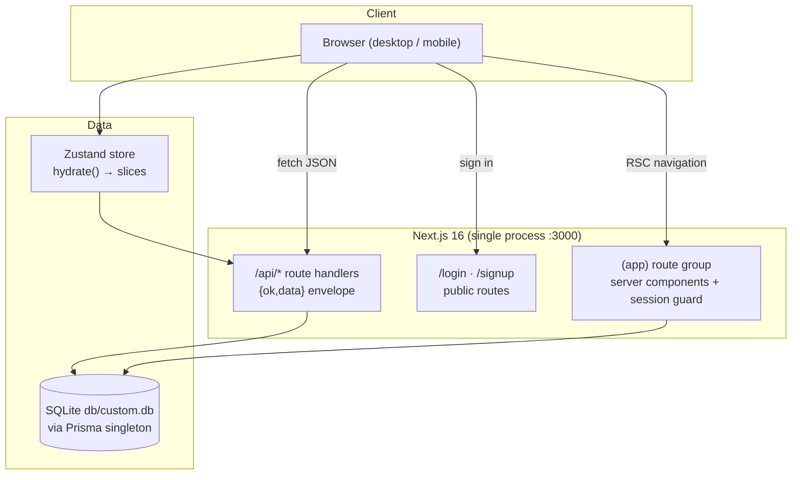

# NEO CRM

[](https://nextjs.org/)
[](https://react.dev/)
[](https://www.typescriptlang.org/)
[](https://tailwindcss.com/)
[](https://www.prisma.io/)
[](#testing)
[](#license)

A complete, self-hostable CRM workspace cloned from the reference app —
public marketing landing page, accounts, contacts, leads, calendar,
activities, analytics and settings in one clean Next.js application, with
the reference's 2026-10 mobile-nav fix mirrored (plus kept behavioral
supersets).

## Overview

The reference CRM lives on a closed platform. For 100+ censused sessions it
shipped a real defect — below the `lg` breakpoint its sidebar disappeared
entirely, leaving phone users unable to reach anything — and this clone's
mobile drawer began as the deliberate fix. The reference's 2026-10 parity
event (probe #119) fixed that defect upstream (its own Radix Sheet), and the
clone now mirrors that fix construction-for-construction, keeping its
behavioral supersets (the resize-past-md auto-close, the main-scroller lock,
the route-change close). NEO CRM remains a faithful, production-grade clone
of that workspace on an open stack you fully control. Everything runs from one
process: a Next.js 16 App Router server, a Prisma/SQLite database, and a
seeded demo workspace so the dashboards, charts and reports are alive from the
first boot. The 2026-10 parity event is fully mirrored too: the reference's
public marketing landing page now lives at `/` (hero, features, preview,
pricing tiers, FAQ, footer — with a working mobile disclosure menu), the CRM
moved to `/dashboard`, and `/About` + `/Contact` joined the app (see
`docs/session_302.md`).

## Key Features

| Feature | Description |
| ------- | ----------- |
| 🌐 Public landing | The reference's 2026-10 marketing layer at `/`: hero (badge, headline, the Open-the-dashboard/See-pricing CTA pair, the 3-item checklist), 6 feature cards, 3 CSS-built dashboard mocks, $8/$14/$20 pricing tiers (the Pro highlight — the s149 repricing), a single-open FAQ accordion and the footer — plus a working mobile disclosure menu at <md (the reference's own hamburger construction) and the post-login redirect to `/` |
| 📊 Dashboard | 6 KPI cards with the reference's HARDCODED static deltas (+5.3%/+15%) and static sparkline arrays, the single-blue #3b82f6 pipeline bars (radius 8, $ axis) with the O-map legend chips (the Won label's gray-400 lookup-miss quirk mirrored), the won/target revenue areas at fillOpacity .6/.3 on stock axes, top reps, the Follow-up checkbox rows, recent deals (table/cards view switcher) — the reference's old-lucide POLYGON filter glyph (hand-rolled SVG: lucide 0.525 re-exports the curved Funnel as Filter) |
| 🏢 Accounts | Tiered company records (A/B/C + key accounts), industry/revenue/owner filters ($0-$1M/$1M-$5M/$5M+), table/cards view switcher, CSV export — the reference's quoted 10-column client-side set incl. the stored Health field; the session-28 row (the building-icon box, the Key-tier yellow tint + filled star, the overdue red border-l-4 + N Overdue badge, the owner initials box, the HEALTH badge under the Status header — the reference's own header/cell mismatch), the row click + View Insights → the Account Insights dialog (max-w-3xl, the Total Revenue/Open Deals/Contacts stat cards, the Recent Activities/Contacts/Open Deals tabs), and the SEPARATE max-w-2xl Edit Account dialog (the full field set incl. Website/Annual Revenue/Employees + the 3-option status) |
| 👥 Contacts | The session-28 contact layer: the Key/Standard/At Risk priority vocabulary, the role/engagement-level/company-size/photo fields, the RAW source values (call/email/website/partner/referral — the emojis are create-dialog labels), the inline role select + the 3-bar engagement cell + the ce last-activity formatter (Never/Today/N days ago/N months ago) in the row, the row click → the Contact Details slide-over (md:w-[500px] right panel, the INITIAL-ONLY hero — the reference renders no photo there, the badges + engagement bars, Call/Email/WhatsApp, the Contact Information card, the Activities/Deals/Notes tabs), the SEPARATE max-w-2xl Edit Contact dialog, the checkbox-card filter panel (Role/Priority/30-day/Company Size/Source), the create dialog's h3 section headers, the rebuilt Scan Card + the s26 Import dialog, and the reference's only full-height layout. Session-30: the create dialog's photo section is the REAL upload round-trip (the img/initials/User-glyph render, the red remove X, the `Please upload an image file (JPG or PNG)` alert, the `John Doe` centered Name field, the max-h-[90vh] scroll-capped shell) backed by the self-hosted `/api/upload` seam |
| 🎯 Leads | The session-29 INTERACTIVE table: the orange Target name box, the INLINE Value number input / Status select (the 5-status set) / Next Follow-up date input with the overdue red border + CircleAlert (immediate mutation, optimistic store), the raw-source outline badge, the STICKY thead, the ⋮ Edit / Convert-to-Opportunity (dead — the reference's own quirk) / Delete menu; the filters popover with the RAW-value selects + the "(Active)" suffix + the NATIVE prompt-based Save View + the loadable Saved Views select; the client-side `leads_` CSV export from the FILTERED rows; 6 KPI cards deriving from the filtered set (Open = new+contacted+qualified, Dropped = lost strictly, the avg cycle = the won leads' average AGE), pipeline/won-lost charts + the recharts FunnelChart conversion funnel, filters popover (status/source/min value/follow-up) with Save View persistence, the SEPARATE max-w-2xl Edit Lead dialog (the 4-option status set + the 4-option source, Estimated Value) |
| 📅 Calendar | Month grid with the reference's tinted clickable event chips (bg-100/text-800 tints + solid dots, click opens the Edit dialog, +N-more overflow lines, plain-text day numbers), the tall-bar upcoming rows with MMM d, h:mm a timestamps, the 40x40 tinted-square agenda rows with the EllipsisVertical Edit/Delete dropdown, type filters — the reference's flat card anatomy (split DOW/month grids, bold responsive title, 8px nav) |
| ⚡ Activities | Call/email/meeting/WhatsApp quick-log (the reference's `calendar`/`message-square` glyphs), priority tabs (overdue / due today / upcoming / completed), activity timeline on the borderless `bg-white rounded-lg shadow p-6` card |
| 📈 Reports | 5 analytics tabs with the reference's bundle-pinned chart internals — the single-line revenue chart, grouped won/lost bars, the row-derived violet pipeline, the cyan horizontal funnel, the two-line forecasting chart, the probability-band PIE, the by-type/by-source label pies, the win-rate/avg-value bars with %/$ tooltips, the Account Health tab (computed Healthy/Needs Attention/At Risk distribution PIE, the horizontal Top-10 by revenue, the red-tinted at-risk rows with Nd-ago/Never, the outline-badge summary), deals-at-risk tables, activity log by owner, source performance summary |
| ⚙️ Settings | Editable picklists (sources, stages, types, tiers, industries) with instant save in a md-breaking 2-col grid, single-column workspace defaults, import templates + data export, and the tinted danger-zone reset (type RESET to confirm — a native confirm() gate + native alert() reporting, the reference's exact dialog strings) |
| 🔍 Global search | Debounced "Search Anything" across accounts, contacts and leads |
| 📄 Document metadata | The reference's full `<head>` surface — its 405-char meta description, the complete OpenGraph + Twitter card family (1200×630 social card), a brand favicon, `/robots.txt` and an eleven-route `/sitemap.xml` served in the reference's byte format (all derived from `NEXT_PUBLIC_SITE_URL` via `src/lib/site.ts`) |
| 📲 PWA / installable | The reference's install surface — `/manifest.json` (standalone display, #000000 theme, same-src 192+512 icons) + the `apple-touch-icon` + the `mobile-web-app-capable`/`apple-*` meta family, plus PER-ROUTE canonical + OG/Twitter on every page (og:title "X \| NEO CRM", the "X on NEO CRM." description prefix — all built by the `pageMetadata()` factory in `src/lib/site.ts`) |
| 📱 Mobile navigation | Focus-trapped slide-out drawer with scroll lock, Escape, close-on-navigate, retry-guarded focus entry (transition-visibility race fixed) — the fix the reference app never shipped |
| ☑️ Stock checkboxes | The reference's Radix-style button checkboxes on every filter rail (`role=checkbox` + `data-state` + Check indicator, the dark #171717 checked fill — was a native input) |
| 🔐 Auth | scrypt password hashing + HMAC-signed cookie sessions, rate-limited login, the reference's full in-place login-card funnel: "Forgot password?" reset flow, the in-place signup view (Email/Password/Confirm — no name field, no Google, no divider) and the verify-email view with its 6-digit code ladder (5 attempts → lockout → resend); every auth error renders the reference's Callout banner — zero toasts. The code is logged to the server console (self-hosted delivery; SMTP can be wired in `src/lib/verification-server.ts`) |
| 👤 Profile | Personal Information form (editable Full Name + the session-30 REAL photo upload — `accept="image/*"` with NO type alert on this surface, the toast vocabulary `Photo uploaded successfully`/`Failed to upload photo`, the img render on the form avatar + the Account card, the save → 500ms-reload mechanism, the TOPBAR avatar pickup) + account summary card — mirrors the reference |
| 🧭 Custom 404 | The reference's designed not-found page — slate-50 center card, divider bar, quoted-pathname message, Go Home pill |
| 🛡️ Security headers | The reference's edge-injected response-header set on every route — `Referrer-Policy: strict-origin-when-cross-origin`, `X-Content-Type-Options: nosniff`, `Strict-Transport-Security: max-age=31536000` (bare, like the reference; inert over plain-HTTP localhost per RFC 6797, correct behind HTTPS) — declared once in `next.config.ts` `headers()` |
| 🔤 Typography | The reference's zero-webfont base: NO Inter, NO font preloads — the stock `ui-sans-serif, system-ui` system stack pinned byte-exact in `@theme --font-sans`, default `auto` font smoothing (no `antialiased`, no `text-rendering` override) and the browser-default `::selection` — measured pixel-identical text metrics after the fix |
| ⌨️ Tabs (ARIA + keyboard) | The reference's full Radix tabs contract on every tab strip (activities, reports, settings) — each trigger carries `id` + `aria-controls` wired to its panel's `id`, each panel carries `aria-labelledby` back, all panel shells stay mounted (inactive ones hidden + empty), and the tablist supports the arrow-key model (ArrowLeft/Right with wrap, Home/End, automatic activation — focus follows selection). Our roving tabindex (selected tab reachable) stays the accessible superset over the reference's all-`tabIndex=-1` platform defect |
| 🔗 Route casing | The reference's route-case contract — every app route serves at BOTH casings (`/Reports` and `/reports` alike) with NO URL normalization, each casing a first-class SSR route (og:url + canonical mirror the requested case; `/Dashboard` serves the root head like `/`); the sidebar + drawer + account-menu hrefs are the reference's CAPITALIZED paths (`/Dashboard`, …, `/Profile`) with case-insensitive active-state matching. Capital `/Login` + `/Signup` 404 on both apps (the reference case-folds only its app routes) |
| ⏳ Loading model | The reference's instant-render-with-zeros contract — ZERO skeletons, ZERO spinners, ZERO loading UI anywhere: with a data fetch network-blocked the full page still renders immediately (KPI cards at 0, the empty table row, "Hi, Guest"). Every skeleton family retired (the empty state IS the loading state); the store's `loadingFlags` went with them |
| 🧾 Settings import/export | The reference's Settings Data-tab family — static CSV templates (`contacts_template.csv` with the byte-exact example rows), raw-dump entity exports (`contact_/account_/lead_/activity_` + ISO date — the header is the first row's own keys, every value double-quoted, an EMPTY file at zero data), and the three CardDescriptions (Import Templates / Export Data / the red Danger Zone warning) |
| 📑 PDF + CSV exports | The reference's REAL client-side artifact family — the Reports **PDF** button captures the content area (no sidebar) through `html2canvas-pro` + assembles A4 portrait pages via jsPDF (`crm_reports_YYYY-MM-DD.pdf`); the per-table **Export PDF** buttons generate text PDFs (`open_deals_by_stage_…` — the slug truncates the card title at the parenthetical); CSVs download as `prefix_YYYY-MM-DD.csv` with the reference's exact column sets (leads 8-col, the singular `crm_report` 7-col deal CSV, the per-table 3-col client-side blobs) |
| 💾 Saved reports | The reference's "Saved Reports (N)" button opens the full Save Custom Report View dialog — Report Name input + the 6 column checkboxes (Name/Account/Owner/Value/Stage/Won Date) + the Current Filters summary + the loadable list — persisted to `localStorage.crm_saved_reports` with the reference's byte-exact schema; **Load** re-applies the saved filters |
| 🧪 Tested | 2817 Vitest unit checks + 195 Playwright E2E checks, including a 11-check mobile-nav regression suite (resize lock-release + drawer focus-entry + the closed-state inert/Tab-wrap trap + the ten-route zero-390px-overflow sweep included), the wrong-code verification ladder (5 attempts → lockout → resend), the stat-value typography contract (the reference's own per-family value forms — bare on the dashboard/activities/accounts arms, the EXPLICIT gray-900 on the contacts/leads/calendar/reports arms), the statcard-family parity contracts (the gm/zv/Mx/ay construction mirrors — the Card/CardContent splits, the bg-CLASS bar color maps, the color-KEY chip pairs with the direct-icon mechanism, the direction-keyed trend rows), the sessioned body pre-gate family pins (13 routes — the users PATCH joined at s72; gate-before-parse AND gate-before-DB ordering, plus the e2e 400 probe), the reports fixed-scale call-site pins (the reference's literal /1e3 formula), the chart-palette contract (REPORTS_PIE_FILLS pinned + the e2e sector-fills check), the settings picklist bordered-row anatomy + the editor mount contracts (the H-72c1 ly geometry + the props-driven ConfigEditor + the resolved-epoch DefaultsEditor), the profile save round-trip (the updateUser store action + the pre-reload Account-card update), the row-menu migration contracts (the real role=menu surfaces with text-only items + the red Delete literal + the MenuContent click containment — the topbar-rowmenu-parity suite), the leads-family parity contracts (the static sortable-header glyphs + the created-date won-vs-lost buckets + the class-pair KPI chips + the raw-string min-value semantics + the select click-focus ring), the contacts-family parity contracts (the @theme v3-palette re-pin — 94 tokens (the s90 red-400/purple-400 extension), every literal palette class computing the reference's own v3 rgb — + the Card/CardContent stat-card split with the bg-class chip + the Activity/Award icon identities + the capitalized Source labels + the RAW export binding + the mr-[500px] detail shrink), the dashboard-family parity contracts (the raw-percentage bar sparks + the dashboard-kpi parity contracts (the Card/CardContent split + the label/value row divs + the single-slot sparks with bg-class bars) + the filter re-derivation onto the p memo + the trailing ghost button + the upcoming 3-furthest-desc window + the accounts Loading row), the login-family parity contracts (the 14px auth text ladder + the ShieldCheck tile + the solid-ring focus construction + the mb-2/mb-2 sm:mb-4 back-button ladders + the mobile nbsp spacer + the verify hint line + the text-muted-ink TableHead sweep), the dialog-geometry parity contracts (the phantom-mb select-triggers neutralized via the controlMt mb-0 + the contact dialog's nested sections + the Event Description rows=3 + the Import columns-box computed-4px margin) and the sweep-tool contract (the one-command zero-data screenshot-diff regression + the pure diffPixels seam + the fresh-clone tsc env-typing pin — the inferred NodeJS.ProcessEnv child-process env, the cast that broke `tsc` on a clean checkout retired — + the phone-width mode: `bun run sweep -- --width 390 --height 844`, the 390px rotation method productized with the viewport-tagged shots dir and the width-agnostic main-content wait + the --pages filter: `bun run sweep -- --pages leads,settings` for targeted rotation runs, the pure parsePagesArg seam with fail-fast unknown-name handling + the --fail-on-drift per-page gate: the STANDING_BASELINES table by viewport class [phone <768 — BOTH walked widths 390x844 + 375x812 ride one table] + the PURE standingBaseline/driftVerdict seams, a page failing when it exceeds ITS OWN baseline + margin [default 0.5pct, --drift-margin override] — a 0.00% page drifting to 5% fails where a global --max-diff 8 never could — and the LOGIN PAGE in the 10-page sweep [the reference serves the login card to authed visitors, the S23-P2 finding]), the login-card v4 space-y-genus remediation pins (the [&>*+*]:mt-1.5 mt-on-following field spacing — the reference's v3 margin lands on the inputWrap block, v4's margin-bottom on the INLINE label is inert — + the ONE w-full block section nesting [google + divider + form] where the adjacent margins collapse to 24/24 like the reference's own DOM; the M-79c2 doctrine), the drawer-battery-tool pins (the F-96a1 reopen-before-resize construction — the auto-close listener only registers while open — + the exact-selector protocol + the URL-based CAPITAL /Leads wait), the session-97 tablet-class + fail-fast + composite-gate pins (the STANDING_BASELINES 3-way md/lg banding — the maiden 768x1024 tablet class with the accounts overflow genus at the md boundary + the parseNumberArg numeric-arg fail-fast [B-97a2: a missing/non-numeric --drift-margin/--max-diff/--width/--height throws instead of arming NaN] + the gate:full composite chaining the standing gate + all three drift sweeps), and the session-98 row-genus + legend pins (the CardHeader base's v4-correct mt-on-following form — the flex-row override genus structurally retired, the space-y census at 23 files / 122 occurrences — + the GroupedBarsChart legend prop with the vs-wins opt-out [the reference ships its legend on the wonlost charts only] + the widened F-98a1 two-file stale-phrasing guard + the PURE standingExplained(width) per-class genera line), the session-99 landscape-class pins (the STANDING_BASELINES 4-way md/lg/xl banding — the maiden 1024x768 landscape class with the accounts overflow genus at its lg-band share [the reference's bare flex-1 floors at its table min-content, squeezes its own w-80 rail 320->183, pokes main +6px; ours the min-w-0 in-box rail-full consistent pattern] + the landscape driftVerdict contrast + the standingExplained landscape line + the gate:full fourth sweep), the session-100 diff-clustering pins (the PURE clusterDiff seam — the coarse-grid union-find decode of the diff mask with the size-mismatch throw parity + the non-positive-gap fail-fast — + the --clusters CLI flag with the browser-side inline twin + the maiden 1280x800 xl-boundary spot-check [accounts 0.00 — the rail-squeeze genus DEAD at 1280, the desktop class assignment holds]), the session-101 edge-wrap + drift-probe pins (the clusterDiff column-bounds guard in BOTH the node seam + the browser inline twin [F-101a1 — the union-find neighbor lookup must never wrap columns; edge cells at opposite frame sides stay separate buckets] + the drift-probe tool contract [bun run probe:ref — the per-session reference-stability throwaway promoted: the POST-LOGIN app-shell bundle md5 + the demo-data/desktop-nav/TRUE-390-mobile-defect census, exit 1 on any CHANGED; the PURE pickAppBundle/stabilityVerdict/desktopNavVerdict/mobileNavVerdict/demoDataVerdict seams + the STANDING constants; NOT part of the offline gate] + the maiden 375x812 second-phone-width drift-gate spot-check [the phone-class margin holds at the second walked width]), and the four session-73 e2e closures (the logout round-trip, the signup 4xx negatives, the contact upload negative trio, the quick-create dropdown smoke), and the session-102 secondary-sites lockstep pins (the docs-counts suite — every live-tense count site under the unit gate: the README badge arithmetic + tree + commands + Tested row, the AGENTS commands + gate-order lines, the PAD tree + Total + HEAD + checklist + commands sites, and the scoped stale-form negatives — the F-99a1/F-102a2 recurring stale-count genus retired; + the F-102a1 75/75 off-by-one corrections + the 414×896 third-phone-width drift-gate maiden CLEAN + the probe ordinals refreshed to the live standing), and the session-103 seeded-state chart-geometry freeze (the seeded-charts suite — the seed→derivation→chart-input chain pinned through the REAL reports-data functions: the leads/opps stage censuses, the $687,000 won-lead + $337.0K won-opp value totals, the post-map source distribution, the 8-slug funnel split, the revenueByMonth/wonLostByMonth/forecastAccuracySeries totals [337,000/316,250], the [6,3,3,0] aging design bands, the "29.2" conversion member — induced-drift-proven: a seed VALUE edit now fails the unit gate, not silently reshaping every chart; + the 320×568 phone-floor maiden — the first maiden to TRIP: the login logo genus diagnosed to its constant-absolute denominator arithmetic [~2,500px at every width; the share 0.75→1.39% as the frame shrinks 45%] and the phone login baseline re-anchored to the class ceiling [0.8→1.4, RED-first pinned] + the F-103a1 seventh-site 75/75 correction + the probe ordinals at the 74th/24th), and the session-104 e2e-count lockstep + the seeded-state mobile walk (the docs-counts e2e-site pins — the F-99a1 stale-count genus retired on the e2e axis: the AGENTS/CLAUDE/README/PAD e2e sites + the mobile-nav suite-count phrases under the unit gate, with the scoped e2e stale-form negatives; + the drawer-OPEN seeded-state e2e guard — the ten-route overflow sweep runs drawer-CLOSED by design, so the OPEN state's 390px contract [docScrollW ≤ 390 · the panel's zero internal overflow · the 288px w-72 budget · the 8 destinations] is now pinned on the SEEDED e2e.db; + the seeded-state mobile captures 158/159 [the KPI ladder + the drawer at phone width, VLM 4/4 × 2] + the 375×812 login maiden re-check CLEAN under the 1.4 class ceiling + the F-104a1 at-birth fix + the probe ordinals at the 75th/25th), and the session-105 second-surface mobile walk (the reports-mobile spec — the reports analytics tabs pinned at phone width on the SEEDED e2e.db: the KPI row 5 cards one-track gap-16, the pill tab bar 5 triggers two-track, the sales panel 4 charts at exactly 300px gap-24 single-track, a REAL tab switch that moves the active tab, swaps the panel, and keeps the frame at 390; + the F-105a1 stale-suite-count fix — two s104-missed sites [the CLAUDE e2e listing + the PAD census row] both fixed, the mobile-nav suite-count pin's scope widened to all five sites with the retired 9-check site-form negatives; + the 834×1112 tablet maiden re-check CLEAN under the tablet class table [login ~0.44% vs 1.0 allowed — the constant-absolute logo genus, the larger frame shrinking the share]; the captures 160/161 with the VLM battery 4/4 × 2 reading the 2×3 tab grid, all 5 tab names, the active-tab styling, and the Forecasting Accuracy chart off the phone pixels; the probe ordinals at the 76th/26th), and the session-106 third-surface mobile walk (the settings-mobile spec — the settings tabs pinned at phone width on the SEEDED e2e.db: the segmented tab bar 3 triggers one-row three-track, the picklist grid 5 cards one-track gap-16, a REAL tab switch that moves the active tab to Data, swaps the panel to its 3 cards, and keeps the frame at 390; + the F-106a1 SKILL H1↔frontmatter↔project_state lockstep pin + the F-106b1 stale-suite-count fix [the AGENTS architecture-facts line + the SKILL §5.4 line, both s105-missed 9-check sites — the mobile-nav suite-count pin widened to seven sites] + the F-106c1 fix [the CLAUDE commands-table unit row joins the lockstep]; the captures 162/163 with the VLM battery 4/4 × 2; the probe ordinals at the 77th/27th), and the session-107 reports KPI-derivations freeze (the seeded-reports-kpis suite — the quarter-filtered KPI row pinned through the NEW reportsKpis seam [the s31-era inline route derivation extracted behavior-preserving, the house seam doctrine]: the seed→rolling-quarter→value chain {Total Leads 18 · Open Leads 6 · Won 4 $337.0K · Lost 2 $92.0K · Conversion 66.7%} + the seam-formula members [openLeads new+contacted STRICTLY · the toFixed(1) conversion · the zero-division guard] + the route-wiring pin + the window-boundary/all-time contrast [−95 outside / −80 the oldest inside / 24-vs-18] — induced-drift-proven both faces; + the F-107a1 SKILL Appendix B totals pin [the s12-stale inventory table refreshed + pinned: unit total · e2e total · the mobile-nav row] + the F-107b1 CLAUDE gate-order fourth lockstep assertion; the captures 164/165 with the VLM battery 4/4 × 2 reading the frozen KPI row off both the phone and the desktop pixels; the probe ordinals at the 78th/28th), and the session-108 fourth-surface mobile walk + the two live finds (the calendar-mobile spec — the calendar grid pinned at phone width on the SEEDED e2e.db: docScrollW AND mainScrollW ≤ 390 [the NEW inner-overflow assertion] · the KPI ladder 4 cards one-track gap-16 · the DOW grid 7 labels 7-track gap-4 · the month grid the COMPLETE-WEEKS cell count computed in-test [28/35/42 as the month demands] with 7 tracks and cells ≥ 40px · zero chips past their cell's right edge [the M-108c1 guard] · the Upcoming/Agenda single-track stack · a REAL month-nav round-trip that keeps the frame at 390; + the M-108c2 COMPLETE-WEEKS GRID REVERSION [the s76 "always-42" gloss a misdecode — the reference LIVE-probed at five months renders 28/35/42 as the month demands: calendarGrid's leading branch now ceils to whole weeks, the fetch window exact]; + the M-108c1 BLOCK-CHIP FIX [the event chips were inline spans — truncate never engaged — 93-177px chips inside 43px cells at 390 pushing main.scrollWidth to 496 and 134-203px chips overlapping neighboring cells at 1440; `block` makes the truncation engage at every width, the documented-superset doctrine]; + the F-108a1 project_state layer-axis lockstep + the F-108a2/a3/a4 stale-docs pins [the page-layout module counts, the reports-data row, the DEPLOYMENT handler count]; the captures 166/167 with the VLM battery 4/4 × 2; the probe ordinals at the 79th/29th), and the session-109 fifth-surface mobile walk + the live find (the activities-mobile spec — the activities priority rows pinned at phone width on the SEEDED e2e.db, the LAST un-walked phone surface: docScrollW AND mainScrollW ≤ 390 · the KPI ladder 6 cards one-track gap-16 · the segmented tab strip 4 triggers 4-track with the Overdue badge self-consistent against the panel's row count · zero rows past the panel's right edge + zero clusters past their row's right edge · the timeline LONG-WEEKDAY h3 headers single-column · the filters/by-type rail display:none below lg [the reference's own desktop-only model, live-verified on both apps] · the quick-log row 2×2 wrap, none past 390 · a REAL Completed-tab switch that keeps the frame at 390; + the M-109c1 SHRINKABLE-CLUSTER FIX [the priority row's right cluster — the time span 40px + the 174px "Check as completed" text button + the 20px edit icon — an un-shrinkable 249px min-content inside the 326px panel that pushed main.scrollWidth to 488 at 390 (a horizontally-swipeable /activities, the M-108c1 genus on the flex axis, invisible to every standing gate — the zero-data sweeps render no rows); min-w-0 on both clusters + the inner text block + the label in a min-w-0 truncate span make the row fit at every width, the documented-superset doctrine — the reference's own construction carries the same latent defect, un-live-verifiable at its zero-data state]; + the F-109a1/a2/a3 line-census pin [the LIVE-CENSUS design — the PAD module-table rows + the SKILL header cluster read live and asserted against the sources, the next staleness either face fails the gate; the tilde forms (~95/~1222/~277/~110) exact-ified]; the captures 168/169 with the VLM battery 4/4 × 2; the probe ordinals at the 80th/30th), and the session-110 dashboard KPI seam unification (the seeded-dashboard-kpis suite — the LAST inline KPI derivation extracted behavior-preserving into the dashboardKpis seam [src/lib/dashboard-data.ts, the s107 reportsKpis precedent applied to the dashboard route]: the seed→seam chain {totalLeads 24 · salesTarget 0 · conversionRate "29.2" · avgSalesCycleDays 83} + the seam-formula members [the hardcoded V=0 target quirk · the toFixed(1) won-LEAD conversion + the zero-division guard · the per-lead-floored rounded average AGE — createdAt only, closedAt never enters the signature] + the route-wiring pin + the cross-seam contrast [the SAME seed through reportsKpis's rolling quarter reads 18/"66.7" — the window axis + the numerator axis: won-LEADS vs won-OPPS] — induced-drift-proven both faces; the s103-era MIRRORED formula in seeded-charts retired — the members now assert through the REAL seam; the captures 170/171 with the VLM battery 4/4 × 2 reading the KPI values off both viewports; the probe ordinals at the 81st/31st), and the session-111 login-family LIVE re-walk (the first since s79 — the pre-auth shell rides untracked rolldown chunks and the drift gates never touch the auth pages: the walk drove both apps through the full view ladder at 1440x900 + 390x844 with computed-style + viewStack-census extraction, adjudicated against the source contracts — the reference's verify FOCUS-ENTRY restored [D1: the first code box auto-focused on verify mount, the 2px ring on box 1 only; the e2e verify test now asserts toBeFocused], the signup's FLAT space-y-4 stack wired [D3: the s21-authored LOGIN_SIGNUP_LAYOUT.viewStack const, correct but never wired — the shared reset stack's sm:space-y-6 arm rode +8px at >=640; the inert titleStack wrapper retired, the h2 a direct stack child like the reference's census], the verify back's mb-2 sm:mb-4 ladder [D4: the reference's back->heading gap computes 16 at >=640, its -mb-2 collapsing with the v3 mt 24], and the two inert byte-parity re-pins [D2: the verify headingStack text-center space-y-2 — the tile's own mb-3 sm:mb-4 always overrides on both apps; D5: the sentCallout's [&>svg] arm family]; the post-fix cards byte-match the reference at both widths — the signup 470@1440/422@390, the verify 488@1440/412@390; the four new s111 pins land in login-family-parity + the D1 e2e expect inside the existing verify test + the F-111a1 wall-clock phrase pin), and the session-112 dialog-family LIVE re-walk (the second un-walked family re-walked live — both apps driven through the CREATE-dialog ladder at 1440x900 + 390x844 with computed-style + census + mount-focus extraction: FULL geometry parity on all seven dialogs at both widths [the s92 fixes + the s15 pins verified live 20 sessions on] + the close-X byte-parity re-pin to the reference's CURRENT stock string [D-112a1: the two inert data-[state=open] arms gained, disabled:opacity-70 retired, ring-offset-background the documented computed-contract exception] + the camera aria-label superset pin [D-112a2: the reference's icon-only button unnamed, ours the documented a11y superset] + the six mount-focus e2e freezes [D-112a3: the dialog focus landing pinned on all the walked dialogs — the first input on lead/account/event/savereport, the camera on contact, the type trigger on activity, the Cancel on import] + the role=dialog shadowing rule documented [D-112a4: the permanently-mounted mobile drawer carries role="dialog" with no data-state — CSS selectors must key on the open-state attribute]), and the session-113 menu/popover-family LIVE re-walk (the third un-walked family re-walked live — both apps driven through the account-menu + leads-Filters + leads-row-menu ladder at 1440x900 + 390x844 with computed-style + census + mount-focus extraction: the account menu in COMPLETE computed parity [the geometry byte-identical 128×74 @1280,56 at 1440 · the content computed-equal on every axis · the item census · the mount-focus + keyboard model identical] + the Filters popover geometry byte-identical at both widths [320×398 @304,483 at 1440 · the 390 collision flip-up matched] + THE FINDS: the Filters field labels re-tagged span → LABEL [D-113a1: the reference renders four bare <label> elements, ours shipped <span>s — real label semantics, the strict-mirror fix] + the MENU_CONTENT outline-none retired for byte parity [D-113a2: the reference's current stock content carries no outline-none — the s112 D-112a1 genus; verified inert on both open paths] + the menu mount-focus + keyboard e2e freezes [D-113a3: the content focus on click-open, the first item + #f5f5f5 highlight on ArrowDown — behavioral parity no class-string pin can see]), and the session-114 profile + settings Data-tab family live walk (the /Profile surface + the interaction battery + the Data tab walked live on BOTH apps at 1440×900 + 390×844: the geometry byte-identical at both widths + the camera/upload/save round-trips measured identical and frozen [the D-114a3 interaction battery — the camera/file-input wiring pin + the upload + save round-trip expects inside the existing /Profile e2e test] + the D-114a1 Danger Zone text-sm re-pin [the reference's current warning line at 14px/20px vs our pre-fix 16px/24px — the +4px card delta retired] + the D-114a2 profile email/role id re-pin [the reference's bare id pairs, our profile-* ids retired]), and the session-115 Defaults-tab + insights-dialog family walks (the Defaults tab re-walked two-app for the first time since s81 — complete parity on every computed axis at both widths, the label htmlFor/id association family the a11y superset over the reference's bare unassociated labels [D-115a1, the s112 D-112a2 genus, KEPT + frozen] + the select round-trip battery frozen [D-115a2, the Defaults-tab block inside the settings-mobile e2e guard]; the Account Insights dialog walked live for the FIRST time [ours-only — the reference's zero-data state, the s73 genus]: the chrome + header + three stat cards + segmented tabs + the tab-switch/Escape battery verified against the s28/s84 decoded contracts + the segmented-variant construction frozen [D-115a4] + the open/switch/close battery frozen [D-115a3, inside the accounts ⋮ menu e2e test]), and the session-116 reports-tables family walk (the ten-CardTitle + risk-construction census pin [the titles never pinned as a set — "Top Deals by Value" in NO test assertion before; the outline-Badge 5-site + bg-red-50 3-site + red-badge 1-site census on the RAW source — a fourth tint site or a sixth badge site is a parity event, not a growth] + the populated-tables e2e battery [INSIDE the existing reports test, the census stays 137: the default-tab titles + row counts before the All-Time switch, the per-tab row contracts + the badge texts + the red-tint classes + the Nd-ago PATTERN + the MMM d, yyyy PATTERN — the s18 time-bomb lesson, never a literal date]), and the session-117 accounts-list family walk (the five-KPI-label census pin [the labels never pinned as a set — "Total Accounts" in NO test assertion before; the per-card trend/color adjacency + the arm census on the comment-stripped source — trend="up" at exactly four sites, color= at exactly six (the sixth the Cards-view Avatar hex)] + the populated accounts e2e battery [INSIDE the existing accounts test, the census stays 137: the five KPI values 10/8/9/$77.5M/3 + the tier census 9 Key + 1 A + the star census 9 + the three overdue rows with the 4px red borders + the Cards-view switch] + the D-117a0 wall-clock defuse [the 117-a audit's F-117a2 finding: the "18d ago" literal was a 10:00-local time-bomb — the bounded /^1[89]d ago$/ pattern; the Overdue 13 count shared the bomb via the two due-today seed rows — the 13-15 bounds; the first-row "Meeting" dependency retired to the card level; the tab-4 comment corrected — the Leads List is LEAD-derived, the :39 lead IS row 1, the asserts hold via the slice cap + the dialog's default stage "new"])), and the session-118 dashboard-charts + leads-statcard family walk + the F-118a1/F-118a2 defuse (the six-label + adjacency census pin [the leads statcard labels never pinned as a set — "Open Leads" in NO unit label-set assertion before, the D-117a2 genus; the per-card icon/chipTone/subValue adjacency + the six-chipTone arm census on the RAW source] + the populated batteries [INSIDE the existing leads + dashboard tests, the census stays 137: the six statcard values 24/9/7/4/29.2% + the $687,000/$226,000 subValues + the Avg-Cycle SHAPE (the day-counter — never a literal) + the dashboard KPIs $337.0k/29.2%/$0k + the Revenue-This-Month in-test month computation (the calendar-rollover precedent — the month-roller pinned exact at every run date)] + the D-118a0 wall-clock defuse [the 118-a audit's F-118a1/F-118a2 findings: the s117 accounts battery's own "Overdue Activities" 3 and the overdue-rows count were 10:00/14:00-local time-bombs — the seed's ownerIdx*2 hour pinning; the bounded 3-5 counts, the D-117a0 idiom applied to the session's own battery]) and the session-119 contacts-list family walk + the primary-foreground re-pin (the four-label + adjacency census pin [the contacts statcard labels never pinned as a set — "Top Decision Makers"/"No Recent Activity" in NO unit label-set assertion before, the D-117a2/D-118a2 genus; the Users/TrendingUp/Award/CircleAlert icon + bg-blue/green/amber/red-500 chip adjacency + the trend row on exactly New This Month + the four-gradient arm census] + the mobile-list empty-state retirement [the s75-era invented bare-p branch retired — the LIVE reference renders the EMPTY container at zero data, probe-verified at both widths; the table's rich empty stack is the only zero-data face] + the populated contacts e2e battery [INSIDE the existing contacts test, the census stays 137: the statcard values 15/15/6 + the bounded 5-7 day-roller No-Recent-Activity count + the priority census 4/7/4 + the 15-row table + the Pke slide-over + the W7 edit-dialog battery with the mount-focus] + the #fafafa primary-foreground token re-pin [the shadcn stock hsl(0 0% 98%) — the LIVE reference computes rgb(250,250,250) on every blue primary; the design-tokens pin, the systemic F-119c2 fix] + the F-119a1 epoch-gate [the settings-debounce e2e's 9-session flake lineage root-caused as the pending→resolved remount racing the fill — the toHaveValue gate before it]), and the session-120 leads interactive-table family walk (the s29-era decode walked TWO-APP through /leads at 1440×900 + 390×844 — the zero-data face byte-equal on every compared axis: the 9 table heads with cursor-pointer on exactly the three sortable ones, the Gke filter panel LIVE, the (Active) suffix, the Save View prompt, the unquoted-header Export download, the phone hidden-column set — ZERO parity defects; the populated face ours-only with every value seed-verified off the db and every mutation verified back onto it: the stage/source censuses with the 4 blank Radix mirrors, the code-unit sort LIVE, the filters/export/saved-view round-trips, the inline Value/Status/date mutations, the overdue face LIVE, the ⋮ Edit dialog / dead Convert / Delete; the pin-only session with ZERO src changes — the SortHead cursor-pointer census pin + the /leads Export e2e click inside the existing battery), and the session-121 photo-upload family walk (the s30-era surfaces walked TWO-APP through the New Contact dialog photo section + /profile at 1440×900 + 390×844 — the zero-data face byte-equal with ZERO parity defects (the seven v4 serialization genera adjudicated noise, L-121c1 the rounded-full radius genus among them); the populated face ours-only 65/65 with every value db-verified; ONE real defect found + fixed: the standalone uploads anchor — the VIRTUAL import.meta.url validated .next/standalone via its traced schema copy, the uploads landing in the EPHEMERAL build output; the cwd-first anchor order + the pure repoRootFor seam + the trap pins (the NEW uploads-path suite); the drawer-battery REPO derivation + the both-avatar-carriers pin + the profile hint/in-flight pins); and the session-122 settings-family walk (the Danger Zone + account-card arms walked TWO-APP through the /settings Data tab + /profile + the Config tab at 1440×900 + 390×844, the walk db riding both zeroes incl. the reference's own empty-settings state — the zero-data face byte-equal with ZERO parity defects (the download contracts byte-exact: the 3 CSV templates + the 4 EMPTY exports; the disabled-cursor genus adjudicated noise); the populated face ours-only 51/51 with every mutation db-verified (the picklist CRUD, the raw-dump exports, the 7-table reset wipe with users + settings surviving) — the pin-only session: the account-card arm pins + the Danger-Zone surface pins + the export title/MIME/EMPTY-face pins + the picklist Add-button pin); and the session-123 reports export/PDF family walk (the six-fix session: the export duo + the per-table quartet + the Save Custom Report View dialog walked TWO-APP at 1440×900 + 390×844 — SIX real parity defects found and fixed: the unguarded dev-server spawns' platform DATABASE_URL poisoning, the reports CSV BOM (the reference's own artifact is BOM-less), the per-table PDF's mm-anchored geometry (the reference's stream decoded and byte-equal-verified), the dialog Save button's black pair, the bar Export CSV's literal white pair, and the v4 space-y trailing-margin genus (main scrollHeight 1545 vs 1521) — the post-fix re-run 0 diffs with the download contracts byte-equal; the populated face ours-only 42/42 incl. the saved-reports localStorage round-trip), and the session-124 calendar family walk (the pin-only session: the shell + the KPI row + the month card + the never-walked filter rail — the radio semantics LIVE-verified two-app for the first time — + the New Event dialog + the month-nav round-trip walked TWO-APP at 1440×900 + 390×844 with ZERO parity defects [the single divergent axis adjudicated noise: our aria-label superset over the reference's unnamed icon-only nav buttons]; the populated face ours-only 44/44 with every value db-verified incl. the chip→Edit round-trip and the create/delete db-verified mutations), and the session-125 activities family walk (the LAST never-two-app-walked interactive family — the s124-calendar genus: the shell + the quick-log quartet + the KPI sextet + the segmented tab strip + the four empty states + the never-walked filter rail + the by-type card + the Log Activity dialog walked TWO-APP at 1440×900 + 390×844 — ONE real parity defect found and fixed: F-125c1 the segmented active-pill bg [ours bg-background #f9fafb vs the reference's white — the F-119c2 inverted-token genus, fixed with the bg-white literal on BOTH segmented surfaces /activities + /settings, live-verified post-fix byte-equal]; the populated face ours-only 49/49 with every value db-verified incl. the FILTERED-basis KPI cascade [the opposite of the calendar's RAW doctrine], the toggle round-trip, and the quick-log preset-rides-the-submit create round-trip), the axe-core a11y two-gate (session-171: the nine CRM pages + the anon surfaces at desktop + phone + the drawer-open state — structural violations ZERO (every interactive control named: the SelectTrigger comboboxes, the inert checkboxes, the phone-width icon buttons) with color-contrast/svg-img-alt nodes citing the sanctioned parity palette + the recharts genus, each verified on the reference's own DOM; session-172: the dialog-open family — the five create dialogs + the contact edit dialog scanned in their OPEN states, the closed-by-default genus, with every dialog Select named via its sibling label + the edit-dialog inputs wired htmlFor/id), and the fast-check property family (session-172: 13 invariant checks over the pure seams — the csv escape/parse round-trip with the RFC-4180 quoted-CRLF parser fix, the guard idempotence, the lead-views/saved-reports round-trips, the formatter/initials robustness freezes; session-173: the deeper family — the Zod round-trip properties [the create-defaults quadrant · the enum membership · the email trim/lowercase contract · the PUT three-state · the required-name quadrant · the legacy priority mapping] + the rate-limit window arithmetic over the injectable clock [the fixed-window reset crossing · the retryAfterSec formula · the remaining monotonicity · the default-clock equivalence]; session-175: the response-side wire-contract family (the READ half — P-r the entity wire round-trips over the six route-exact shapes [Dates as exact ISO strings, nulls present, the key set exact] + P-s the envelope pair property [the ok() two-key passthrough + the fail() verbatim error arm] + the crud-zod-seam READ-half source pins [the include select sets · the orderBy contracts · the every-GET-through-the-envelope doctrine · the opportunities raw-row contract · the me-route SessionUser carrier]), the recharts-3 migration contract (session-176: the version floor ^3.10.1 + the lockfile resolution + the accessibilityLayer 9-site parity census + the e2e grid-sentinel existence freeze — ADR-021's chart-major doctrine, render-identical on all six drift gates), the walk51 decode-freeze family (session-178: the topbar search FOCUS + the settings segmented ACTIVE interiors walked two-app under the ADR-022 doctrine — REAL keyboard Tab focus censused computed, the focused 1px near-black ring byte-equal, the active white pill byte-equal at both viewports, ZERO live defects, the v4 outline-none rename decoded as the hazard family's fourth member — 5 born-green contract-freeze pins in the page-layout suite), the walk52 pill-focus contract (session-179: the reports pill-tab FOCUS state walked two-app at both axes — the focused ring rgb(255,255,255) 0 0 0 2px + rgb(10,10,10) 0 0 0 4px byte-equal under REAL keyboard focus, the ring-2+offset-2 form's own proof, 4 born-green pins), the walk53 dropdown/select OPEN-interior contract (session-180: the account-menu + the settings Defaults select OPEN states walked two-app at both axes — the menu/listbox spines byte-equal under the REAL keyboard ArrowDown drive, every delta a documented genus, 5 born-green full-string pins), the walk54 dialog-focus interior contract (session-181: the New Lead dialog's OPEN + FOCUS states walked two-app at both axes — the 51-row spine byte-equal, the REAL keyboard Tab chain position-identical through all 10 stops + the focus-trap wrap, the close X's focused DOUBLE ring byte-equal, every delta a documented genus + the NEW dangling-aria-describedby genus decoded, 4 born-green full-string pins), the walk55 reports-filter selects open-interior contract (session-182: the four filter selects' OPEN states walked two-app at both axes — the period/stage/status spines byte-equal with the ArrowDown highlight identical on every drive, the owner arm the DATA-STATE genus (our seeded DISTINCT-opportunity-owners list vs the reference's zero-data All Owners-only list), every OPEN face byte-equal behind the standing genera, the captures 463-466 with the period pair byte-identical), the walk56 leads-popover + contacts-panel open-interior contract (session-183: the popover family's two OPEN arms walked two-app at both axes — the portal arm byte-equal geometry + labels + the REAL Tab chain, the 390 collision FLIP-UP matched, the D-183a1 live find cured (the contacts Filters trigger's OPEN flip to the reference's dark stock primary #171717) + re-walked byte-equal), the walk57 activities-rail open-interior contract (session-184: the more-filters expander's RESTING + HOVER + OPEN faces walked two-app — the first mouse-borne hover face in the battery, computed-equal rgb(245,245,245)/rgb(23,23,23) via the line-soft/neutral-900 ≡ accent/accent-foreground pair; the closed-rail REAL Tab chain byte-equal 9 stops on both apps, ours-open 11 with the revealed Task/Note checkboxes entering the order; the Filter primary byte-equal blue — the D-183a1 family's second member adjudicated CLEAN; the reference's dead stub re-verified, ours the functional superset), and the walk58 quick-log dialog open-interior contract (session-185: the Log Activity dialog's OPEN interiors walked two-app at BOTH axes — the reference's quartet FUNCTIONAL, the dialog byte-equal at 384,237 672x426 desktop / 0,201 390x442 phone, the labels + footer + the type quintet + the related quartet byte-equal, the REAL Tab chains structurally identical 17 stops; the by-type footer re-walked under ADR-022 byte-equal; the D-185a1 live find cured — the s133 placeholderState retirement REVERSED, the empty-select placeholder ink rgb(115,115,115) byte-equal post-cure; the D-183a1 same-family check on the dialog submit CLEAN at rgb(23,23,23)), and the walk59 settings picklist open-interior contract (session-186: the picklist editor's arms walked two-app at BOTH axes — the rows LIVE on both apps (the settings singleton's own configuration, not the demo data), the row chrome + the rename OPEN swap + the mount-focus (the Save-button DOM-reuse landing) + the add-row + the hover faces byte-equal, the Defaults vocabularies Month/Week + Monday/Sunday byte-equal, the Escape probe answered byte-equal (the reference's own swap does not close on Escape either); the D-186a1 live find cured — the rename-trigger glyph is the lucide PEN, not Pencil (the reference's icon carries exactly ONE path, ours added the tip line), the re-walk proving the glyph byte-equal), and the walk60 profile photo-upload + Data-tab focus-open contract (session-187: both families walked two-app at BOTH axes — the profile construction byte-equal on every resting face (the Upload/name/Save geometry, the labels, the small-card vocabulary), the REAL keyboard Tab drives structurally identical with the byte-equal 1px near-black focus ring; THREE live finds cured — D-187a1 the hidden file input's id + explicit-tabIndex retirement (the D-114a2 same-page id-precedent), D-187a2 the avatar's stock DIV fallback with the color ON THE SVG at both sites, and D-187a3 the Data-tab 8px button-row offset (the v4 space-y semantics flip's INLINE-FLOW variant — the reference's margin-TOP form drops the baseline row 8px, cured with the s11-era explicit form); the re-walk proves all three cures byte-equal on both axes), and the walk61 settings segmented tab-bar + accounts-rail/leads-search focus-open contract (session-188: all families walked two-app at BOTH axes — the settings strip byte-equal on every resting face (the 288,189 1120x36 strip + the three 371x28 triggers + the 24px content gap), the REAL keyboard Tab chain 13 stops STRUCTURALLY IDENTICAL on both apps with the byte-equal focus-visible ring (the white 2px offset slot + the 4px near-black ring), the mouse-click face byte-equal (3px none on both — nothing paints), the rail selects byte-equal at 1113,376/456/536 with the OPEN listbox construction byte-equal modulo the DATA-STATE item counts, the leads search byte-equal at both axes; ZERO live finds on the walked surfaces — every delta a documented genus, the outline COLOR-CARRIER sub-form the register's newest arm (zero visible pixels on both); the round's ONE live find D-188a1 a DOCS head defect — the retired session-186 SKILL-head block's corrupted ship line (the s187 first-pass residue), cured with the s171-fix doctrine restored and PINNED in docs-counts; the settings/rail/leads/reports construction freezes born-green (4 pins) + the D-188a1 pin) |

## Architecture

| Layer | Technology | Version | Purpose |
| ----- | ---------- | ------- | ------- |
| Framework | Next.js (App Router) | 16.4.2 | Server rendering, routing, API handlers |
| UI runtime | React | 19.3 | Component model (async params/cookies, no forwardRef) |
| Language | TypeScript | 5.9 | Strict types, explicit `typecheck` gate |
| Styling | Tailwind CSS | 4.3 | CSS-first tokens (`@theme`, no JS config) |
| Components | Radix UI + custom kit | — | Dialogs, selects, popovers with native-ARIA tabs/tables |
| Charts | recharts | 2.15 | Pipeline, revenue, funnel, donut visualizations |
| ORM | Prisma | 6.19 | Schema-first models, `db push` workflow |
| Database | SQLite | — | Zero-config local persistence at `db/custom.db` |
| State | Zustand | 5.0 | Single client store for all server state |
| Icons | lucide-react | 0.525 | Nav chrome (1.8 stroke) + content (2.0 stroke) |
| Unit tests | Vitest | 5.0 | Pure domain seams |
| E2E tests | Playwright | 1.64 | Real-browser golden path + mobile regression |
| PDF export | jsPDF 4.2 + html2canvas-pro 2.5 | — | The Reports canvas + text PDF artifact family |



## File Hierarchy

```
📂 neo-crm/
├── 📂 src/
│   ├── 📂 app/
│   │   ├── 📄 page.tsx               # public landing (/ — the s142 marketing surface)
│   │   ├── 📂 (app)/                 # session-guarded route group (layout redirect)
│   │   │   ├── 📂 dashboard/         # Dashboard (/dashboard)
│   │   │   ├── 📂 accounts/ contacts/ leads/
│   │   │   ├── 📂 calendar/ activities/
│   │   │   └── 📂 reports/ settings/ profile/
│   │   ├── 📂 (marketing)/           # the marketing pair (login-walled since s147)
│   │   │   └── 📂 about/ contact/    # About + Contact (page.tsx + capitalized aliases)
│   │   ├── 📂 api/                   # 29 REST route files, 41 verb handlers (accounts → users)
│   │   ├── 📂 login/ signup/         # public auth pages
│   │   ├── 📂 reset-password/        # the s163 reset landing (token-gated)
│   │   ├── 📄 layout.tsx             # root layout, metadata, Toaster (no webfont — the stock system stack)
│   │   ├── 📄 error.tsx             # route-segment error boundary (s170 — the resilience family)
│   │   ├── 📄 global-error.tsx      # root error boundary, own html/body + globals.css (s170)
│   │   ├── 📄 instrumentation.ts    # the boot gate's register() hook (s170)
│   │   ├── 📄 globals.css            # Tailwind v4 @theme tokens + utilities
│   │   └── 📂 vendor/tw-animate.css  # vendored animation utilities
│   ├── 📂 components/
│   │   ├── 📂 layout/                # sidebar, topbar, mobile-nav (the fix), app-shell
│   │   ├── 📂 ui/                    # button, dialog, select, table, tabs, toast…
│   │   ├── 📂 charts/                # recharts wrappers (recharts defaults, no empty-state boxes — the s10 reversal)
│   │   └── 📂 shared/                # KPI cards, page headers, entity dialogs
│   ├── 📂 lib/                       # auth, api envelope + parseBody seam, schemas (the Zod layer), db(+path), format, csv, constants, reports-data, dashboard-data, boot-env (s170), chunk-recovery (s170)
│   ├── 📂 stores/crm-store.ts        # the single Zustand store
│   └── 📂 types/index.ts             # shared wire types
├── 📂 prisma/
│   ├── 📄 schema.prisma              # 9 models (User…Setting)
│   └── 📄 seed.ts                    # idempotent demo workspace
├── 📂 tests/
│   ├── 📄 *.test.ts                  # 138 Vitest suites (2817 checks)
│   └── 📂 e2e/                       # Playwright (195 checks)
├── 📂 scripts/
│   ├── 📄 smoke-test.sh              # the s170 smoke leg — boots the standalone artifact, 14 checks
│   └── 📄 census.ts · sweep.ts · drift-probe.ts · … # the drift-gate family
├── 📂 docs/                          # validation report, SSH runbook, screenshots
├── 📄 AGENTS.md · CLAUDE.md · Project_Architecture_Document.md · neo-crm_SKILL.md
├── 📄 worklog.md
└── 📄 next.config.ts · postcss.config.mjs · playwright.config.ts
```

Also under `src/app/`: the metadata-asset file conventions — `icon.png`
(512×512 favicon) + `apple-icon.png` (180×180 touch icon) — plus the
`manifest.json/`, `robots.txt/` and `sitemap.xml/` route handlers that
serve the reference's byte formats.

## Quick Start

Requirements: **Node.js ≥ 20** (or Bun ≥ 1.1) and the
[Bun](https://bun.sh) runtime (`curl -fsSL https://bun.sh/install | bash`).

```bash
git clone https://github.com/nordeim/neo-crm.git
cd neo-crm

bun install
cp .env.example .env
# set a session secret:
echo "AUTH_SECRET=\"$(openssl rand -hex 32)\"" >> .env

bun run db:push        # create db/custom.db from the schema
bun run db:seed        # demo accounts/contacts/leads/activities/events
bun run dev            # → http://localhost:3000
```

### Verify Setup

1. `bun run dev` prints `✓ Ready` and serves `http://localhost:3000`.
2. Visiting `/` serves the public landing page (the s142 marketing
   surface — "Welcome to NEO CRM" lives at `/login`).
3. Sign in with the demo credentials — **`sepnetflix2023@outlook.com` /
   `$Abcd1234`** — and land back on the landing page (or the `from_url`
   page you came from); the dashboard at `/dashboard` carries 24 seeded
   leads, live charts and a Recent Deals table.
4. Shrink the window below 768px: the hamburger (top-left) opens the
   navigation drawer with all 8 destinations (the desktop sidebar itself
   appears from 768px, mirroring the reference).

## Environment Variables

| Variable | Required | Purpose | Default |
| -------- | -------- | ------- | ------- |
| `DATABASE_URL` | Yes | SQLite URL, resolved relative to `prisma/schema.prisma` | `file:../db/custom.db` |
| `AUTH_SECRET` | Prod | HMAC secret for session cookies (≥16 chars — production fails hard on missing/short) | dev-only constant (warn; production throws) |
| `NEXT_PUBLIC_SITE_URL` | No | Canonical origin for metadata, `robots.txt`, `sitemap.xml`, `manifest.json` and the per-route OG/Twitter/canonical family (consumed via `src/lib/site.ts`; inlined at build time) | `http://localhost:3000` |
| `NEO_PROXY_HOPS` | No | Declared proxy-topology trust depth for the rate-limit IP keying — unset = 1 (the last `x-forwarded-for` hop is the client); 0 = direct exposure (client-suppliable IP headers ignored); N ≥ 2 = N trusted appending proxies; unparsable/negative fails CLOSED onto 1 (a bad value never widens trust) | unset (`1`) |
| `NEO_DISABLE_IN_APP_OTP` | No | Signup/resend responses stop carrying the verification code — a deployment with a real mail transport sets `1` (the no-enumeration 200 is unchanged; ADR-014) | unset (in-app delivery) |
| `NEO_DISABLE_IN_APP_RESET` | No | Forgot-password responses stop carrying the reset link — a deployment with a real mail transport sets `1` (ADR-014) | unset (in-app delivery) |

## Testing

```bash
bun run test          # 2817 Vitest unit checks (nav-config,auth, avatar, constants, db-path, metadata, pwa-metadata, http-headers, login-views, typography, tabs-aria, page-layout, page-titles, profile-route, format, csv, rate-limit, lead-filters, design-tokens, reports-data, login-reset, charts-contracts, route-case, pdf-export, saved-reports, loading-layer, csv-contract, report-periods, settings-data-tab, reset-flow, csv-templates, entity-export, account-health, import-dialog, charts-internals, account-health-tab, dashboard-contracts, leads-charts, calendar-cells, calendar-fetch-bounds, calendar-grid, contact-model, entity-edit-dialog, contact-surfaces, account-surfaces, leads-inline, upload-api, uploads-path, contact-photo, profile-photo, opportunity-model, api-robustness, auth-reset, gate-script, coercion-guards, topbar-search, dialog-clear-parity, report-save-guard, report-pdf-guard, storage-read-guards, store-fetch-guards, format-hygiene, mutation-feedback, settings-debounce, settings-rollback, settings-profile-parity, topbar-rowmenu-parity, reports-page-parity, account-contacts-parity, activities-calendar-parity, leads-family-parity, settings-family-parity, reports-family-parity, leads-statcard-parity, statcard-family-parity, spacey-hazard-parity, dashboard-family-parity, dashboard-kpi-parity, login-family-parity, profile-family-parity, settings-defaults-parity, contacts-panel-parity, reports-filter-parity, insights-parity, reports-tabcontent-parity, accounts-rail-parity, contacts-family-parity, dead-code-hygiene, edit-dialog-remount, dropdown-containment, dashboard-export, insights-vocabulary, leads-inline-feedback, topbar-import-hygiene, csv-formula-guard, source-vocabulary, insights-badge-case, reports-export-feedback, reports-filter-validation, create-dialog-single-mode, db-census, badge-contract, auth-contract, parse-body, password-seam, schemas, stat-value-contract, body-pregate, dialog-mount-contract, dialog-geometry-parity, sweep-tool, drawer-battery-tool, drift-probe-tool, docs-counts, seeded-charts, seeded-reports-kpis, seeded-dashboard-kpis, toast-anatomy, landing-page, interior-census-tool, settings-rhythm-tool, bounded-reader, schemas-crud, crud-zod-seam, dashboard-interior-parity, fullpage-sweep-tool, leading-inert-genus, schemas-census, inventory-census, facts-census, a11y-controls, dialog-controls, property, type-gate)
bun run build         # E2E runs against the standalone production build
bun run test:e2e      # 195 Playwright checks on :3100 with its own db/e2e.db
bun run gate          # the full gate in one command: lint → typecheck → test → build → CI=1 e2e (the CI=1 prefix forces a fresh e2e server — a leftover :3100 listener is never reused)
bun run gate:full     # gate + the SIX drift gates (the desktop, phone 390x844, tablet 768x1024, landscape 1024x768 sweeps + the fullpage sweep + the interior census — each --fail-on-drift against its own class baselines)
```

E2E coverage: logged-out surface (redirects, bad credentials — the
reference's Callout banner with zero toasts, the login
card's full in-place funnel: the reset-password flow, the signup view
swap with its mismatch guard, the verify-email view with the attempts
ladder + resend, and the /signup superset page), the
authenticated golden path across all 9 pages, lead creation through the real
dialog, global search, the per-page document titles, the reports tab 2-4
structure, the account menu (real role=menu with Profile/Logout), the reports
funnel (horizontal bar chart with the raw stage slugs + dashed grid), the
activities by-type card (chips row + checkbox footer), the settings Defaults/Data tab structures + /Profile casing alias, the entity-dialog
geometry layer (the stock New Lead dialog at phone width — full-bleed,
radius 0, centered title, the 2-col Status/Source pair; the Contact avatar
section with live initials; the wide New Event family with its one-off blue
submit), the session-16 responsive layer (the contacts full-height root at
390 with its 326px card + the 5px mirrored scroll quirk, the settings
picklist grid at md/tablet width, the calendar's split DOW/month grids +
bold title, the borderless accounts table card), the session-17 stock
button/checkbox layer (the account trigger's ghost-Button construction +
two-level avatar, the sidebar `users`/`circle-user`/`calendar` glyphs, the
accounts tier filters' stock button checkboxes with the dark #171717
checked fill, the blue primaries' bare shadow scale), the session-18
document-metadata layer (the reference's meta description, the OG/Twitter
card family, the favicon link, robots.txt's Sitemap line, the eleven-route
sitemap.xml), the session-19 PWA + per-route metadata layer (the
installable manifest.json, the #000000 theme-color + the apple/meta
family, the resolving apple-touch-icon, per-route canonical + OG/Twitter
on /accounts, the unprefixed root family, the Contact dialog's type=tel
phone + zero datalists + the exact avatar accept list), the session-20
HTTP response-header layer (the reference's edge security set —
Referrer-Policy/X-Content-Type-Options/HSTS on every response incl.
static assets, plus the sitemap's bare `application/xml` content-type),
the session-21 login-card funnel layer (the reference's in-place signup
view — the s10 "dead button" pin disproven live — plus the verify-email
view with its 6-digit attempts ladder, the Callout error/info banners,
the exact auth error strings, and zero auth toasts), the session-22
typography layer (the reference's zero-webfont base — the Inter webfont
retired for the stock system stack, default `auto` smoothing, the
browser-default `::selection`), the session-23 tabs ARIA + keyboard
layer (the reference's Radix tabs contract — wired trigger/panel ids,
all shells mounted with the inactive ones hidden + empty, the arrow-key
model with wrap + Home/End + automatic activation, and the activities
priority card restructured into the reference's single p-4 border-b
region), the session-24 route-case + URL-state layer (the
reference serves every app route at BOTH casings with no normalization —
its sidebar links point at the capitalized paths, each casing a
first-class SSR head; our capital-route render aliases + the capitalized
nav hrefs + the case-insensitive active state, the dashboard's dead
"More..." affordance restored, and the URL-state census closed at
parity — zero writes, params ignored), the session-25 loading +
export-contract layer (the reference's instant-render model — the
dashboard KPI cards visible immediately post-login with zero skeleton
pass; the Reports header PDF downloading a real client-side
`crm_reports_*.pdf`; the per-table Export PDF/CSV downloading the
reference's `open_deals_by_stage_*.pdf` + `open_deals_*.csv` artifacts;
the Save Custom Report View round-trip — save → count "(1)" → the
list → Load reapplies the filters; the period dropdown's 6-option
vocabulary), the session-26 Settings import/export layer (the three
Data-tab CardDescriptions, the static template artifacts, the raw-dump
singular-prefix exports, the quoted page-level contacts/accounts CSVs
incl. Health, the rebuilt Import Contacts dialog with its result box +
2s auto-close, and the reset flow's native confirm/alert round-trip —
decline holds, accept wipes), the session-27 chart-internals +
Account Health / calendar layer (the Account Health tab's computed health
distribution PIE with its `${name}: ${value}` slice labels, the horizontal
Top-10 chart with the $ axis, the red-tinted at-risk rows with "Nd ago"/
"Never" + the red "At Risk" badges, the outline-badge summary; the
dashboard's "Follow up with {source}" checkbox rows, the static KPI
sparklines + deltas; the calendar chip click opening the Edit Event
dialog; the activities by-type bars all single #3b82f6), the session-28
entity layer (the contacts slide-over + the W7/wce/Mke edit-dialog family,
the inline role select + engagement bars + the Call/Email/WhatsApp actions,
the Account Insights dialog, the checkbox-card contacts filter panel), and
the session-29 leads interactive layer (the inline Value/Status/Date
editing round-trip with the overdue border + CircleAlert, the orange
Target name box + the sticky thead, the "(Active)" filter suffix + the
prompt-based Save View + the loadable Saved Views select, the dead
Convert-to-Opportunity menu item), and the walk62 saved-views-select + calendar month-nav focus-open contract (session-189: both arms walked two-app at BOTH axes — the conditionally-mounted Saved Views select byte-equal at 428,443 192x36 desktop + 32,482 326x36 phone with the OPEN listbox byte-equal at 428,483 194x42 radius 6 + the native-prompt save flow + the ArrowDown/Enter apply round-trip identical, the REAL-keyboard chain reaching the select at stop 5 on both apps; the month-nav trio byte-equal at 877/921/1003,372 with the heading flip + today-jump round-trips identical, the REAL chain landing at stop 15 on both, the Today button hidden below sm on both at 390; the reference's memory-only view list decoded live — ours the localStorage superset kept, and the walk63 save-report-dialog focus-open contract (session-190: the dialog walked two-app at BOTH axes — the Saved Reports (N) outline trigger byte-equal at 1216,113 192x36 with the OPEN dialog byte-equal at 384,240 672x420 (radius 8) at desktop and 0,184 390x476 at phone, the name input's placeholder + COMPUTED font byte-equal 14px/400 at desktop + 16px/400 below md, the 6-column checkbox grid vocabulary identical, the Current-Filters summary + the Cancel/Save/Close footer byte-equal, the REAL-keyboard chain STRUCTURALLY IDENTICAL at 10 stops on both apps [the Save never in the fresh-open chain — disabled buttons are not focusable; its REAL face captured post-type], the save/reopen round-trips identical [the L-74c8 post-save clear + the L-74c7 cancel-keep + the saved-list arm with the Load outline-sm], and the D-190a1 literal-id cure — the reference's six column checkboxes carry the REPORT_COLUMNS keys as ids where ours shipped React useId ids, id={col.key} at the call site the cure, the re-walk proving the id/for ledger deltas gone), and the walk64 three-create-dialogs focus-open contract (session-191: the CONTACT/ACCOUNT/EVENT create dialogs — the walk54/58 family's three never-opened members — walked two-app at BOTH axes: the triggers byte-equal at 1255,115 153x36 / 1274,103 134x32 / 1269,113 139x36 with the OPEN roots byte-equal at 464,45 512x810 / 384,214 672x472 / 384,133 672x634, the field vocabularies + footer pairs byte-equal, the REAL-keyboard chains STRUCTURALLY IDENTICAL at 19/12/19 stops on both apps (the datetime segments' native 7-tab cycles identical), the meet/status select rides + the EVENT related-to conditional Name field (the M-76c13 placeholder "Enter Contact name") byte-equal, the phone axes byte-equal; FOUR live finds cured — the id-parity family: D-191a1 the contact literal id/for map (the reference's name/email/phone/company/position restored, the ct-* retired), D-191a2 the account literal id/for map (name/industry/email/phone/website/revenue/employees restored, the acc-* retired), D-191a3 the selects' id + label-for wiring (button id="source"/for="source" + id="status"/for="status", the aria-label superset kept), D-191a4 the contact file input's explicit tabIndex retired (the D-187a1 doctrine's next member), D-191a5 the event create-dialog's start-date pre-fill retired (the reference's fresh-open start EMPTY — the VLM battery's catch; the day-cell dblclick flow keeps its own defaultStart), the re-walk proving the id/for/tabIndex ledger deltas gone; every other delta a documented genus or kept superset (the event dialog's id-less reference inputs + bare labels decode as the KEPT s172 wiring superset — the reference's own defect, never mirrored; the cancel-then-reopen state delta decodes as the PINNED S71-P1 fresh-per-open contract)), and the walk65 login-anon + landing-arms focus-open contract (session-192: the login page's anon-surface interiors — the s404 close's named unwalked surface, last walked at the s111/s126 computed-style censuses, never at the OPEN-LEDGER level — walked two-app at BOTH axes on FRESH contexts: the four-view ladder (signin → signup → reset → sent — the client-state arms only, the submits never fired; the one write-free exception: the sent view's nonexistent-email forgot-password POST, the no-enumeration 200 family) with the card roots byte-equal at 496,95 448x710 / 16,73 358x650 (signin) + 448x470/422 (signup) + 448x374/310 (reset) + 448x398/354 (sent), the REAL-keyboard chain through the signin card STRUCTURALLY IDENTICAL at 7 stops on both (the reference's 7th stop lands on its own platform badge-close button — the s149 platform-pill genus), the email input's REAL focus ring byte-equal (white 2px + slate-400 4px both apps), the view-flip draft decode documented as the KEPT house superset (ours keeps the typed email across the in-card flips, the reference clears it — its own defect, never mirrored), the FAQ single-open ride + the mobile disclosure menu ride byte-equal (the Q2/Q3 rides flip the single open item with the chevron rotate-180; the menu panel 0,64 390x229 with the 6-link vocabulary + the icon swap + the re-toggle close — ours the aria-expanded a11y superset, the standing s142 DEVIATION family KEPT); THREE live finds cured — D-192a1 the signup confirm input's literal id (confirmPassword — the kebab-case retired), D-192a2 the reset view's bare literal email id (the reset-email retired — the ids-are-construction-parity doctrine's next members), D-192a3 the auth-card dark submits' REAL focus-visible ring (ring-slate-400 → ring-ring at all four submit sites — the first REAL-keyboard-face ring find: the reference's stock dark submits focus to the near-black --ring token over the white offset, live-walked on signin/signup/reset; the INPUTS' byte-equal slate-400 rings stay), the re-walk proving the id/for ledger deltas gone + the submit's REAL ring now the reference's family), and the walk66 marketing-interior arms focus-open contract (session-193: the /About + /Contact authenticated interiors' interactive arms — the s406 close's named unwalked surface, 48 sessions stale — walked two-app at BOTH axes on the sweep-state pair: the main roots byte-equal at 256,69 1184x831 with the FULL anchor inventories byte-equal (every href/target/rel — the Get-in-touch link, the mailto, the LinkedIn/X/GitHub trio), the REAL-keyboard chains STRUCTURALLY IDENTICAL at 15 stops on both (the reference's 16th stop its own platform badge-close button — the s149 genus), the link rides + the phone axes byte-equal (the drawer triggers 16,16 36x36 aria=Open navigation); TWO live finds — D-193a1 the base layer's universal outline-color rule cured (the reference's compiled base carries the shadcn base template's `outline-color: hsl(var(--ring) / .5)` universal line; ours carried only the border-color half, so every UA-outline-painting surface resolved the engine default — the cure adds the color-mix outline-color half over our --color-ring #0a0a0a, the re-walk proving every focus outline-color now the reference's authored 50% ring family), D-193a2 the sidebar links' REAL focus-visible ring pinned as the KEPT SUPERSET (ours paints ring-2 ring-white/50 — the s7 deliberate a11y superset, walk-proven at the REAL keyboard face and carrying zero test teeth until this round's pin; the reference ships the bare UA outline — its own keyboard-focus-gap family, never mirrored), the walk67 404-interior arms contract (session-194: the designed 404 view — the s408 close's named unwalked surface, 180+ sessions stale against the reference's CURRENT build — walked two-app at BOTH contexts (the sweep-state pair + fresh anon contexts): the DFS ledgers byte-equal from the min-h-screen page root, the h1/h2/p/span faces byte-equal, the Go Home arm byte-equal on every visible layer (box 658,556 123x38 + color + bg + border + radius + font + padding), the REAL keyboard Tab chains structurally identical (OURS 2 stops, the REF 3 with its platform badge-close — the s149 genus), the Go Home rides byte-equal (both land at the landing "/"), the phone axes byte-equal post-cure (card 24,278 342x288 + span 106,431 103x19); THREE live finds cured — D-194a1 the quoted-pathname form (the reference interpolates its router path WITHOUT the leading slash; ours stripped usePathname's at the interpolation), D-194a3 the Go Home glyph (the reference's heroicons home outline inlined — the M-82c2 icon-identity family's first cross-library member: ONE path, NO stroke-width (computed weight 1), the bare w-4 h-4 class; the lucide-house import retired at this one site), D-194a4 the 404 title (the s12 absolute title was a pre-drift decode — the current reference ships bare "NEO CRM"; the metadata export retired, the root default renders byte-equal); TWO supersets pinned — D-194a2 the Go Home anchor (the reference ships a no-href JS-router button; ours keeps the WCAG-correct link semantics — the D-112a2 doctrine's next member, never mirrored) and D-194a5 the anon unknown-route posture (the reference's auth-first client-router guard walls anon unknown-routes at /login?from_url=<absolute-url> and its SPA never ships a real HTTP 404 — ours renders the designed 404 with the true 404 status, session-independent by design, the s149 platform family, never mirrored); the re-walk proves the cures live (43 deltas -> 23, every remaining delta a documented genus or pinned superset)), and the session-195 404 gate-coverage contract (the two-skill audit round — the skills/web-application v1.2.0 rubric over the s193/s194 product changes + the standing infrastructure, 0 Critical/High/Medium; three cures: the TRUE-HTTP-404 wire freeze inside the S12-P2 e2e test — the D-194a5 ship claim's zero-teeth gap closed, mutation-proven by the planted catch-all redirect flipping the status pin RED exactly once; the a11y two-gate's 404 registrations +2 — the one anon-reachable surface the register never adjudicated, its display heading cited as the reference's own designed 404 palette, mutation-proven by the neutralized matcher tripping GATE 2 at both widths; the playwright child-env kill-switch scrubbing — the NEO_DISABLE_IN_APP_* pins that make the e2e ladder deterministic regardless of shell state; the seven declined findings recorded considered-and-declined in the plan under the parity doctrine), and the session-196 drawer-open spine contract (the re-walk staleness round — the walk50 drawer re-walked 19 sessions after the s177 original: the element ledger STABLE, zero new deltas, every disagreement an adjudicated genus or KEPT superset [the 8 span.truncate wrappers · the bg-sidebar token vs the bg-[#2563eb] literal — computed-equal · the Close stock-version drift · the lucide aria-hidden + icon child-order version genera · the nav aria-label/aria-current/focus-ring supersets · the sr-only p's y-delta — the mb-0 cure's mechanism fingerprint], the post-cure spine byte-equal two-app [header 80/80 · nav 80/80 · footer 428/428]; the one cure: D-196a1 the drawer-open spine freeze — the rendered interior geometry pinned at the walk50 ledger's own boxes inside the mobile-nav e2e spec [content 288x844 · header 0,0 288x80 — the s177 mb-0 cure's own face · h2 24,24 240x32 · nav 0,80 288x332 · the 7-link 264x44 with the 48px pitch · footer 0,428 288x61 · Close 256,16 16x16], mutation-proven by the planted mb-2 regression flipping the pin RED exactly at the header box [Expected 80 / Received 88 — the s177 defect's own shape]), and the session-197 sweep-coverage contract (the s412 close's other named standing material — the sweep-state's own coverage audit: every renderable route adjudicated against the drift-gate inventories, the designed 404 found as the only two-app-renderable surface with ZERO pixel-drift teeth; the cure: D-197a1 the 404 sweep registration — the 14th sweep PAGES entry with the heading-404 capture-wait override (the bare root 404 carries no shell main) + the 0.1 family-floor baselines at all four viewport bands, mutation-proven twice [the planted text-8xl regression tripping the drift gate at 1.12% vs the allowed 0.60; the removed baseline tripping exactly the two coverage pins] + D-197a2 the sweep header's own stale s91-era page-count comments re-anchored to the count-proof NAME form — the s98 F-98a1 guard's live face had pinned the stale count since s144), and the session-198 advisories-re-triage contract (the security-ledger round — the s164 bun-audit pre-ship duty re-run live caught the census drift 9 → 12 with the repo's first CRITICAL on a runtime chain [jspdf › dompurify 3.4.16, GHSA-cg2g-xh64-v4q7, dormant in our tree: pdf-export.ts never calls pdf.html(), dompurify's only jsPDF activation site]; the cures: D-198a1 the 3.4.17 transitive override [overrides.dompurify — the exhaustive lockfile pin scanning EVERY resolution + the dormancy freeze, both mutation-proven: the lockfile flip and the planted .html( call each trip exactly 1 RED] + D-198a2 the security ledger's stale census [the PAD §10 row + the AGENTS gate-order note re-anchored at the live post-cure census 9: 4 high / 4 moderate / 1 low, all dev-toolchain again — the census had gone stale silently for 33 sessions with zero test teeth; both claims re-pinned]), and the session-30 photo-upload
layer (the contact dialog's REAL upload round-trip — the img/initials/
User-glyph avatar render, the red remove X, the exact alert strings,
the "Uploading photo..." hint, the `John Doe` centered Name field; the
profile-photo flow with the toast vocabulary + the 500ms-reload
mechanism + the topbar avatar pickup; the self-hosted `/api/upload` +
`/api/uploads/[name]` seam mirroring the base44 UploadFile contract;
the reference's dialog scroll-cap layer — `max-h-[90vh] overflow-y-
auto` on the contact create + the Event/Activity family + Save Custom
Report, the bare `max-w-2xl` account create, its own inconsistency
mirrored),
and the session-31 Opportunity-split layer (the reference's SECOND deal
model, bundle-decoded: the Opportunity entity with NO create-edit UI —
its data feeding the dashboard's pipeline chart + Top Reps + Recent
Deals + the won-opp KPIs with the HARDCODED $0 sales target, the FIXED
Nov..May revenue labels, ALL FIVE reports tabs (the 8-slug funnel as the
leads+opps CONCATENATION, the actual/forecasted accuracy formula, the
probability bands, the created-date aging, the last-activity at-risk
join, the opp-based sources + account health), the insights dialogs'
account_name joins, the list-only `/api/opportunities` + the seeded
demo opps),
and the session-32 currency-format + period-wire-id layer (the
reference's LITERAL scale formulas mirrored through the format seam's
fixed `scale` option — the dashboard's currency KPIs always
`$${(v/1e3).toFixed(n)}k` (the "$0k" hardcoded-target quirk included)
and the accounts' revenue family always `$${(v/1e6).toFixed(1)}M`; the
REPORT_PERIODS wire ids corrected to the bundle's
`today/thisWeek/thisMonth/quarter/ytd/all` — the s25 week/month
inferences disproven — with `normalizeSavedPeriod()` migrating stale
localStorage saved views),
and the session-33 dead-control decode closure (the 29th-session
bundle re-read: the reference's dashboard filter-bar "Stage: Source"
search input is DEAD — no value/onChange, the s32 topbar-search family —
and its header "Add" button is dead too; ours stay the documented
functional supersets, with the placeholder + the three-button header
trio now pinned in the `FILTER_BAR`/`DASHBOARD_HEADER` contracts and
their decode notes + render pins in the test layer),
and the session-34 standalone-launch database-path recovery (the
production start `bun run start` from the repo root could NOT open the
database: bun absolutizes the relative `file:` `DATABASE_URL` against the
LAUNCH directory while the standalone `server.js` `process.chdir()`s into
`.next/standalone` before the seam runs, so the bun-absolutization
detection compared against the wrong directory and passed a
parent-of-repo path to the engine — SQLITE_CANTOPEN on every
database-touching route; `runtimeDatabaseUrl()` now also tests the
signature of the .env at the validated standalone repo root — the launch
directory — and re-anchors through `urlForRoot()`, so the documented
production start opens `<repo>/db/custom.db` again; verified live on
the production server: `/api/health` `db:"up"`, login 200, the seeded
dashboard),
and the session-35 uploads-GET-route recovery + the API robustness layer
(the uploads GET route — documented since session-30 and pinned by
tests — was NEVER IN GIT: the unanchored gitignore pattern `uploads/`
also matched `src/app/api/uploads/`, so the file was authored in the
old sandbox but silently never tracked, and every FRESH CLONE shipped
the gate red with every uploaded photo 404ing behind an e2e mask that
only asserted the `src` attribute; the pattern is now anchored
`/uploads/`, the route restored per the session-30 contract — public,
the pinned 32-hex charset, the content-type map, immutable caching —
and the e2e now demands the image bytes back; alongside it: the
launch-dir `isRelativeFileUrl` guard in the db-path seam so an absolute
production `.env` is never re-anchored into a corrupted path, the
mobile-nav close-on-navigation ownership move into AppShell (the
sanctioned own-state adjust-during-render — no more cross-component
render warning on browser back/forward), FK existence guards on every
PUT `[id]` body + the missing POST-side `accountId` checks with
try/catch → `ERR.INTERNAL()` so DB failures stay inside the
`{ ok, error }` envelope, and the store's reset/logout hygiene),
and the session-36 envelope-completion + input-hardening layer (the
re-audit found the session-35 robustness claim broader than its
implementation — the five DELETE handlers, the three POST creates, the
users PATCH update, the settings PUT upsert and the activities `[id]`
update still let Prisma failures escape as raw non-envelope 500s, and
the reset route's seven `deleteMany` calls ran outside a transaction
with a partial-wipe risk on mid-chain failure; now every mutating DB
call in every handler is inside try/catch → `ERR.INTERNAL()`, the
reset wipe is atomic inside `db.$transaction`, the events PUT enforces
the end≥start invariant its own POST carries — checked against the
MERGED record so an endAt-only patch can't slip past an unchanged
startAt, the upload POST pre-gates on the declared Content-Length
before `formData()` buffers the body, `photoUrl` accepts only `null`,
`/api/uploads/…` or `https://…` (no `data:`/`javascript:` payloads),
and `/api/health` returns an honest 503 on db-down while the Playwright
boot probe still passes — fresh-boot e2e verified),
and the session-37 containment + FK-type-hardening layer (the re-audit
found the session-36 "every mutating DB call" claim one family short:
the auth routes' four writes — signup's create, verify's two updates,
resend's update — plus the activities `[id]` existence fetch and the
settings GET's lazy singleton create still escaped the envelope; now
every DB call in every mutating handler is provably INSIDE a try→catch
span — the pins assert containment, not mere presence, so a write that
moves back out fails its pin; a non-string FK payload
(`{"accountId": 123}`) is a 400 "Invalid company/owner/contact
selection" instead of a silent FK clear; and the profile photoUrl cap
normalized to the contacts writers' 500 — a 400-char `https://` URL
stores whole instead of truncating broken),
and the session-38 silent-bug + parser + proof-coverage layer (the
re-audit's headline: the signup `nameFromEmail` fallback was DEAD CODE
for 16 sessions — `asString`'s non-optional `""` defeats the `??`, so
every UI signup stored `name: ""`; now the absent-name path derives
"Probe S38"-class display names again; `photoUrl` gained the same
type-guard the FKs got — a numeric payload is a 400 "Invalid photo URL"
on all three writers instead of a silent clear (contacts) or a silent
ignore (users), with the trim harmonized across both writer families;
the Import dialog now uses the TESTED `parseCsv` seam — RFC-4180 quoted
cells with embedded commas import whole where the naive
`row.split(",")` silently corrupted them — plus the store's
`importContacts` batch with ONE slice refetch after the loop instead of
a full-list refetch per row; the upload POST's mkdir/writeFile joined
the envelope (ENOSPC answers `{ ok, error }`, not a raw 500); all four
rate-limited auth routes run the limiter's opportunistic sweep; and the
`bun run gate` umbrella script encodes the documented gate order in one
command — build chained before the e2e boot, and the e2e step runs
with `CI=1` so `reuseExistingServer` evaluates false and the gate
ALWAYS boots the just-built server — the session-39 correction of the
stale-server claim),
and the session-39 error-semantics + gate-integrity layer (the
dual-audit's findings, all RED-first: the gate's stale-server claim
was FALSE in the reuse scenario — a leftover `:3100` standalone
listener was REUSED regardless of the preceding build, so `bun run
gate` could go green on stale in-memory server code; the e2e step now
runs under `CI=1`, forcing a fresh boot while plain `bun run
test:e2e` keeps the reuse ergonomics; the Import dialog's failure
banner conflated "every POST failed" (expired session, network drop)
with "no valid rows" — both rendered "No valid contacts found…";
`importContacts` now returns `{ created, attempted }` and the banner
is the reference's own "Failed to import contacts. Please try
again." when rows were attempted but none landed; the profile
`save()` gained the try/catch/finally its sibling upload always had —
a network throw no longer strands the Save button busy with no toast;
the signup name family completed — `{"name": 123}` is a 400
"Invalid name" instead of silently deriving, and the DERIVED name is
capped at the explicit-name ceiling of 80; the lint gate enforces
`--max-warnings 0` so the documented 0/0 standard is load-bearing;
and the sweep placement on the three s38 auth routes finally matches
login's (before the denied return — denied requests sweep too)),
and the session-40 non-FK coercion-guard layer (the graduation
audit's headline, all RED-first: three new parse predicates in
`src/lib/api.ts` — `isBadString` / `isBadDate` / `isBadNumber` —
applied at 35 PUT sites + 7 POST-inventing twins across six routes,
killing the silent-mutation family the FK guards of s37-39 closed one
parse-shape over (`{"status": 123}` silently reset an inactive
contact to "active"; `{"endAt": {}}` cleared the end time AND
bypassed the end≥start invariant; `{"value": true}` stored 1 through
`Number()`'s truthy edge; the settings quartet's `?? "default"`
fallbacks were DEAD CODE — `""` is not nullish — so a non-string
silently stored an empty string; all LIVE-proven before the fix); the
contacts PUT `status` gained its missing `CONTACT_STATUSES` enum
check; login's `findUnique` joined the envelope as the last unwrapped
auth read; and the two dead api.ts helpers were deleted),
and the session-41 POST-side lenient-create + export-integrity layer
(the graduation audit's headline: the ledger's "lenient-create, no
data destroyed" rationale was FALSE as stated — `POST {"phone": 123}`
silently stored `phone: null`, the caller's data dropped without
error, and `POST {"stage": 123}` silently invented the "new" default;
all LIVE-proven. 31 `isBadString` guards now close the five POST
routes' silent-drop family — the 19 string fields that silently nulled
plus the 12 enum type-gaps that silently defaulted — each the exact
PUT twin's predicate + message, zero new vocabulary; the three CSV
export builders gained the RFC-4180 `qq()` cell-quoter (a value like
`Acme "Best" Inc` exported as malformed CSV before — the column shift
corrupted our own export→import round-trip; byte-identical for every
quote-free cell, the pinned reference format untouched); the
Deals-at-Risk join went case-insensitive (the Activity/Event dialogs
send lowercase "opportunity" while the seed stores "Opportunity" — a
UI-logged activity NEVER joined the table; the reference's FK join
always matched); `requireSession()`'s shared session read + auth/me
joined the `{ ok, error }` envelope (a DB-down session read answered a
raw non-JSON 500 on every protected route); and the dead `sources` var
+ the stale `DEFAULT_SETTINGS` export deleted),
and the session-42 GET-list envelope + silent-clear completion layer
(the family-symmetry graduation: the ELEVEN GET list routes — the five
entity lists, opportunities, users, dashboard, reports, search, export
— joined the `{ ok, error }` envelope, the last raw reads in the app
(a SQLITE_BUSY-class failure during a list read answered a raw
non-JSON 500 the store degraded to "Request failed (500)"); the
strict-bool silent-clear family closed with `isBadBool` (a present
non-boolean `{"isKey":"yes"}` silently stored FALSE on create and
silently DE-KEYED a key account on PUT — the s41 class one type-shape
over, LIVE-proven); the activities PUT gained its missing
`contactId`/`accountId` branches (a PUT FK was silently IGNORED — an
activity's links could never be re-assigned or cleared; the
contacts/[id] shape + the POST's existence vocabulary); the contacts
PUT `{"status": ""}` silent reset to "active" closed (the only
optional-parse enum whose `??` default passed membership); and the
bare-request period default fixed LIVE (a GET `/api/reports` without
an explicit period returned 400 — the `?? "quarter"` defaults were
dead code, unreachable since `asString(null)` returns `""`)),
and the session-43 Lead.contactId + defaults-quartet + dead-?? layer
(`Lead.contactId` — carried by the schema and wire type but silently
DROPPED by both leads routes — now accepted, validated and stored on
POST + PUT with the FK existence checks; the settings defaults trio
gained membership (`{"defaultLeadStage":"banana"}` used to save
verbatim and poison every subsequent dialog create — LIVE-proven; now
"Default lead stage must be a valid stage") plus the firstDayOfWeek
type guard; the NINE dead `?? "<enum>"` fallbacks on the [id] PUT
routes removed (non-optional `asString` returns `""`, never
undefined — behavior-identical); the events GET `from`/`to` window
params reject garbage instead of silently dropping the filter; and the
topbar global search's debounced fetch — the last unwrapped fetch in
src — joined the try/catch family, resetting results + dropdown on a
network failure),
and the session-44 health/status + clear-parity layer (`Account.health`
— the LAST dead schema field, carried by the schema, wire type, seed
and the badge/CSV readers but silently dropped by both accounts verbs
(LIVE-proven: `{"health":"At Risk"}` → 200 + "Healthy", the stored
badge frozen at its seed value forever) — now accepted + membership-
validated on POST + PUT against `ACCOUNT_HEALTH_STATUSES`; the
contacts POST `status` silent drop closed (the PUT has accepted it
since s42 — every contact was created "active" regardless of payload);
the **UI clear-parity sweep** — 21 payload mappings across all five
dual-verb dialogs (account industry/email/phone/website/revenue/
employees/owner, contact company, lead email/phone/company/source +
both dates, event description/location/Related-To-"None"/end date,
activity notes/related-type/related-name) mapped emptied fields to the
API's explicit-clear convention instead of DROPPING the key —
reference-parity PROVEN live both directions (the reference persists
clears; our `|| undefined` silently kept the old value while the save
toasted success); the reports saveReport localStorage write joined the
leads-page saveView guard convention (a quota/private-mode failure now
toasts instead of throwing uncaught); the topbar search resets on a
non-ok envelope too (a JSON 401/500 no longer strands stale results);
and the reports' dead account include removed (fetched, then discarded
by the serializer — a wasted LEFT JOIN on every reports read)),
and the session-45 unwrapped-surface + stale-response layer (the reports
PDF button's `void exportReportsPdf()` — the last genuinely rejectable
discarded promise in src; html2canvas-pro rejects on huge canvases and
mid-capture DOM mutations — now carries the `.catch` + toast convention;
the localStorage READ guards completing the s44 write-guard family —
`listSavedReports` + the leads saved-views mount timer, a blocked storage
(all-cookies-blocked Chromium) falls back to the empty list instead of
throwing inside an uncaught setTimeout; the topbar search's
AbortController — one per effect run, aborted in cleanup, so a superseded
in-flight response can no longer overwrite the newer query's results; the
calendar `fetchEvents` last-call-wins token — only the newest call's
resolution may write the events slice, rapid month flips can't strand the
stale month; and the format.ts hygiene pair — three dead exports removed
plus `formatMonthYear` gaining the sibling NaN guard),
and the session-46 mutation-feedback + settings-write + dialog-repair
layer (the ten silent mutation-failure sites now toast per the
codebase's own convention — three EntityEditDialog submits that used
to strand open on a failed PUT, five inline deletes (one behind a
literally empty `if (res.ok) {}`), and two fire-and-forget inline
mutations; the settings DefaultsEditor's per-keystroke PUT collision
with the membership guards — a red toast per keystroke while typing a
stage name — replaced by one 500 ms trailing debounced, serialized
flush with an unmount flush so a typed edit is never lost; the failed
picklist add now reverts its phantom chip (guarded so a user who kept
editing is never clobbered) and the settings remount keys moved off
JSON length onto the full serialization; the topbar envelope reset
made abort-aware like its catch; and two LIVE-discovered pre-existing
bugs — the three edit dialogs opened with EMPTY fields (the form
useState captured the empty `initial` at page mount; a per-target
remount key now re-initializes the form on every open) and the ghost
dialog under every row-menu action (Radix portal clicks bubbled
through the React tree to the TableRow's onClick — the dropdown
content now contains its clicks)),
and the session-47 export-rewire + vocabulary + feedback layer (the
dashboard's five export affordances — dead since the s29 route re-scope,
navigating the browser to a raw 400 JSON body — rewired to the
client-side entity-export family with the pages' own builders and
filenames plus a new download e2e closing the coverage gap that hid
the bug for 18 sessions; the account-insights activity icons — dead
Capitalized comparisons against our lowercase vocabulary, every row
fell to the purple fallback — now match the storage so email/call
render their blue Mail / green Phone icons; the three leads inline
edits — fire-and-forget onChange arrows whose failed PUT silently
reverted the user's edit — now toast through one shared 500 ms
debounced failure window so a failing per-keystroke burst collapses
into a single toast; and the topbar's dead Dropdown import block
removed),
and the session-48 security-remainder + decision layer (the operator's
two long-deferred decisions landed: the CSV formula-injection posture
(b) — a shared guardFormulaPrefix seam in BOTH csv.ts and
entity-export.ts that prefixes the Excel text marker on cells starting
with = + @ tab CR, byte-identical for safe cells, `-` deliberately
excluded, the static templates and the import parser untouched; and
the source-vocabulary reconciliation — DOCUMENTED PARITY, not a merge:
the src-dead CONTACT_SOURCES constant and its self-contradicting s5
comment removed, the no-membership/free-form/settings-verbatim posture
recorded in-file with the new bundle evidence that the reference's own
settings list is an entity-backed CRUD surface consumed only by its
settings page). Plus the insights dialog's type badges now render the
ACTIVITY_TYPE_META labels (Call/Meeting — the reference's display from
our lowercase storage), and the reports header Export CSV — the last
window.location.href download seam, which navigated to the raw JSON
envelope on any non-200 — is now the fetch→blob flow with the s46
failure toast, the BOM byte-preserved through an ignoreBOM decode, and
a new download e2e closing its zero-coverage gap),
and the session-49 filter-semantics + feedback layer (the pointer-(a)
filter-membership decision landed: the reports/export routes now
membership-validate the genuinely-closed vocabularies — stage vs
OPPORTUNITY_STAGES, status vs the new shared REPORT_STATUSES, both
through the envelope's 400s, while owner (the data-dependent
name-string join) and source (the s48 free-form parity) stay
deliberately open with the rationale recorded in-file, and the
saved-view Load normalizes stale stage/status entries so a Load never
400s; the stage∧status AND-semantics parity fix — the reference's
filter predicate ANDs every conjunct while our where-builder's
object-spread let a status filter OVERWRITE a concurrent stage filter
(an 18-session-old divergence, now AND-wrapped in both routes with a
new e2e proving the empty intersection); the 12 e2e sleeps retired to
2 annotated no-op-contract keeps (polling assertions, response-waits
with body-level wipe proofs, and one race-free reorder); the leads
inline-edit stale failure toast — a later success within the 500ms
window now cancels the pending error; and the src-dead LEAD_SOURCES
twin removed with the s48 CONTACT_SOURCES precedent),
and the session-50 dead-mode retirement + INFO-triage layer (the
N-47d dead-edit-branch closure: the three create dialogs
— ContactDialog/AccountDialog/LeadDialog — carried full dual-mode
machinery that was UNREACHABLE since the s28 EntityEditDialog family
took over editing, while the reference itself never reuses its create
dialogs for editing; they are now create-only with the create field
sets byte-preserved, the three pages' dead `editing` states removed,
and EventDialog/ActivityDialog keeping their LIVE dual-mode — pinned
RED-first by the create-dialog-single-mode suite with the boundary
guard; the INFO family triaged — F-47c/N-48c/N-48f/N-48j all KEEP
with rationale recorded, N-47d closed; and the four docs-accuracy
carriers fixed — CLAUDE.md's e2e table count, PAD's golden-path row
off-by-one, SKILL's stale constants inventory entry, AGENTS' removed
source-vocabulary constants),
and the session-51 calendar window + KPI-baseline layer (the N-51a
closure: the calendar's month-flip fetch window is now the pure seam
`calendarFetchBounds` in `src/lib/format.ts` — its `to` bound covers
the UNTRIMMED 42-cell grid's final cell, so the trailing next-month
cells [up to 6 days into the next month, e.g. the Nov 2026 view
renders Dec 1-5] keep their events after a month flip, where the old
month-end bound lost them to the s45 last-call-wins windowed fetch;
LIVE-verified end-to-end with a create → flip → persist → delete
round-trip; plus the N-51b KPI-baseline fix — the calendar trend
baselines now read the same filtered population as the currents, so
a filtered view no longer compares a filtered current against an
unfiltered baseline — both pinned RED-first by the
calendar-fetch-bounds suite, proven non-vacuous in a pre-fix
worktree),
and the session-52 saveView purity layer (the N-52c closure: the
leads-page saveView's localStorage write hoisted OUT of the
`setSavedViews` updater into the handler body — updaters stay pure, the
storage side effect runs once per call, behavior-identical through the
blocked-storage + reload paths; the S44-P4 saveReport convention
adopted; pinned RED-first in the storage-read-guards suite, proven
non-vacuous in a pre-fix worktree; plus the four docs-accuracy carriers
— the three sibling "5 checks" mobile-nav rows and README's frozen
Tested-count leading pair),
and the session-53 census-seam + hygiene layer (the N-53b closure:
`bun run db:census` — a census that goes through the app's own db
singleton and PRINTS the resolved path, after the session proved live
that a raw `new PrismaClient()` from the repo root silently opens the
sandbox-root mirror db under both node and bun; plus the N-53c
orphaned-import retirement — eight s27-era dead imports and the
src-dead EVENT_STATUS_META constant — and the N-53d never-caching
wonVsLost useMemo extracted to a plain module-scope call; all pinned
RED-first in the db-census + dead-code-hygiene suites, proven
non-vacuous in a pre-fix worktree),
and the session-54 dead-vocabulary retirement + calendar-memo layer
(the N-54b closure: eleven src-dead vocabulary exports retired from
constants.ts — the fully-dead seven [OPEN_STAGES, isClosedOppStage,
CONTACT_SOURCE_LABEL, LEAD_EDIT_STATUSES, LEAD_EDIT_SOURCES, TIER_META,
PRIORITY_META] + the test-only four [DROPPED_STAGES/isDroppedStage,
REPORTS_PIPELINE_SLUGS, FUNNEL_STAGES, ACCOUNT_EDIT_STATUSES] — the
s48/s49 retirement policy extended, their stale pins removed or
re-anchored to the living surfaces [the Dropped-equals-lost-STRICTLY
filter, the ACCOUNT_STATUSES select wiring]; plus the N-54a calendar
visible/eventsOn never-caching wrappers gone plain [the s53-P4 idiom],
the census banner derived from EXPECTED, and the ghost-action
dead-affordance annotations [bundle-verified]; the month-flip
trailing-cell e2e — the s51 N-51a fetch-window proof end-to-end;
all pinned RED-first, proven non-vacuous in a pre-fix worktree),
and the session-55 orphaned-import + test-only-seam retirement layer
(the N-55a reports-page import narrowing — four lint-invisible orphans
[KpiCard, RevenueLineChart, ConversionFunnel, CHART_COLORS] that
survived the s53 sweep; the N-55b/N-55c test-only seam retirements —
format.ts avgDaysBetween/percentDelta and lead-filters.ts
encodeLeadFilters/decodeLeadFilters — with the encode/decode behavioral
pins RE-ANCHORED to the living saved-views pair, the s54
ACCOUNT_EDIT_STATUSES precedent; the PAD lead-filters row corrected to
the living storage key; all pinned RED-first [4 RED + 1 guard, +5 −3
stale its = 1184], proven non-vacuous in a pre-fix d4b6a61 worktree),
and the session-56 orphaned-import sweep + dead-module retirement layer
(the N-56a TWELVE lint-invisible orphaned imports narrowed across six
files — contacts ×6 [Pencil, Avatar, DropdownSeparator, FILTER_RAIL,
ENGAGEMENT_LEVELS, timeAgo], accounts ×1, activities ×2, the dashboard
×1, the reports route ×1 [addMonths, orphaned since s31], charts ×1
[the dead-since-initial-commit React namespace import] — plus the
N-56b/N-56c dead-module retirements: page-parts' fully-dead CardCaption
and the whole app-authored ui/misc.tsx module (its sole export EmptyState
was s25-stranded), the loading-layer Skeleton pin re-anchored to the
module's absence, and addMonths retired from format.ts as the seam went
test-only when the route import narrowed [the s55 N-55b class]; the
N-56d stale it-title corrected; the source-vocabulary operator boundary
PINNED by a new guard: the vendored ui stock-surface mirror stays whole
— unused stock exports [CardDescription, DialogClose, SelectGroup, …]
stay exported because the mirror's completeness is part of the parity
contract; all pinned RED-first [6 RED + 2 guards + 1 re-anchored it,
+8 −1 stale its = 1191], proven non-vacuous in a pre-fix f7ca140
worktree),
and the session-57 dead-surface narrowing + comment-accuracy layer
(the N-57c dead-prop retirement: the profile page passed
`usersTotal={users.length}` that ProfileForm never read — dead since
s10, and the `users` store destructure existed solely to feed it; the
N-57b export-keyword narrowing: uploads.ts's `UPLOADS_DIR_NAME` export
had zero external consumers while the constant itself stays alive for
its internal repo-root resolution; plus the N-57a stale nav-config
comment corrected to the live `mt-auto` footer truth, the s56 record
comments' Avatar consumer attribution corrected to accounts-page
[profile hand-rolls its avatar spans], the page-parts "seven living
exports" count corrected to ten, and the stale activities-page line
citation refreshed; all pinned RED-first [2 RED + 1 guard, +3 its =
1194], proven non-vacuous in a pre-fix 5b86880 worktree),
and the session-58 dead-surface narrowing + type-contract boundary layer
(the N-58a zero-consumer alias export retired: crm-store's
`export { call as apiCall }` — dead since the initial commit, the aliased
`call` stays the internal engine of every store action; the N-58b
definition-only TYPE retirements: the types barrel's `SearchResult`
interface [zero references repo-wide AND shape-inaccurate vs the topbar's
live inline row shape] plus constants.ts's `LeadStage`/`ActivityType`/
`EventType` derived types [zero non-definition references — the s54
fully-dead class, TYPE variant]; the N-58c module type-contract boundary
PINNED by a new guard: ~20 internally-consumed export keywords
[ApiError/ApiResult, CrmState, DeltaText/DeltaBadgeText,
RateLimitResult, …] stay exported as each module's declared contract
surface — the N-56e KEEP mechanism applied to app-owned modules; plus the
s58 line-citation self-shift refresh; all pinned RED-first [3 RED +
1 guard, +4 its = 1198], proven non-vacuous in a pre-fix d33a90d
worktree),
and the session-59 dead-surface narrowing, missed-sibling layer
(the N-59a types-barrel `SavedReport` interface retired: the
DB-wire-shape type had zero references repo-wide INCLUDING its own
file AND is shape-divergent from the LIVE localStorage `SavedReport`
in saved-reports.ts — the s58 SearchResult class's missed sibling,
the type shadow of the dead Prisma model; the N-59b entity-edit-dialog
`entityId` prop retired with its three call-site bindings —
destructured + typed + passed since s28 but never read in the body,
the lint-invisible dead-prop class's DESTRUCTURED variant; plus the
README badge arithmetic corrected [the s58 badge read 1309 where the
convention demanded 1310]; all pinned RED-first [2 RED + 1 guard,
+3 its = 1201], proven non-vacuous in a pre-fix dca98e9 worktree),
and the session-60 dead-surface narrowing, palette-key + test-local layer
(the N-60a CHART_COLORS key retirement: six of the palette's sixteen keys
— blue/cyan/teal/amber/orange/green — had zero key-reads AND zero computed
access repo-wide, the s54 fully-dead class's KEY variant [the third face
after the TYPE (s58) and INTERFACE (s59) variants]; the live read set
red/gray/violet/emerald + the -400 family verified by exhaustive grep and
LIVE-rendered [the dashboard sparklines + the accounts/activities stat-card
mini bars]; the SKILL §15.4 example + §19 palette-note carriers followed;
the N-60b dead test-local locator retired: crm.spec.ts's formAvatar,
declared since s30 and never used — the lint-invisible class's TEST-LOCAL
variant [its fourth home: IMPORT s56 / PROP-TYPE s57c / DESTRUCTURED s59 /
TEST-LOCAL s60]; plus the session_111.md line-count bracket corrected [the
s59 record's "no trailing newline" claim was false — the SKILL-edit
script's count("\n") + 1 formula over-counts on the newline-terminated
file; the s60 script counts by wc semantics]; all pinned RED-first [2 RED +
1 guard, +3 its = 1204], proven non-vacuous in a pre-fix b077443 worktree),
and the session-61 dead-surface narrowing, manifest + public-asset +
doc-numerics layer (the N-61a public/ duplicate asset retired:
public/neo-crm-dashboard.png was a byte-identical duplicate of the
referenced docs/ original — zero tracked references, yet it shipped in
every standalone build via the `cp -r public` step — the s54 fully-dead
class, PUBLIC-ASSET variant; the N-61b + N-61d dead-dependency
retirement: @radix-ui/react-alert-dialog + @radix-ui/react-radio-group
[zero imports repo-wide AND in all git history — the session-2 R-4
unused-scaffold class, RUNTIME-DEP variant] + bun-types [zero references
— the DEV-DEP variant] dropped, both lockfiles regenerated so
package-lock.json returns to package.json parity for the first time
since session 4; the N-61c doc-numerics refresh: the README/PAD
tree-block counts + the PAD §11 Lines column re-censused by `wc -l`;
the 61-a SKILL §19 chart-row hex sync to globals.css [stale since
session 4]; all pinned RED-first [2 RED + 1 guard, +3 its = 1207],
proven non-vacuous in a pre-fix b01bd01 worktree),
and the session-62 manifest-honesty + dead-arm + profile-save layer
(the N-62a never-imported @radix-ui/react-toast retired —
src/components/ui/toast.tsx is a from-scratch mirror that has never
imported the package [convergent fresh-eyes find; the s61 census had
wrongly counted it live and the s61 guard had pinned it — the guard now
asserts a REAL import site for EVERY surviving radix package, label
included]; the 62-a#3 npm-world closure: @types/node joined as an
EXPLICIT devDep pinning the 26.x the bun tree already resolves, after
the s61 lockfile regen had dropped the resolved entry npm never
auto-installs through the optional-peer chain; the N-62b profile save
gate retired as a reference-divergence fix — bundle evidence: the
reference's Save is disabled only while saving and PATCHes
unconditionally, where our name-only dirty gate silently swallowed
photo-only uploads; the N-62c unreachable `?? a.dueAt` arms retired at
both activities count filters [Activity.createdAt is non-nullable];
the 62-a#2/#5/#6 doc-numerics sweep: the 22→27 route-file counts
[auth(6) + opportunities/upload/uploads named], the SKILL §5/§7
component/model/line-count refresh [9 models with the Opportunity row,
23 activities], the lockfile "session 25"→"session 4" anchor + the
"pure additions"→308/86 framing corrected; all pinned RED-first
[3 RED: the manifest it + the re-anchored s46 it + the profile it],
proven non-vacuous in a pre-fix k6125f6b worktree [3 failed | 52
passed there, 55/55 at the fix]),
and the session-63 server-seam honesty layer
(the two foreign project manuals retired from the repo root —
scandihaven_SKILL.md + project-management_SKILL.md, ~160 KB of OTHER
projects' docs tracked since the initial scaffold with zero functional
references [the operator's prompts cite the GitHub repo, never the
local copies]; the dead-arm SPLIT by risk class — the
construction-dead `?? stage` pair [the PIPELINE_STAGES loops index
PIPELINE_LABELS with every key present] + the `!view` fragment
[asString's non-empty contract] retired, while the defensive DB-read
family [the ACTIVITY_TYPE_META triple + `o.stage || "unknown"` + the
statically-required `: 0` arm] stays ANNOTATED as deliberate; the
page-layout honesty package — CALENDAR_CELL RE-DERIVED from the live
calendar cell [the drifted stale copy made honest, the pins
re-anchored], the allLayoutClasses sweep extended from 41 to 71
groups [the bare-string branch added], the module header's false
"pages consume these records" claim corrected + the 8 zero-consumer
records annotated as test-pinned snapshots; the micro-honesty — the
DEV_SECRET production warn-once, the login email cap joining the 160
family [truncation parity with signup/resend/verify], the rate-limit
comment at the real per-route numbers, the server-TZ annotation; all
pinned RED-first [7 RED: the foreign-docs it + the dead-arms it +
the auth-warn it + the login-cap it + the sweep it + the two
CALENDAR_CELL re-anchors; +6 its = 1216], proven non-vacuous in a
pre-fix d0129de worktree [7 failed | 272 passed there]),
and the session-64 logout-seam + test-suite honesty layer
(the N-64j logout write-guard — the s45 token family's third seam:
a module-level sessionWriteToken every slice fetch captures at entry,
logout bumps it + the events token before the clearing set so a
logout landing mid-hydrate can no longer let stale resolutions
re-populate the cleared slices, and hydrate dies entirely on a
mid-auth logout [the s35 leakage class's last open window]; the
N-64b vacuous-pin re-anchor — the leads status-cumulative funnel pin
matched /cumulative|LEADS_FUNNEL/ over a region that always contains
LEADS_FUNNEL.map, so it could NEVER fail while the exact cumulative
filter forms went unpinned repo-wide; now pinned to the forms and
perturbation-proven; the N-64g dead-cargo retirement — the
stripComments helper's unreachable second replace [the
braced-pattern pass after the plain-pattern sweep] retired from all
54 test-helper copies, absence-pinned with an escaped needle; the
N-64a stale-anchor refresh — 13 line-citation drifts across 10 test
files, token-form citations preferred; the precision carriers — the
dead region local, the E>=4 title, the retired-constant comment, the
tautology/sampling annotations, the vestigial scaffolding; all
pinned RED-first [5 RED: the 4 store its + the stripComments
absence it; +6 its = 1222], proven non-vacuous in a pre-fix f7760f7
worktree [5 failed | 49 passed there; the funnel pin additionally
perturbation-proven]),
and the session-65 e2e-honesty + page-render dead-surface layer
(the N-65b vacuous-search re-anchor — the global-search e2e test
asserted getByText("Accounts").first() [the always-visible SIDEBAR
nav link] + getByText("Northwind Energy").first() [the RECENT DEALS
accountName cell], so a completely broken search stayed green; now
pinned to the dropdown's OWN DOM [the SearchResultRow button + the
section header as its preceding sibling]; the N-65c dead-destructure
retirement — contacts-page's leads/users/settings + settings-page's
updateSettings, the s41-P5 sweep's missed siblings; the N-65d/N-65e
dead-arm retirements — the a.tier === "Key" disjuncts [tier is
membership-validated to A/B/C at both write seams] + the
OPP_STAGE_META ?? s arm, the s63 class's missed siblings; the
N-65g /Profile doc re-derive — AGENTS + PAD re-derived from the
retired s14 redirect to the s24 render alias; the N-65h focus-restore
assertion on the mobile-nav Escape test; the precision carriers —
the anchors drifted at birth, the only e2e line-citation, the
below-lg comments, the no-op conditionals, the defensive DB-read
annotations, the owner-select comment, the re-indent, the import
merge; all pinned RED-first [5 RED: the 4 dead-surface its + the
AGENTS/PAD mechanism it; +5 its = 1227], proven non-vacuous in a
pre-fix 9952a23 worktree [5 failed | 47 passed there]),
and the session-66 badge-primitive honesty + parity-gap wiring layer
(the N-66i Badge primitive RE-DERIVED as the reference's stock badge
mirror — a DIV with rounded-md px-2.5 py-0.5 text-xs font-semibold and
the stock default/secondary/destructive/outline variant set, replacing
the scaffold-era rounded-full SPAN with invented variants; every
call-site className was already byte-identical to the bundle's, so only
the chrome diverged — computed-equal variant expressions where our
tokens are deliberately inverted [default -> neutral-900/50 + shadow,
destructive -> the solid #ef4444, outline -> text-foreground]; the
slide-over priority badge's wrongly-copied row overrides dropped; the
accounts "N Overdue" badge rides the reference's destructive form),
the N-66d OVERDUE COUNT BADGE wired (the reference renders a red count
span on exactly the activities Overdue tab while > 0 — our tabs had the
machinery but never passed a count; the span re-pinned to the literal
classes and the activities page passes the guarded count), the N-66a
search ESCAPE close (the dropdown previously stranded open for keyboard
users — the mobile-nav S12-P1 precedent), the F-66a1 calendar
agenda-row alignment revert (the s65 mid-flight-repair residue that
shipped items-center where the bundle renders items-start), the N-66b/c
dead-surface retirement (GRID_COLS_LG + the page-parts dead props +
the Sparkline guard reorder), and the N-66e/f coverage closures (the
route-case scan now sees the nine .jsx aliases; the new mobile-nav
inert + Tab-wrap e2e) — all pinned RED-first [17 RED across the new
badge-contract suite + the dch session-66 describe + the calendar/tabs
re-anchors; +18 its = 1245], proven non-vacuous in a pre-fix 603184e
worktree [17 failed | 1228 passed there]),
and the session-67 auth-seam honesty + small-hole closures layer
(the N-67c verify attempt counter ATOMIC — the DB-side increment whose
returned record feeds the lockout/remaining ladder, closing the
concurrent-overshoot race; the N-67d auth body pre-gate —
MAX_AUTH_BODY_BYTES 16KB + isBodyTooLarge in api.ts applied before
req.json() in all four public auth routes, the upload precedent extended;
the N-67e upload route rate limit — 20/15min/IP after the session guard,
the disk-writing route joins the family; the N-67f /signup authed-redirect
retirement — the s23-P2 /login pure-render shape, closing the s43
deferred session-read ledger entry; the N-67h Retry-After family —
ERR.RATE_LIMITED gains the optional param, all four routes pass
limit.retryAfterSec, login's hand-built 429 retired; the N-67j
clear-cookie twin symmetry; the N-67k resend in-flight guard; the N-67l
honest body.data.message read; the N-67a DEPLOYMENT.md X-Forwarded-Proto
claim re-derived to the NODE_ENV reality — the header was never read; the
N-67o AUTH_SECRET 16-char minimum documented; the N-67g stale carriers
refreshed; the F-67a1 screenshot re-captured in the Due-Today-active
contrast state) — all pinned RED-first [10 RED in the new
tests/auth-contract.test.ts; +12 its = 1257], proven non-vacuous in a
pre-fix 9628bf4 worktree [10 failed | 1247 passed there], plus the NEW
e2e wrong-code ladder (rungs 2-5 + the lockout repeat + the post-lockout
resend — the 114th check),
and the session-68 stat-value honesty + small-wiring layer (the N-68a
KPI-value typography sweep completed — the s13 decoration trio retired
from BarStatCard/IconStatCard/CircleStatCard, every stat value now the
bundle's bare form; the N-68b reports fixed-scale — scale:"k" at the
Won/Lost call-sites, the reference's literal /1e3 formula, closing a
sub-1000 window that misread amounts 1000x; the N-68d unwired-duplicate
wiring — DIALOG_CONTENT.wide/DIALOG_FOOTER_WIDE/SETTINGS_PICKLIST/
CONTACTS_LAYOUT consumed where byte-copies lived; the F-68a2 sessioned
body pre-gate — isBodyTooLarge in all 12 sessioned routes, the N-67d
family extended; the N-68e format coverage closures; the F-68a1/a3/b1
doc carriers; the N-68i CARD_TITLE_OVERRIDE.filters retirement) — all
pinned RED-first [18 RED across the new stat-value-contract + body-pregate
suites + the format/dch/page-layout/saved-reports/entity-edit-dialog/
contact-photo extensions; +18 its = 1275], proven non-vacuous in a
pre-fix 3d60a20 worktree [18 failed | 1257 passed there],
and the session-69 e2e-honesty + s68-straggler layer (the F-69a1
leads-variant stat value — the IconStatCard leads render arm's
surviving text-foreground retired, the bare family-order form per the
reference's own leads classes; the F-69a3 gate hoist — the leads/[id]
pre-gate moved above the try so an oversized body is rejected before
any DB round-trip, the handler-scoped no-DB-before-the-gate pin added;
the F-69a5 MONTHS_SHORT export — the N-68h dedupe class closed
repo-wide, contact-detail-panel rides the single declaration; the
N-69a local reused-server limiter hazard documented in the playwright
config; the N-69c redundant assertion retired; the N-69g E2E_PORT
single source — tests/e2e/e2e-port.ts owns the default, config + 401
probe import it; the N-69h/i/b comment carriers) — all pinned RED-first
[4 RED: the stat-value-contract leads-variant it + the body-pregate
handler-scoped it + the dch MONTHS_SHORT it + the gate-script E2E_PORT
it; +4 its = 1279], proven non-vacuous in a pre-fix 57e692b worktree
[4 failed | 74 passed there], plus the TWO NEW e2e checks (the sessioned
pre-gate 400 probe + the ten-route zero-390px-overflow sweep — the
LIVE-only surfaces the 69-c rotation catalogued, now pinned; 114 → 116),
and the session-70 chart-family honesty + store write-guard layer (the
F-70a1 STAT_CARD.value retirement — the 5th stat-card family, the
calendar TrendStatCard, kept text-foreground AND a page-layout pin
asserting it AS-CORRECT; now the bare family form per the s69 leads
precedent, LIVE-verified at 24px/700/32px; the N-70c4 REPORTS_PIE_FILLS
constants — #ec4899 had appeared in zero test assertions, the three
reports pies now consume the pinned palettes with a new e2e
sector-fills check; the N-70c5 by-type family rewire — the invented
name="Logged" retired, the tooltip reads "count : N" like the
reference; the N-70c6 animation retirement x3 — the funnel + the
Sparkline arms, the reference never disables chart animation at a
call-site; the N-70c2 updateSettings write-guard — the post-await set
gains the s64 session token; the N-70c10 updateLead refetch shape —
the rollback stays unconditional, the dashboard refetch gates on
res.ok) — all pinned RED-first [8 RED + the page-layout lockstep pin
+ the dch s56 re-anchor; +8 its = 1287], proven non-vacuous in a
pre-fix 047f3be worktree [10 failed | 286 passed there], plus the
pie-fills e2e check and the post-wipe fixed-list-flat-bars assertion
in the reset test (the s10 real-chart-renders-empty parity, LIVE-only
until now; 116 → 117),
and the session-71 permanently-mounted dialog-family layer (the
M-71a1 ActivityForm render-time key retirement — the create key rode
`${defaultType}-${Date.now()}` and every parent re-render while the
dialog was open silently WIPED the typed input; the M-71a2/I-71a4
exit-animation restoration — the three EntityEditDialog outer keys
unmounted the Radix Root at close so the pinned slide-out chrome
never played, and the five create dialogs' `{open && ...}` conditionals
emptied the body mid-exit, where the reference renders its
W7/wce/Mke and create forms unconditionally with full bodies
animating out (bundle-decoded); the S71-P1 open-epoch key pattern —
the adjust-during-render useOpenEpoch counter bumping only on
false→true transitions: fresh state per open, inert to store
re-renders while open, full body through the exit; the S71-P2
savingEdit wiring — the three edit call sites feed isLoading, the
reference's own disabled/"Saving..." capability with the
double-submit guard; the hygiene quartet — the invented hideClose
prop retired, ContactForm's dead settings destructure, the slide-over's
dead `??`, the zero-consumer DIALOG_FIELDS_WRAPPER records; the
N-71c2 Event status literal form) — all pinned RED-first [16 RED:
the dialog-mount-contract suite's 8 + the rewritten edit-dialog-remount
4 + the dch hygiene trio + the re-anchored page-layout wrapper pin;
+13 its = 1300], proven non-vacuous in a pre-fix 098ce51 worktree
[16 failed | 239 passed there], plus the TWO NEW e2e checks (the
Log Activity quick-create round-trip — the ActivityDialog's first
e2e with the 700ms typed-value persistence window + the
exit-phase/reopen-fresh pair: data-state=closed while mounted, the
typed value in the animating body, fresh state on reopen; 117 → 119),
and the session-72 settings/profile seam layer (the H-72c1 picklist
item-row anatomy — the reference's ly renders BORDERED LIST ROWS
(`flex items-center gap-2 p-2 border rounded-lg hover:bg-gray-50`)
with a span.flex-1 name + a Pencil inline-rename (Input + Save + X)
+ a red Trash2, where our chip pills were a scaffold-era invention the
S12-P8 "chip rows — ALIGNED" misread protected for 71 sessions
(bundle-decoded); the M-72c1 editor remount-wipe retirement — the
ConfigEditor is now PROPS-DRIVEN (the reference's React-Query shape:
items render from store data, only the transient edit state local,
a failed PUT structurally cannot leave a phantom item) and the
DefaultsEditor keys on the RESOLVED EPOCH only (one remount when the
fetch lands, none on saves — focus survives the debounced persist);
the M-72c2 users-PATCH body pre-gate (the 13th sessioned route); the
M-72c3 agenda retirement; the M-72c4 instant render (no loading
gates — fallback values + "No items yet" ×5); the M-72c5 Data-panel
space-y-6; the L-72c1 export-button icons; the S72-P7 profile sextet
(the updateUser store action — call() + the s64 write-guard + the
user-slice set: the reference's t(await me()) contract, the
pre-reload Account-card update; single-arg toasts; three-dot
"Saving..."; the headerless py-12 "Loading..." branch); the defaults
input parity (raw keystrokes + the AED/new/B placeholders); +30 its
= 1330], proven non-vacuous in a pre-fix 0e40a09 worktree [35
failed | 473 passed there], plus the THREE NEW e2e checks (the
picklist add/rename/delete round-trip — the ListEditor's first e2e;
the defaults debounce + focus-persistence contract; the upload
negative — the documented standing gap closed; 119 → 122),
and the session-73 topbar/search + row-menu family layer (the M-73c6
row-menu MIGRATION — the four row-action menus [accounts/contacts/
leads/calendar] moved from the Popover-based Dropdown to the REAL
Menu* primitives: role=menu + arrow-key navigation + the S46-P7 click
containment extended to MenuContent, LIVE-proven [the accounts Edit
opens ONLY the edit dialog]; the M-73c7 item-icon + separator
retirement — the reference's items are TEXT-ONLY; the M-73c8 leads
trigger 28px → the stock 36px; the M-73c9 red-Delete literal
[text-red-600 on the stock base, the destructive prop retired]; the
topbar sextet — the L-73c1/c2/c9 mail/bell as the STOCK ghost icon
Buttons with text-gray-600 + COMPUTED 16px icons [the
[&_svg]:size-4 cascade LIVE-measured on the reference — ours rendered
20px], the L-73c3 header border-line-strong [the reference's explicit
gray-200], the L-73c4 "Hi," chain with no @-split + the "Guest"
terminal, the L-73c5 Profile item as a REAL next/link anchor; the
N-73c5/c6 stock-mirror completion [BUTTON_BASE.svgSize +
INPUT_BASE.file]; the N-73c2/c7 search hygiene pair; the FOUR e2e
closures [the logout round-trip, the signup 4xx negatives, the
contact upload negative trio — the gif-whitelist discovery, the
quick-create dropdown smoke; 122 → 126]; +26 its = 1356], proven
non-vacuous in a pre-fix 06e50f7 worktree [38 failed | 311 passed
there],
and the 11-check
mobile-navigation regression suite (drawer opens with every destination, link
navigation closes it, Escape + focus restore + focus entry into the drawer,
body scroll-lock, the resize-past-md lock release, desktop sidebar swap, the
seeded-state drawer-OPEN 390px overflow guard).

## Deployment

The production build is a standalone server:

```bash
bun run build                        # emits .next/standalone (server.js + traced deps)
bun run start                        # NODE_ENV=production, port 3000
```

`DATABASE_URL` may stay in the mandated relative form (`file:../db/custom.db`)
for `bun run start` from the repo root — `runtimeDatabaseUrl()`
(`src/lib/db-path.ts`) re-anchors it through the schema rule for the
standalone server too (session-34), and an **absolute** path remains the
most conservative choice for exotic deploy trees (see
`docs/DEPLOYMENT.md`). Put the standalone server behind a TLS-terminating
proxy; session cookies are marked `Secure` whenever `NODE_ENV=production`.

## Troubleshooting

| Issue | Cause | Fix |
| ----- | ----- | --- |
| Database created OUTSIDE the repo (e.g. `<parent>/db/custom.db`) | bun absolutizes a relative `file:` `DATABASE_URL` from `.env` against the `.env` location, and the Prisma engine resolves raw relative URLs against the process CWD | Already handled by `runtimeDatabaseUrl()` (`src/lib/db-path.ts`) and the `db:push` wrapper — if you see it, make sure `db.ts`/`seed.ts`/`scripts/prisma-env.ts` derive the URL through that seam |
| Pages render unstyled (raw HTML look) | `postcss.config.mjs` missing or lacking `@tailwindcss/postcss` | Restore the config — Tailwind v4 directives (`@theme`, `@utility`) are only compiled through the plugin |
| `Can't resolve 'tw-animate-css'` | The package only exposes the `style` export condition, unsupported by Turbopack | Keep the vendored copy at `src/app/vendor/tw-animate.css` and import that |
| E2E sees stale data after reseeding | The db file was deleted under a running server (deleted-inode handle) | Never delete `db/e2e.db`; the seed wipes and reseeds **in place** |
| Login rejected despite correct password | `AUTH_SECRET` changed after the cookie was issued (or rate limiter tripped: 10 attempts/15 min/IP) | Re-sign-in; wait out the window if rate-limited |
| `tsc` errors in `tests/e2e/global-setup.ts` after edits | `import.meta` is unavailable (Playwright loads it as CJS) | Use `process.cwd()` there |

## Contributing

- Work on `main` with atomic Conventional Commits (`:tada: feat:`, `:bug: fix:`, `:memo: docs:`).
- Gate before every push: `bun run lint && bun run typecheck && bun run test && bun run build && CI=1 bun run test:e2e` (or just `bun run gate`).
- React 19 rules apply: no `setState` inside effect bodies (use remount-via-key
  or adjust-during-render), no `forwardRef`, no components created during render.
- Tailwind v4: tokens in `@theme` as literal hex — never a JS config, never
  `var()` chains inside `@theme`.
- Push through `docs/ssh_git_wrapper_v3.py` (runbook:
  `docs/how-to-git-push-using-ssh-wrapper_SKILL.md`).

## License

MIT — same as the vendored `tw-animate-css` (Womp LLC). All CRM code in this
repository is provided as-is for educational and self-hosting purposes.

---

**Companion documents:** [`AGENTS.md`](AGENTS.md) (agent contract) ·
[`CLAUDE.md`](CLAUDE.md) (workflow reference) ·
[`Project_Architecture_Document.md`](Project_Architecture_Document.md)
(engineering blueprint)
